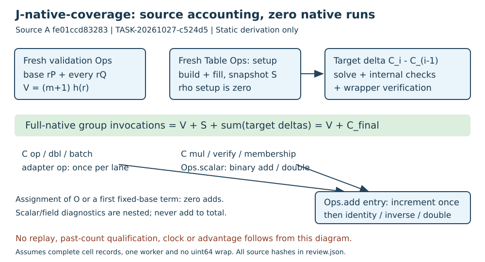

# Native additive-counter coverage review

TASK-20261027-c524d5 | J-native-coverage | 2026-10-27

**Verdict: holds for the inspected static accounting law. Independent execution replay remains inconclusive because it was not performed.** No missed or duplicated additive invocation path was found. This does not qualify historical native counts, clocks, an advantage, or scientific status.

## Observation: source and method

Source A is `fe01ccd832832488c58abeef17548b0a8db6035f`. All sixteen inspected native files match its bytes. Paths below are relative to `harness/classical_ecdlp_endpoint_reuse/implementation/`; full SHA-256 bindings and the complete read list are in `review.json` and `read-attestation.yaml`. Inspection used targeted source slices and searches over all operation/counter call sites, not a claim to have read every line. The plan and task handoff preceded this session. No sibling report, blind derivation output, raw native count, private scalar label or credential was read. No native program was compiled or run.

The work-accounting primary sources were source A's README and SCHEMA, together with the arithmetic and dispatch implementations. They define the metric; no external paper was needed to establish this ABI/accounting property. No novelty or literature performance claim is made. The four handoff entrypoints required transitive dependencies; direct dispatch authorized the implementation tree and the Coordinator explicitly confirmed that interpretation. Every extra source is attested.

## Derivation: event law and dispatch

`arithmetic/legacy/decoder.hpp:59-79` defines the actual instrumented arithmetic. `Cost` initializes every field to zero; `Ops.add` increments `group_additions` exactly once on entry, before input validity and identity/inverse/doubling branches. Neither the field helpers nor addition recurse into a second group operation. For valid calls, identity operands, inverse pairs and same-point inputs each charge one event. Failed calls can increment before throwing; incomplete output must not be certified as a complete run.

`bridge.hpp:28-40` connects C operations to this object. Ordinary `op` calls `Ops.add` once; `dbl` calls `op` once; batch loops `op` once per lane. Conversion/copies do not call group arithmetic. `ca_group.h:92-118` only forwards through that vtable. Arguments are converted before writing the result, so in-place aliases do not add an extra arithmetic invocation. The Adapter's first-member layout assertion makes the group-pointer conversion explicit.

`endpoint_reuse.cpp:139` implements `ca_group_mul` through the same `Ops.scalar`, even when the upstream operation-count pointer is null. A non-null pointer receives a difference of the same group counter, not an increment to it. `dlog_internal.h:31-37` verifies all candidate witnesses through this scalar function. `endpoint_reuse.cpp:140` performs both rho membership multiplications through it too. These checks do not disappear when absent from `upstream_stats.reported_group_ops`.

For positive k, the scalar loop consumes each set bit with one add and each remaining bit with one double, hence h(k)=popcount(k)+floor(log2(k)); h(0)=0. The scalar-call diagnostic is nested and is never added to group work. This source's `DEC_COUNTERS` has no dedicated doublings field. Doublings already enter `group_additions`; a doubling diagnostic from a different counter implementation cannot be imported here.

Identity construction (`bridge.hpp:31`) is assignment, zero events. By contrast `add(O,P)` is one. `pc_base_mul` copies the first set-bit term and adds later terms: max(popcount(k)-1,0) events, rather than h(k). Its k=0 path constructs identity with zero events. These are different executed algorithms, not counter omissions. Uninstrumented `lab::Curve.add/mul` exist in `common.hpp:30-36`, but the `--run` call graph uses the instrumented Ops paths; legacy self-test/reference helpers are outside that path.

## Derivation: complete phase conservation

* Common validation: `endpoint_reuse.cpp:130-131` creates a fresh `validation` Ops object, checks the base order once and every target subgroup once, then emits its own row. `validate_fixture` calls the instrumented base scalar at `decoder.hpp:102`. For m public targets, V=(m+1)h(r). Curve equation/primality/order sanity work is not another EC add. Some raw field sanity arithmetic is outside the field diagnostics; those are not complete arithmetic/runtime costs.
* Setup: a different fresh Table Ops object is constructed at `endpoint_reuse.cpp:59`; its Adapter only installs metadata. Snapshot at line76 includes initial build and static fill. `precomp.c:380` and candidate line500 prepare Gpow through `dbl`; fixed-base starts use `op`; walk batches use the same adapter. `er_precompute_fill:1246-1286` also uses those paths. Pre-construction limit/rho early returns perform zero group work and leave zero setup cost. Allocation/error returns after work still reach the normal snapshot.
* Target: line109 records the previous cumulative Table cost. Lines112-115 include rho or precomp solves, their membership checks, starts, walks, collision/bucket witness checks and rare rho cycle-escape doubling. Line117 adds the wrapper's final public-equation check. Line119 takes the delta only after these operations. Failed-solve work is retained in the delta if a row is emitted.
* Promotion: candidate `er_try_bucket:253` counts every tested witness through `ca_verify_log`. `er_recycle_solve:1205-1224` returns only after activation/discard. `er_activate:279-306` uses scalar modular arithmetic, exponent comparisons, swaps and heapsort, with no EC add to omit. Event streaming, table inspection, memory reporting, state hashes, and destructors do not call EC add.

Let S be the Table count after setup and C_i its value after target i (C_0=S). No group work occurs between these snapshots. Therefore S+sum(C_i-C_(i-1))=C_final. The complete native additive invocation total for one cell is **V+S+sum(target deltas)**. Adding common validation twice is wrong; dropping V while using a full-native label is also wrong. Repeat membership or wrapper witness checks are actual extra invocations and must remain charged even when mathematically redundant.

The resets at line109 clear adapter auxiliary and RNG diagnostics, not Ops cost. The only Ops reconstruction is the next Table/cell or common-validation object. `difference` at `decoder.hpp:41-45` checks every field for a reversal. Natural-number conservation assumes no uint64 wrap, the configured single worker, and complete emitted cell records. Threads=1 is set for build and rho; no claim is made for arbitrary concurrent use of the non-atomic Ops counter.

## Comparison: known-false controls

These are explicitly **symbolic controls**, not a claim that mutated runtime records passed through an executed verifier.

1. **Counter +1, correct scalar:** on the public r181 fixture, scalar(P,1) returns P through exactly add(O,P). Its group delta is 1 and scalar diagnostic is 1. Advertising 2 group events is rejected even though scalar1 is a valid witness. Witness correctness alone cannot certify any arbitrary historical advertised counter; that remains a replay gap.
2. **Common validation omitted:** 181 is binary10110101: eight bits, five set bits, h(181)=12. One target yields two membership scalar calls, so V=24. Reporting method total M as full-native is rejected; full-native is M+24. Identity targets still incur the same twelve Ops.add invocations during subgroup checking.
3. **One rho execution copied eight times:** the set of independent execution identities still has cardinality1. Eight serialized copies are rejected as eight independent reference executions. Scalar equations and count values may all remain correct; the execution/sample assertion is false.

## Inference and limitation

The static source joint holds under the metric's explicit additive-invocation definition. Negation/canonicalization, hashes, comparisons, modular scalar arithmetic, field work, recording, allocation and process costs are not asserted to vanish. Their placement in auxiliary or nested diagnostics does not authorize summing them into group events or converting group counts to elapsed time.

No historical executable/input identity, run completeness, native count row, timing, independent execution trace or comparative ratio was verified. Static call-graph coverage is not independent execution replay. No full-algorithm replay was promised or completed. No official ledger/claim transition or qualified advantage is requested. No canonical scientific graph was changed: this review checks a source accounting law and contributes only its assigned diagram.

A future independent probe needs its own frozen protocol/admission: pin source A, compiler versions/flags, instrumented binary digest and public input bytes; instrument `Ops.add` entry with a separate event log keyed by counter object and phase, not the production Cost. Exercise success/failure, identity, bucket aliases, cycle escapes and the three false controls; compare disjoint phase totals and A/A replays. Instrumented clocks are invalid for performance qualification. This proposal was not compiled or executed.

The requested role is review-adversarial/xhigh. A resolved serving-model identity was not exposed or probed, so it is recorded unknown/unverified. Derivation was independent inspection from source, not a blind mathematical re-derivation. The Coordinator must archive these files before treating them as durable review evidence.

## Review attestation

Task: TASK-20261027-c524d5. Joint owned: J-native-coverage only. Verdict: holds for static source accounting; independent execution replay inconclusive/unperformed. Read sibling reports: false. Full sources, exact hashes, scope interpretation, controls and model provenance: `read-attestation.yaml` and `review.json`.
