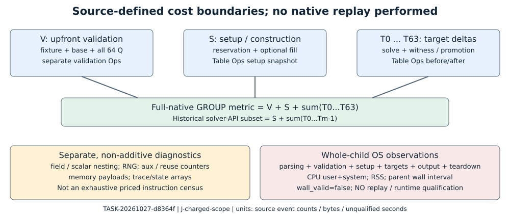

# Charged cost scope review

TASK-20261027-d8364f · J-charged-scope · 2026-10-27 UTC

**Scoped verdict: holds for the source-defined group metric and disclosure boundary. Actual native counts, execution replay, total-cost advantage, and timing qualification remain inconclusive.** This review makes no official status, qualification, promotion, or whole-claim decision.

## Observation

No native executable, benchmark, fresh cohort, private scalar file, remote service, credential inspection, or Git operation was used. The only execution was a small synthetic Python summary/schedule control, with no scientific data or timing measurement. No sibling review report or output was read. Requested inference policy is review-adversarial/xhigh; actual model/backend identity and policy conformance are unverified because no actual model probe was performed.

The task handoff and prior registered review plan assign only J-charged-scope. The assigned README, native wrapper and arithmetic source were inspected independently. Read scope was explicitly broadened to implementation dependencies, historical aggregation, whole-child resource collection, and the new sweep's source/protocol to resolve this accounting joint. The exact read set, partial-read descriptions, SHA-256 bindings, and hash-only checks are in read-attestation.yaml and review.json. Those bindings attest inspected bytes, not the executable that ran in a past session.

The internal prior-source review used the implementation README/SCHEMA, the historical protocol analysis source, the native phase wrapper, and the actual frozen sweep protocol. No external literature was fetched, and no novelty, external theorem, or asymptotic claim is made. The evidence gap is independent native execution and complete runtime-cost measurement, not an asserted absence of prior work.

## Comparison: what is charged

Let V denote fixture_validation.counters, S denote setup.counters, and T_i denote target i's counter delta. The full-native group metric at 64 targets is V.group_additions + S.group_additions + sum(T_i.group_additions, i=0..63). The historical solver-API compatibility metric at prefix m is S.group_additions + sum(T_i.group_additions, i=0..m-1). Each vector component is aggregated separately; the vector is not summed into a single price.

The native wrapper creates a separate validation Ops object before constructing Table. It validates the fixture/base and all 64 public target subgroup memberships and emits that object's counters. Table owns another Ops object. Its setup snapshot follows construction, reservation and optional distinct-endpoint fill. Each target snapshots that object's counters before the solver call, retains internal lookup/answer/promotion work, performs the final public answer equation, and only then computes its delta [S1, S2]. This source establishes a disjoint phase design. Exhaustive native call coverage belongs to the separately assigned native-coverage joint and is not certified here.

The old analysis initializes its total from setup and adds target deltas; fixture_validation falls through as an event. Thus it excludes V by construction, despite retaining the raw validation row [S3]. The new summarize_stream initializes the same solver total, then constructs full_native_counters by adding V exactly once; it rejects duplicate validation/setup rows and makes a missing validation phase incomplete. It also checks the upfront target count [S4]. Repeated logical membership checks inside a solver are additional physical calls in S/T, not deduplicated against V. At shorter full-native prefixes it retains the complete upfront validation charge; it never prorates all-64-Q certification into an invented cold one-target run. Published shorter-prefix comparisons explicitly use the solver-API subset.

## Separate cost families and boundaries

- Group primitives: Ops.add increments group_additions once on entry, including identity and doubling cases. scalar_multiplications counts calls whose group operations are already inside that total. Adapter batch calls likewise contain ordinary group calls. Adding nested diagnostic counts would double count [S1, S2].
- Field diagnostics: plus/minus/times and power/inverse count wrapper events. Power and inverse contain lower-level multiplications, and point validation contributes field work. These are overlapping diagnostic levels. They do not count every machine arithmetic instruction, integer modulus, comparison, branch, or scalar-ring operation. Fixture discriminant/Hasse/gcd calculations also contain direct arithmetic outside these field helper counters [S2].
- RNG: seed_calls, word_draws and below_calls are separate. Seed initialization performs four SplitMix steps; below requests can consume several xoshiro words through rejection. Requests and words must not be added. Forced header inclusion in build.py places the wrapper around the compiled C sources, and the inspected bounded-draw algorithm matches the pinned semantics textually. No RNG execution-equivalence test was run here [S5].
- Auxiliary and reuse bookkeeping: adapter hashes, equality, negation, canonicalization and batch calls are separate; candidate growth/fill records modular additions, exponent comparisons, sort comparisons, bucket witnesses, duplicates and occupancy. These are not an exhaustive non-EC instruction census. In particular ordinary upstream walk ca_addmod updates, binary-search comparisons, initial qsort comparisons, allocation and copying are not all itemized by those candidate counters [S6].
- Trace and recording: Stream::emit formats JSON, writes events and computes audit hashes. entry_digest hashes setup entries after setup_cost is snapped. Those operations do not increment group_additions and do consume real time. Trace volume differs by arm. Export retains integer-family sequences and trace-row count; row count does not price formatting, bytes, filesystem or digest work [S1, S7].
- Memory: C slots of two uint64 values give a 16*C-byte requested arena shared by known and pending entries, plus fixed-base, adding-point/scalar and object payloads. Initial worker/collection buffers and sort work remain separate. Reported requested bytes exclude allocator metadata, library-sort scratch, pthread stacks and actual RSS. Rho does not acquire an artificial BL arena merely because BL capacity appears in its input cell [S1, S6].
- Process diagnostics: wait_child obtains the native child's own wait4 rusage. CPU=user+system and RSS cover parsing, upfront validation, setup, all targets, instrumentation/output and teardown. Wall time is a parent observation interval including log opening, launch/reap and polling. The outer worker's orchestrator/descendant aggregate is a different boundary and must not be added to native-child CPU. The sweep uses the source-pinned helper through the Modal adapter alias. All clocks stay wall_valid=false; host facts, hashes and successful equations supply no L2 qualification [S8].

**Concrete breaking interpretation:** calling this a complete priced native workload is false. The uncounted qsort comparator and JSON formatting/hash paths alone break that interpretation. These paths do not break the explicitly defined EC invocation metric. Their execution cost is not zero and no count-to-time conversion, exponent improvement, or overall attack-cost advantage follows. The precomputation watchdog bounds reported initial/fill work, not all actual Ops.add calls; it must not be advertised as a full-native bound [S1, S6].

## Shared reference and setting selection

The new schedule contains five BL arms for each of eight settings plus exactly one shared.rho_reference slot per cell: 41*128=5,248 planned children and 128 rho slots. The same public target ordinal/paired seed law makes one shared rho reference appropriate to several contrasts; it creates covariance, not new reference executions. Collection rejects duplicate arm/fixture/replicate identities, export emits one row per confirmed child, and the same curve resample indices preserve both replicates/all variants/shared-reference dependence [S4, S7, S9]. These are source/control findings, not observed new executions.

The 64 curves, two replicates and 64-Q panels are reused public inputs. Summaries report all eight settings as exploratory, selection_qualification=false, and pointwise cluster intervals. Selecting the smallest displayed ratio cannot qualify that setting on the same panel or give a familywise discovery claim. A same-panel best static baseline is also selected context, not an independently fixed confirmatory reference. No holdout, multiplicity-adjusted winner test, or new-grid measurement was performed [S4, S10].

## Synthetic controls actually performed

The source and results are embedded in review.json; command: python3 controls.py in the task's external development directory. The symbolic fixture uses V=100, S=10, and 64 target deltas of 2, with nonzero nested diagnostics. Those numbers are stipulated test inputs, not ECDLP measurements.

1. Formula: parser returns full=238 and solver-API=138. Prefix-1 full=112 retains all V. Nonzero scalar/field diagnostics do not alter group totals.
2. False advertised cost: adding one group event to the first target leaves every scalar answer unchanged and produces 239. A public witness uses E/F383, a=261, b=146, P=Q=(196,297), x=1, hence [1]P=P. The stipulated event ledger says 238, so the altered advertisement is false. The production summarizer accepts 239: it is not an independent native cost verifier. This control preserves that gap rather than describing it as a successful replay.
3. Omitted validation: advertising solver-only 138 as full is false by 100. Removing V makes output_complete=false and full_native_counters=null. It cannot support the complete paired comparison.
4. Double validation: adding a second V row raises duplicate counted validation/setup phase.
5. Shared-rho copies: the synthetic schedule has 128 unique shared reference slots. A duplicate shared identity raises duplicate observed execution identity. Eight copies would falsely claim 1,024 reference samples. Renaming copies and fabricating matching manifests is outside what this parser-only test can authenticate.
6. Winner selection: illustrative same-panel ratios [0.95,1.05,0.94,1.06,0.96,1.04,0.93,1.07] select 0.93; that selection is expressly unconfirmed. This is a logical negative control, not an executed statistical coverage test.

All five sweep source-file digests match the declared C3 manifest, which binds C3=14a97265c647e9abe4ad3f21d1b9822f1ab5c8b3, native A=fe01ccd832832488c58abeef17548b0a8db6035f and adapter B=de6ed88850fc8bad17ccbabfad8b66a791e478e5. The 13 pinned vendor-file digests match their local manifest. The sweep manifest matches the frozen protocol binding, and canonical protocol hashing yields f882380374559faae1b50d86c1583c06c36738fc5dce43d2861fadaa6204b812. No Git/remote history or actual binary was inspected; revision labels remain manifest declarations.

## Inference and unresolved obligations

Holds: the inspected aggregation and scope labels distinguish V+S+targets from the historical S+targets subset, retain separate diagnostic families, avoid synthetic shared-rho replication, and refuse selected-winner/qualified-clock inference. Breaks: the known-false advertisements in the controls, and any stronger reading that the counters exhaustively price non-group work. Inconclusive: actual past/new native event totals, binary/runtime conformance, exhaustive call coverage, independent replay, actual emitted export coverage, measured memory, clock quality, field/RNG runtime equivalence, or any finite runtime/exponent/attack-cost improvement.

Next check, if independently authorized: bind the exact compiler/binary/source/protocol and complete native workload to an independent event-entry replay; preserve failed/censored paths and qualify isolation separately. Witness equations, source hashes, schemas and source review cannot replace that check. No source change, scientific record transition or canonical graph change is proposed. Other canonical graphs were not read because this task's scoped review does not alter their measured content.

## Source anchors

All citations have internal repository provenance. Exact file digests are retained in read-attestation.yaml. S1-S10 are independently inspected source/contract evidence, not producer result reports.

- S1: harness/classical_ecdlp_endpoint_reuse/implementation/endpoint_reuse.cpp, lines 49-80, 86-104, 105-138; phase snapshots, trace, memory and public answer checks.
- S2: same implementation prefix, bridge.hpp lines 18-43 and arithmetic/legacy/decoder.hpp lines 29-105; wrapper counters, adapter operations and common validation. arithmetic/legacy/common.hpp was also read to distinguish legacy uninstrumented helpers from active Ops.
- S3: harness/classical_ecdlp_endpoint_reuse/protocol/analysis.py, panels and summarize; historical setup-plus-target aggregation.
- S4: harness/classical_ecdlp_parameter_sweep/analysis.py, lines 98-156, 252-325, 338-404; phases, identity coverage, controls, covariance and scope.
- S5: implementation/rng_instrumentation.h/.c, build.py, vendor/src/ca_internal.h lines 23-76; forced wrapper and nested draw semantics.
- S6: implementation/candidate/endpoint_reuse.c lines 190-305, 1147-1289; baseline_inspection.c; vendor/src/precomp.c lines 340-414 and 936-967; vendor/include/cryptanalysis/ca_modarith.h lines 54-66; explicit bookkeeping versus ordinary uncounted arithmetic/sort work.
- S7: harness/classical_ecdlp_parameter_sweep/export.py, lines 60-119 and 177-190; analysis.py lines 77-96; family sequence and one-child-row retention.
- S8: endpoint-reuse execution/run_experiment.py lines 106-160, execution/worker.py lines 140-184, execution/README.md lines 78-106; modal/engine.py lines 25-40; sweep engine.py lines 181-193 and 307-324.
- S9: harness/classical_ecdlp_parameter_sweep/engine.py lines 215-223; one shared reference schedule per cell.
- S10: experiments/EXP-ECDLP-f50061/protocol.json, metrics, decision_rule, inadmissible, input_reuse and parameter_sweep; actual frozen prospective scope.

The task's read-attestation.yaml carries the required review_attestation block. This report's diagram is the only graph created. PDF rendering and visual inspection are recorded in review.json.
