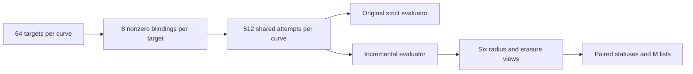

# TASK-20261029-fe803f: independent blind native-record review

The primitive schedule and retained raw arithmetic agree at **1,033,728 predicate
queries**. All 12,288 original/incremental confirmation pairs have identical
non-counter contents, and the six decoder cells share the same attempts and
target identities. Every checked raw invariant passed. This qualifies retained
values and finite arithmetic within the declared native scope; it does not
independently qualify execution, public EC equations, counters, custody, the
export payload, or realized host-reference results.

Phase 1 was sealed **2026-10-30T01:09:43.646974+00:00**, SHA256
`859328a6984ba2b79d40b99074b8897364631dd7ee54ad7b54fdba2af9e4b931`, mode 0444. Root acknowledged that exact seal at
**2026-10-30T01:10:29.150507+00:00**, ACK SHA256 `7297659ebfb158abfc2a19b606f3f803e1b8af2d0b4ff937bdfe782057324cc3`. Only then were native raw
records opened. Exact note bytes, executed fixed-check source/result, complete
phase1 command/source ledger, seal and root ACK are embedded in `checks.json`.
The full permitted trial-plan exposed embedded historical administrative
pre-data fixture text (27 fixtures, 7 mutation groups, 49 native facts); this was
disclosed and acknowledged, and no linked review was opened.

## Assigned joints

- Physical-call arithmetic: **holds within retained-record scope**.
- Shared six-cell/paired denominator and dependence: **holds within scope**.
- Nonzero uniform/zero cost/decoder scope: **inconclusive as a complete host-reference comparison**. The finite law and every native M/list/zero/conversion check hold; actual host uniform/null/BSGS records were outside read scope.

## Recomputed observations

The actual once-run streaming command was `python3 /workspace/TASK-20261029-fe803f-fresh-blind-20261030T010304Z/phase2-raw-checks.py`;
it completed from 2026-10-30T01:14:49.500920+00:00 to 2026-10-30T01:15:37.064887+00:00 with exit 0 and no
invariant findings. It read exact native inputs in place, without dataset
copies, producer imports, EC solving, predicate replay, entropy or SDK/network.

The four predicate streams are 345,600 calibration singles,344,064 calibration
trace queries, 172,032 original confirmation queries and172,032 incremental
confirmation queries. The primitive derivation uses two calibration stages,
three tiers, four slots, eight arms, 1,800 singles and 128 trace starts; confirmation
uses two stages,three tiers, four slots, 64 targets, eight blindings and both
evaluators, with trace lengths 11, 14, 17. Six shared decoders add no predicate
trace calls. The native records contain216 setups, 36,864 intents/traces and
73,728 decoder cells. Single-point status counts retain 345,473 BIT and 127
UNDEFINED records; no truth-label correlation was computed.

Each of 144 curve/cell entries has 512 retained attempts. Each cell below spans
24 confirmation curves and 1,536 target identities; unique coverage is an OR
over each target's eight blindings. These totals are descriptive nested counts.

| Cell | Attempts | Recorded recovery events | Unique target-cell pairs | M=0 cells | Raw capped flag |
| --- | ---: | ---: | ---: | ---: | ---: |
| t0.e0 | 12288 | 4 | 4 | 7819 | 127 |
| t0.e2 | 12288 | 4 | 4 | 7735 | 0 |
| t1.e0 | 12288 | 42 | 38 | 133 | 127 |
| t1.e2 | 12288 | 43 | 39 | 6 | 0 |
| t2.e0 | 12288 | 214 | 183 | 127 | 127 |
| t2.e2 | 12288 | 227 | 196 | 0 | 0 |

All statuses, erasure/cap flags, M histograms and 78 zero-event curve/cell
entries are retained individually in `checks.json`. The 127 e0 cap flags are
retained erasure-limit outcomes, not asserted infrastructure failures or
mathematical refutations. Original and incremental strict evaluators each
record 4 recoveries. The primary paired t0.e0/t1.e2 table is00=12245,
01=39,10=0,11=4; its 39 additional recorded
events share attempts, rather than constituting new independent trials.

All 3,068,802 retained word records were checked for unique bits, radius/erasure
membership, integer intervals, scalar conversion, distinct legal nonzero M,
zero-check separation, and agreement with retained public-check/recovery
fields. The largest actual word list is 184, below the blind 484-word envelope;
that envelope is a list bound, not a recovery or independent-sample claim.
All 452 legal zero-word checks remain separate from M. The 15,820 M=0 cells
retain 15,614 constructed words and 15,820 abstract order-inverse calls, including
eight zero-candidate checks; common trace work belongs once to their 7,819
shared trace identities. No mixed scalar cost total or counter replay claim is
made.

## False-claim controls and uncertainty

Before any outcomes, actually executed fixed public arithmetic rejected a
duplicate/zero-inflated M list and a wrong scalar, rejected independent-six-cell
multiplication, and exhibited q=1/2 with positive zero-hit probability 1/4.
Exact subset enumeration verified min(M,r-1)/(r-1), including M=0 and
saturation. M=0 implies zero uniform guesses; setup,trace,list and M-determining
work remain paid. The word-count derivation is
`2^u sum_{j<=t} binom(L-u,j)` only when u<=e; it does not establish the true
word's inclusion or a joint error law.

The phase1 note derives the fixed-curve calibration Hoeffding/Bonferroni bound
384exp(-9) and the conditional 512-complete-iid zero-event upper formula
1-(.05/144)^(1/512). Neither is an independently sampled curve-population
interval. No actual q=0, infinite retry cost, significance, mechanism, advantage,
exponent or family closure is inferred. The frozen calibration metric's
1/512 resolution conflicts with its 1800-draw mean's1/1800 lattice; this is an
explicit prospective metadata discrepancy.

## Remaining scope and publication boundary

The native `experiment.review/v1` record binds root's opaque export identity
`experiments/EXP-ECDLP-080f41/export.json` / `EXP-ECDLP-080f41.controlled-export` /
`c96a2393bfd90e605d9f12f6bfc0e974701c6fdc003f9d0760cb17956d37c6b3`. The export payload was never opened. Export schema, rows,
aggregate flow and file validation are unassessed by this projection; the
integrity reviewer owns those checks. The actual native schema and pure
`lint_review(record,base=None)` output function pass with no findings. The CLI
filesystem/export branch was deliberately not run under the payload exclusion.

Host reference realization, calibration labels/correlation, EC equation
replay, counter replay, source/runtime/custody and full-round composition remain
explicit gaps. Root alone owns canonical writes, storage, Git, publication and
scientific status. This report is an input to composition and requests no new
scientific run. A graph is embedded above; no standalone PDF was created under
the exact four-file handoff. All additional local proof material needed for
this review is embedded within those four files rather than depending on an
unpublished outside artifact.

## Additive protocol-binding repair

Root withheld canonical integration of the original delivery after finding a
metadata binding mismatch. This is an output-format correction, not a
mathematical finding or a change to any verdict, observation, denominator,
scope gap, phase1 seal or ACK. The third joint remains inconclusive.

The original native review used raw protocol file SHA256
`c27bbea0ab1a0753958de31b2ed97910597b5a1aaa0dd79e0f50e1b62032c23c` for `protocol_sha256`. That digest correctly identifies
the exact containing file in the read ledger. The standard native review field
instead binds the frozen semantic protocol hash:
`4e3aa54f421cdf1c4fe5b5c96edeac9898c628c625e98cf0d1fe8d997d1ccf60`. The permitted `/freeze` projection confirms this value;
the permitted `review_scaffold` lines865–890 set the native review field from
`export["protocol"]["sha256"]`. Root supplied the export's semantic binding;
the export payload remains unread and unhashed by this reviewer.

Only `protocol_sha256` changes in the native review JSON. The portable export
path remains `../../../../../../../experiments/EXP-ECDLP-080f41/export.json`. All four original sealed files
remain untouched in `deliverables-final`; their hashes and the original native
review's exact bytes/hash are embedded as history in the new `checks.json`.
The new four-file set is additive in `deliverables-final-binding-v2`.

At 2026-10-30T01:27:46.687827+00:00, the actual native review schema and actual pure
`lint_review(record,base=None)` returned no findings. Export filesystem and
payload validation remain for root after canonical copy. No raw/scientific
rerun, new raw read, producer access, entropy draw or canonical write occurred.
