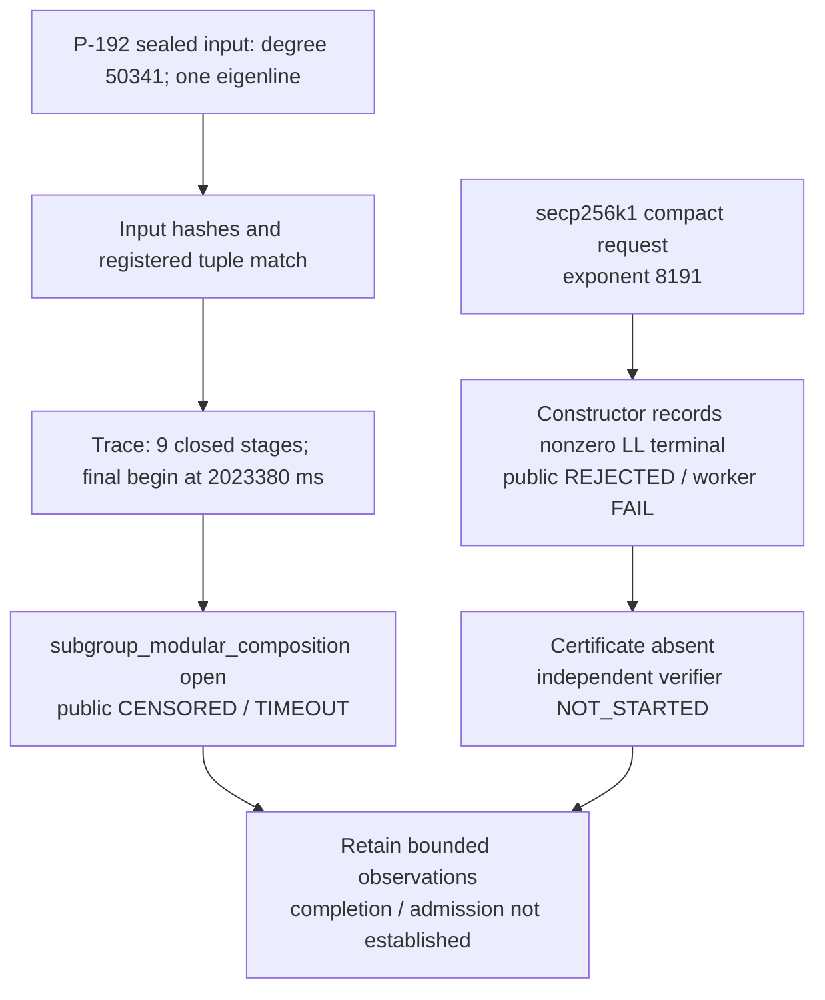

# Independent scoped native evidence review

Task `TASK-20261016-66f447`; goal `GOAL-ISOU-f30a07`; batch `BATCH-9924e2`.

The expanded-profile joint **holds for the bounded diagnostic record**: the submitted bytes are unchanged, the preserved trace is a well-nested incomplete prefix, and the native public result is `CENSORED/TIMEOUT`. The compact-completion joint is **inconclusive**: the constructor records an LL rejection before emitting a certificate, and the independent verifier records `NOT_STARTED`. Neither joint supplies an admitted new map or a completed compact certificate instance. This report recommends retaining these exact observations without a frontier, performance, security, or mathematical rejection promotion.

This is an independent, zero-scientific-run evidence review. I executed no scientific binary, tests, benchmarks, LL recurrence, target computation, or replay. Python was used for archive extraction, hashes, JSON inspection, trace-stack checking, and arithmetic on recorded timing values. All authored files are in private scratch. The Coordinator retains publication and state-transition authority.

## Frozen scope and provenance

The review owns only `expanded_trace_and_resource_integrity` and `compact_degree_and_independent_replay`, as assigned by the frozen review plan in `final-e82-compact-report-completion/dispatch_queue.json`. Review policy requested: `review-adversarial`; requested effort: `xhigh`; independent session: required and used; fallback/degradation: neither requested nor used. The runtime does not expose the actual served model or effort, so both remain **unknown**. The policy's serving floor is `low`; its requested effort and independent-session requirement remain `xhigh` and true. I made no external model/provider request.

I waited for START before inspecting artifacts. I read neither forbidden producer `observation.md`, no sibling review report, no producer descriptive run report, no snapshot receipt, no collector terminal summary, and no Coordinator conclusion. The governing AGENTS file and frozen protocol contain historical context; I did not use their historical result summaries as evidence for these runs. The archived `launch-admission.json` was read as launch metadata after the native records; its sentence about prior monitoring was not used to derive the profile state.

My initial raw-derived notes were saved before consulting archive hash manifests or later permitted metadata: `/private/tmp/TASK-20261016-66f447-independent/raw-derived-notes.json`, SHA-256 `6d4ad405648b45212d914328afe6fa5efafb65852cd0a2846ba453f7a7d329f5`. No later producer summaries were needed. All evidence citations below have provenance **internal** and were inspected by `validator-native-frozen` in this session; external theorem documents were not retrieved.

The exact source inspected is Git object `e82d80feaf82d3730576ccd9137911b336f9dab8` in `aburan28/crypto`, read with `git show`, never substituted by current working source. Both original archives also exactly match their Git blobs at the Coordinator-published review-start commit `b85bf6717e`.

| Original archive | Bytes | Independently computed SHA-256 | Listed member hashes |
|---|---:|---|---:|
| `final-e82/execution/TASK-20261016-d481d6/native-evidence.tar.gz` | 3,594,206 | `55c1c18440109a8c1e87c266a67e6d366cbfd64c988a86b5e52ff528126be0ae` | 21/21 match |
| `final-e82/execution/TASK-20261016-145d29/native-evidence.tar.gz` | 14,903 | `52301500bbeaa1d6bce211746657b6d66968cd4efd4c6fff6bbbb5ed5901c4f6` | 34/34 match |

The listed-member check establishes content consistency for those 55 members; it is not a computation proof or an independent audit of collector completeness. The original member inventories preserve the expected failures, empty outputs, and absent execution state rather than replacing them with successful records.

Both trial plans' input/protocol/adapter hashes match their frozen values. In particular, the adapter hashes to `2f416cf59443a334a271557ab6573b3974652c8023bd9e86388b0c1497a9ca59`, and the protocol to `9ddf77a62099935aed715791d9814cb6b32f37efb60f6315d7b585e49da7f342`. The installed binary was read and hashed, without execution: 36,087,488 bytes, SHA-256 `b3cbd6ac5d457a0f6d6398d1fcefc408f627e60be52c81c9009406486b61587b`, matching the frozen binding. This checks byte identity, not a fresh source-to-binary build proof. Environment claims of a clean source tree were not reconstructed from the historical machine state.

## Observation: expanded same-map profile

Run `RUN-ISOU-93b2b3`, experiment `EXP-ISOU-32a530`, executes the frozen shell adapter's `profile` mode. Its scientific argv is the bound binary followed by `challenge judge --input experiments/EXP-ISOU-e7eeb5/runs/RUN-ISOU-f9546d/native/construction --out RUN/native --timeout 3600`, with absolute paths in the adapter and a fresh absolute `ISOGENY_REPLAY_TRACE` path. The archive's command/environment agree with the trial-plan argv. The worker command is `challenge __judge` over the fresh snapshot, with an RSS acknowledgement path.

The three snapshot files equal both the sealed input hashes and the original input files, byte for byte:

| File relative to construction/snapshot root | Bytes | SHA-256 |
|---|---:|---|
| `search.json` | 1,853 | `a4046e312f4110bcabc000ce282e106b3dae80c3e362bc26abdb893296f5c99d` |
| `p192/ell-50341.json` | 7,656,861 | `82e3951488c793c5901ecf1dfeb3ab072b7cda16730899330df7caa9832a170c` |
| `p192/ell-50341.stderr.txt` | 288 | `487d94e8bfeba3515cd756a0e6c590b1f04c755af8a090c7659d12f5877f16fb` |

The map names exact source `icv1-fp192-t31607402316713927207482677199-52e4af59`, whose p/a/b tuple matches the pinned registry row. It contains one map at degree 50,341, explicitly `PARTIAL`/one Frobenius eigenline, with 25,171 kernel coefficients, 50,342 numerator coefficients, and 50,341 denominator coefficients. These are the required shape counts; they alone do not certify the map. The preserved constructor record has source commit `6547d252889ac0e1089a0497bf80f05b884ab24e` and its own older executable hash. The fresh judge is e82; this review does not relabel the historical constructor as an e82 construction.

The independently hashed pinned registry and challenge rules give season `ff4f7c405146fbd26faa63cb6fb9d1513eada31d15f3998368005fd5f05db3e0`, matching the public entry. The entry, native stdout, and `raw-result.json` are identical bytes. `verification.json` and worker stderr are empty, and their receipt hashes match those empty files. The native public exit is 3; the worker receipt is `TIMEOUT`, exit code null, elapsed 3,600,033 ms, and map count null. Public status is `CENSORED`, reason `TIMEOUT`, score null.

The trace is 3,912 bytes, SHA-256 `2b87949c4919dc30e13fda614fee08beba3f268047edafc1a83d833efd58d94d`, with 23 parseable newline-terminated records, no partial terminal line, one PID 5885 matching `verification.pid`, unique begin IDs, monotone timestamps, and no parent/stack mismatch. It has 14 begins and 9 matching ends, with no error or terminal event. Independently subtracted durations are:

| Closed stage | Begin ms | End ms | Derived duration ms |
|---|---:|---:|---:|
| setup/loading/parsing | 0 | 5 | 5 |
| setup/field_parsing | 15 | 16 | 1 |
| source_loading_and_registry | 16 | 26 | 10 |
| source_generator_subgroup_order | 26 | 26 | 0 |
| coefficient_parsing | 26 | 58 | 32 |
| kernel_degree | 59 | 59 | 0 |
| squarefree_kernel_gcd | 59 | 21,730 | 21,671 |
| selected_division_polynomial_torsion | 21,730 | 2,023,357 | 2,001,627 |
| subgroup_inverse | 2,023,357 | 2,023,380 | 23 |

Zero ms means below the recorded millisecond resolution. The open stack is `total → attempt_0 → map_0 → kernel_validation → subgroup_modular_composition`, whose last begin is at 2,023,380 ms. The kernel observer places that event immediately before modular composition and its predicate. That stage, its ancestors, subsequent codomain/map/subgroup/transport checks, and overall replay are unfinished in the retained evidence. I do not subtract this trace timestamp from public wall time to manufacture a completed stage duration: the clocks have different origins and the terminal trace time is absent.

The pinned generated dispatcher starts the trace at replay-core entry. Parent preflight and snapshotting, and child preflight/document validation, occur before that call. The trace's `total` therefore is not public-command or campaign total time. Its `COMPLETED` marker, if present in another input, would state only that the instrumented core returned; it would not replace the later public admission checks.

## Observation: resources and actual CPU scope

| Recorded quantity | Profile | Compact constructor |
|---|---:|---:|
| Worker receipt status | TIMEOUT | FAIL |
| Worker operational elapsed ms | 3,600,033 | 385 |
| Native sampled peak RSS bytes | 250,052,608 | 2,932,736 |
| Unavailable memory samples | 0 | 0 |
| OS public-command real seconds | 3,600.05 | 0.40 |
| OS public-command user seconds | 1,716.81 | 0.32 |
| OS public-command system seconds | 62.75 | 0.01 |
| Derived displayed user+system seconds | 1,779.56 | 0.33 |
| OS public-command maximum RSS bytes | 250,052,608 | 3,244,032 |

Native receipts set an 8,589,934,592-byte sampled RSS limit, 25 ms sampling interval, and 100 ms unavailable-monitor grace. Ready files exist for both executed workers; only the compact worker has a done marker, consistent with normal failure return versus timeout interruption. Pinned source requires a positive RSS sample before releasing supervised algebra, rejects sustained unavailable/zero telemetry, and polls worker RSS until the done marker or exit. Its timeout/RSS enforcement is a sampled host-protection envelope, not an OS hard limit. The archive contains aggregate receipts rather than every RSS sample; this review cannot independently reconstruct the full sampling timeline or prove a never-exceeded instantaneous peak.

CPU data are present in the actual `/usr/bin/time -l` logs. The sums above are derived from printed measurements at two decimal places, not exact unrounded CPU totals. Their scope is OS accounting for the public native command and its accounted children. They are neither per-stage CPU nor complete campaign cost. The native receipt itself supplies no CPU measurement. The common adapter writes `cpu_seconds: null` even when raw OS data are available; that normalization gap must not be paraphrased as absent raw CPU accounting. The verifier has no native timing log because its native process did not start, and its CPU is unavailable rather than a measured zero.

Host records describe shared Apple M4 Pro hardware, 14 logical CPUs and 51,539,607,552 bytes RAM. The recorded loads are high (profile `{41.25,44.40,45.45}`, compact `{56.90,59.69,59.56}`). There are no paired A/A timing controls, dispersion measurements, or complete setup/campaign costs here. Operational timing or the single completed-stage durations support no speed comparison.

## Observation: selected compact instance

Run `RUN-ISOU-bdbf5d`, experiment `EXP-ISOU-feb102`, requests `compact-cm construct --exponent 8191 --out RUN/native --timeout 1800` under the same frozen binary. The target is the exact secp256k1 tuple and degree expression `2^8191-1`, represented as a compact known-endomorphism expression with unreduced signed coefficients. A successful LL receipt would require 8,189 transitions; none is emitted for this failed attempt.

The actual public construction record is `REJECTED`, score null, with `Lucas-Lehmer rejects M8191` and a nonzero decimal terminal. The terminal is retained in full in the originals; its 2,465-digit decimal text has SHA-256 `d4ef8a2d892b1bca108570af64a2725708d2f6970ee8c611bc566e97a3c4d191` (decimal bytes without a newline). The inner construction elapsed field is 372 ms; its worker wrapper is `FAIL`, worker exit 1, and the public resource receipt is `FAIL` with nonzero RSS. The public/native raw-result files agree. `artifact/construction.json` preserves the same failure. There is no emitted certificate, certificate hash seal, or verification certificate.

Run `RUN-ISOU-2b2372` has `NOT_STARTED` with reason `construction_not_passed_or_certificate_hash_changed`, no native directory, no worker receipt/PID/output, and empty native stdout/stderr. The manifest explicitly says `native_process_started: false` and `status: not_started`. Its `native_exit_code: 0` is the adapter's initialized value on the branch that invokes no native program; it is not an independent verifier success or exit measurement. The outer adapters deliberately return 0 when they finish delivering an observation, including a rejection or nonstart.

The frozen adapter requires `CONSTRUCTED`, worker resource `PASS`, a present certificate and a passing sealed certificate hash before native verification. This attempt does not satisfy that antecedent. Refusing verification is consistent with the frozen conditional protocol. The producer LL rejection was not independently recomputed here, because this task permits no scientific run; it must not become a compositeness or impossibility conclusion. This review establishes the recorded software failure state and consequent missing completion evidence.

## Static admission and proves-too-much checks

These are independent source/logic checks, not newly executed mutation tests. Existing source tests were inspected only as code; I neither ran them nor independently reproduced the frozen suite's reported pass count.

| Known-invalid or unsupported assertion | Static rejection boundary / check | Result in this review |
|---|---|---|
| Core `COMPLETED` implies public map acceptance | `challenge.rs` requires resource PASS and nonzero sampled RSS, then fresh worker PASS bound to season, source, degree, map hash; worker also requires nonempty PASS rows and twenty transports per row | Assertion rejected; actual profile also lacks COMPLETED |
| Last stage begin is a completed measurement | End events close exact stack IDs; normal finish emits total end plus terminal; killed worker leaves prefix | Assertion rejected; last open stage remains censored |
| Mutate map bytes or input hash | Parent/child preflight hashes map and stderr; source/degree/document counts checked; public output binds the snapshot | Hash mismatch rejects statically; actual sealed inputs match |
| Keep finite subgroup points but replace alpha by alpha+[n] | Independent verifier computes norm over exact signed integers before reduction and checks canonical Cornacchia transform | Point alias cannot substantiate the original degree |
| Change degree, LL terminal/count/digest, source, or coefficients | Exact domain equality; degree=2^e−1; independent LL/count/terminal/digest; exact norm and canonical coefficient checks | Relevant predicates exist; no selected certificate reaches them |
| Supply wrong beta/lambda or collapse separability/recovery | Root conditions, full-point pairing, nonzero differential and dual product, subgroup inverse/product | Source requires these checks; actual attempt did not run them |
| Substitute point replay for universal map proof | Separate exact-Z norm identity, LL degree gate and finite fixed-point diagnostics | Finite diagnostics remain supplementary; none was emitted here |

For alpha=`[a]+[b]phi`, phi²+phi+1=0, the exact symbolic identity is `(a+bt)(a-b-bt)=a²-ab+b²-b²(t²+t+1)`. Thus its conjugate has coefficients `(a-b,-b)`, and the unreduced norm is `a²-ab+b²`. With the canonical transform `a=x+y`, `b=2y`, this norm is `x²+3y²`. Replacing a by a+n changes the norm by `n(2a-b+n)=n(2x+n)`, even though all n-subgroup points have the same images. This independently explains why finite subgroup agreement is inadequate to identify degree.

The pinned verifier's LL uses repository `Int` arithmetic with general modular reduction, rather than the producer's `num_bigint` Mersenne folding; it checks exact recurrence metadata and digest. Cornacchia uses independent Euclidean equations, stopping/square tests and transcript checks. Point replay uses a separate four-limb affine field engine, with canonical coordinate and on-curve checks. It requires the exact fixed eight inputs (infinity, G, −G, and `[2,3,17,101,65537]G`), independent output agreement, subgroup action, both dual compositions and group-law compatibility. These implementation separations are visible in source, but **a fresh invocation of this verifier is absent for the selected instance**. Shared certificate types, domain constants, identity statement and underlying platform remain common dependencies.

The successful-source path explicitly labels p/n primality as trusted SEC2 parameters rather than self-contained primality certificates. That trust is distinct from proving the proposed Mersenne degree prime. The 2 MiB native certificate-reader bound, constructor/verifier timeout bounds, and post-run output admission remain resource/admission policy, not mathematical evidence. No expanded-map score is provided by compact verification.

## Findings and recommendation

1. **Preserve the profile as a bounded timeout diagnostic.** Its identity, trace-prefix structure and receipt consistency hold. Later map checks and acceptance remain unfinished; no duration may be assigned to the final open stage as a completed measurement.
2. **Preserve compact rejection and verifier nonstart.** The selected completion joint is inconclusive. A newly authorized investigation would need to discriminate arithmetic/implementation/custody explanations for the LL rejection and produce a fresh sealed construction followed by its independent native receipt before a compact completion claim. That is future scientific work, not performed by this task, and must not overwrite these records.
3. **Expose CPU scope carefully in any new derived accounting.** Retain the manifests and raw logs; cite the displayed public-command user/system values and their precision. Leave per-stage, unrounded, and complete-campaign CPU unavailable. This is a metadata completeness finding, not a reason to invalidate the raw failure observations.
4. **Do not consume the nonstart exit field as native success.** Any downstream structured summary should retain `native_process_started:false` and native exit unavailable for `RUN-ISOU-2b2372`; the existing immutable manifest's zero is an adapter default.



The diagram describes two distinct questions rather than comparable timings. It uses recorded states only. No canonical frontier graph is changed or independently audited by this scoped reviewer. The Coordinator's decision-report publication owns any canonical graph check and rendered, inspected PDF before its archival commit, as the research-visuals skill assigns to the archival session when it receives review records.

```yaml
validation_report:
  id: VAL-20261016-66f447
  task_id: TASK-20261016-66f447
  run_ids: [RUN-ISOU-93b2b3, RUN-ISOU-bdbf5d, RUN-ISOU-2b2372]
  artifact_checks:
    - "Both original archives equal committed blobs at b85bf6717e; 55 listed member hashes match."
    - "Frozen plan hashes, installed binary bytes, original/snapshot input bytes and receipt output hashes match."
    - "Expected failure outputs and verifier nonstart are preserved; no selected compact certificate exists."
  metric_recomputations:
    - "23-row JSONL prefix, 14 begins, 9 matching ends, 5 open stages, monotone timestamps and matching PID."
    - "Closed-stage durations are independently subtracted; no unfinished-stage total inferred."
    - "Printed public-command CPU sums: profile 1779.56 s; constructor 0.33 s."
  control_checks:
    - "Static proves-too-much boundaries checked; no dynamic mutation/control suite run by this reviewer."
  heuristic_validation_checks: []
  cost_model_checks:
    - "Public-command OS accounting kept separate from per-stage and complete-campaign cost."
    - "No timing comparison, speedup, worldwide record or security conclusion admitted."
  proof_architecture_checks:
    - "Unreduced exact norm, LL, Cornacchia, source, pairing, differential, subgroup and dual gates inspected statically."
    - "Finite subgroup agreement does not determine geometric degree; alias norm change independently derived."
  verdict: incomplete
  limitations:
    - "Profile timed out before complete replay/admission."
    - "Compact constructor rejected before certificate; independent native verifier did not start."
    - "LL mathematical outcome was not recomputed; no compositeness or impossibility inference."
    - "Historical dirty state, full RSS series, source-to-binary build proof and full campaign costs were not independently reconstructed."
    - "Actual served model and effort are unknown; requested review-adversarial/xhigh is recorded."
  artifact_paths:
    - coordination/goals/GOAL-ISOU-f30a07/batches/BATCH-9924e2/final-e82/reviews/TASK-20261016-66f447/report.md
joint_verdicts:
  expanded_trace_and_resource_integrity: holds
  compact_degree_and_independent_replay: inconclusive
procedure_deviations: []
review_attestation:
  task_id: TASK-20261016-66f447
  joints_owned:
    - expanded_trace_and_resource_integrity
    - compact_degree_and_independent_replay
  sources_read:
    - AGENTS.md
    - agents/validator.md
    - orchestration/model-policies.yaml
    - templates/research-records.md
    - .agents/skills/research-visuals/SKILL.md
    - .claude/skills/research-visuals/SKILL.md
    - coordination/goals/GOAL-ISOU-f30a07/batches/BATCH-9924e2/final-e82-compact-report-completion/dispatch_queue.json
    - coordination/goals/GOAL-ISOU-f30a07/batches/BATCH-9924e2/final-e82/PROTOCOL.md
    - coordination/goals/GOAL-ISOU-f30a07/batches/BATCH-9924e2/final-e82/bindings.json
    - coordination/goals/GOAL-ISOU-f30a07/batches/BATCH-9924e2/final-e82/native-command.sh
    - experiments/EXP-ISOU-32a530/trial-plan.json
    - experiments/EXP-ISOU-32a530/inputs.json
    - experiments/EXP-ISOU-feb102/trial-plan.json
    - experiments/EXP-ISOU-feb102/inputs.json
    - experiments/EXP-ISOU-e7eeb5/runs/RUN-ISOU-f9546d/native/construction/search.json
    - experiments/EXP-ISOU-e7eeb5/runs/RUN-ISOU-f9546d/native/construction/p192/ell-50341.json
    - experiments/EXP-ISOU-e7eeb5/runs/RUN-ISOU-f9546d/native/construction/p192/ell-50341.stderr.txt
    - "coordination/goals/GOAL-ISOU-f30a07/batches/BATCH-9924e2/final-e82/execution/TASK-20261016-d481d6/native-evidence.tar.gz: all non-metadata members; metadata/files.sha256"
    - "coordination/goals/GOAL-ISOU-f30a07/batches/BATCH-9924e2/final-e82/execution/TASK-20261016-145d29/native-evidence.tar.gz: all non-metadata members; metadata/files.sha256"
    - "/Volumes/SSD990-2/crypto/isogeny-degree-challenge-builds-20261015/compact-final-e82d80feaf/isogeny (hash only)"
    - "crypto@e82d80feaf82d3730576ccd9137911b336f9dab8:tools/isogeny-cli/Cargo.toml"
    - "crypto@e82d80feaf82d3730576ccd9137911b336f9dab8:tools/isogeny-cli/build.rs"
    - "crypto@e82d80feaf82d3730576ccd9137911b336f9dab8:tools/isogeny-cli/challenge.json"
    - "crypto@e82d80feaf82d3730576ccd9137911b336f9dab8:tools/isogeny-cli/src/compact_cm.rs"
    - "crypto@e82d80feaf82d3730576ccd9137911b336f9dab8:tools/isogeny-cli/src/compact_cm_verify.rs"
    - "crypto@e82d80feaf82d3730576ccd9137911b336f9dab8:tools/isogeny-cli/src/challenge.rs"
    - "crypto@e82d80feaf82d3730576ccd9137911b336f9dab8:tools/isogeny-cli/src/replay.rs"
    - "crypto@e82d80feaf82d3730576ccd9137911b336f9dab8:tools/isogeny-cli/src/replay_trace.rs"
    - "crypto@e82d80feaf82d3730576ccd9137911b336f9dab8:tools/isogeny-cli/src/supervisor.rs"
    - "crypto@e82d80feaf82d3730576ccd9137911b336f9dab8:tools/isogeny-cli/src/main.rs"
    - "crypto@e82d80feaf82d3730576ccd9137911b336f9dab8:tools/isogeny-cli/src/verification_field.rs"
    - "crypto@e82d80feaf82d3730576ccd9137911b336f9dab8:tools/isogeny-cli/src/verification_map.rs (copied/hash only)"
    - "crypto@e82d80feaf82d3730576ccd9137911b336f9dab8:tools/isogeny-cli/src/catalog.rs (copied/hash only)"
    - "crypto@e82d80feaf82d3730576ccd9137911b336f9dab8:research/p192_p224_large_degree_isogenies_20261009/verification_kernel.rs"
    - "crypto@e82d80feaf82d3730576ccd9137911b336f9dab8:docs/curves/registry.json (hash and matching source row)"
    - /private/tmp/TASK-20261016-66f447-independent/raw-derived-notes.json
    - /private/tmp/TASK-20261016-66f447-independent/identity-checks.json
  read_sibling_reports: false
  blind_from_respected: true
  verdict: inconclusive
```
