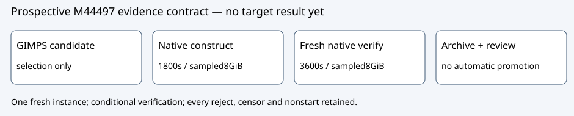

# Fresh M44497 protocol approval

GOAL-ISOU-f30a07 / EXP-ISOU-0c7e60 / H-ISOU-ffa8b0 / DEC-20261016-4c28d0. Protocol approval, no target evidence/EV promotion.

Observation: the earlier P-192 profile remains CENSORED/TIMEOUT; M8191 construction remains REJECTED and native verification NOT_STARTED. DEC-20261016-30a54b retains both exact outcomes without scientific promotion. No M44497 target has been run.

Comparison: primary GIMPS lists exponent44497 (13395decimal digits), the largest listed exponent within the existing65536bound. Native parsing allows20000decimal digits and a2MiB total certificate. Independent parameter review verifies required44495LL transitions. The source/executable/custody and published94-pass controls are reused unchanged, not rerun.

Inference: approve only a fresh bounded known-CM secp256k1 instance, degree2^44497-1 represented by unreduced coefficients with norm a²-ab+b². Candidate listing is not target admission. Exact constructor certificate, resourcePASS and a conditional fresh independent verifier VERIFIED_COMPACT for the same source/degree are required. SEC2 p/n primality stays trusted-standard.

Limitation: no global-record, expanded-map score, novelty, security or speed claim. Worker sampling25ms with100ms unusable grace is a diagnostic envelope, not an OS hard limit. Output256MiB is a postrun admission bound, not live quota. Preserve all CPU/wall/RSS/partial-output scopes.

Next action: parent Executor alone runs TASK-20261016-6db186 after exact TASK-20261016-61db9a input snapshot verification and Coordinator ownership release. Science concurrency1. Actual first constructor UTC binds a single four-file report covering both run IDs; no invented timestamp. Final producer snapshot binds22paths after report binding, then independent TASK-20261016-4bad89 review.

Independent TASK-20261016-eda340 initially found all three prospective joints hold in packet68d94f2c28. Its original empty blind_from declaration failed the mechanical contract; original files and failure retained. Published addendum c977e36923 widens to seven still-unread final approval/report/producer sources before native reaffirmation. Composed gate passes only after that reaffirmation, without retroactive original-pass claim. Requested xhigh; actual model/effort unknown. No provider substitution or scientific execution.

Sources: PROTOCOL.md, parameter-review-plan.yaml +review-plan-addendum.yaml, reviews/TASK-20261016-eda340/{report.md,attestation.json,reaffirmation.md,reaffirmation-attestation.yaml}, gimps-candidate-source.json, inputs.json, final native trial-plan/specification and content_at_commit snapshot. GIMPS primary https://www.mersenne.org/primes/.

Sourcee82d80feaf82d3730576ccd9137911b336f9dab8; binarySHA256b3cbd6ac5d457a0f6d6398d1fcefc408f627e60be52c81c9009406486b61587b. Source model icv1-fp256-t432420386565659656852420866390673177327-76dadd18, y²=x³+7; full field/order/generator in fixed source and inputs. Historical run/review and source-study canonical graphs checked unchanged because no supported frontier or coverage changes.

PDF rendered and every page visually inspected before archive. Diagram is prospective, not measured performance.
