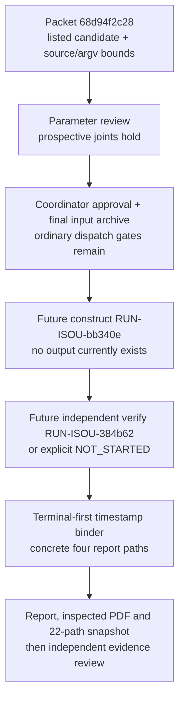

# Independent prospective M44497 parameter review

Task `TASK-20261016-eda340`; goal `GOAL-ISOU-f30a07`; candidate experiment `EXP-ISOU-0c7e60`.

**Recommendation: accept the prospective parameter delta in packet `68d94f2c28`. All three assigned joints hold at parameter, source-contract and metadata scope. I found no blocking defect in the reviewed packet.** This recommendation is not scientific execution approval, target admission, a completed certificate, or an official research-state transition. The Coordinator must still publish the final approval, concrete executable queue and input archive, verify their bindings, and complete the declared predecessor reviews before dispatch. All fresh target arithmetic and postrun evidence review remain mandatory.

This is a separate predeclared review of the M44497 packet. I executed zero scientific runs: no native scientific executable, test suite, benchmark, LL recurrence, Cornacchia, curve-point evaluation or target certificate construction. The parameter arithmetic below uses decimal logarithms and integer counts only. Repository access was read-only; outputs are private scratch. Requested policy and effort are `review-adversarial/xhigh`, with an independent session, no fallback or provider substitution. Actual served model and effort are unexposed and remain **unknown**.

## Immutable material and independent derivation

The handoff is committed at `23a6fee948`, archived by exactly `TASK-20261016-61db9a`. The packet is commit `68d94f2c28`, including its preapproval queue and pending, explicitly unauthorized scientific specification. All ten packet files plus experiment `inputs.json` equal their current on-disk bytes. The pending trial plan's three source hashes also match. Key identities independently checked:

| Material | SHA-256 |
|---|---|
| `PROTOCOL.md` | `22bdfb990a93d77ff49302908c9e8475de20d49ed1c44282e32e8fbaf617285a` |
| `native-command.sh` | `2650dbf6025f6de8b5c8ceee101170735b216e252a0e948b188af9f06cdce78b` |
| Experiment `inputs.json` | `c9a77924b771fbe778731a18a1ae05ba836aa1132bd9e087f7de9629d7ceec37` |
| `parameter-review-plan.json` | `a664df2955c3cc869445272925225afea334ca6259ccd0d928c63a9099e553e5` |
| `report-template.json` | `07c12fdbc98eca422740c04e36a3f5cd9b5ffe726b8b571f3e95251b87fffd2c` |
| `report-binding-contract.json` | `b5fdba0e7a35650b18eb4d1e2accaf7f187f1363fcf6ee27216bcf66cb4eb486` |

The exact native source is Git object `e82d80feaf82d3730576ccd9137911b336f9dab8`; inspected source was retrieved with `git show`, rather than substituted by working HEAD. The binary was only read/hashed: 36,087,488 bytes, SHA-256 `b3cbd6ac5d457a0f6d6398d1fcefc408f627e60be52c81c9009406486b61587b`, matching the packet. Source hashes are `b82ff8fec77a12c3e6a2be543a1605c945fbcb715669cc2ab0bd1d42f25dda7d` for `compact_cm.rs`, `277af787edfa8cd11e5d28b461f628afcda6afa88cd14501f625d84b24ef13d4` for `compact_cm_verify.rs`, and `c6020c16bcac00e4a8844e3a567353e805e162ec1f1a178883f6291dcb3d56f0` for `supervisor.rs`. This is byte/source-contract checking, not a new reproducible-build attestation.

Own arithmetic and packet-hash derivations were saved in `/private/tmp/TASK-20261016-eda340-independent/independent-derivation.json` and `packet-hashes.json`. No target output was read; both declared run roots and the experiment report directory were absent when inspected, and Git history for both run paths returned no prior commits.

## Joint: candidate_identity_and_bound — holds

I retrieved the primary [GIMPS list of known Mersenne primes](https://www.mersenne.org/primes/) independently. Its adjacent rows list exponents 23,209, 44,497 and 86,243; the 44,497 row gives 13,395 decimal digits. Thus 44,497 is the largest exponent on that list within the unchanged native 65,536 bound. This is a bounded list-selection fact, not a maximum over isogenies or a result from this implementation. Provenance: retrieved, verified by `validator-native-parameter`, 2026-10-16.

The target is **exponent** `e=44497` and **degree expression** `ell=2^44497−1`, not degree 44,497 and not a subgroup scalar. It is the same exact secp256k1 source tuple embedded in e82, source ICV1 `icv1-fp256-t432420386565659656852420866390673177327-76dadd18`, with its declared SEC2 p/n trust basis.

The independent count is `e−2=44495` LL transitions. The verifier loop hashes the initial state and each resulting state, for 44,496 states including index zero, and performs a transition only before the last index. The producer and verifier therefore agree on the required transition count without using an assumed final residue.

Independently, `44497 log10(2)=13394.931717060171…`, so `2^44497−1` has 13,395 decimal digits, matching GIMPS. The value is far from a decimal boundary; subtracting one does not change this digit count. It fits the native 20,000-digit canonical integer parser and exponent range `3..=65536`. The Cornacchia root is at most ell/2; x and y are at most sqrt(ell); a=x+y and b=2y are bounded by 2sqrt(ell). Their valid exact magnitudes therefore also fit the per-integer parser bound. No actual large integer or LL sequence was constructed for this review.

The **total serialized certificate** has a separate hard reader bound of 2,097,152 bytes. The reader takes at most that bound plus one and rejects an oversized input; the public constructor also uses this bounded read before sealing its public certificate. Per-integer compatibility does not prove that a future serialized artifact satisfies the total byte bound. Actual emitted bytes and their hash must be recorded and checked after construction. The fixed certificate structure uses recurrence/division hashes rather than embedding all large recurrence states, so the parameter change does not itself require an unbounded transcript inside that reader input.

A prime exponent alone is insufficient to establish a Mersenne prime. GIMPS supplies a candidate-selection basis; it does not waive either native full recurrence or the fresh independent verifier. This conclusion uses the primary listing and the pinned acceptance predicates, not the Coordinator's assertion or the earlier attempt's outcome.

## Joint: source_reuse_and_admission — holds prospectively

The parameter changes within the unchanged source range; it changes no arithmetic, source tuple, binary, mathematical acceptance predicate or resource-monitor implementation. I checked the existing mathematical review and e82 resource retake as earlier-round scope records, not as M44497 results. The mathematical review is conditional and explicitly leaves concrete-instance acceptance incomplete. The e82 retake is static source/control-definition evidence and makes no fresh test or target claim. Their bytes match those committed in the packet's ancestry. Their reuse does not establish that the larger instance will complete within its watchdogs, nor does it create a new independent arithmetic proof.

The producer uses `num_bigint` with Mersenne folding; the independent verifier uses repository `Int` and general modular reduction. The latter reconstructs ell from the certificate exponent, checks exact degree equality, prime-exponent eligibility, transition count, theorem label, terminal zero and recurrence digest. Its Cornacchia checker independently verifies the normalized root, Euclidean steps, stopping/square test, transcript and canonical unreduced coefficient transform. The full verifier still requires exact source-domain equality; exact-Z identity plus its supplementary evaluated certificate; unreduced norm; separability/differential product; beta/lambda roots and full-point pairing; subgroup scalar/inverse/dual product; generator/order/Hasse checks; and the fixed eight public inputs with independent affine replay, both dual compositions and group-law checks. None is replaced by the primary listing.

The generic native verifier accepts a valid certificate for its own internally bound exponent; it is not intrinsically restricted to 44,497. The **experiment admission contract** therefore additionally requires fresh `VERIFIED_COMPACT`, resource `PASS`, `degree_bits:44497`, the exact source ICV1, and the precise sealed constructor bytes. These target fields must be checked in postrun review; merely observing a generic native PASS from a substituted smaller certificate does not satisfy this experiment. The frozen construction argv, sealed-input chain and explicit target checks together provide the required prospective binding.

SEC2 p/n primality remains explicitly trusted standard data, separate from the degree's native LL proof. Compact output remains a compact known-endomorphism self-map, separate from expanded maps and their season scores. A successful future instance would still support only its archived, independently reviewed scope.

The unchanged supervisor requires positive RSS acknowledgement before protected arithmetic and rejects persistent unavailable/zero telemetry before or after acknowledgement. It enforces an 8 GiB **sampled worker** envelope, 25 ms sampling and 100 ms monitoring grace, with 1,800 s construction and 3,600 s verification watchdogs. These are neither OS hard memory limits nor campaign spending caps. Postrun output admission is 256 MiB, not a live disk quota. Timeouts/monitor failures remain inconclusive; every partial artifact must be preserved. No new control suite was executed by this review, and the packet's 94-pass custody claim was not independently rerun.

## Joint: argv_artifacts_report_binding — holds prospectively

The exact prospective operations use the same installed binary directly under `/usr/bin/time -l`:

```text
compact-cm construct --exponent 44497 --out <RUN-ISOU-bb340e>/native --timeout 1800
compact-cm verify --input <RUN-ISOU-bb340e>/native/certificate.json --out <RUN-ISOU-384b62>/native --timeout 3600
```

The pending plan freezes absolute roots in `EXP-ISOU-0c7e60`, one invocation per fresh ID, construct before verify, scientific concurrency one, and no alternative candidate or silent retry. The adapter checks the binary hash and refuses existing manifest/native paths. Public native code separately requires fresh native output directories. The shell wrapper is receipt orchestration, with no mathematical implementation.

Verifier dispatch requires constructor `CONSTRUCTED`, constructor native-resource `PASS`, the emitted certificate and its matching seal. Failure of that antecedent records `NOT_STARTED`, preserving the distinction between missing computation and measured zero cost. Successful adapter exit means observation delivery, not mathematical acceptance. Raw `/usr/bin/time -l` user/system/real/RSS data remain available when the process actually starts; canonical null CPU fields do not override those logs, and complete campaign/per-stage costs must not be inferred.

**Numeric-exit check:** `native_exit` is initialized to numeric zero and assigned only shell `$?` results. The numeric comparisons are against that variable (`-eq 0` for sealing and `-ne 0` for delivery status). After those comparisons, `native_exit_field` is copied from it and becomes literal `null` only if no native process started. Only `native_exit_field` is interpolated into the manifest. No numeric test compares null, and no nonstart is rendered as a measured native exit zero.

The reserved report task is `TASK-20261016-6239ad`, science budget zero, covering both run IDs under exclusive experiment-report scope. No future timestamp is embedded in an executable report artifact card, and no report directory exists now. Binder `TASK-20261016-3e1186` runs after producer terminal delivery/release and derives the four concrete filenames from the actual first native constructor UTC. Its explicit no-native-start branch uses labelled generation time rather than inventing a native start. The `run-YYYYMMDDTHHMMZ` text is a template rule, not a ready wildcard artifact card.

The binding stage may instantiate only the reserved report task, publish its concrete handoff/paths, and extend the still-pending producer snapshot's dependencies and sources. It must publish this queue state before completing its release; the snapshot then waits for the report and binds exactly `14+3+4+1=22` paths. Source/binary/input/certificate bytes, scientific argv, resources, run IDs, approval and earlier archive bindings are forbidden changes. This is a prospectively declared metadata stage, not permission for a post-hoc scientific scope change. Actual binder outputs, ordering, timestamp provenance, PDF inspection and the resulting content-at-commit snapshot remain future verification obligations.

## Proves-too-much checks and limits

| Unsupported conclusion/object | Required boundary | Review outcome |
|---|---|---|
| Prime exponent alone admits its Mersenne number | Full producer and independent LL must pass | Rejected by contract/source |
| Smaller valid certificate substitutes for 44,497 | Exact result degree_bits, source and sealed target bytes | Rejected by experiment admission contract; generic verifier success alone is insufficient |
| Constructor-only success or NOT_STARTED is completed admission | Fresh independent VERIFIED_COMPACT and resource PASS | Rejected by contract |
| Unknown future timestamp becomes an artifact path now | Terminal-first binder and actual-start provenance | Rejected by declared stage; directory absent |
| Trace/hash/schema success proves prescribed computation or performance | Separate execution-proof and cost/claim gates | Not established or claimed |

These are static attacks on the predeclared predicates, not newly executed mutation fixtures. I found no removed gate or target/source/resource mismatch. No conclusion here says that M44497 native construction or verification has succeeded, or that any future failure establishes nonexistence. I did not inspect a sibling report in this parameter-review round. The two earlier mathematical/resource reviews were read explicitly as historical source-scope records.



No canonical frontier graph changes are proposed by this parameter review. Approval/decision-report rendering and canonical graph checks belong to the Coordinator archival step. The recommendation is **accept this fixed parameter/protocol delta and retain all normal launch and postrun gates**. There is no concrete refusal or blocking finding within the assigned prospective scope.

The complete machine-readable review attestation is supplied as `attestation.json` beside this report.

```yaml
review_attestation:
  task_id: TASK-20261016-eda340
  joints_owned:
  - candidate_identity_and_bound
  - source_reuse_and_admission
  - argv_artifacts_report_binding
  sources_read:
  - AGENTS.md (governing instructions reused from this session)
  - agents/validator.md (role reused from this session)
  - orchestration/model-policies.yaml (policy reused from this session)
  - templates/research-records.md (attestation contract reused from this session)
  - .agents/skills/research-visuals/SKILL.md (workflow reused from this session)
  - .claude/skills/research-visuals/SKILL.md (workflow reused from this session)
  - ledger/handoffs/TASK-20261016-eda340.yaml@23a6fee948
  - coordination/goals/GOAL-ISOU-f30a07/m44497/PROTOCOL.md@68d94f2c28
  - coordination/goals/GOAL-ISOU-f30a07/m44497/gimps-candidate-source.json@68d94f2c28
  - coordination/goals/GOAL-ISOU-f30a07/m44497/native-command.sh@68d94f2c28
  - coordination/goals/GOAL-ISOU-f30a07/m44497/parameter-review-plan.json@68d94f2c28
  - coordination/goals/GOAL-ISOU-f30a07/m44497/preapproval-dispatch_queue.json@68d94f2c28
  - coordination/goals/GOAL-ISOU-f30a07/m44497/record-ids.json@68d94f2c28
  - coordination/goals/GOAL-ISOU-f30a07/m44497/report-binding-contract.json@68d94f2c28
  - coordination/goals/GOAL-ISOU-f30a07/m44497/report-template.json@68d94f2c28
  - coordination/goals/GOAL-ISOU-f30a07/m44497/specification.pending.yaml@68d94f2c28
  - coordination/goals/GOAL-ISOU-f30a07/m44497/trial-plan.pending.json@68d94f2c28
  - experiments/EXP-ISOU-0c7e60/inputs.json@68d94f2c28
  - https://www.mersenne.org/primes/
  - docs/reports/isogeny-cm-norm-design-20261016/independent-review.md (earlier mathematical
    review; relevant excerpts)
  - coordination/goals/GOAL-ISOU-f30a07/final-source-e82d80feaf/independent-resource-retake.md
    (earlier source retake; relevant excerpts)
  - crypto@e82d80feaf82d3730576ccd9137911b336f9dab8:tools/isogeny-cli/src/compact_cm.rs
  - crypto@e82d80feaf82d3730576ccd9137911b336f9dab8:tools/isogeny-cli/src/compact_cm_verify.rs
  - crypto@e82d80feaf82d3730576ccd9137911b336f9dab8:tools/isogeny-cli/src/supervisor.rs
  - /Volumes/SSD990-2/crypto/isogeny-degree-challenge-builds-20261015/compact-final-e82d80feaf/isogeny
    (read/hash only)
  - /private/tmp/TASK-20261016-eda340-independent/packet-hashes.json
  - /private/tmp/TASK-20261016-eda340-independent/independent-derivation.json
  read_sibling_reports: false
  blind_from_respected: true
  verdict: holds
  joint_verdicts:
    candidate_identity_and_bound: holds
    source_reuse_and_admission: holds
    argv_artifacts_report_binding: holds
  verdict_scope: Prospective fixed parameter, source-contract and metadata review
    only; no target arithmetic or completion result.
  requested_policy: review-adversarial
  requested_effort: xhigh
  actual_served_model: unknown_not_exposed
  actual_served_effort: unknown_not_exposed
  independent_session_required: true
  independent_session_used: true
  originated_parameter_proposal: false
  fallback_used: false
  degradation_used: false
  provider_or_api_substitution_used: false
  source_packet_commit: 68d94f2c28
  claim_commit: 23a6fee948
  source_commit: e82d80feaf82d3730576ccd9137911b336f9dab8
  archived_by: TASK-20261016-61db9a
  scientific_runs_executed: 0
  test_binary_benchmark_or_target_execution: false
  target_LL_executed: false
  target_outputs_read: false
  repository_modified: false
  conductor_claim_or_wrapper_created: false
  prior_round_reviews_read:
  - TASK-20261016-3b4ca9
  - TASK-20261016-ed10a6
  prior_reviews_used_as_target_success: false
  source_provenance:
    metadata_and_code: internal
    candidate_listing: retrieved
    verified_by: validator-native-parameter
    candidate_source_url: https://www.mersenne.org/primes/
    retrieved_on: '2026-10-16'
  independent_quantities:
    exponent: 44497
    required_LL_transitions: 44495
    LL_states_including_initial: 44496
    degree_decimal_digits: 13395
    native_exponent_limit: 65536
    integer_decimal_digit_limit: 20000
    certificate_input_byte_limit: 2097152
    producer_snapshot_paths_after_binding: 22
  numeric_exit_handling:
    native_exit_always_numeric: true
    native_exit_field_null_only_for_nonstart_manifest_rendering: true
    numeric_comparison_of_null: false
  freshness_observation:
    constructor_run_root_absent: true
    verifier_run_root_absent: true
    experiment_report_directory_absent: true
    prior_git_history_for_run_roots_empty: true
  actionable_blocking_findings: []
  procedure_deviations: []
  recommendation: accept_parameter_delta_in_exact_packet_68d94f2c28
  scientific_execution_approval: none
  target_admission: none
  official_state_transition: none
  remaining_obligations:
  - Coordinator final approval and exact approved input snapshot/dispatch binding
    before launch.
  - Fresh target construction and independent native verification, including exact
    degree_bits44497/source/sealed-input checks.
  - Actual serialized certificate byte admission and complete retained resource/cost
    receipts.
  - Terminal-first report binding, rendered/inspected PDF and resulting22-path snapshot,
    then independent postrun review.
```
