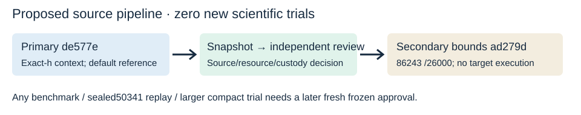

# Source-only next-step design

Parent implements primary source-only TASK-20261016-de577e from coordination/goals/GOAL-ISOU-f30a07/next-native-source-20261016/dispatch_queue.json after exact ledger archive TASK-20261016-857601 verifies; separately reserve crypto paths and use fresh codex/isogeny-fixed-modulus-20261016 from1180f89d568c52ac60a022358b6fd70fa9e3bd30. No scientific measurement authorized.

# Ranked next source work

1. Primary TASKde577e: opt-in reusable fixed-modulus reciprocal across selected torsion and subgroup baby/giant composition for the same sealedP19250341 map. Reference remains default and independent; semantic/adversarial/resource controls and clean matched A/B builds precede new measurement approval. This resolves whether repeated same-h reciprocal construction can be removed safely and measurably before any larger expanded-map construction. No speed result assumed.
2. Secondary TASKad279d: next compact envelope86243/26000digits with parser-only boundary controls, after the primary source gate. Known-CM numerical-degree extension is separate and cannot replace expanded-board progress. No new compact target run approved.
3. Deferred: native LL subphase accounting before any decimal/digest encoding proposal; no measured hotspot exists.

Prior work screened: independent verification_poly already has Karatsuba/reciprocal reduction and verify_kernel already has baby/giant composition. Existing isogeny_algos/docs/large-ell-20261016/REPORT.md and results/p13-large-ell.txt are prior shared4-vCPU/n1 kernel/codomain/image observations, not this P192 independent replay or an all-CPU proof. No duplicate benchmark was launched. Local knowledge/source rg found no existing accepted M44497 finding or this verification-cache handoff. Known fixed-modulus caching is not claimed novel. Expanded54 boards and compact category remain separately ranked.

The source queue is a zero-science implementation/review pipeline. Cross-repository code changes require the parent's separate crypto Conductor reservation and clean branch. HA producer scopes contain only source/control/custody binding receipts. Source code and raw controls must be committed/pushed in crypto first, then exact external Git/hash bindings here. Scientific benchmark/replay/next-target protocols require later fresh approvals. No implementation agent is spawned by Coordinator; parent implements.

Full primary API/proof/control/measurement contract: ../../FIXED-MODULUS-PLAN.md. Source binding: ../../source-bindings.json. Existing accepted P2241471 cache-path fixture: ../../cache-fixture-bindings.json. Original proposal retained byte-for-byte. Future source gates own prospective DEC5cf723 and DEC7a0aed; no numerical outcome is prewritten.

Decision basis: archived P192 replay remains censored; repeated reversed-modulus reciprocal construction is a source-level candidate, not a measured bottleneck or improvement. Reuse covers both selected torsion and baby/giant composition. Existing default reference remains independent, every acceptance check retained. Native semantic/adversarial/resource controls, actual clean A/B builds and immutable custody precede independent source review; no target or benchmark campaign is an implementation control.

The existing accepted P2241471/L736 fixture exercises the cached threshold; low-degree P19213/P5217 exercises fallback only. Fresh A/B public acceptance and high-degree recomputed-hash bad-kernel/bad-numerator refusals required. No new construction/search. Put reduction policy only in public version JSON, outside existing embedded provenance/certificate/verdict. Companion generate takes explicit --input SEALED_MAP_JSON, never embedded workspace paths.

Later measurements require frozen inputs and8A/A pairs+8ABBA blocks per completed case, nearest-rank empirical q90 at ceil(.9n),n8 index8/max; no interpolation/drop. Full mathematical verification bytes equal by default; no excluded fields unless an actual future schema enumerates provenance-only differences before freeze. Timing rules remain descriptive under noise/censor, no prewritten ratio. All phases/accounting and proposed exact native argv are in plan.

Prior shared4vCPU/n1 kernel/codomain/image measurements are not this replay. No duplicated benchmark. Secondary86243 requires a new independently checked envelope, not old e82 execution. LL decimal/digest profiling is a deferred lead, not a measured hotspot. Diagram is a proposed workflow with no timing axis or result.
