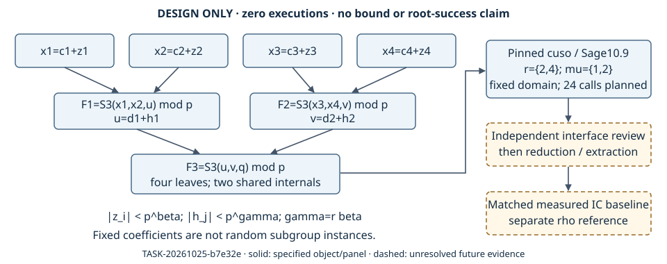

# Weighted joint Semaev applicability and first-test design

2026-10-25 · TASK-20261025-b7e32e · GOAL-PFDR-fd09e0 · BATCH-3cfef2

The user's request is: “Establish the reach–cost tradeoff of joint-system small-root decomposition and demonstrate a verified improvement over the current prime-field IC baseline.” The user invoked `/skills /coordinate` and “Yes continue.” This goal-mode continuation advances the unresolved optimal-shift/joint lead through a zero-run design. The requested IC improvement remains unestablished. Beating rho is a separate reference, not a prerequisite for improving a measured IC baseline.

No scientific program, bound search, algebra system, lattice reduction or root extraction was executed here. This package creates no official experiment, hypothesis, evidence or scientific transition. The contract preview remains `review_required`, `approved_by: null`. Machine-readable details are in [applicability.yaml](applicability.yaml), [experiment-contract-preview.yaml](experiment-contract-preview.yaml) and [next-handoffs.json](next-handoffs.json).

## Observations and provenance

Repository inputs were retrieved at published commit `295b244f1de08797f3b0ce0f925ef20625a337c9` [R]. External source was read statically at cuso commit `fb2747d2105a8e48499bf10a3a717cf80c14d079` [C]. No full Ryan theorem was retrieved in this task; the README/source guarantee is not upgraded to a theorem-applicability attestation. No knowledge-search tool was exposed, so this is not a novelty or exhaustive-literature claim.

The archived readiness manifest reports Sage 10.9, CPython 3.12.15, igraph 1.0.0 and fpylll 0.6.4. The documented univariate example completed and printed `delta*=1/3`; time and peak RSS were not captured. That is an already observed calibration, not new joint data. The first panel binds that record instead of repeating calibration for its own sake.

The archived unshifted fixture has `a=2,b=3,xQ=5`, not an identified subgroup or random target distribution. Its finite joint inequalities are `44beta+38gamma<3`, `1140beta+938gamma<98` and `12048beta+9620gamma<1280` at multiplicities 1, 2 and 3, before norm losses. These are cited archived counts, not newly computed bounds and not the translated fixture's counts. The independent review establishes its assigned determinant/divisibility accounting. Earlier producer text and artifact flags saying review was not completed describe an earlier snapshot; they remain frozen and do not erase the later scoped review. Neither record supplies a joint extraction oracle. The old `0.8408`, `8/9` and quoted gap remain unreconciled.

## Exact object and interface

Over a prime field with `p>3`, require `4a^3+27b^2 != 0 mod p`. Define

```text
S(A,B,C)=(A-B)^2 C^2-2((A+B)(AB+a)+2b)C+(AB-a)^2-4b(A+B).
x_i=c_i+z_i; u=d1+h1; v=d2+h2; target x-coordinate=q.
F1=S(c1+z1,c2+z2,d1+h1) = 0 mod p,
F2=S(c3+z3,c4+z4,d2+h2) = 0 mod p,
F3=S(d1+h1,d2+h2,q)     = 0 mod p.
```

The variable order is `(z1,z2,z3,z4,h1,h2)`. Four leaf bounds are `|z_i|<X`, two internal bounds `|h_j|<Y`, with `X=ceil(p^beta)`, `Y=ceil(p^gamma)`. Finite trials must record exact integer bounds and check window injectivity (`2X-1<=p`, `2Y-1<=p`) or account for collisions. Affine windows may wrap modulo p; their integer deviations must remain explicit. S3 zeros alone do not establish F_p y-lifts, compatible signs, subgroup membership or equality of the resulting group sum to the target. Identity, tangent and equal/opposite-point cases need separate treatment.

Use `SymbolicCoppersmithProblem([F1,F2,F3], bounds=[1,1,1,1,r,r], int_rels=[], modulus_name='p', divisor_bound=1, relation_modulus_degrees=[1,1,1], mod_mult_modulus_degree=1)`. Here `beta=delta`, `gamma=r*delta`. The coefficient field for the first panel is QQ with fixed integers. Cuso introduces a formal p as its first variable; this is characteristic-zero symbolic known-modulus algebra, not a Groebner computation over F_p.

For multiplicity `mu`, let E be the union of exact nonzero supports of the three expanded affine polynomials. Specify `M_mu = conv({0} union {mu*e : e in E}) intersect Z_nonnegative^6` and `J=(p,F1,F2,F3)^mu`, with `J_inf=(0)`. Pass vertices as seven-coordinate tuples `(0,mu*e)`, including the origin: the leading zero is the modulus exponent. Cuso fills the convex hull's integral points. This domain differs from the archived discrete support sum. Retain the internal enlarged `M_bar`, shifts, leading terms and echelon artifacts too.

Call `get_asymptotic_bounds` with `bounds_guess=(1,1,1,1,r,r)/20` as exact rationals, `precompute_multiplicity=mu`, all six `tshifts_to_include=False`, and `skip_reduce=False`. The internal weighted lexicographic order rounds 1000 times `(1,bounds_guess)`; retain actual weights. The returned `tau_cuso` is the zero tuning tuple here. It is not the attack-cost exponent `tau_attack`.

## Applicability boundary

| Joint | What static reading establishes | Still required |
| --- | --- | --- |
| Symbolic interface | Multiple shared-variable relations with known common modulus are representable. | Full theorem/Algorithm 3/Lemma 7 hypotheses checked independently. |
| Coefficients | The first fixed integer fixture has constant input heights as p grows. | Growing public a,b,q and centers need numerator/denominator-height accounting; fixed coefficients do not model that distribution. |
| Specialization | Cuso returns coefficient-denominator coprimality conditions. | Retain every condition; prove denominators and needed leading coefficients invertible modulo p, and preserve specialized degrees, ideal/span and pivots. |
| Shift domain | A finite convex integer domain and ideal are specified. | Audit exact domain and closure; any optimality statement is confined to its stated construction and hypotheses. |
| Cost | Ideal construction, `J_inf.groebner_basis()` and `J.groebner_basis()` occur internally. | Charge those calls, closure/echelon, polytope work and interpolation; later reduction/extraction and all failures also count. |
| Extraction | A span guarantee and heuristic symbolic bound do not recover roots. | Enough independent integer equations and tractable extraction, original-equation and group verification, success probability and cost. |

`polynomial.py` interpolates construction statistics; `limit.py` takes a leading-term ratio. Enabling t-shifts would also invoke floating constrained minimization, so it requires a separately frozen finite plan. A single vanishing polynomial or Jacobian-rank check does not establish zero-dimensional extraction. No global optimality, root success or IC advantage is claimed.

## Fixed first joint workload

The prospective main fixture is `a=2,b=3,q=5`, centers `(c1,c2,c3,c4,d1,d2)=(11,13,17,19,23,29)`. It is an algebraic object with no promised root. Freeze `(r,mu)=(2,1),(2,2),(4,1),(4,2)`, in that order, with `0<delta<1/r`. The ray `gamma=4beta` is a goal-facing anchor; `gamma=2beta` is a shape reference. Neither is selected from new data.

For each cell run, in order, the three projected single-block references, joint A, joint A/A, and a nearby object: 24 symbolic calls total, one cold process each. Case IDs are `J-r{r}-mu{mu}-{arm}`, the ordered Cartesian product of the four stated cells and arms `F1_single,F2_single,F3_single,joint_A,joint_AA,nearby_A`; A/A is included in the six arms. Each single block uses its active variables, projected bounds and the same domain rule; F3 has two unknowns because q is fixed. Joint A/A repeats exactly joint A's serialized input, generator order, options, weights and domain in a fresh cold process. This identical-input pair is a descriptive A/A diagnostic, not a confidence interval. Reversing generator order is a separate future representation-sensitivity intervention, outside these 24 calls and their noise floor. Joint versus projected blocks changes several structural factors and is explicitly confounded: it cannot establish per-block tightness or a speedup.

The nearby object retains each expanded polynomial's exact support and replaces the coefficient at exponent e in equation j by `1+(int(SHA256('nearby-v1|'+j+'|'+comma_join(e)),16) mod 19)`, using decimal ASCII, commas without spaces, j in 1,2,3. It has no assigned group interpretation. Since the implementation uses coefficients, equality of its bound with the elliptic fixture is not presumed. The control prevents treating a support signature as a decomposition oracle.

Before those calls, the exact sign/divisibility control reuses the published test fixture over F_101: `P=(1,39)`, `T=(3,6)`, `R=(41,15)` on `y^2=x^3+2x+3`. Independently verify P+T=R. Enumerate all eight sign triples in `{-1,1}^3`, retaining the same x-coordinates, and classify group-sum zero separately from S3 vanishing. Then use one full tree with leaves P,T,P,T, internals R,R and target 2R computed by exact doubling. Use centers `(1,3,1,3,41,41)` and zero deviations. Verify every equation and constructed shift's p^mu divisibility; the corrupted `F1+1` must fail at that tree. These repeated-point public controls are not random subgroup samples or extraction results.

Primary outputs are exact `delta_star` or a classified failure, capped and uncapped weighted exponents, `V=4beta+2gamma`, `V/3`, rows/support/closure, exponent sums, modulus powers, coefficient heights and denominators. Record phase time/CPU/RSS, process-tree peak memory, and all failed-call costs. Reduction and extraction are `not_requested`, not zero-cost successes. The preview includes the variable ledger, A/A, prediction provenance and affine-map obligations; its formal transfer assessment is still a gate. New affine cuso joint cells are out of sample; the archived univariate result is in-sample calibration only.

Run sequentially under an 8 GiB process-tree/cgroup memory limit with at least 12 GiB available host memory, and a justified 1800-second watchdog per call. Guards must work before launch. A guard stop checkpoints an explosive symbolic process; it is not mathematical negative evidence or a spending cap. A failed exact control stops the panel. Preserve every requested cell as complete, failed, censored or not started with reason, including raw output, exceptions, environment and intermediate objects. No automatic retry, tuning or parameter escalation is permitted.

Complete measurement means control and exact-input audits pass and all 24 cells are accounted for. A low/equal bound is a scoped observation, not lead closure. A joint/block difference within A/A spread is representation-sensitive; a larger difference remains a family-specific heuristic observation pending review. Timeout, memory or interpolation/denominator failure identifies a diagnostic obligation. An input or modular-control failure invalidates affected comparisons. These outcomes determine implementation repair, a separately frozen diagnostic, or independent review before a later reduction/extraction design; none promotes a scientific claim.

## Conditional cost and remaining gates

Only under independently uniform windows, subgroup order Theta(p), usable rank, bounded extractor success and fully charged attempts is the optimistic model `lambda=p^(4beta+2gamma-3)`, `C=max(3-3beta-2gamma+tau_attack,2beta)` relevant. The frozen measured current IC baseline has not been reproduced here; do not substitute rho for it. A future comparison needs identical registered curves/subgroups, seeds, resources and verified DLP success, with cold/reused setup, construction/Groebner, reduction, extraction, misses, duplicates/signs, relation yield/rank, linear algebra and final verification charged. Require independent replay, multiple fixed sizes, uncertainty and peak memory. Rho/vOW is reported separately. Rank-at-least-two GAP substitutions change dimension, height, injectivity and multiplicities and require a separate follow-up contract.

Still missing are the owner-repository launcher/adapter and lock, exact finite trialplan/supervisor, formal transfer assessment, independent theorem/interface and extraction-boundary review, exact-byte preapproval packet returning `approvable:true`, Director runbook/task-card lint, Coordinator approval binding the runbook hash, verified isolated archive, pushed publication and selector `execution_state: ready`. Current live ownership and resource guards must be rechecked before `/run`. The named obstruction remains `problems/joint-smallroot-reach-baseline-and-oracle-unverified.md`; this package does not resolve it.

## Operational correction and provenance

Open lanes are not active claims. The parent reports that the hydrated full-history PFDR archival task `TASK-20261017-83cf43` is ready; it remains separate. `TASK-20261017-56402f` is the completed snapshot, not that ready archival task. This task holds the epoch-1 design claim under `coordinator-smallroot-3cfef2` in its disjoint lane, branch `lane/smallroot-3cfef2`, PR 2557 stacked on audit PR 2547. No older lane was taken over or closed.

The native managed Coordinator was selected as `gpt-6.1-sol`, reasoning `high`, policy `coordinator-orchestration-code`, configured binding `openai-gpt61`, through the parent's native `collaboration.spawn_agent` dispatch. Parent preflight reports READY with consistent authority/generated bindings, and `codex login status` reports ChatGPT authentication. This is native selection provenance, not an API catalog probe or SQLite receipt. No fallback/degradation was used. The earlier nested CLI initialization failure is a separate session, not failure of this working managed thread.

The shared artifact-tool correction must land owner-first in crypto before audit PR 2547 merges. The parent prepared the exact patch but the Conductor ownership tool is absent, so no owner code was edited. That operational gate does not block this zero-run design. Root renders and visually inspects this report's PDF before isolated archive `TASK-20261025-f950af`; no rendering receipt is asserted here. The historical `reach-cost.svg`, review `accounting.svg` and readiness `weighted-reach.svg` were checked through their reports and remain frozen; this prospective diagram changes no canonical scientific graph.



Exactly one next action: Executor-implementation prepares the finite adapter/launcher, exact trialplan and supervisor packet described here without executing it; then return for independent review and prospective preapproval.

## Retrieved source references

[R] [Pinned repository tree](https://github.com/aburan28/crypto-autoresearcher/tree/295b244f1de08797f3b0ce0f925ef20625a337c9): `AGENTS.md`; `agents/coordinator.md`; `.claude/skills/{coordinate,design-experiment,research-visuals}/SKILL.md`; `docs/{confound-control,lab-contract,agent-contract-extended}.md`; `ledger/handoffs/TASK-20261025-b7e32e.yaml`; `ledger/decisions/DEC-20261025-fe4f22.yaml`; `ledger/proposals/IDEA-20260904-39336c.yaml`; `knowledge/leads/ecdlp/ic-prime/LEAD-ICP-coppersmith-smallroot-semaev.yaml`; `research/joint_smallroot_reach_20261024/{report.md,independent-review.md,artifacts/finite-audit.json,readiness-20261025/report.md,readiness-20261025/manifest.json}`; `tests/test_joint_smallroot_reach.py`. Read-only inspection by `/root/joint_applicability_design_3cfef2`; parent operational updates identified above are dispatch provenance.

[C] [Pinned cuso tree](https://github.com/keeganryan/cuso/tree/fb2747d2105a8e48499bf10a3a717cf80c14d079): `README.md`; `examples/symbolic/{rsa_affine_padding,common}.py`; `src/cuso/symbolic/{problem,ideal,optimal,asymptotic,polytope,polynomial,limit,shift_set_properties,utils}.py`. Retrieved and statically read by the same Coordinator. The README links Ryan, *Solving Multivariate Coppersmith Problems with Known Moduli*, eprint 2024/1577; the paper itself remains an independent-review obligation.
