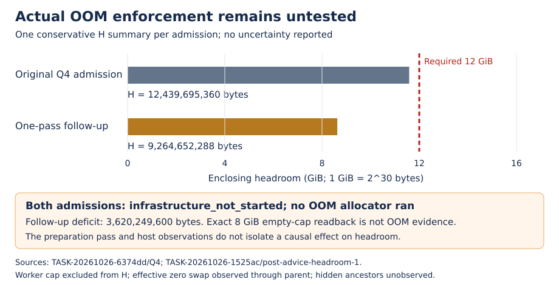

# Guard qualification remains partial: actual OOM enforcement is untested

TASK-20261026-94c1e6 · DEC-20261026-3380c9 · 27 October 2026

**Decision: revise.** Independent Reviewer TASK-20261026-5bedd5 reports **breaks** for `guard-enforcement-coverage-and-retention`: both Q4 admissions stopped before an allocator ran. The narrower placement, tree cleanup, repaired watchdog/serial exclusion, negative-case retention and declared native custody observations hold in the recorded fixture. Full guard qualification remains false. This is a source-bounded software assessment; it grants no scientific approval, mathematical result, attack-cost advantage, global-host readiness or goal promotion. The decision becomes official only after root verifies and publishes its isolated ledger archive.

## Observation

Original C1 is owner `204735c3f6f3144911df58a6ece7699c0e74d4ad`; protected production source remains pinned to `86ddd19f67e08160c22a0d8ba9a32a92321d18ad`. Original Q1, Q2 and Q5 passed their fixed native assertions. Original Q3 remains **failed**: its genuine watchdog fired, but generic orphan cleanup consumed the competitor before its dedicated `wait4`, leaving ECHILD and unavailable status/usage. Original Q4 remains **infrastructure_not_started**. Neither row was rescored.

The successor source, preparation and final owner commits are `6b3ed020228586f60ab4ae56edf68fed2a853ef5`, `608f7198db59fc431123de2c4d928e4e3466d6da`, and `76a3e4eb67e818354da7575dad4b834467a97e5c`. Its programme snapshot is `c90b8b1a12bc6323ece604a965bb96bad823c166`. Five of five original and successor snapshot hashes match. The independent source comparison found all 12 protected source files unchanged; the only helper change moves Q3's dedicated competitor receipt before generic cleanup. Worker, runtime, Makefile, resource envelope, predicates and production timer are unchanged.

| Retained item | Recorded result and attribution |
| --- | --- |
| Original Q1/Q2/Q5 | Placement, exact 8 GiB readback, escaped-session cleanup and missing-exec/read-only negatives hold in the original C1 fixture. Q5 has two retained negative cases. |
| Original Q3 | Failed dedicated receipt, `-1/ECHILD(10)`; genuine watchdog, serial rejection, tree cleanup and lock release remain retained. |
| Retention regression | One producer invocation passed; old order loses the exit-23 child receipt, corrected order retains it. Reviewer replay was prohibited and did not occur. |
| Q3-followup-1 | One invocation passed under the repaired helper; no other original class reran. |
| Original and follow-up Q4 | Both infrastructure not started; zero allocator and Q4 worker launches. Actual OOM behavior remains unknown. |
| Additional preparation | One pass, 375 eligible unique files / 631,361,269 bytes, all 375 advice returns 0 with stable metadata; 23 duplicate-inode exclusions from 398 candidates. Advice is not proof of reclamation. |

The sole repaired-helper Q3 container ran from `01:03:08.619938647Z` to `01:33:08.853118452Z` on 27 October. Measured production watchdog time is 1,800,064,885,794 ns and independent elapsed time is 1,800,065,709,473 ns. The supervisor retained `censored=true` and wait status 9. Dedicated competitor `wait4` retained exact PID 7, errno 0, reaped true, exit 0, user 1,018 us and system 0 us. Serial rejection occurred before a competing worker launch; no competing worker ran. Stable escaping descendant identities changed from R/Z with populated 1 to Z/Z with populated 0; the owned group was removed, the lock reacquired, and container removal/absence verified. The external 1,950-second fail-safe did not fire. These durations are observations, not performance comparisons.

## Comparison

The figure plots the two recorded conservative H summaries, one per admission; no measurement uncertainty was reported. Original H is 12,439,695,360 bytes, a **derived** deficit of `12,884,901,888 − 12,439,695,360 = 445,206,528` bytes. Follow-up H is 9,264,652,288 bytes, a **derived** deficit of `12,884,901,888 − 9,264,652,288 = 3,620,249,600` bytes. Each summary takes the limiting recorded host/enclosing/container constraint and excludes the prospective 8 GiB worker. The observations do not isolate a causal effect of preparation on headroom.

The empty worker group read back exactly 8,589,934,592 bytes, current 0 and no members. Its raw swap cap was `max`; the observed container parent's raw swap cap 0 establishes effective zero swap over that observed path. Hidden ancestors remain unobserved. The empty group was removed. Neither Q4 record contains an OOM event delta, bounded over-cap touch, kernel victim, peak at enforcement, parent survival or cleanup after OOM. Readback and unexecuted test predicates cannot supply those observations.

## Inference and independent coverage

The full five-class qualification claim breaks because a required enforcement class was never executed. This does not falsify the supervisor's actual OOM behavior. Q1/Q2/Q5 remain observations of C1; Q3 follow-up is an observation of its repaired helper. The Reviewer supports transfer only to the same protected supervisor and exact fixture: the sole helper change is Q3-specific after `supervised()` returns, leaving the other branches unchanged. This does not imply that all five classes reran or repair the original failed Q3.

The Reviewer verified the exact original 691-path set and successor 690-path set, with zero set delta; 681 current successor members and seven shards match their declared hashes and bytes. All five retained external binaries match their seals. Seven original subtree indexes bind hashes but do not declare byte counts; no absent byte-count assurance is inferred. Historical source-stage and preparation-stage manifests resolve at their own commit trees, while the final index binds the appended daily log. Guard custody is complete for those declared sets; the ancillary full Rust log has the separate limitation below.

The independent publication-order review finds the pre-action source and admission gates hold. Cache admission preceded preparation; Q3 admission and dispatch seal preceded its launch; the Q4 refusal preceded any possible allocator, and none ran. Preparation archive `608f7198...`, published at `01:10:40Z`, came after Q3 began. It preserves completed preparation records and is **not** represented as a prelaunch source/admission gate. This timing remains explicit and does not supply missing Q4 coverage.

The canonical independence command, with explicit `--plan review-plan.json` and the canonical attestation, exits 0: “1 report(s), every joint owned and attested, blindness respected, controls declared.” Actual review was a fresh `fork:none` session on `openai/gpt-5.6-sol`, `review-adversarial/xhigh`, with no fallback or degradation. The Reviewer ran no guard, regression, allocator, stress or scientific case. Mechanical consistency is not authentication of private runtime history. The older mathematical round still has its two retained attestation/phase-list checker issues and receives no new pass from this round. CPU-only acceptance DEC-20261026-49e865 also remains separate.

## Limitations and retained diagnostics

The positive fixture uses trusted root workers inside the recorded privileged/private-cgroup container: pinned Debian image, read-only rootfs/build/library binds, network none, 16 GiB parent memory and memory-plus-swap request, 2 CPUs and pids limit 64. Q5-readonly is the separate nonprivileged negative. There is no hostile-worker or arbitrary-host claim. Full process-tree CPU remains unknown. The production supervisor checks host MemAvailable; the stricter enclosing-headroom admission belongs to the frozen Q4 fixture, so this review does not establish a general production refusal for every low-headroom cgroup.

The complete Rust library run remains exit 101: **4,888 passed, 6 failed, 121 ignored**. Its six same-binary replays are four failures and two passes. Source/test/Cargo parity supports the unchanged-service scope assessment; it does not excuse the failures. The 18-file bounded package preserves excerpts and replays. The 431,104-byte full log, SHA256 `b37a4217610b6d40aa72004ef36b170bac669545f389b6bc218f7f6c2cd38636`, remains local because configured-credential upload failed; canonical full-log custody is incomplete. No Rust PASS or HAWK repair is claimed. Owner head `76a3e4...` has 16 failed checks and one skip in root's current observation; the inspected [review annotation](https://api.github.com/repos/isogeny-labs/crypto/check-runs/121956938857/annotations) says the job did not start because of account payment/spending-limit availability. No failed-check merge bypass is authorized.

The cached owner diff check exits 2 for eight blank-at-EOF diagnostics in two raw CPU-info and six raw replay logs. Those immutable bytes were preserved. Reviewer metadata diagnostics retain a transport disconnect and a wrong-checkout lookup that attempted a sandbox-blocked promisor fetch; no object was fetched and correct local lookups recovered. `agents/reviewer.md` is absent; the Reviewer used present shared review-plan/attestation contracts. No external source was newly retrieved by the Reviewer under its frozen/offline instruction. Coordinator checked repository contracts, prior CPU/mathematical reviews, prospective plans and the retained primary [waitpid/waitid manual](https://man7.org/linux/man-pages/man2/waitpid.2.html) (`retrieved` cache, read by this Coordinator); WNOWAIT/ECHILD semantics explain the bounded ordering repair, not a new scientific claim.

## Exactly one next action

**Coordinator:** after this exact ledger archive is verified and published, retain the active goal's resource impediment and prospectively specify a lawful actual-OOM qualification route with measured enclosing H at least 12,884,901,888 bytes, the unchanged 8 GiB payload, real production watchdog, serial admission, kernel-enforcement and cleanup receipts, and fresh maintained ownership. Current one-pass/no-retry cards authorize no further advice, allocator or case. Recheck when such a host/admission packet is available; do not automatically repeat under the exhausted authority.

All 24 scientific cases remain unrun. The joint-system reach-cost tradeoff, theorem applicability, executed parity, extraction, complete charged costs and a verified improvement over the frozen current prime-field IC baseline remain unresolved. No mathematical impossibility or security conclusion follows. Knowledge promotion: none; bounded partial software qualification supplies no new scientific finding or validated instrument across scientific experiments. Canonical scientific graphs checked and unchanged: `research/joint_smallroot_reach_20261024/reach-cost.svg`, `review-20261024/accounting.svg`, and `readiness-20261025/weighted-reach.svg`; no supported scientific relationship changed.

Sources (`internal`): the original and successor five-output packets and their snapshot receipts; TASK-20261026-5bedd5 report, canonical attestation and checks; prospective review plan/directives; this `independence-check.json`; DEC-20261026-49e865 and the original mathematical independence record. These exact paths/digests are recorded in the composition check. Coordinator claim: epoch 1, `coordinator-guard-ledger-94c1e6`, `native-guard-composition-94c1e6`; role `coordinator-orchestration-code`, explicit parent-managed `openai-gpt61/gpt-6.1-sol/high`. No new API model probe, usage estimate, scientific call or delegation occurred in this composition. Root owns receipt, exact isolated archive, publication and PR controls; no Git commit was made by this task.
