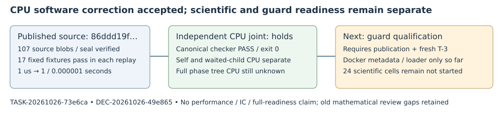

# CPU receipt software review: accepted within scope

2026-10-26 · TASK-20261026-73e6ca · DEC-20261026-49e865 · GOAL-PFDR-fd09e0

**Accept the bounded CPU receipt software correction; retain the overall decision `revise`.** At published owner source `86ddd19f67e08160c22a0d8ba9a32a92321d18ad`, the independent owned-joint review holds and the recomputed mechanical independence check passes. This acceptance covers correct units, honest CPU-counter coverage and software failure retention. It establishes no mathematical result, performance gain, complete process-tree accounting, guard qualification or experiment readiness. The decision awaits root's isolated archive/publication before downstream admission.

## Observation

The producer's four outputs match programme snapshot `b50185b81b7c145f04aae40eb0ef9770b427dc3d` byte-for-byte. The independent reviewer verified all 107 changed owner Git blobs, the exact path set, sizes and expectation seal without mismatches. Both the producer and fresh independent replay pass the same 17 sealed native software fixtures under warnings-as-errors builds. The published expectation SHA256 is `1fb61b6c45e4ef9bd0383519d255c0ea7084ca260038a0e0e5963622fcf5d4fe`; the owner expectation is `18f166bff8b94e53d52d3ec8209e135512fa90c65193a15315f4901ae4728df2`.

Independent exact formatter observations:

| Input `(seconds,microseconds)` | Integer microseconds | Compatibility seconds |
| --- | ---: | ---: |
| (0,1) | 1 | 0.000001 |
| (0,10) | 10 | 0.000010 |
| (0,999999) | 999999 | 0.999999 |
| (1,0) | 1000000 | 1.000000 |
| (1,1) | 1000001 | 1.000001 |

These are deterministic software checks, not scientific timing samples. Negative/range/overflow inputs are rejected or explicitly unavailable. The former unpadded seconds encoding is corrected; old receipts remain unchanged.

## Comparison and scoped inference

The one assigned joint is `cpu-units-coverage-and-failure-retention`, owned by TASK-20261026-64f987. Its actual verdict is **holds**. Version `native-smallroot-cpu-v2` separately records `RUSAGE_SELF` worker usage and `RUSAGE_CHILDREN` waited-child usage. Individual `wait4` receipts remain diagnostics and are not added again. Usage is credited on reap, not exclusively time-sliced to the phase; further descendants are covered only when usage is propagated through intervening waits. Full phase/process-tree CPU remains explicitly unknown.

Both fake backend/helper paths retain wait/usage evidence before exit-17, SIGTERM, missing-exec-127 and malformed-output failures. Phase success and exception paths preserve scoped CPU and checkpoints. Additional independent pure-software probes preserve `ECHILD`/unavailable status, counter regression and a nonstandard exception checkpoint. No breaking artifact was found. The supervisor's actual guarded execution was inspected statically only.

The recomputed canonical checker exits **0**: “1 report(s), every joint owned and attested, blindness respected, controls declared.” The current round has one fresh independent review, no sibling review, no blind derivation assignment and no procedure deviation. This pass belongs only to the CPU round. The earlier mathematical source review under DEC-20261026-cf272f retains its two schema/phase-list checker issues and applicability limitations; it was neither rewritten nor passed by this review.

The initial strict build failure and five raw serializer whitespace advisories remain preserved. Successful correction/replay did not alter sealed expectations or normalize raw outputs. Current source/receipt correctness is an engineering result within this exact software scope, not measured attack-cost improvement.

## Limits, current host and next action

The retained whole-library Cargo attempt 7 at base `27fca774...` exits 101 on the unchanged upstream unclosed delimiter in `src/cryptanalysis/binary_semaev_chain_sat.rs:1648`; log SHA256 `c5c5cf1a7ee6b111b654532f5e94d28a09453219696205221acd2cdaf935be14`. No clean whole-suite claim follows at the reviewed source. The older 4862/0/121 result belongs to b02. Hosted Actions account/payment availability still prevents checks from starting; neither gate is bypassed.

Outer cgroupfs remains read-only. Supported Docker private delegation and Debian loader/startup smoke now supply a candidate local runtime; they do not qualify stopped-child placement, whole-tree cleanup, actual 1800-second watchdog, serial admission or exact 8 GiB OOM enforcement. `/proc` or a parent 16 GiB limit alone does not establish required headroom. These conditions are the subject of the separately prospective five-class guard packet, not results of this CPU task.

**Single next action — Executor:** after this CPU decision/archive is published and a fresh actual owner T-3 reservation and goal claim are admitted, perform the bounded nonresearch guard qualification under TASK-20261026-6374dd / DEC-20261026-2a1490. Keep the real frozen supervisor unchanged, all failures/unknowns, and the OOM headroom gate. No scientific execution follows automatically.

All 24 scientific cells remain not started; reduction, extraction, applicability and authoritative scientific admission obligations remain unresolved. Future scientific routing also retains its exact lane-pointer and open-lane-count checks. The original goal—joint-system reach-cost tradeoff, then verified improvement over the named current prime-field IC baseline with complete costs, verified answers, matched rho and independent replay—remains unresolved. Knowledge promotion is none; no new scientific finding or canonical scientific graph change.

## Evidence and provenance

[P] TASK-20261026-dc4016 four outputs at the programme snapshot above. [R] TASK-20261026-64f987 report.md, review-attestation.yaml and checks.json; source/counter semantics checked against Linux `getrusage`/`wait4` primary documentation by the independent reviewer. [C] This directory's independence-check.json retains actual checker output and exact input hashes. [D] Earlier DEC-20261026-cf272f remains unchanged. The diagram summarizes software evidence and its boundary; there is no scientific dataset or performance comparison to plot.

Composition provenance: actual parent-managed native Coordinator continuation, `coordinator-orchestration-code`, explicit `openai-gpt61`, gpt-6.1-sol/high; published claim actor `coordinator-native-cpu-45aec1`, epoch 1. No API catalogue probe, fallback, degradation, serving attestation, new worker or scientific call was performed by this composition. Root owns the final ledger receipt and publication.

