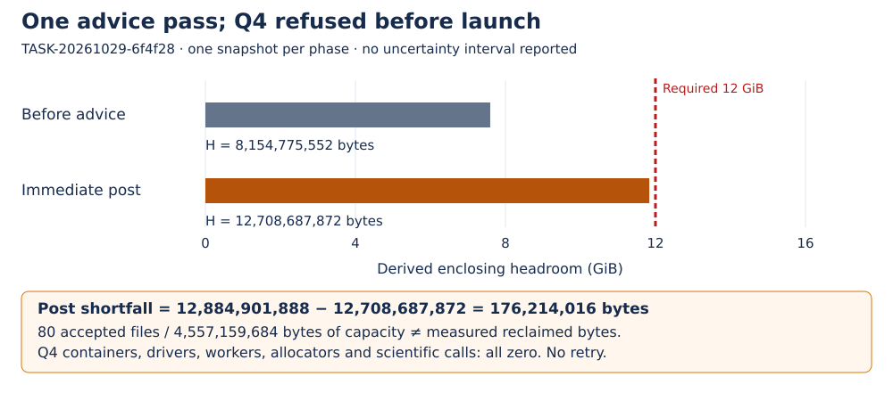

# Fresh Q4 qualification remains partial and unqualified

DEC-20261029-7ce9bf · TASK-20261029-947247 · GOAL-PFDR-fd09e0 · BATCH-ee839d · 2026-10-29

**Decision: revise.** This composition records bounded source/advice/refusal observations. Actual Q4 OOM qualification is absent, and the canonical independence checker fails on the frozen Coordinator plan. The review round is not mechanically complete; no qualification, all-five transfer, scientific state or goal completion is accepted. Evidence tier: source-bound software observations only, unqualified for the missing OOM claim.

## Observation

The sole fresh native `--seal` in TASK-20261029-30f612 accepted 80 owned files, zero exclusions, 4,557,159,684 bytes. Owner prep66ea and programme snapshot86f4 were published before the advice phase. Source mapping correctione946 adds two Task6f/source files; original prep/protected production bytes remain immutable. The corrected Q4 launcher was syntax-checked and **never executed**.

Under separate published advice-only authority327869, TASK-20261029-6f4f28 performed one native `--advise`: exit0, 80 accepted, zero exclusions/failures, all80 rc=0/stable_after=1. Accepted file capacity is not a measurement of reclaimed memory. No second advice, seal, case or opportunistic retry is authorized.

| Quantity | Before advice | Immediate post advice | Classification |
| --- | ---: | ---: | --- |
| Host MemAvailable, bytes | 17,962,373,120 | 17,974,874,112 | raw kB × 1024 |
| Visible init memory.max | max | max | observed raw bound |
| Visible init memory.current, bytes | 9,020,907,520 | 4,466,995,200 | observed |
| Visible parent memory.max, bytes | 17,179,869,184 | 17,179,869,184 | observed |
| Visible parent memory.current, bytes | 9,025,093,632 | 4,471,181,312 | observed |
| H, bytes | 8,154,775,552 | 12,708,687,872 | derived minimum |
| Shortfall from required 12,884,901,888 bytes | 4,730,126,336 | 176,214,016 | derived subtraction |

H=min(host MemAvailable, every finite observed enclosing memory.max−memory.current). No prospective worker exists. The post value is min(17,974,874,112,17,179,869,184−4,471,181,312)=12,708,687,872 bytes. Each phase has one sequential raw snapshot, with no uncertainty/error bars reported. The pre interval is16:48:16.998783–16:48:16.999444Z; post16:48:19.806546–16:48:19.807241Z. The retained controller records the post sample first after helper return, before advised-file/library/Git rereading. The native-return marker follows at16:48:19.807465Z. No exact causal reclamation quantity is inferred from their difference.

Graph data/source: editable diagram.svg metadata and the table above; owner raw0bcdc1a8, advice-control/pre-resources.json and post-resources.json. Values in GiB are derived with1GiB=2^30 bytes; no Q4 run occurred.

Observed namespace0::/ and inherited mountroot/.. are bound to observerPID28738/starttime890876: present in visible init before/after, absent visible parentroot. Bounded init→visible-parent capture is supported; hidden ancestors remain unobserved. No remount or lexical '..' traversal occurred. Outer swap.max=max/max and hostSwapTotal0 do not establish an absent worker's effective swap0. Outer oom_kill delta0 and historical outer peaks are not new worker enforcement measurements.

## Comparison

Required postH was12,884,901,888 bytes; actual postH missed by176,214,016. The published refusala204291 correctly retains `infrastructure_not_started`/`refused_Q4`. Q4 containers, driver calls, workers, allocators and scientific calls are each0. Worker cap/swap/allocation/PID/starttime/OOMdelta/victim/peak, driver survival and post-OOM cleanup are unavailable. The16GiB visible outer bound is not a measured Q4 parent-container limit.

Fresh independent reviewer TASK-20261029-e276d7 verified96prep paths and26case-inventory paths (25members+self;24changed because source2files prepublished), protected source and old rows, recomputed H, and returned **breaks for missing required coverage**. Its narrower source/advice/refusal subfinding is coherent within stated limits. This is no observation that the cap failed under stress and no mathematical negative. The original C1 source, binary/image lineage and historical accepted fixtures do not give a fresh-host all-five runtime transfer. Original Q3 remains failed; repaired-Q3 and Q1/Q2/Q5 retain their earlier scope. CPU DEC49e86517/17 remains a separate observation; full process-tree/phase CPU remains unknown.

The canonical check was rerun against the unchanged review-plan.json and frozen review-attestation.yaml. It returned **exit1**: `blindness.lifted_for must be a list of valid TASK owners`. The Coordinator plan supplies DEC3380c9/DEC49e865 instead of TASK owners. The current attestation's joints_owned is correct and declares no sibling access. We preserve original plan, checker, reviewer outputs and actual failed check in independence-check.json. No retrospective plan edit, checker weakening, additive waiver, accepted round or qualification promotion follows.

## Inference

DEC7ce9bf is revise/partial/unqualified. Bounded file-custody, source-correction and one-advice/refusal observations may be reported with provenance; they do not discharge the required Q4 enforcement joint or mechanical review-completion gate. No new KN scientific finding is warranted. No hypothesis status, canonical checkpoint, other lane, or active goal is changed. All24original scientific cells remain0run. Joint reach–cost, applicable optimized joint construction/theorems, full native/reference parity, finite specialization, root extraction, random-target yield/rank and verified complete prime-field IC improvement remain unresolved.

## Limitations and departures

- One old pack-fa66 mtime_ns1793053277390270427 differs from the explicitly published fresh1793056768668436294, cause unknown. Other historical fields/content agree;79/80 entries have full historical metadata equality. All80fresh plan/seal/advice hashes and metadata are stable. The old broad old_metadata_matches label is not proof of all-field equality. Old records remain unchanged.
- Reviewer initially wrote the four files at a wrong output cwd, then moved those exact bytes into the approved path; the frozen attestation retains the departure. This does not repair the failed plan/schema gate.
- Native helper argv/cwd/selectors/stdout/stderr/exit are retained, but no distinct outer Python interpreter launch-argv receipt appears in the26-file case inventory. Safe published lease observations are not a replay of the private DB or continuous private heartbeat history. Remote publication provenance is root's actual control verification; reviewer inspected available Git objects without a new remote query.
- Original C1 static map operator[] can default missing event keys and membership uses substring readback. No new runtime test ran; future acceptance needs actual raw keys and exact victimPID/starttime, not source assertions.
- Owner journal deferral was resolved by normal merge8217 with parent blocks preserved, then actual raw log append. Own raw24-path diffcheck0/artifact policyPASS are scoped checks. Merged cached full check exit128 after three inherited patch-trailing warnings and promisorHTTP503 is retained as non-PASS.
- Frozen reviewer facts remain at their earlier pending snapshot. New root input at17:53:08Z records current8217 Rust/Cargo/test tree equal raw0bcdc and terminal whole-library **5261passed/0failed/123ignored/0filtered,5384registered,exit0,1427.58s**. This is an ancillary current-source library PASS, not Q4 qualification. Attempt1 stopped before compilation for a missing tracked pencil package; exact tracked restoration made no source/test/workload/criteria change. Current fullraw467436B SHA256625799c468d07e4534f9795cb4e9057d15f282dd0fb2128cb4c918495d5efc01 remains localonly/canonical_upload_complete=false. No AWS CLI/runtime bindings/default config files were observed, no canonical upload was attempted, and no access-denial claim is made. Exact root terminal metadata is embedded in independence-check.json. Historical12c5198passed/8failed/123ignored plus8individual same-binary passes remains a failed full run with replay evidence;464884B full-log canonical custody incomplete. Older4888/6/121 and431104Bfull-log gap remain historical. Unit validation is not a guard/scientific metric.
- Model provenance is explicit managed gpt-6.1-sol/high Coordinator/Executor and fresh independent gpt-6.1-sol/xhigh Reviewer, operator-supplied policy overlay, API-model probe unverified; no fallback or invented doctor proof. Earlier mathematical independence/phase-list issues and quorum limitations remain unchanged.

## Canonical graphs checked

No mathematical mechanism, relation, reach bound or IC cost changed, so the source-attributed per-block lead/atlas and known-results graph inputs stay unchanged. The lead's closed_obstructed disposition covers its single-S3 proof scope only; joint three-equation/six-unknown lattices remain revisit cases. This resource refusal supplies no frontier point, IC speedup or universal memory impossibility. Historical diagrams retain their exact earlier evidence dates rather than being overwritten. Checked source/view hashes:

- `knowledge/leads/ecdlp/ic-prime/LEAD-ICP-coppersmith-smallroot-semaev.yaml` — SHA256`30a351169b86632385631829d2828c1157775df02f9ca18a53ca514f4da1c2d0`; unchanged.
- `knowledge/frontiers/ecdlp/index-calculus/KR-IC-401ebf.yaml` — SHA256`a7548cc054fdfe8743faaf295dc103dabf78d04196e77164efa6339bfce26360`; unchanged.
- `knowledge/frontiers/ecdlp/index-calculus/KR-IC-5931ee.yaml` — SHA256`bba718f3ea4ee173a8b79362f04ad994bd4366b3830bf8c27db028c1ba389948`; unchanged.
- `coordination/goals/GOAL-PFDR-fd09e0/batches/BATCH-ee839d/continuations/DEC-20261026-2a1490/tasks/TASK-20261026-94c1e6/diagram.svg` — SHA256`1e4f4273eca80bf08bc606c65e2fb1f823d73a8b31a06c30cc749d2f81a06c88`; unchanged.
- `coordination/goals/GOAL-PFDR-fd09e0/batches/BATCH-ee839d/tasks/TASK-20261026-589ad5/diagram.svg` — SHA256`b040f0910b4fada8f0ee16734b67b94ce7dcd16123f98fa0c3b4805a2566e96e`; unchanged.

## Next actions and stopping rule

1. Root archives these exact reviewer4+composition/decision/problem/index/receipt artifacts, verifies actual commit/path/hash/IDs/push/PR, and binds the existing947archive. This is a concrete partial technical record; the failed independence gate remains visible and unwaived.
2. The current ancillary unit job is terminal with its scoped PASS and canonical raw gap above. Only after this negative archive, rank metadata-only observation of first-use current build artifacts (new test binary/objects), as potentially distinct owned immutable candidates from exhausted80. Check exact ownership/path/inode/mtime/size/capacity and current observed H; no content reread, advice, seal, case or new card is authorized here. Candidate capacity is never reclaim proof. A newly justified route needs fresh complete prospective authority and a schema-valid review plan before review, not a retry of this terminal card. A larger host is one candidate route, not asserted the only route.
3. Any future actual Q4 requires fresh owned namespace/live lease, published source/runtime/claim/admission, unchanged12GiB H, exact8GiB/16GiB/effective swap0, original1800s/1950s timers, serial bounded execution and complete enforcement evidence. If no fresh lawful route is justified, record the actual operational block; scientific readiness remains unknown. Original24cells must still pass their separate applicability/readiness/approval/extraction/full-cost obligations.

## Evidence and provenance

All repository records below are **internal, actually read** by this Coordinator. Primary namespace documentation is **retrieved**, man7 cgroup_namespaces(7), https://man7.org/linux/man-pages/man7/cgroup_namespaces.7.html (2026-10-29), read by root and independent reviewer; source-review.json records supplied-copy SHA d843d0410f732bcbd89d0f3c3acbf1646f7aaf7db930e1d223da9b5369976a91. No remount instruction was executed. No new mathematical literature claim is made.

- Source/prep: owner66ea1a6936fa5dd766e51559db527b8a3807f1d9; programme86f4e6b86ceb305ccc443c3939403bd9f6345d9e; verificationadb30907d959ceb25fc5f2a4f2947aaf7b77aadf.
- Correction: ownere9467d351eda0b7e92652642176cc12594838ce0; launcherSHAe258c8bbb163da2273a69de0c3b0ce2df641e7e60f57e3e27091a6d8c54ac9b0; sealSHA80e18f24792311fabd9b5399806bd00c03f3401b88dfcce633c7d76dbeebe5f2.
- Advice-only32786901e02b3a72241842e4e4612580f6c03c66; terminal refusala204291fb2530cc3e0ce8a6092d057e664d389f1.
- Actual owner raw0bcdc1a8f950715e6539780702706b8985071e5f;26inventory/24changed; owner-manifestSHA13a48120f98ccc27609956f6c0f53af0f8b00da746b873311b99aa0ffe974ec7.
- Exact results snapshotcc367e96706d69abe3535710dbe3bcb0f438b1f2, parent35cac88686fc4448606800b7522c453ec0fe9968; reviewer4reports/checks/attestation/source-review under ../TASK-20261029-e276d7/.
- Existing947claim1aac0fded4717c75fcf26b0e0197792b7c0132d3; published scope extensiona204291 and effective application703b6bfb12. No future archive commit or own recursive receipt digest is asserted.

Rendering and every-page visual inspection are recorded in independence-check.json after actual inspection. Coordinator helper/container/allocator/scientific executions:0. Report rendering and canonical metadata checker are software communication/control actions only.
