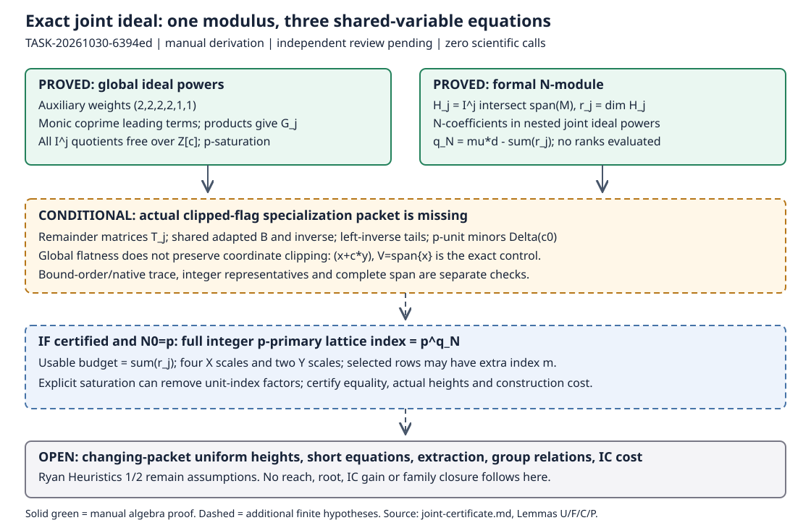

# Joint ideal layers and specialization: a conditional finite certificate

2026-10-30 · TASK-20261030-6394ed · GOAL-PFDR-fd09e0 · BATCH-ee839d

**Manual derivation, pending independent review.** The exact Semaev three-equation ideal has a universal monic ideal-power control in an auxiliary order. For a fixed finite monomial domain, its supported formal-modulus module is governed by the nested *joint* intersections H_j=(F1,F2,F3)^j∩span(M). A finite clipped-flag certificate gives a precise good-specialization condition and, in the known-prime case, an exact complete integer-lattice index. The actual domain intersections and native returned span remain uncertified; no numerical reach, root, or IC advantage is claimed.

## What was derived

Let c=(a,b,q,c1,c2,c3,c4,d1,d2), x=(z1,z2,z3,z4,h1,h2), A0=Z[c], I=(F1,F2,F3), and Jμ=(N,I)^μ, with F_i exactly as in the protocol and independent of formal N. For a fixed finite monomial set M of size d:

1. **Universal global ideal control, proved manually.** With auxiliary x-weights (2,2,2,2,1,1), the unique monic leading monomials of F1,F2,F3 are z1²z2², z3²z4², h1²h2². They are pairwise coprime. Applying the monic product criterion to F_i−t_i over Z[c,t][x] proves a free Z[c,t]-module description of Z[c,x], with t_i acting by F_i. Consequently every I^j has the explicit auxiliary monic Gröbner basis {F^β:|β|=j}, and every quotient Z[c,x]/I^j is free over Z[c]. These facts survive arbitrary coefficient specialization. This proves global p-saturation of the ideal powers without assuming a regular sequence. It does not determine clipped ranks or reproduce the bound-induced native term order.
2. **Exact formal joint module, proved manually.** If g=Σ_a N^a g_a, then g∈Jμ iff g_a∈I^{max(μ−a,0)}. Thus the supported module is Σ_{a<μ} N^a H_{μ−a}+N^μ V[N]. Over Q(c), write r_j=dim H_j and use a basis adapted to this nested flag. The formal N-exponents λ_i satisfy q_N=Σ_i λ_i=μd−Σ_{j=1}^μ r_j. No per-block dimension is added.
3. **Finite clipped specialization certificate, conditional implication proved.** A remainder matrix T_j from the monic auxiliary basis, a common adapted invertible matrix B, and left inverses for the nonzero tails T_j B=[0,C_j] certify exact kernels and their base change. The coefficient denominators of these finite identities define a nonzero Δ(c). For p∤Δ(c0), the clipped ranks, inclusions and complements survive over Z_(p) and F_p. Finite existence is proved for each fixed μ,M, but no T_j, r_j, B, Δ or specialized good-prime record has been produced for the actual cells.
4. **Exact p-layer bridge, conditional on the clipped certificate and N0=p.** Global p-saturation gives ((p,I)^t:p)=(p,I)^{t−1}. The clipped base-change certificate then gives L_t=H_t+pL_{t−1}. The full integer supported lattice L_Z=(p,I_Z)^μ∩Z^M has index p^{q_N}; its usable determinant-level budget is Σ_j r_j. Its weighted covolume is p^{q_N}∏_{e∈M}X^{e1+…+e4}Y^{e5+e6}. For selected integer rows, a further index [L_Z:L'] multiplies this determinant. Generic rank or p-local span does not remove the full integer index or its height cost.

The worked μ=2 derivation lists all ten generators, proves the explicit mixed row z1 F1F3−h2 N F2 has multiplicity two, and gives q_N=2d−r1−r2 without evaluating ranks. The single-relation slice recovers the archived K=t*d−q accounting and the principal layer sum. It does not transfer the one-polynomial Newton-polytope ceilings to this joint ideal.

Even without a clipped-flag certificate, the universal global saturation proves a finite joint inequality: the actual p-layer A_a is contained in bar I^(μ−a)∩F_p^M, and K_actual=Σ_a dim A_a≤Σ_j dim(bar I^j∩F_p^M). This is an exact finite formulation with uncomputed dimensions, not a numerical bound. The clipped certificate supplies the extra lifting needed to identify these dimensions with the generic r_j.

## Discriminating controls and heights

The manual nonunit control (N,cx) over Q(c)[N,x], followed by c=p,N=p,x=1, disproves generic-normalized-membership ⇒ specialized integer divisibility. Its cleared row cx is valid and has coefficient size p. The denominator-free matrix [[1,1],[1,1+c]] loses rank modulo p at c=p. The monic ideal (x+c y) with V=span{x} has generic clipped intersection zero and specialized intersection span{x} at c=0; at c=p it also fails clipped base change modulo p. This shows why universal global ideal flatness leaves a real clipped-minor obligation. Repeated relations leave I unchanged and cannot contribute three independent gains.

An explicit height bound for the exact affine input is ||F_i(c0,x)||1≤28(H+1)^4, with H bounding the nine integer parameter magnitudes and 1. For a cleared retained row P_i=d_i g_i, the certificate records an integral ideal witness and bounds ||P_i(c0,N0,x)||1 by ||P_i||1 H^{deg_c P_i} max(1,|N0|)^{deg_N P_i}. Clearing denominators can enlarge the selected integer determinant even when they are p-units. Modular-inverse representatives can instead be centered modulo |N0|^μ, with coefficient sizes at most |N0|^μ/2, while retaining exact membership; their actual leading terms, integer spans and determinant must be checked again. Products of k fixed base rows have L1 norm bounded by the product of the base norms and multiplicity μk. Coefficient reduction for such products must respect modulus N0^{μk}.

For a fixed finite packet and H≤p^C, these are polynomial bit-length bounds in k and log p. When μ, M or the base packet changes, the degrees, coefficient norms, minor/denominator sizes, good-locus coverage and transformation costs need uniform bounds. The result has quantifiers ∀fixed μ,M ∃finite Δ,certificate ∀good specializations. It is not ∃one Δ ∀μ or a random-growing-parameter success claim.

## Source reading and method

I actually read the relevant text of the pinned 52-page Ryan primary PDF: §2.5/Heuristic 1 p6; ideal construction §3 pp7–8; integer-lattice optimality §4.3 pp11–12; §§6.1–6.2 pp19–20; §6.4/Heuristic 2 pp21–22; Lemma 7 p23; Algorithm 3 p24; Appendix C pp48–51. Its SHA256 is 15dd6ae6b939c51f3bc124097f954bd858ef47e4739037381fb4951f0366043f. The matching extracted text was hash checked. The full PDF/text remain external read-only inputs and are not copied into Git.

Ryan §6.1 explicitly requires denominator inverses to exist modulo N^{k_pre}. Section 4's integer span guarantee is distinct from coefficient-field specialization. Heuristics 1 and 2 remain heuristics; Lemma 7 additionally assumes the stated suitable/shared-root construction, proportional specialization, strict bound and sufficiently growing log p. Its polynomial-time statement excludes final root recovery. The fixed-precomputation height reasoning in Appendix C does not justify a silently changing precomputation packet.

I read pinned cuso `symbolic/{problem,convert,ideal,optimal,asymptotic,shift_set_properties,limit,utils}.py`, without importing it. Its current HEAD matches fb2747d2105a8e48499bf10a3a717cf80c14d079. The reported denominator list in `asymptotic.py` covers returned S1 coefficients; it is not the full witness/minor/integer-span certificate designed here. The native `model.hpp` object was read and its bytes matched the published 4f27d0cd0a50b94d4f990a593321cf2951015ce9 blob. No unpublished owner integration was adopted.

Historical assigned reports, the principal S3 source §§1–2, and S4/S5 §§7b–7c were checked. Their principal conclusions remain source-attributed, with their original formalization/measurement qualifications; no new validation of their scientific data occurred. No knowledge MCP is exposed. Exact `rg` retrieval covered the assigned batch, historical joint audit, lead/problem records and generated ledger indexes for joint layers, specialization/height and nonunit controls. This bounded text search is not an exhaustive novelty survey. The auxiliary-order route and clipped (x+c y) control were suggested in parent correspondence after the initial flag derivation and checked manually here; this producer is not an independent reviewer.

## Exact remaining obligations

* **JOINT-FINITE-PACKET-6394ed:** for each actual fixed μ,M, use the proved global product bases to supply T_j, B/B^{-1}, tail left inverses, ranks, Δ and complete native row witnesses; certify the actual bound-order trace and supported span. At a concrete prime, check p-unit conditions, actual representatives, integer span/index and charged heights. These finite identities are the next proof target. A pass would qualify the algebraic interface only.
* **JOINT-UNIFORM-HEIGHT-6394ed:** either restrict to a fixed finite base packet or supply explicit uniform size/height/good-specialization bounds as μ,k,M and coefficients grow. No exceptional-fiber frequency or uniformly growing-packet efficiency is proved.
* Actual HHG-short independent integer equations, tractable extraction, compatible signs/F_p lifts/subgroup relations, random-target yield and relation rank, full costs, and matched current IC/rho evidence remain required for the original objective.

These names refine the existing [problem record](../../../../../../../../../problems/joint-smallroot-reach-baseline-and-oracle-unverified.md); it was not edited under this task's nine-path scope. The accompanying [full derivation](joint-certificate.md), [certificate schema](certificate-schema.yaml), [theorem matrix](theorem-matrix.yaml), [proof search map](proof-search-map.yaml) and [source manifest](source-manifest.json) give checkable details. A future native proof-of-certificate checker is design only and has not been implemented or run.

## Preserved scope and record

Scientific calls, algorithm calls, lattice/ideal/rank/domain computations, crypto computations, trials, workers and provisioned hosts: **0**. Tools read source/text and Git metadata, hash files and render documents only. No Git, claim, queue, source, owner-log, frozen record, checkpoint, global problem or other-agent artifact was mutated. All 24 old scientific cells remain unrun, Q4 remains terminal no-retry, and the prior independence exit1 remains unwaived. No independent-review verdict or official state change is asserted.

Canonical graph sources checked: the smallroot lead and its cited principal-source scope, and the historical joint-audit diagram/relations. Their quantitative claims and official coverage do not change; this new diagram shows conditional proof dependencies only. No scientific data exist here to graph. Novelty is adaptation/unknown beyond the checked sources; `dominated_by: n/a (no attack result claimed)`; `sota_delta: finite conditional proof-interface contribution only`; family closures: none.

Actual session: native managed producer `/root/joint_certificate_6394ed`, selected gpt-6.1-sol/high, research-deep, no fallback/degradation or API catalog probe. Parent supplies published normal claim e0cece3d03e07ccc874224121c3442e711af68e3 and initial packet 250596d5d556334080ea9f332ca105bb8c81e3fe. Root owns reporting release, snapshot TASK-20261030-a09435, publication and subsequent fresh independent review.
