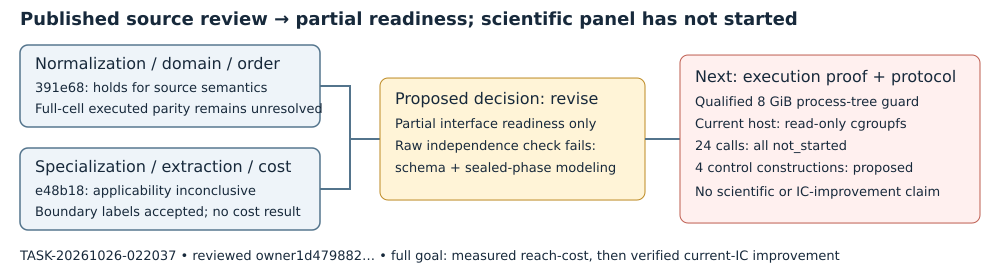

# Native joint-smallroot review composition

2026-10-26 · TASK-20261026-022037 · GOAL-PFDR-fd09e0 · BATCH-ee839d

**Proposed DEC-20261026-cf272f: revise; partial interface readiness only.** The two independent reviewers support a bounded static source construction and honest interpretation boundaries. They do not establish executed native/reference equivalence, theorem applicability, extraction, a measured reach-cost tradeoff, or verified IC improvement. The actual independence checker exits1 with two recorded issues; no clean review gate or experiment approval is asserted. This is a proposal for archival task TASK-20261026-9fec07, not an official DEC or scientific state transition.

## Observation

The producer's ten outputs are archived at programme snapshot `0baa7b0901230b23dce945adc55695abd3e48249`. Both reviewers inspected published crypto source `1d47988261c4d13f7a8549d70f53571163246c77` (PR 2642), through content-bound source records; one checked the seven relevant source blobs and the other all 77 manifest paths. Publication and bounded software fixtures establish source custody and software checks only. No scientific call occurred: all 24 symbolic slots remain `not_started`, scientific metrics are null, and reduction/extraction are `not_requested`. The four proposed D-sign ideal/domain/closure constructions remain a separate, unapproved control amendment.

The subsequent integrated owner library log records **4862 passed, 0 failed, 121 ignored in 1217.09 s** (`/workspace/smallroot-session/native-owner-cargo-test-attempt6-main-integrated.log`, inspected final result). This is software validation on the integrated tree, not a run of the scientific cells or equivalence of all revisions to the reviewed snapshot. Earlier 4844/18 missing-fixture failures and 18 passing same-binary rechecks remain historical records; the new full pass does not rewrite them. Current owner merge/publication reconciliation is the parent's work; the immutable reviewed source remains the evidence anchor.

## Comparison: compose the assigned joints

| Owned joint | Actual review conclusion | Composition boundary |
| --- | --- | --- |
| TASK-20261026-391e68, normalization/domain/order | Holds for published-source semantics: exact affine equations, six/seven coordinates, weighted order, convex integral domain, one multiplicity normalization and constant-pivot intersection match the sealed derivation. | `UNRESOLVED-NDO-1`: no full fixed-cell domain/intersection execution certificate. Static agreement is not executed parity. |
| TASK-20261026-e48b18, specialization/extraction/cost | Inconclusive for theorem applicability/readiness; scoped acceptance of symbolic/group/cost boundary labels. | Finite specialization, denominator/leading-coefficient/pivot and ideal/span preservation, suitable independent equations, extraction and full cost remain unresolved. |

The second review supplies concrete boundary controls: for a=2,b=3, the discriminant factor is275=5^2*11, so primes5 and11 cannot supply the intended nonsingular group; x-only vanishing does not fix a signed group relation; `S(1,3,41)=4545=45*101`, whereas support-preserving `F1+1` is 1 modulo 101. These are hand/source checks, not newly executed control results. They prevent promotion of a support signature or symbolic bound to a verified decomposition oracle.

Both reviewers retrieved and read the full 52-page Ryan primary paper, archived capture 20250716082047, SHA256 `15dd6ae6b939c51f3bc124097f954bd858ef47e4739037381fb4951f0366043f`. This resolves the earlier access/read gap only. Lemma 7 still assumes Heuristics 1 and 2, suitability/shared-root obligations, proportional specialization, sufficiently large p, a strict bound and the stated log-p growth condition; its polynomial-time statement excludes final root recovery. I checked the PDF hash and relevant primary text for Heuristics 1/2 and Lemma 7. No applicability theorem is certified here.

## Inference and procedural limits

The frozen review prior expected representability with unresolved algebraic and extraction obligations. The returned joints narrow those obligations; their conclusions are not votes on the whole claim. The decisive remaining gap is actual source execution proof and guarded runnable admission, not another permission to research.

The actual `check_review_independence.py` result is preserved in `independence-check.json` (exit 1; two problems). Specialization uses `joint_owned` instead of the checker's required `joints_owned` list. Normalization's combined read list includes producer artifacts accessed after its sealed blind derivation; the flat checker treats them as forbidden reads. Both reports attest mutual blindness. The recomputed derivation/seal hashes match, and the reviewer records notification before implementation access. Separately, it disclosed a pre-seal filename-only glob that exposed path names, with no prohibited technical content declared read. All three procedure issues remain explicit. No reviewer artifact, frozen plan or attestation was rewritten; no perfect mechanical independence pass, theorem approval or experiment approval is claimed.

Current source also has partial failure-semantic equivalence and incomplete authoritative upstream-receipt interpretation. Whole-call cgroup CPU/memory retention is planned; per-phase worker CPU excludes children and cannot be presented as complete phase CPU. No measured attack cost exists.

## Decision boundary and single next action

**Executor-implementation: complete an actual source execution-proof and guard-qualified protocol before the 24-call panel.** That bounded follow-up must bind the reviewed source/intermediates, address failure and upstream-receipt semantics, and preserve the proposed control amendment separately until adopted. The current host's read-only cgroup filesystem cannot enforce the required 8589934592-byte process-tree guard; guard qualification and runnable approval therefore remain unavailable here. Compatible host information is pending separately; standing research authorization is already satisfied. No unguarded substitution or scientific trial is authorized by this review. Exact-byte approvable:true preapproval, Director/runbook/card gates and published approval/readiness remain later requirements.

The original full objective remains unresolved: establish the joint-system reach-cost tradeoff and demonstrate a verified measured improvement over the named frozen current prime-field IC baseline, with same-instance correctness, full charged costs, matched rho gap, independent replay and progress-fidelity evidence. No baseline or verified DLP has been produced. Knowledge promotion is none: no new scientific finding. The study's `reach-cost.svg`, `review-20261024/accounting.svg` and `readiness-20261025/weighted-reach.svg` remain unchanged because no scientific quantity or edge changed. The accompanying diagram represents review coverage and remaining gates; there are no measured scientific values to plot.

## Sources and provenance

[R1] TASK-20261026-391e68: report.md, source-review.json, blind-derivation.md, blind-seal.json and review-attestation.yaml. [R2] TASK-20261026-e48b18: report.md, source-review.json and review-attestation.yaml. Both directories are siblings of this report; exact input SHA256s are in independence-check.json. [P] TASK-20261026-589ad5 archived outputs and pinned owner source above. [L] Ryan, *Solving Multivariate Coppersmith Problems with Known Moduli*, ePrint 2024/1577, [primary PDF capture](https://web.archive.org/web/20250716082047id_/https://eprint.iacr.org/2024/1577.pdf), verified_by R1/R2; retrieved primary text inspected for the stated limits. Internal reviews and source custody are distinct from scientific execution. No EV/RUN or official DEC is created here.

Actual composition provenance: native managed Coordinator continuation; `coordinator-orchestration-code`, explicit `openai-gpt61`, gpt-6.1-sol/high; published task claim actor coordinator-native-smallroot/session native-smallroot-composition-20261026, epoch 1. No new API model-catalog probe, fallback, degradation or serving-metadata attestation is asserted.

