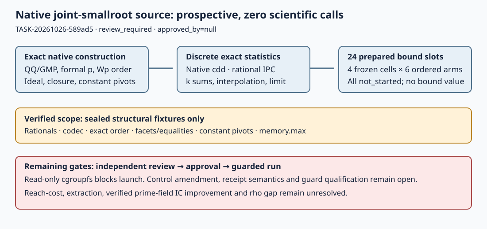

# Native weighted joint-smallroot source — prospective implementation

2026-10-26 · TASK-20261026-589ad5 · BATCH-ee839d · review_required · approved_by=null

The native C++17 source and finite24-call plan are prepared. A warnings-as-errors
build and eight sealed structural fixture groups, an exact memory.max codec
fixture and two missing/unapproved admission-codec rejection checks pass.
**No scientific call, bound, control, ideal/closure construction, interpolation,
calibration, lattice reduction or root extraction was executed.** This is partial
interface readiness, not cuso equivalence, theorem applicability or IC improvement.

The original request remains open: establish the joint-system reach-cost tradeoff,
then demonstrate a verified measured improvement over a named frozen current
prime-field IC baseline. The baseline, verified DLP recovery, full charged cost,
matched rho gap and independent replay have not been established by this task.

## Scope and source

Owner repository: `isogeny-labs/crypto`, branch
`research/joint-smallroot-native-20261026`, base
`e8fcadf62cd0b674c40ebc4e76dfe88e26e71f5c`. Writes are restricted to
`experiments/joint-smallroot-native/` and an additive today's session-log entry.
Actual workspace-local Conductor T-1/id`0c8ff4c7-acc1-4e59-9322-f90a9e0eafc9`
reserved both scopes at epoch1; the parent maintains its lease. No cross-host
exclusivity is asserted. Parent verified the exact77 source blobs at owner commit
`1d47988261c4d13f7a8549d70f53571163246c77`, published in
[crypto PR2642](https://github.com/isogeny-labs/crypto/pull/2642). No merge is claimed.
The parent binding records this update after the producer release.

The source implements exact sparse QQ/GMP polynomials, modulus-first weighted
order, signed Sage polynomial comparison, first stripped leading coefficients,
Singular ideal powers/reduced ordered basis/normal forms, exact rational facets
and integer enumeration, reference FIFO closure, constant-pivot intersection,
discrete augmented valuations and k-sums, rational interpolation and limit.
Native workers retain exact intermediates and failures. All scientific routines
are compiled but unexecuted. Full source mapping and minimal repair checks are
in [compatibility-map.json](compatibility-map.json).

Sage10.9 explicitly identifies wdeglex as Singular `Wp`. Source therefore uses
`Wp(weights)` rather than assuming the contract's candidate composite order.
Actual Singular exponent/codec fixtures pass; this bounded check is not a
whole-algorithm equivalence attestation. The source preserves six active
coordinates and a leading formal-p coordinate, projected single-block maps,
exact convex-integer domains and the nearby-v1 SHA256 coefficient rule.
A/A input serialization excludes case-id/replica labels and uses identical
algebra/options in a separate future cold process.

## Dependencies and checks

Compiler: g++14.2.0, `-std=c++17 -O2 -g -Wall -Wextra -Wpedantic -Werror`.
Selected runtime: Singular4.4.1, GMP6.3.0, cddlib1!0.94n and OpenSSL3.6.5 for SHA256.
Exact package, library, compiler and binary hashes are in the owner
`spec/dependency-lock.json`; no binaries are committed.

Installed cddlib metadata declares GPL-2.0-only. Its independently written generic
GPL2 vertex-to-halfspace helper runs as a separate native executable using exact
rational text IPC; the LGPL3 cuso-derived core does not link cddlib. cuso/GMP/GPL
and OpenSSL license texts are preserved. This technical boundary and recorded
metadata do not constitute a license compatibility certification.

Reproduction commands and literal raw logs live in the owner README and
`spec/checks/`. The final command is `make -C experiments/joint-smallroot-native
-j2 all`, followed only by the structural binary with the Singular and cdd-helper
paths and a fresh output directory. The expected original fixture hash was sealed
before first invocation:
`6325487a3caa90db9aeae4d7ecd630aee021e55e4c39686af7ebe7992c0cb046`.
The additional exact memory parser expectation hash is
`b7ce2ae8405e8145c41bc7e1f07e2214936461122c683084bdd7532c3f3c8995`.
It accepts exact8GiB decimal readback and rejects larger values sharing its prefix.
Build failures are preserved, including a wrong-working-directory command and
clang-format reordering cdd headers before setoper; the final source fixes both.
The parent release-library run finished:4844 passed,18 missing-fixture failures,
121 ignored. Tracked inputs were restored unchanged; all18 exact same-binary
rechecks pass. The failed full run is retained and is not relabelled a clean
whole-suite pass. Root source/runtime-input logs remain outside Git.

## Requirement status and remaining gates

| Requirement | Status / evidence boundary |
| --- | --- |
| Native source/build/locks | Implemented, build verified; no Python research runtime or wrapper. |
| Codec/order/rational/facets/constant pivots | Fixed sealed structural fixtures pass. |
| Full ideal/closure/statistics/interpolation compatibility | Implemented but unverified; no scientific or differential algorithm call made. |
| Literal failure semantics | Partial: None valuations and zero-leading failure timing are explicitly classified rather than fully matching Sage exceptions. |
| Prospective24-call plan | Prepared source; every slot not_started, all scientific metrics null. Canonical algebra bytes/digests await authorized preparation. |
| Supervisor/admission | Real prospective entrypoints prepared, missing/unapproved envelopes reject. Upstream authoritative receipt interpretation and actual guard qualification remain partial. |
| Current execution host | infrastructure-not-started: cgroupfs is read-only; required writable delegated8GiB process-tree guard unavailable. |
| Cost retention | Exact objects, phases and whole-call cgroup CPU/memory prepared. Per-phase child CPU remains unavailable; worker CPU is labeled separately. |
| Publication/review/approval | Owner source published in PR2642; independent review, final preapproval, Director lint/card, exact runbook approval and isolated final archive remain pending. |
| Original reach-cost / verified IC gain | Unresolved, no scientific observations. |

Prepared D-sign source checks the exact F101 sign/tree/corruption fixture and
proposes four fixed(r,mu) control-only ideal/domain/closure constructions to check
all retained shifts' denominator-cleared101^mu divisibility. It performs no
bound interpolation. This is an explicit prospective control workload amendment,
separate from24 bound calls, requiring Coordinator adoption and a reviewed budget
before execution. No control ran. A failed control stops every bound slot.

The supervisor requires at least12GiB host MemAvailable, exact8GiB memory.max,
whole-tree cgroup ownership/kill, memory.peak/events and a monotonic1800-second
watchdog. No parent-RSS or unguarded fallback exists. A compatible host and
nonresearch guard qualification are still required. The local admission envelope
content-binds files but does not authenticate the declared external receipt
statuses; final integration must consume actual upstream approval/lint/review
semantics. Minimal repair tests are named in the owner Director request.

Full-tree V=4beta+2gamma and V/3 on single-block output are labeled reference
conversions, never a joint feasibility or four-leaf group oracle. See
[transfer-assessment.md](transfer-assessment.md) for map/injectivity, denominators,
specialization, group signs/lifts/subgroup, extraction and complete-cost duties.

## Literature and provenance

Read the frozen BATCH-3cfef2 design/applicability/preview/next-handoffs, readiness
manifest, selected lead, native contract and admission decision. Read pinned
[cuso source](https://github.com/keeganryan/cuso/tree/fb2747d2105a8e48499bf10a3a717cf80c14d079)
and Sage10.9 order/comparator/ideal/matrix implementation statically.
The exact [Ryan eprint2024/1577 PDF](https://eprint.iacr.org/2024/1577.pdf) returned403.
The parent identified Ryan's2025 university dissertation, chapter3, as an
[alternative primary source](https://escholarship.org/content/qt8bz3g5b6/qt8bz3g5b6.pdf);
this session's fulltext attempt returned429. The parent reports an earlier
intermittent237-page open, not a completed chapter read. No paper-version byte
equivalence or full Algorithm3/Lemma7/theorem applicability is attested.

Actual managed session `/root/native_smallroot_implementation_20261026` was
explicitly selected by the parent as `gpt-6.1-sol`, effort `high`, policy
`executor-implementation` under the task-local published overlay. Authority is
Executor. No API catalogue probe, SQLite session receipt, fallback or degradation
is claimed. This is native dispatch provenance.

No new scientific values affect the historical reach-cost/accounting diagrams,
scoreboard or leaderboard, so they remain unchanged. The diagram below describes
only prospective source and gates. No new mathematical theorem or Lean proof is
claimed. [validation.json](validation.json), [trialplan.json](trialplan.json),
[owner-source-manifest.json](owner-source-manifest.json) and
[prospective-packet.json](prospective-packet.json) retain exact scope and gaps.

