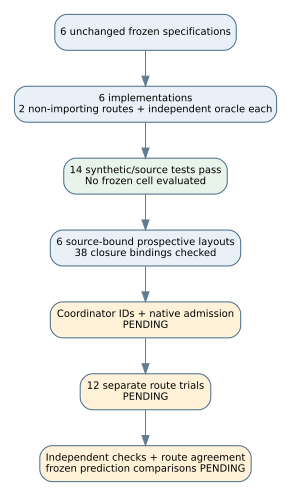

# Six finite worksheet implementations prepared

2026-10-18. Source-only work under `ledger/handoffs/TASK-20261018-993753.yaml`, authorized by `DEC-20261018-59a33a` and archived for implementation at commit `323663e23d292ebd42876332cd3dbc9448fdd3bc`.

All six assigned contracts now have two separate scientific route modules, a direct native driver interface, an independently written finite oracle/checker, and a source-bound prospective trial layout. No frozen worksheet was evaluated. The implementation is ready for Coordinator source review and native-plan construction; it is not a ready/admitted scientific trial or a completed part of the original twenty-item audit.

| Contract | Two measured routes | Independent checker |
|---|---|---|
| EXP-ECDLP-080496 | z-first and x-first projective charts | Nonzero homogeneous vectors, quotient by scaling |
| EXP-ECDLP-4a3f03 | Explicit beta walks and cubic-fibre partitions | Square-root table and equivalence closures |
| EXP-ECDLP-5a293e | x-outer and y-outer affine listings | Residue-indexed square-root census and separate map calculations |
| EXP-ECDLP-6491b4 | Fraction arithmetic and Euclidean integer arithmetic | gcd-normalized independent cross products |
| EXP-ECDLP-65f903 | Fraction inequalities and repeated integer products | Signed determinants and product lists |
| EXP-ECDLP-911c16 | Fraction substitution and integer rational pairs | Independent coefficient cross products and gcd normalization |

The exact sources are `experiments/<EXP-ID>/implementation/{route_a.py,route_b.py,oracle.py,run.py,check.py}`. Exact original inputs, controls, metrics, tails, stopping rules, criteria and out-of-scope limits are copied into `preparation/<EXP-ID>/trial-layout.json`. These are prospective layouts with placeholder IDs, not canonical trial plans. Each contract retains two separate RUN allocations, one per route; route b depends on route a and compares both complete measurements and canonical witnesses/point sets after checking its native successful dependency receipt and retained artifact hashes. Route a reports comparison pending rather than inventing agreement.

The shared `worksheet_envelope.py` handles metadata only. It binds actual supervisor launch, environment, command, plan, specification and source closure; writes outputs without overwrite; uses deterministic seed null; records real timing/resource boundaries; and sets the outer certificate kind to none. `certificate.yaml` is a finite transcript bound to the raw-result digest. It is not a formal proof, decomposition or discrete-log certificate. Checkers rederive measurements without importing either measured route. A false prediction is preserved separately from control validity and output integrity. Type-aware JSON comparisons reject Boolean/integer substitutions.

Fourteen software-only tests pass on distinct alternative fields/rationals and wholly mocked metadata fixtures. They cover three-way arithmetic/listing agreement, modular x+1, a coprime cancellation regression, false-prediction acceptance, the native minimum manifest gate, source binding, no overwrite, metadata/witness scope, Boolean scalar/resource tampering, changed previous artifacts and explicit cross-route witness equality. These tests ran in 0.261 seconds under a one-GiB address-space cap, one worker and the actual Python 3.12.14 runtime. This is a software-check duration, not a scientific measurement or performance comparison. The original complete frozen cells were not run. The inherited validator ResourceWarning is retained in stderr. See `checks/software-controls-03.command.txt`, `.sources.sha256`, `.stdout`, `.stderr` and `.source-recheck.log`.

All 32 final software-source hash entries pass. All 38 source bindings across six layouts pass, and the six frozen specifications match the Coordinator's protected hashes. `implementation-receipt.json` and `checks/final-layout-validation.json` contain exact paths, hashes, checks and unresolved obligations. Earlier smoke logs and prospective records before final witness-comparison hardening are retained. Internal read-only cross-agent source checks found no blocking issue before that final focused hardening, whose additional synthetic regression passes; final helper hash is `7841908dbed9caee0ff878aeb6b3c90e1327d80071e4f22061aab1dc6f8f12ad`. This is not external or formal review.

Two bounded gaps remain explicit. In 4a3f03, `denominator_mod` has no formula in the supplied frozen specification/hypothesis; those two numbers are retained as declared inputs and are not claimed measured or verified. The native manifest gate accepts honest seed null, while the separate JSON schema still requires an integer seed. Neither gap is repaired by inventing a value. The absent recommended `/usr/local/bin/python3` and lack of pinned Python 3.12.8 parity are also disclosed; prospective commands name the existing runtime.

The Coordinator still owns ID allocation, final source publication, artifact-complete plans/queues/handoffs, native preapproval/ready admission and subsequent scientific delegation. All twelve actual per-route worksheet runs, independent checks, final route agreements and frozen prediction comparisons remain unexecuted. No original specification, hypothesis, approval, old run, official scientific status, claim or leaderboard was changed. No commits, pushes or provider actions were performed by this implementation task.

No canonical scientific graph changes are implied by source preparation. The campaign pipeline source `reports/ideas_execution_20261018/final-native-worksheets/pipeline.dot` was inspected; its historical worksheet/manifest path remains historical evidence, while the diagram below separates this new source preparation from pending admission/execution. Unrelated isogeny/attack graphs have no new mathematical or measured datum to add.

