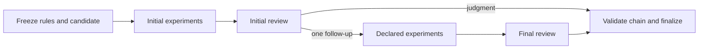

# Curvesmash verification in autoresearch

`autoresearch verify` integrates the verifier used by the live
[Curvesmash challenge](https://www.yukon.org/curvesmash). It supports bounded
submission intake, isolated supporting experiments, one exploratory reviewer,
one optional follow-up batch and deterministic finalization. Each phase is a
separate command. The existing experiment launchers and scientific state machine
retain their authority.

## Source audit and pins

Source provenance is **retrieved**, inspected by the implementation session on
2026-10-23. The live page identified
[`Layr-Labs/curvesma.sh` at `6423c27`](https://github.com/Layr-Labs/curvesma.sh/tree/6423c2728dc03d5f2d647c7f22adf1dac0643a66).
Its protected
[configuration](https://github.com/Layr-Labs/curvesma.sh/blob/6423c2728dc03d5f2d647c7f22adf1dac0643a66/tracks/secp256k1-ecdlp/verifier.json)
and
[workflow](https://github.com/Layr-Labs/curvesma.sh/blob/6423c2728dc03d5f2d647c7f22adf1dac0643a66/.github/workflows/secp256k1-ecdlp.yml)
delegate to
[`Layr-Labs/llm-verifier` at `8c1f098`](https://github.com/Layr-Labs/llm-verifier/tree/8c1f098875fae0750c29ecfd641f7c9fc53a0f41).
The implementation reuses that package rather than copying its runner or judge.

The registered design differs materially from the earlier
[`zac-williamson/curvesmash` prototype](https://github.com/zac-williamson/curvesmash/tree/1641787fb09e4c358326d880bbf5702bc6c17c0e).
The prototype used four signed initial reviews and defense/adjudication. The
registered release uses one `gpt-6-astra` reviewer at high effort; there is no
committee or independent adjudication. A reviewer can request one bounded batch
of inputs to already declared immutable programs, after which it must give a
final judgment. See the registered
[evaluation contract](https://github.com/Layr-Labs/curvesma.sh/blob/6423c2728dc03d5f2d647c7f22adf1dac0643a66/tracks/docs/EVALUATION.md)
and shared
[phase implementation](https://github.com/Layr-Labs/llm-verifier/blob/8c1f098875fae0750c29ecfd641f7c9fc53a0f41/src/llm_verifier/pipeline.py).

The imported protected files are in `config/curvesmash/`, byte-for-byte with
their source. `source-lock.json` records both full revisions, every imported
file's SHA-256 and the verifier's installed Python-source digest. Their original
Apache-2.0 license is retained. Candidate submissions, historical scores,
prototype evaluator code and signing authorities are not imported.

## What the harness enforces



The upstream verifier binds candidate bytes, protected rules, configuration,
implementation and stage parents into content-addressed artifacts. Candidate
files remain inert during review. Declared Python experiments run through its
digest-pinned Linux/amd64 Docker executor, with bounded time, memory, processes
and output, no network or credentials and no host-execution fallback. Initial
and final review share the registered request/time budget. Only transient
provider failures are retried; a mathematical rejection is final. These properties
come from the pinned
[executor](https://github.com/Layr-Labs/llm-verifier/blob/8c1f098875fae0750c29ecfd641f7c9fc53a0f41/src/llm_verifier/runner.py),
[provider](https://github.com/Layr-Labs/llm-verifier/blob/8c1f098875fae0750c29ecfd641f7c9fc53a0f41/src/llm_verifier/provider.py)
and [artifact validation](https://github.com/Layr-Labs/llm-verifier/blob/8c1f098875fae0750c29ecfd641f7c9fc53a0f41/src/llm_verifier/artifacts.py).

Every original declared claim must meet `exploratory-v1` as written. Supported
plausible heuristics may qualify; missing algorithmic detail and unsupported
heuristics do not. The first claim supplies its exact rational score, normalized
by the manifest adapter and projected only after complete acceptance. The model
does not choose a confidence-based score or silently tighten the claimed bound.
Memory is supplementary; preprocessing, advice, failures and parallel work all
count. Finite experiment results have only their measured scope.

This bridge additionally verifies the pinned installed implementation, checks
the imported protected files when preparing a workspace, requires an independently
retained intake digest for consuming phases, applies the repository's provider
ban before live review and reserves fresh output paths. An existing output or an
in-flight bridge writer is refused before the upstream CLI can clear it. Each
attempt uses new paths; failed and rejected attempts stay in the record.

Hashes detect changed bytes and cross-evaluation replay; they do not authenticate
an artifact's author. Transfer only organizer-produced same-run artifacts over
a trusted channel. Credential separation requires separate workers/jobs, as in
the upstream workflow; this CLI is not a worker isolation service.

## Targets

`autoresearch verify tracks` lists these distinct registered targets:

| Track | Input and required answer | Reference unit |
| --- | --- | --- |
| `secp256k1-ecdlp` | Recover x from Q=[x]P | secp256k1 addition |
| `p256-ecdlp` | Recover x on P-256 | Borrowed secp256k1 normalization |
| `bls12-381-g1-ecdlp-plain` | Recover x from T=[x]P0 | BLS G1 addition |
| `bls12-381-g1-ecdlp` | Recover s with public powers [s^i]P0 | BLS G1 addition |
| `bls12-381-fixed-g1-invert-g2` | Given P,z, return Q with e(P,Q)=z | Fp12 multiplication |
| `bls12-381-fixed-g2-invert-g1` | Given Q,z, return P with e(P,Q)=z | Fp12 multiplication |

Only the auxiliary-powers track evaluates W(n) at n=2^20. For pairing inversion,
the supplied nonidentity argument is sampled per instance and cannot be replaced.
The sole objective is `time_log2`, lower is better; different reference units
make scores across tracks incomparable. Definitions, the 0.39 success threshold
and reference prices remain exactly those of the imported
[rules](../config/curvesmash/tracks/secp256k1-ecdlp/rules.md) and
[cost model](../config/curvesmash/tracks/docs/COST_MODEL.md).

## Use

Install the optional, Git-pinned backend from this editable repository:

```sh
python3 -m pip install -e '.[verifier]'
autoresearch verify --help
autoresearch verify tracks
autoresearch verify init-curvesmash --track secp256k1-ecdlp --out /tmp/curvesmash-secp
```

Initialization needs no optional dependency, network, model credential or Docker.
It creates an incomplete, unscored draft under
`submissions/secp256k1-ecdlp/candidate/` and retains the protected track definitions.
Supply a complete `submission.json`, argument and declared supporting files.
The draft cannot qualify. The
[pinned submission guide](https://github.com/Layr-Labs/llm-verifier/blob/8c1f098875fae0750c29ecfd641f7c9fc53a0f41/docs/solving.md)
documents the manifest format. Both intake and preflight must name the actual
candidate subtree explicitly.

For example, on the credential-free intake worker:

```sh
autoresearch verify preflight --root /tmp/curvesmash-secp \
  --config tracks/secp256k1-ecdlp/verifier.json \
  --submission submissions/secp256k1-ecdlp/candidate
autoresearch verify intake --root /tmp/curvesmash-secp \
  --config tracks/secp256k1-ecdlp/verifier.json \
  --submission submissions/secp256k1-ecdlp/candidate \
  --out /tmp/attempt-001/intake.json
```

Retain `intake.json`'s top-level `sha256` independently of transferred artifacts.
Set `LLMV_EXPECTED_INTAKE` on each consuming worker to that trusted digest, or
pass `--expected-intake` explicitly. Use a new attempt directory for a new intake.

| Worker | Commands | Provider credential |
| --- | --- | --- |
| Initial execution | `prepare-runtime`, then `experiments` | Absent |
| Initial review | `review-initial` | `OPENAI_API_KEY` only here |
| Follow-up execution, if requested | `prepare-runtime --phase followup`, then `followup` | Absent |
| Final review, if a follow-up ran | `review-final` | `OPENAI_API_KEY` only here |
| Finalization | `finalize` | Absent |

Pass `--intake`, `--initial`, `--initial-review`, `--followup` and `--out` as
required by each phase's `--help`. The pinned
[phase guide](https://github.com/Layr-Labs/llm-verifier/blob/8c1f098875fae0750c29ecfd641f7c9fc53a0f41/README.md#independent-phases)
has the full argument sequence. For the direct-judgment path:

```sh
autoresearch verify prepare-runtime --intake /tmp/attempt-001/intake.json
autoresearch verify experiments --intake /tmp/attempt-001/intake.json \
  --out /tmp/attempt-001/initial.json
# Transfer artifacts to a separate credentialed review worker:
autoresearch verify review-initial --intake /tmp/attempt-001/intake.json \
  --initial /tmp/attempt-001/initial.json --out /tmp/attempt-001/review.json
# Transfer the review back to a credential-free finalization worker:
autoresearch verify finalize --intake /tmp/attempt-001/intake.json \
  --initial /tmp/attempt-001/initial.json --initial-review /tmp/attempt-001/review.json \
  --score /tmp/attempt-001/score.json --dossier /tmp/attempt-001/dossier.json
```

If `.data.decision.kind` is `followup`, run the follow-up and final-review phases
on their respective workers, then also supply their artifacts to `finalize`.
A missing stage fails finalization. There is no combined execute-with-secrets
command. The backend uses its fixed native OpenAI API, not the multi-provider
research-role adapter; it cannot act as a fallback for an official independent
review role. Production hosting and model access need their own provisioning.

Preflight is a packaging check. A completed rejection exits 0 and reports
`valid: false`; infrastructure/input failures exit 2. Always check both the exit
status and the current attempt's result. `simulate` is explicitly offline and
cannot publish a production score, even when a scripted judgment says valid.
No command changes a hypothesis, frontier, claim tier or research ledger.
Exploratory acceptance is not proof, independent scientific review, an executed
production attack or promotion. Existing progress-fidelity, measured-bound,
review-plan and Coordinator requirements apply before any official claim changes.

## Software validation

```sh
python3 -m pip install -e '.[dev,verifier]'
python3 -m pytest -q tests/test_verification.py
```

The focused suite uses the real pinned backend for preflight, snapshotting,
exact rational preprocessing, empty execution plans and artifact validation.
It exercises both scripted review branches, rejection of a second follow-up,
tampered artifacts, source drift, reused outputs, absent credentials and
simulation-to-production rejection. Scripts are fixtures, not scientific evidence.
The dedicated `curvesmash-verifier` CI job installs the optional dependency and
runs these controls; ordinary base installs retain dependency-free discovery.
These checks do not measure judge accuracy or validate live provider/Docker behavior.

Implementation validation on 2026-10-23 used CPython 3.12.14: 182 selected tests
and 27 subtests passed across verification, CLI entrypoints, inference adapter,
model tiers, progress fidelity, review independence and skill routing. This
includes 15 bridge controls with the real pinned optional backend installed.
