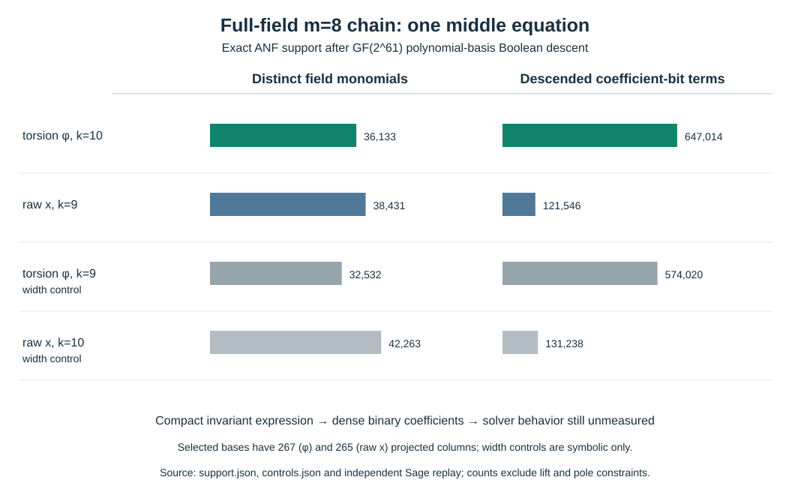

# Boolean input support of two binary eight-summand chains

**Date:** 2026-10-17. **Scope:** exact algebraic-normal-form (ANF) **input** construction on one certified ordinary-binary `GF(2^61)` fixture and one fixed planted raw target. This is a stage diagnostic, with no Gröbner, SAT, Macaulay, degree-of-regularity, relation-rank, or end-to-end run. The [producer](../../tools/icperf_binary_boolean_support.py), [selected-base record](../../research/icperf_binary_boolean_support_20261017/support.json), [width-control producer](../../tools/icperf_binary_boolean_support_controls.py), [control record](../../research/icperf_binary_boolean_support_20261017/controls.json), [independent Sage source](../../tools/icperf_binary_boolean_support_sage_verify.py), [Sage replay](../../research/icperf_binary_boolean_support_20261017/sage_replay.json), [editable chart](2026-10-17-binary-boolean-support-chart.py), [SVG](2026-10-17-binary-boolean-support.svg), and [PDF](2026-10-17-binary-boolean-support.pdf) bind the observations. The target and seven-link circuit come from the [independently replayed planted m=8 chain](2026-10-17-binary-torsion-m8-chain.md).

## Exact comparison boundary

Both arms use the same curve `y²+xy=x³+31`, field polynomial `z^61+z^5+z²+z+1`, one raw target `S`, six full-field intermediate coordinates, seven three-point equations and the same polynomial basis. The selected torsion-coordinate arm uses the [267-column `t`-affine base](2026-10-17-binary-torsion-coordinate.md): each external coordinate is an offset plus 10 binary basis variables, giving 446 total Boolean variables. Its equation is `Pφ,3(a,b,c)=∏(tᵢ²+tᵢ)+γ(a+b+c)²`. The selected classical arm uses the [265-column raw-x affine base](2026-10-17-binary-projected-base.md): nine binary variables per external coordinate, giving 438 total, with `S₃=(x₁x₂+x₁x₃+x₂x₃)²+x₁x₂x₃+31`. The raw target `S` was planted through the torsion base; reachability through the raw-x base was **not** established and is irrelevant to these input-support counts.

Every field polynomial was reduced in the Boolean quotient `vᵢ²=vᵢ`, with identical monomials canceled over characteristic two. A **distinct field monomial** has one nonzero `GF(2^61)` coefficient. Its **coefficient-bit terms** are its coefficient's Hamming weight across the 61 descended Boolean equations. The latter sum is the number of nonzero ANF term occurrences the solver would receive for the seven displayed equations, before any other constraints or preprocessing. The record fixes variable order, monomial-mask encoding, source hashes, support digests and seeded evaluation assignments.

| Arm | External width `k` | Boolean variables | Middle equation field monomials | Middle equation coefficient-bit terms | All seven coefficient-bit terms |
| --- | ---: | ---: | ---: | ---: | ---: |
| Selected torsion `φ` base, 267 columns | 10 | 446 | 36,133 | 647,014 | 3,326,200 |
| Selected raw-x base, 265 columns | 9 | 438 | 38,431 | 121,546 | 637,159 |
| Torsion `φ`, equal-width control only | 9 | 438 | 32,532 | 574,020 | 2,943,683 |
| Raw x, equal-width control only | 10 | 446 | 42,263 | 131,238 | 688,797 |

**Measured symbolic construction and independently replayed checks.** The selected torsion expression has fewer distinct field monomials in a middle equation, but substantially more coefficient-bit terms after descent. The direction persists in the equal-width controls, which isolate binary variable count at the cost of using offsets without matched realized point sets. Each arm's maximum input Boolean degree is **three**. Independent Sage arithmetic reproduced the exact support histogram, per-bit counts and digest for the first, one middle, and final equation in **all four** arms, and evaluated all seven field equations on eight seeded assignments per arm. The five middle equations in each arm have identical term counts under variable renaming. The producer recorded 12.176559 seconds wall, 3.183803 seconds CPU, and 121,569,280 bytes peak RSS on a shared host for both selected-arm support constructions and diagnostics; these are preparation metrics, not a solver comparison.

## Interpretation and next falsifier

This exact fixture **does not support a claim that the two-term invariant formula yields a sparser expanded Boolean input** than the classical raw-x chain under the selected bases. Compression in invariant generators and fewer field monomials do not by themselves imply fewer Boolean terms. This statement is restricted to the frozen polynomial basis, offsets, target, quotient and equation circuit. A different basis, elimination order, quotient presentation, straight-line circuit or common-subexpression solver could change the practical outcome. The support count does not measure degree of regularity, first fall, fill-in, runtime, relation yield or end-to-end `S`; it cannot by itself rank the two bases as ECDLP algorithms.

These seven equations omit the curve-lift predicates, relative point-sign consistency, exceptional poles, final full-point certificates, three other target torsion channels, duplicated relation rows and linear algebra. A solver that operates on an arithmetic circuit may exploit the compact `Pφ,3` formula without materializing the expanded ANF counted here; that is a separate test. The next frozen protocol should compare (1) expanded Boolean, (2) circuit/Tseitin, and (3) any symmetrized direct or chained presentation at equal realized projected-column counts, with planted and unseen targets, independently verified roots, observed solving degree, monomial/matrix support, all phase costs, peak memory, useful rank and matched rho. The [full-width measurement obstruction](../../problems/full-width-ic-arity-grid-unmeasured.md) remains open.

**Canonical graphs checked:** no ECDLP frontier graph changes because this is an input-support diagnostic without a reviewed complete-cost improvement.
