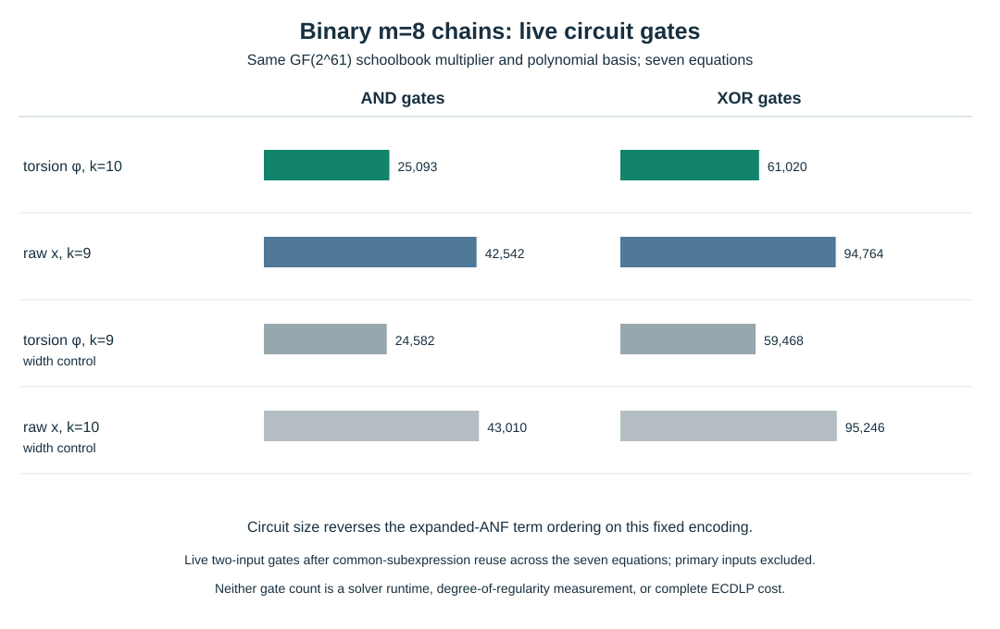

# Circuit input support of two binary eight-summand chains

**Date:** 2026-10-17. **Scope:** exact structural XOR–AND encoding of the seven three-point equations on the [certified ordinary-binary GF(2^61) fixture](2026-10-17-ordinary-binary-fixture.md). The [constructor](../../tools/icperf_binary_circuit_support.py), [write-once count and evaluation record](../../research/icperf_binary_circuit_support_20261017/circuit.json), [editable chart](2026-10-17-binary-circuit-support-chart.py), [SVG](2026-10-17-binary-circuit-support.svg), and [PDF](2026-10-17-binary-circuit-support.pdf) are the artifacts. The constructor binds the [selected-base ANF record](../../research/icperf_binary_boolean_support_20261017/support.json), its [same-width controls](../../research/icperf_binary_boolean_support_20261017/controls.json), and the [planted m=8 chain](../../research/icperf_binary_torsion_m8_chain_20261017/chain.json) by SHA-256. The previous [independent Sage replay](../../research/icperf_binary_boolean_support_20261017/sage_replay.json) checked the field equations underlying those records.

## Fixed encoding and exact counts

Both arms use one raw target, six full-field intermediate coordinates, seven equations, the same polynomial basis `z^61+z^5+z²+z+1`, and the same canonical two-input XOR/AND gate builder. General field multiplication is a schoolbook binary circuit followed by reduction modulo that polynomial. Squaring and multiplication by a fixed field constant are linear XOR circuits. Identical gates are shared, and **live** gates are those reachable from the 427 coefficient-bit outputs of all seven equations. Primary input bits are counted separately. The raw-x three-point formula uses the characteristic-two identity `ab+ac+bc=(a+b)(b+c)+b²`, so each link needs three general field multiplications; the torsion-coordinate formula uses two. These field-operation counts alone do not predict gate counts because input sparsity and common subexpressions matter.

| Arm | External width | Input bits | Live AND | Live XOR | Live gates | Middle-equation live AND / XOR |
| --- | ---: | ---: | ---: | ---: | ---: | ---: |
| Selected torsion `φ`, 267 projected columns | 10 | 446 | 25,093 | 61,020 | 86,113 | 4,453 / 10,782 |
| Selected raw x, 265 projected columns | 9 | 438 | 42,542 | 94,764 | 137,306 | 7,991 / 17,756 |
| Torsion `φ`, symbolic width control only | 9 | 438 | 24,582 | 59,468 | 84,050 | 4,392 / 10,583 |
| Raw x, symbolic width control only | 10 | 446 | 43,010 | 95,246 | 138,256 | 8,052 / 17,783 |

The constructor evaluated every circuit equation on the eight seeded assignments archived for each arm and obtained **all seven recorded field values for all four arms**. Those parent field values were independently checked in Sage. The circuit constructor recorded 3.564181 seconds wall, 2.031896 seconds CPU, and 93,798,400 bytes peak RSS on a shared macOS host; these describe artifact preparation only. The same-width arms do not realize matched factor bases and are controls for variable width, not ECDLP candidates.

## What the two input views say

The [expanded ANF diagnostic](2026-10-17-binary-boolean-support.md) found **more** descended coefficient-bit terms for the selected torsion link than the selected raw-x link (647,014 versus 121,546 in one middle equation). In this fixed circuit encoding, the selected torsion chain has **fewer live AND and XOR gates**. Both observations are exact for their stated representation and can coexist: expansion distributes products into a large list of monomials, while the circuit retains shared intermediate products and linear maps. Neither is a measured degree of regularity, SAT/XOR-SAT or Gröbner cost, relation rate, rank, target recovery or whole-pipeline `S`.

The circuits encode only the seven displayed three-point equations. They omit rational curve-lift predicates, relative signs, exceptional poles, three additional target torsion channels, root-to-point verification, duplicate-row filtering and linear algebra. The selected bases also differ in realized projected-column count and external bit width. A solver may preprocess the circuit or ANF differently from either static count, and native XOR handling differs from CNF-expanded parity. The next frozen comparison needs equal realized projected-column subsets, a paired random base, the expanded ANF and circuit/Tseitin encodings, planted and unseen targets, independently checked roots, observed solving degree and memory, all four target channels, useful rank and complete phase costs. The [full-width three-family measurement problem](../../problems/full-width-ic-arity-grid-unmeasured.md) remains open.

**Canonical graphs checked:** this structural diagnostic changes no reviewed ECDLP frontier or complete-cost claim, so no canonical frontier graph changed.
