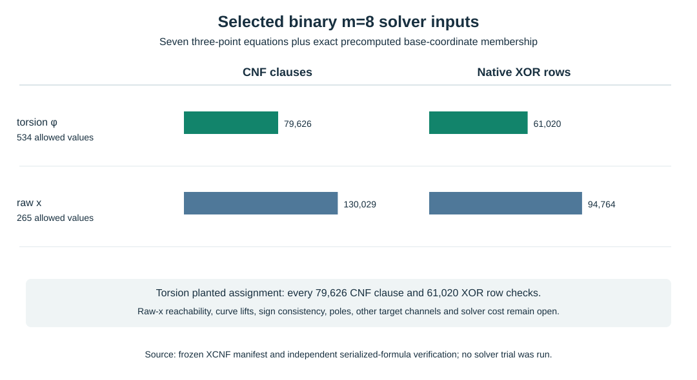

# Membership-constrained binary eight-summand circuit inputs

**Date:** 2026-10-17. **Scope:** frozen serialized *input equations* on the [ordinary-binary GF(2^61) fixture](2026-10-17-ordinary-binary-fixture.md). The [emitter](../../tools/icperf_binary_circuit_xcnf.py) turns the [exact seven-link circuit](2026-10-17-binary-circuit-support.md) and predeclared factor-base coordinate lists into [torsion-coordinate XCNF](../../research/icperf_binary_circuit_xcnf_20261017/torsion_phi.xcnf.gz) and [classical raw-x XCNF](../../research/icperf_binary_circuit_xcnf_20261017/classical_raw_x.xcnf.gz). The [manifest](../../research/icperf_binary_circuit_xcnf_20261017/manifest.json) binds their raw and gzip SHA-256 values, source, parent inputs, gate counts and one planted assignment. A [separate serialized-formula verifier](../../tools/icperf_binary_circuit_xcnf_verify.py) produced its [write-once check record](../../research/icperf_binary_circuit_xcnf_20261017/verification.json). The [editable chart](2026-10-17-binary-circuit-xcnf-chart.py), [SVG](2026-10-17-binary-circuit-xcnf.svg), and [PDF](2026-10-17-binary-circuit-xcnf.pdf) visualize the exact input size.

## What was frozen

Each file encodes seven three-point field equations for **one** raw target channel as 427 zero-output bits. Live two-input AND gates become three ordinary CNF clauses each; live XOR gates become native parity rows using the XCNF syntax tested against the installed CryptoMiniSat binary in two [retained two-variable controls](../../research/icperf_binary_circuit_xcnf_20261017/format_controls.json). Each of eight external coordinates gets an exact target-blind lookup predicate: the emitter forbids every affine coordinate value absent from the archived base's accepted list. This predicate encodes the archived liftable-coordinate **set**, not the associated point sign or an arbitrary curve lift. The field basis, schoolbook multiplier, offset, target, source hashes and variable order are fixed. The ordinary CNF and native-XOR counts are separate because their solver costs are not interchangeable.

| Selected arm | Allowed coordinate values / affine space | Membership forbids | CNF variables | CNF clauses | Native XOR rows | Raw / gzip bytes |
| --- | ---: | ---: | ---: | ---: | ---: | ---: |
| Torsion `φ`, 267 projected columns | 534 / 1,024 | 3,920 | 86,559 | 79,626 | 61,020 | 2,702,946 / 652,319 |
| Classical raw x, 265 projected columns | 265 / 512 | 1,976 | 137,744 | 130,029 | 94,764 | 4,190,098 / 1,056,770 |

The CNF totals decompose exactly as `3 × live AND gates + 427 output units + membership forbids`. These counts describe this fixed representation, including its different external widths and base sizes; they are not solving work or an end-to-end performance comparison. The emitter recorded 4.051513 seconds wall, 1.681794 seconds CPU and 172,195,840 bytes peak RSS on a shared macOS host for artifact construction only.

## Independent checks and remaining system

The verifier parses the compressed bytes without importing the emitter's `Circuit` DAG. It checks header and file hashes, reconstructs every AND/XOR gate definition and verifies that **all eight membership truth tables per arm** match the archived accepted coordinate lists. For the torsion arm it independently evaluates the complete serialized formula from the planted chain's archived primary assignment: all **79,626 CNF clauses and 61,020 XOR rows** hold. The underlying seven field equations and group sum had earlier independent Sage checks. The raw-x arm has no supplied satisfying assignment for this torsion-selected planted target; its structural and membership checks say nothing about existence of one. The parser was tested on the full files; the CryptoMiniSat syntax controls tested `x` and `x-` parity convention on tiny formulas. A full selected-arm solver invocation has not occurred.

**Remaining correctness branches:** each accepted external coordinate may have multiple point lifts or signs; the seven coordinate equations can admit roots that fail a consistent full-point sum. The current files do not enforce sign choices, intermediate curve membership, exceptional denominators, all four torsion target channels, or final group-law certificates. Duplicate root presentations may map to one projected relation row. These obligations, plus observed solver degree, solver work, unknown-target relation supply, useful rank, linear algebra, phase costs and matched rho, remain in the [full-width measurement problem](../../problems/full-width-ic-arity-grid-unmeasured.md). The next frozen protocol must complete this formulation and run equal-realized-column and random-base controls before a quantitative claim.

**Canonical graphs checked:** no reviewed ECDLP frontier or complete-cost claim changes from preparing and checking input files.
