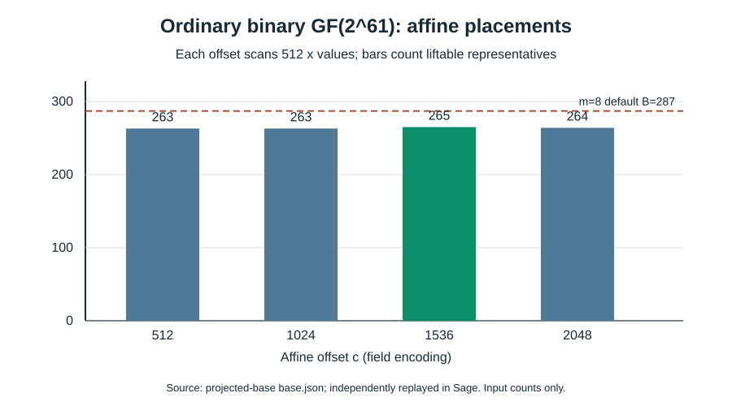

# Cofactor-projected affine base on an ordinary binary curve

**Date:** 2026-10-17. **Scope:** deterministic factor-base input construction and independent group-identity replay on the [certified ordinary-binary fixture](../../research/icperf_ordinary_binary_fixture_20261017/fixture.json). This is a substantive search record, not an index-calculus trial, a degree-of-regularity result, or an end-to-end cost comparison. The [producer](../../tools/icperf_binary_projected_base.py), [frozen record](../../research/icperf_binary_projected_base_20261017/base.json), [independent Sage replay](../../research/icperf_binary_projected_base_20261017/sage_replay.json), [editable chart source](2026-10-17-binary-projected-base-chart.py), [SVG](2026-10-17-binary-projected-base.svg), and [PDF](2026-10-17-binary-projected-base.pdf) bind the claims below.

## Question and exact input

Can a sparse affine-space predicate admit every liftable point without the prime-subgroup membership filter of the [earlier binary subspace candidate](2026-10-17-binary-subspace-base.md), while still giving well-defined logs in the 59-bit prime subgroup? The curve is `y^2+xy=x^3+31` over `GF(2^61)` represented by `z^61+z^5+z^2+z+1`. Its certified group order is `4r`, `r=576460752557211763` prime. Thus the ambient field has 61 bits and the target subgroup order has 60 bits (`log2(r)≈59`). These are distinct size coordinates. The fixture and its independent Sage proof establish the curve and subgroup facts.

**Derived construction.** Let `V=span_F2(1,z,…,z^8)` (512 x values) and use the four predetermined offsets `c=512,1024,1536,2048`. The monic linearized polynomial `L_V(X)=∏_{v∈V}(X+v)` was constructed recursively; its exact kernel is `V`. The equation `L_V(x)=L_V(c)` describes `c+V`, with 10 nonzero Frobenius terms plus a constant and binary codimension 52. The raw base consists of each liftable curve point with `x∈c+V`, represented by one root `y` and its implicit negative `(x,x+y)`. Curve lift is an additional exact condition. Selection minimizes the absolute gap between realized representative count and the prime engine's default `m=8` size `B=287`, breaking ties by smaller offset; no target was used.

**Measured preparation and independently verified identities.** The counts for offsets 512, 1024, 1536, 2048 are respectively **263, 263, 265, 264** representatives out of 512 attempted x values each. Offset 1536 was selected, 22 below B=287 (7.7%). The equal-size SHA256-seeded random-x control has 265 representatives from 517 draws, with 252 nonliftable x values. The independent Sage replay reconstructed every x list and count, verified the exact kernel of `L_V`, all selected point lifts and subgroup projections, and the random draw stream. The producer recorded 9.642826 seconds wall, 5.599027 seconds CPU, and 69,500,928 bytes peak RSS for complete input preparation on a heavily shared macOS host; these describe one preparation process, not a controlled speed comparison. The per-offset scan times are in the record. No solver input, relation yield, rank, degree of regularity, or target solve was measured.

## Why projection preserves the discrete-log equation

**Independently verified group identity.** For each raw curve point `P_i`, store a subgroup column `F_i=[4]P_i`; since `#E=4r`, `[r]F_i=O`. The target `R∈E[r]` has four raw preimages under `[4]`: `R_0+jT` for `j=0,1,2,3`, where `R_0=[4^{-1} mod r]R` and `T=[r]P_source` has order four. A raw relation `ΣP_i=R_0+jT` projects to `ΣF_i=R`. All four channels are necessary to avoid discarding valid raw relations because the raw sum can have any torsion component. Their construction, lookup, and misses must enter complete target cost; this record does not measure them. The Sage replay checked all four channels, a public known-answer scalar 17, and a planted three-point raw sum in exactly one channel.

The sparse affine equation applies to the **raw decomposition points**. The log columns are the projected points `[4]P_i`, whose x coordinates need not satisfy that equation. A future summation-polynomial or Boolean formulation must explicitly connect the raw point equations, the selected y signs, projection, and four target channels. Sparsity of `L_V` alone gives no bound on solving degree or cost. The earlier subgroup-filtered base also remains a distinct arm; no stage timings from the two constructions are comparable as an ECDLP speed ratio.

## Next check and status

Freeze one size-matched comparison of this projected base, the subgroup-filtered affine base, and random/affine controls on the same fixture and held-out targets. Measure polynomial construction and complete input size, observed degree of regularity and sparsity, relation attempts and useful rank, linear algebra, each of four target-channel costs, verification, setup reuse, peak memory, and matched rho. Direct `S_8` means seven summands plus target; an eight-summand direct equation is `S_9`. Stop a cell under its declared process limits and preserve censored evidence. The [full-width measurement obstruction](../../problems/full-width-ic-arity-grid-unmeasured.md) remains open until a runnable frozen protocol and complete checked comparison exist.

**Canonical graphs checked:** the ECDLP frontier graphs remain unchanged because this record adds an independently checked input representation, not a reviewed complete-cost observation.
