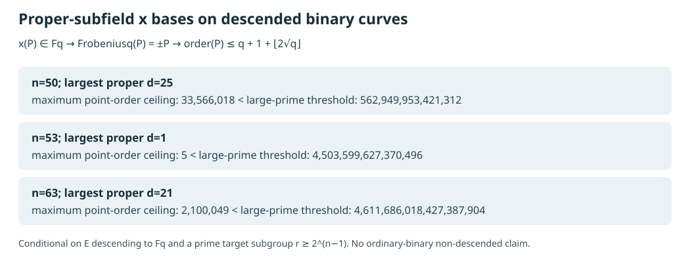

# Direct proper-subfield x bases cannot span a large prime subgroup on a descended binary curve

**Derived conditional lemma, 2026-10-17 UTC.** This note tests the multiplicative-closure direction in the [preregistered factor-base campaign](https://github.com/aburan28/crypto/blob/b59187e5549adb02a43c977f4bea9979a46bf3a3/research/factor_base_dor_campaign_20261013/PREREGISTRATION.md): a direct subfield base. It makes no solver or end-to-end performance claim. Its scope is an elliptic curve `E` defined over a proper subfield `F_q` of `F_(2^n)`, including Koblitz curves defined over `F_2`.

## Lemma and proof

Let `q=2^d` with `d|n`, `d<n`, and let `P∈E(F_(2^n))` have `x(P)∈F_q`. Because the coefficients of `E` are in `F_q`, its `q`-Frobenius `π_q` preserves `E` and fixes `x(P)`. The two points with this x-coordinate are `P` and `−P`, so `π_q(P)=εP` for `ε∈{+1,−1}` (the 2-torsion case is included).

Write `#E(F_q)=q+1−t`. The Frobenius identity `π_q²−tπ_q+[q]=0` applied to `P` gives `[q+1−εt]P=O`. Thus a prime order `r` of `P` divides one of `q+1−t` and `q+1+t`. Hasse's bound `|t|≤2√q` yields

`r ≤ q+1+⌊2√q⌋`.

The Frobenius identity, its characteristic polynomial, and the point-count definition of `t` are stated in the [retrieved elliptic-curve text, §6.4](https://hyperelliptic.org/tanja/dmbook.pdf), pp. 116–117. The substitution `π_q(P)=±P` and the resulting ceiling are derived here. If the target is a prime subgroup of order `r` above that ceiling, **every point whose x-coordinate lies in the proper subfield has zero component in that subgroup**: such a point's order is coprime to `r`, and the cofactor projection kills it. Sums of those points cannot span a nonzero target in that subgroup.

## Exact 50–63-bit screen

The [integer record](../../research/icperf_subfield_rank_gate_20261017/hasse_bounds.json) lists every proper `d|n` and the exact Hasse ceiling. The [editable diagram source](2026-10-17-binary-subfield-base-rank-gate-chart.py), [SVG](2026-10-17-binary-subfield-base-rank-gate.svg), and [PDF](2026-10-17-binary-subfield-base-rank-gate.pdf) present its largest proper subfield for each requested boundary size. The threshold `r≥2^(n−1)` is an explicit *condition*, not an assertion that a particular curve with that subgroup has been constructed at each n.

| Ambient n | Largest proper d | Largest Hasse ceiling for a point with subfield x | Conditional large-prime threshold |
| ---: | ---: | ---: | ---: |
| 50 | 25 | 33,566,018 | 562,949,953,421,312 |
| 53 | 1 | 5 | 4,503,599,627,370,496 |
| 63 | 21 | 2,100,049 | 4,611,686,018,427,387,904 |

The inequalities hold for all proper subfields in the record. For `n=53` the only proper subfield is `F_2`; for `n=50,63` the largest proper degrees are 25 and 21. The 53-bit Koblitz comparator's target prime order is 21,044,858,204,113 [in the baseline report](2026-10-16-elite-factor-base-baseline.md); it exceeds the actual `F_2` ceiling 5, even though it is below the illustrative half-field-order threshold above. Its direct `F_2`-x base is therefore also excluded by the lemma.

The separate [exact Koblitz order screen](2026-10-17-koblitz-size-screen.md) finds no standard Koblitz curve at field degrees 50–63 with `r≥2^50`. The 50- and 63-bit threshold rows above are conditional examples, not claims that those particular Koblitz fields supply an admissible large-prime target.

## Scope and remaining angles

This is a **proved structural obstruction under the stated descent and x-membership assumptions**, pending independent review as a research record. It does not exclude a base only *near* a subfield, a union of displaced subfield-like sets, a different sparse ideal with full target-subgroup rank, or an ordinary binary curve whose coefficients do not descend to `F_q`. For a non-descended curve, `q`-Frobenius maps to a conjugate curve and the proof's first step fails. Prime fields have no proper subfield. A sparse input equation or low refutation degree alone cannot overcome zero target-subgroup rank.

The next discriminating construction is a target-blind near-subfield or sparse linearized-predicate base on a certified 50–63-bit binary curve. Independently verify nonzero projected points and enough rank in the target subgroup **before** comparing its polynomial support and observed degree of regularity against equal-realized-size orbit, random, and subfield controls. Then charge base search and all later relation, rank, solve, and target phases. A pure subfield control should return zero projected rank; failure of that control is an implementation error. The full-width [grid obstruction](../../problems/full-width-ic-arity-grid-unmeasured.md) and the new [rank-gate problem](../../problems/binary-subfield-base-has-no-large-prime-component.md) track the remaining requirements. The canonical frontier graph remains unchanged because no complete cost result was reviewed.
