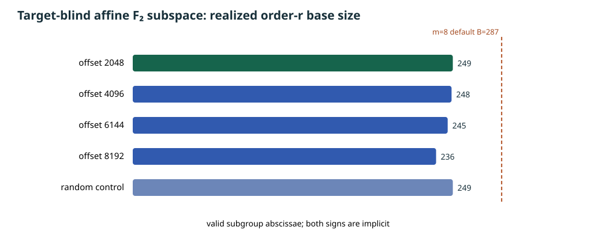

# A target-blind affine-subspace base candidate on the ordinary-binary fixture

**Preparation record, 2026-10-17 UTC.** The [certified ordinary-binary curve](2026-10-17-ordinary-binary-fixture.md) is `E: y²+xy=x³+b` over `GF(2^61)` with `b=z⁴+z³+z²+z+1` and prime subgroup order `r=576,460,752,557,211,763`. This report constructs an m=8 factor-base **input** and an equal-realized-size random control before any target is chosen. It measures no decomposition, solver degree of regularity, relation yield, useful rank, target DLP, complete IC cost, or matched rho.

## Construction fixed before scanning

The [source](../../tools/icperf_binary_subspace_base.py) fixes `V=span_F₂{1,z,…,z¹⁰}`, dimension 11, and four affine offsets `c∈{2048,4096,6144,8192}` in the fixture's polynomial basis. For every `x∈c+V`, it tries a curve lift and retains one y representative only when the point lies in the order-`r` subgroup; signs are implicit. The m=8 default size from the existing prime-field formula is `B=287`. The predeclared selection rule chooses the offset with realized size closest to 287, breaking a tie by smaller offset. A SHA-256 counter stream with fixed seed `20261017` then samples uniform 61-bit x coordinates until it has the **same number** of valid subgroup abscissae for a random control. The record retains all four scans, rejected lifts and subgroup checks, every retained point, the random draws, digests, CPU/wall and peak RSS. Selection uses no target or relation observation.

The subspace polynomial is constructed recursively from `Q₀(X)=X` and `Q_(i+1)(X)=Q_i(X)²+Q_i(z^i)Q_i(X)`. The resulting monic `Q₁₁(X)` has degree `2^11` and exactly the 2,048 elements of `V` as roots. It has **12 nonzero Frobenius terms** `c_j X^(2^j)`; the affine-space equation `Q₁₁(X)+Q₁₁(c)=0` adds one nonzero constant, for **13 field terms**. In a binary coordinate basis these are affine-linear constraints, with kernel dimension 11 and rank 50. **This equation is a prefilter, not exact membership in the 249-point base:** the curve equation enforces liftability, and an additional `[r]P=O` predicate filters lifted points into the prime subgroup. The cost and algebraic form of that extra predicate must be charged; sparse affine input alone does not determine the degree of regularity or cost of the combined Semaev/chained system. The [base JSON](../../research/icperf_binary_subspace_base_20261017/base.json) retains every coefficient and membership constant.

The [editable graph source](2026-10-17-binary-subspace-base-chart.py), [SVG](2026-10-17-binary-subspace-base.svg), and [PDF](2026-10-17-binary-subspace-base.pdf) show the fixed offsets, chosen size and target size. The exact counts are:

| Offset | Lift fails | Lifted points outside order-r subgroup | Accepted x | Measured construction wall |
| ---: | ---: | ---: | ---: | ---: |
| 2048, selected | 995 | 804 | **249** | 11.298 s |
| 4096 | 1,025 | 775 | 248 | 8.085 s |
| 6144 | 1,028 | 775 | 245 | 10.353 s |
| 8192 | 1,024 | 788 | 236 | 12.803 s |
| Random x control | 1,099 | 797 | **249** from 2,145 draws | 13.098 s |

The complete preparation process took **56.143 s wall**, **38.774 s CPU**, with peak RSS **68,960,256 bytes** on this host. These are descriptive setup measurements, including all four scanned offsets and the random control, not an isolated speed comparison. A cold-start pipeline must charge this search; amortization is valid only across explicitly measured target reuse. The fixed field has `2^61−1` prime, checked below `2^64` and recorded in the base JSON, so a proper multiplicative coset sized near `B` is unavailable on this exact field. That does not exclude other structured x bases or a different field.

## Independent input replay and next gate

The [Sage replay source](../../tools/icperf_binary_subspace_sage_verify.py) independently enumerated all four affine spaces and the SHA-256 random stream, reproducing every accepted/nonliftable/outside-subgroup count and x list. It checked the polynomial's exact kernel, stored point coordinates, curve membership and order-`r` membership. The [replay receipt](../../research/icperf_binary_subspace_base_20261017/sage_replay.json) binds the base and checker source hashes. The command was `sage -python tools/icperf_binary_subspace_sage_verify.py --base research/icperf_binary_subspace_base_20261017/base.json --out research/icperf_binary_subspace_base_20261017/sage_replay.json`.

The next discriminating design compares two exact representations before a speed claim: (1) this subgroup-filtered base, with a priced `[r]P=O` predicate or an exact accepted-x polynomial; (2) an all-liftable affine-space base whose raw points are cofactor-projected for subgroup logs, with every torsion class in relation and target equations handled and charged. The latter may retain the sparse x equation without a separate subgroup predicate, but it is not yet implemented or validated. Then pair an admitted representation with an equal-realized-size random control on frozen unseen same-point targets. Measure input and observed solving degree, monomial count, sparsity after reduction, misses, independent verified rows, useful rank, LA, target recovery, complete cold and genuinely amortized `S`, memory and matched rho. For eight summands, direct elimination is `S_9`; direct `S_8` corresponds to seven summands, while chained `S_3` is a separate formulation. Preserve timeout or unavailable cells as such. The [full-width problem](../../problems/full-width-ic-arity-grid-unmeasured.md) remains open; no canonical attack-cost graph changes because this candidate has no complete-cost comparison.
