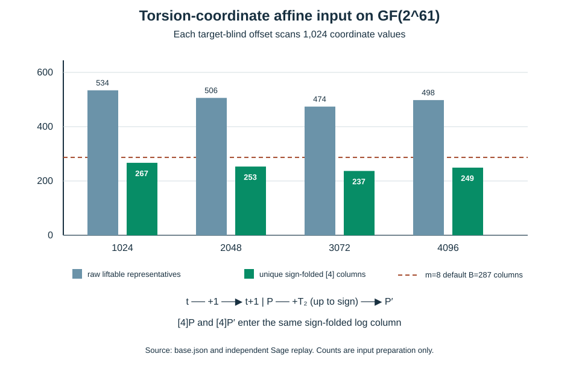

# Torsion-adapted affine coordinate for binary index calculus

**Date:** 2026-10-17. **Status:** a target-blind input construction and exact three-point identity, independently replayed; no decomposition solver, degree-of-regularity, rank, or complete ECDLP result. The evidence is the [producer](../../tools/icperf_binary_torsion_coordinate.py), [input record](../../research/icperf_binary_torsion_coordinate_20261017/base.json), [independent Sage source](../../tools/icperf_binary_torsion_sage_verify.py), [Sage replay](../../research/icperf_binary_torsion_coordinate_20261017/sage_replay.json), [editable chart](2026-10-17-binary-torsion-coordinate-chart.py), [SVG](2026-10-17-binary-torsion-coordinate.svg), and [PDF](2026-10-17-binary-torsion-coordinate.pdf). This search concerns the same [certified ordinary-binary fixture](2026-10-17-ordinary-binary-fixture.md) and follows the [raw-x affine candidate](2026-10-17-binary-projected-base.md).

## Mechanism and scope

**Independently verified fixture.** The curve is `E: y²+xy=x³+31` over `GF(2^61)` with field polynomial `z^61+z^5+z²+z+1`, group order `4r`, and prime `r=576460752557211763` (60-bit target order; `log₂(r)≈59`). Its rational two-torsion point is `T₂=(0,2147483661)`. The fourth root `γ=70364449406991` satisfies `γ⁴=31` and `γ²=2147483661` in this field.

**Derived coordinate identity.** For finite points away from the pole set, define `t=φ(P)=γ/(x(P)+γ)`, so `x=γ(1+1/t)`. The addition formula gives `x(P+T₂)=γ²/x(P)`, hence `φ(P+T₂)=φ(P)+1`. This is the rational two-torsion action used in the [retrieved primary paper by Faugère, Huot, Joux, Renault and Vitse](../../research/equation-schemes-20260905/retrieved-pages/hal-00935050.txt) (`retrieved`; Proposition 8, characteristic two). The identity was independently checked in Sage on every selected pair. The source paper's full high-arity relation timings use different extension-field and factor-base parameters, so they are not measurements for this curve.

**Derived three-point polynomial.** For `t₁,t₂,t₃`, let `e₁=t₁+t₂+t₃` and `s₃=∏ᵢ(tᵢ²+tᵢ)`. The characteristic-two summation relation is

`Pφ,3(t₁,t₂,t₃)=s₃+γ e₁²=0`.

This has two terms in the invariant generators. The [classical binary `S₃`](../../tools/icperf_binary_torsion_coordinate.py) is `S₃(x₁,x₂,x₃)=(x₁x₂+x₁x₃+x₂x₃)²+x₁x₂x₃+31`. Where all `tᵢ` are nonzero, direct substitution gives `S₃·(t₁t₂t₃)²=γ³Pφ,3`; denominators and poles must remain explicit in any solver implementation. The product term has Boolean algebraic degree at most three under binary descent, while the `γ e₁²` term is binary-linear. This is an **input degree and sparsity fact**, not an observed solving degree or regularity bound. The Sage replay checked 32 true point-sum triples and 32 false triples, and the rational identity in both sets.

## Target-blind base preparation

**Derived selection rule.** Let `V=span_F₂(1,z,…,z⁹)` in the `t` coordinate, and choose from four frozen offsets `c=1024,2048,3072,4096`. The exact affine membership equation `L_V(t)=L_V(c)` has 11 nonzero Frobenius terms plus a constant; after binary descent it imposes 51 independent linear constraints. Since `1∈V`, every accepted `t` has its partner `t+1`. The two raw curve representatives project under `[4]` to the same sign-folded prime-subgroup log column. The producer retains the sign of each pairing. The selection rule minimizes the gap between **unique projected columns** and the prime engine's derived default `m=8` size `B=287`, breaking ties by offset. The public target schedule was not used.

| Affine offset | Attempted `t` | Liftable raw representatives | Distinct projected columns |
| ---: | ---: | ---: | ---: |
| 1024, selected | 1,024 | 534 | 267 |
| 2048 | 1,024 | 506 | 253 |
| 3072 | 1,024 | 474 | 237 |
| 4096 | 1,024 | 498 | 249 |

**Measured preparation; independently replayed membership and pairing.** The selected base is 20 columns (7.0%) below the derived `B=287`. Every one of its 267 columns has two raw representatives; with the producer's canonical root choice, all paired projected points have opposite sign. An equal-column **paired random control** was generated from SHA256-seeded random x values: 267 accepted pairs (534 raw representatives) from 489 draws, including 222 nonliftable x values. Sage reconstructed all four accepted `t` lists, exact affine kernel, selected points, pair signs, projected subgroup orders, control stream, and three-point checks. The producer used 83.729985 seconds wall, 12.419274 seconds CPU, and 69,484,544 bytes peak RSS on a heavily shared macOS host; this one process includes all placements and the paired control. It is descriptive preparation cost, not a controlled end-to-end comparison.

## High-arity opportunity and missing work

The retrieved paper reports a characteristic-two torsion-symmetrized **eighth** summation polynomial with 470,369 monomials in its invariant representation and about 40.5 CPU hours of polynomial construction on its historical Magma setup (`retrieved`; Table 1 and §5.1). That is a literature result for its model and variables, not a solver time, relation yield, or cost measurement here. Direct `S₈` or `Pφ,8` represents **seven summands plus target** (`m=7`); a direct eight-summand test needs `S₉` or `Pφ,9`, while a chained lower-arity system is a separate `m=8` formulation. No `Pφ,8`, `Pφ,9`, or chained descended solver was constructed in this round. The paper's small factor base uses extension-field structure that does not transfer to this prime-degree `GF(2^61)`; the affine `t` base is the new candidate to test, not an inherited speedup.

For context, the [prime-engine default-size formula](../../src/crypto_autoresearcher/index_calculus/factor_base.py) gives, on this **same** subgroup, derived `B_m` values for `m=2..8`: 379,625,063; 600,160; 25,643; 4,044; 1,217; 528; 287. This search constructed the `m=8` input only. Its 267 unique columns and 534 raw opportunities must be compared with size-matched controls, including raw-input and torsion-phase overhead; m=2..7 remain separate cells.

The next discriminating contract should freeze this coordinate base, the raw-x affine base and paired random control at equal **projected-column** count (a target-blind 265-column subset can match the frozen raw-x base), then measure the exact `Pφ,3`/classical `S₃` and chained/direct high-arity systems on the same planted and unseen targets. Record monomial support, observed solving degree and regularity, relation attempts and duplicates, independently useful rank, four target torsion channels, linear algebra, reconstruction, setup reuse, all unsuccessful attempts, peak memory, and paired rho. A sparse equation or a literature construction alone cannot change the end-to-end baseline. The [full-width obstruction](../../problems/full-width-ic-arity-grid-unmeasured.md) remains open.

**Canonical graphs checked:** no ECDLP frontier graph changes because this is a checked input representation, without a reviewed complete-cost improvement.
