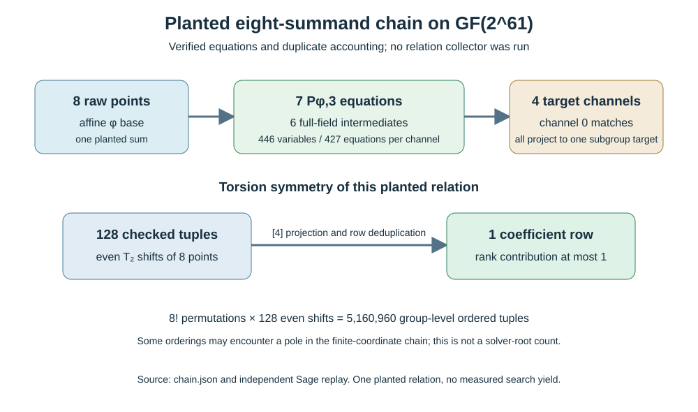

# Eight-summand chained torsion-coordinate witness

**Date:** 2026-10-17. **Status:** one planted correctness and duplicate-rank witness on the [certified ordinary-binary GF(2^61) curve](2026-10-17-ordinary-binary-fixture.md). It is not a relation-yield, solver-degree, or end-to-end cost observation. The [producer](../../tools/icperf_binary_torsion_m8_chain.py), [chain record](../../research/icperf_binary_torsion_m8_chain_20261017/chain.json), [independent Sage replay](../../research/icperf_binary_torsion_m8_chain_20261017/sage_replay.json), [editable diagram](2026-10-17-binary-torsion-m8-chain-chart.py), [SVG](2026-10-17-binary-torsion-m8-chain.svg), and [PDF](2026-10-17-binary-torsion-m8-chain.pdf) support the statements below. The input base and exact three-point identity are in the [preceding report](2026-10-17-binary-torsion-coordinate.md).

## Exact planted chain and target channels

**Derived formulation.** Let `P₁,…,P₈` be the first eight canonical raw representatives of the predeclared `t`-coordinate base at offset 1024. Define `Uᵢ=Σ_{j=1}^{i+1}Pⱼ` for `i=1,…,6` and `S=U₆+P₈`. With `t(X)=γ/(x(X)+γ)`, the seven equations are

1. `Pφ,3(t(P₁),t(P₂),t(U₁))=0`;
2. `Pφ,3(t(Uᵢ₋₁),t(Pᵢ₊₁),t(Uᵢ))=0` for `i=2,…,6`;
3. `Pφ,3(t(U₆),t(P₈),t(S))=0`.

Here `Pφ,3(a,b,c)=∏(tᵢ²+tᵢ)+γ(a+b+c)²`, with `γ=70364449406991` in the fixture field. This is an **eight-summand chained system**, distinct from a direct eighth summation polynomial, which represents seven summands plus target. A direct eight-summand system would use a ninth polynomial. The seven equations were constructed on the exact 61-bit field and independently replayed in Sage; all seven evaluate to zero for this planted point sum.

**Independently verified channel check.** The projected target is `R=[4]S` in the prime subgroup of order `r=576460752557211763`. For `R₀=[4⁻¹ mod r]R` and the order-four `T=[r]P_source`, the four raw target channels are `R₀+jT`, `j=0..3`; the planted sum is channel **0**. Their final three-point values in field encoding are `0`, `63269471411680863`, `70364449406991`, `63323901532157520` for this one chain, and all four channel points project to `R`. These three nonzero values do not prove other channels lack alternative decompositions. The replay checked the exact point sum, all intermediate coordinates, all four channel points, and every displayed polynomial value.

**Derived system size before correctness branches.** Each of eight base coordinates has 10 binary degrees of freedom; six intermediate coordinates range over all 61 field bits. Thus one channel has **446 Boolean variables** and **427 coefficient equations** from seven field equations. This counts the circuit shape, not its expanded monomial support, degree of regularity, memory, or solve time. Four target channels are separate right-hand sides; shared computations, if any, must be measured. A complete formulation must handle coordinate poles, enforce rational curve lifts, reconcile point-sign choices across the chain, and verify every full point sum. A polynomial root alone is not a decomposition certificate.

## Torsion multiplicity is not useful rank

**Independently replayed finite orbit.** The base contains both `t` and `t+1` for each selected raw point. Adding rational two-torsion `T₂` to any **even** subset of the eight points keeps their raw sum `S` and leaves each `[4]Pᵢ` unchanged. The producer and independent Sage replay checked all **128** even masks: they give 128 distinct ordered `t` tuples, all with the same raw sum and exactly **one** projected coefficient row. Therefore these 128 presentations contribute at most one independent relation to linear algebra. The producer's canonical paired lifts have the opposite sign, so a collector must retain relative signs when mapping a `t` root back to its stored column.

**Derived larger group-level multiplicity.** The eight selected pairs occupy 16 distinct `t` values. Permuting eight summand positions gives `8! × 128 = 5,160,960` distinct **ordered group-level** point tuples with the same sum and projected row. This is a combinatorial identity, not a count of solver roots: some orderings may pass through a pole in a finite-coordinate chain, and a solver may quotient permutation symmetry. It shows why counting raw roots as independently useful relations would be unsound.

## Next discriminating test

Freeze the chain and a direct/symmetrized high-arity arm if implementable; compare them with the [raw-x affine base](2026-10-17-binary-projected-base.md) and a paired random control at the same unique projected-column count. Record source/base hashes, input monomials, observed solving degree and regularity, poles and nonliftable roots, verification success, repeated rows, **marginal rank**, all four target-channel attempts, linear algebra, unknown-target reconstruction, setup reuse, peak memory, and a matched rho arm. The input base has 267 columns; a predeclared 265-column subset can match the frozen raw-x base. Bound memory and process time per cell, preserving a censored result if limits are hit. A full 2^50–2^63 `m=2..8` three-family end-to-end comparison is still missing; the [recorded obstruction](../../problems/full-width-ic-arity-grid-unmeasured.md) remains open.

**Canonical graphs checked:** no frontier graph changes because this is a planted equation/duplicate-row result, without a reviewed complete-cost comparison.
