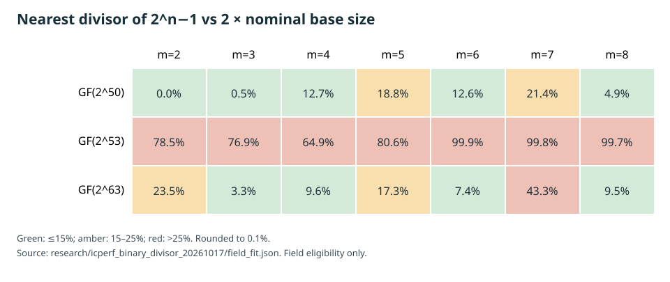

# Binary-field multiplicative-divisor eligibility at 50, 53, and 63 bits

**Derived screening record, 2026-10-17 UTC.** Question: can the multiplicative group of each field supply a coset with divisor `d` near twice the default factor-base size for arities `m=2…8`? This is a field-only screen. It constructs no ordinary-binary or Koblitz curve, factor base, relation system, or discrete-log run.

## Method and provenance

[`tools/icperf_binary_divisor_fit.py`](../../tools/icperf_binary_divisor_fit.py) factors `2^n−1` for `n∈{50,53,63}` with SymPy 1.14.0, checks the product and primality of every factor, lists every divisor, and chooses the closest one to `2B`, where `B=default_fb_size(2^n,m)`. Every integer here is below `2^64`, the deterministic range of SymPy's `isprime`. It also records the default `B` at both endpoints of the Hasse interval `[2^n+1−⌊2√(2^n)⌋, 2^n+1+⌊2√(2^n)⌋]`. A specific curve's target subgroup order must still be substituted before constructing a base. Source SHA-256: `a215659446ab2af14e43650cf503fd7ec42553875d31e2f559677e2be633ea12`.

The write-once [machine-readable record](../../research/icperf_binary_divisor_20261017/field_fit.json) has SHA-256 `a5d2387e5cebdf34c3a66e766ab14e7d43878c24998132eb32c2d19aa6b8c6b9`. The [SVG heatmap](2026-10-17-icperf-binary-divisor-fit.svg) and its [editable renderer](2026-10-17-icperf-binary-divisor-fit-chart.py) plot exact percentage gaps rounded to 0.1%; the PDF below includes the same figure. These values are derived integers, not timings.

| Field | Exact factorization of `2^n−1` | Arity cells with nearest `d` within 15% of `2B` |
| --- | --- | --- |
| `GF(2^50)` | `3·11·31·251·601·1801·4051` | `m=2,3,4,6,8` |
| `GF(2^53)` | `6361·69431·20394401` | none |
| `GF(2^63)` | `7²·73·127·337·92737·649657` | `m=3,4,6,8` |

At 63 bits and `m=8`, the nominal default size is `B=406` and the closest divisor is `d=889`, a gap of `77/812 = 9.48%`. At 53 bits there are only eight divisors of `2^53−1`, and none fits any of the seven nominal cells. The endpoint `B` values in the record differ from nominal by at most one here, so the 15% classification is unchanged across the Hasse interval for this screen.

## Meaning and next check

A matching divisor is a **necessary size opportunity** for the same multiplicative-coset construction, not evidence of a useful base. On an actual binary curve, point lifting may change the realized base size; the resulting membership equation, relation probability, solver degree of regularity, sparsity after reduction, useful rank, setup, target phase, and matched rho remain unmeasured. The prime-field constructor in PR #2329 does not implement binary-field arithmetic. Koblitz signed-Frobenius orbit bases are a separate construction and remain eligible even when this multiplicative-divisor screen fails.

The next discriminating step is to choose and certify a concrete ordinary-binary and Koblitz curve/subgroup at each size, construct target-blind coset and matched realized-size controls where field fit allows, and freeze a complete-cost m=2…8 protocol. At 53 bits, test another public field size or a different structured base; this exact field cannot give a multiplicative coset with `d≈2B` under the stated default sizes. Record all field search and failed lifts as setup. Direct S8 construction and solver behavior require their own bounded resource gate before an end-to-end claim.

No canonical ECDLP frontier graph changes: the screen has no reviewed cost comparison. The prime-field counterpart is [the 2026-10-17 divisor-fit report](2026-10-17-icperf-divisor-fit.md).
