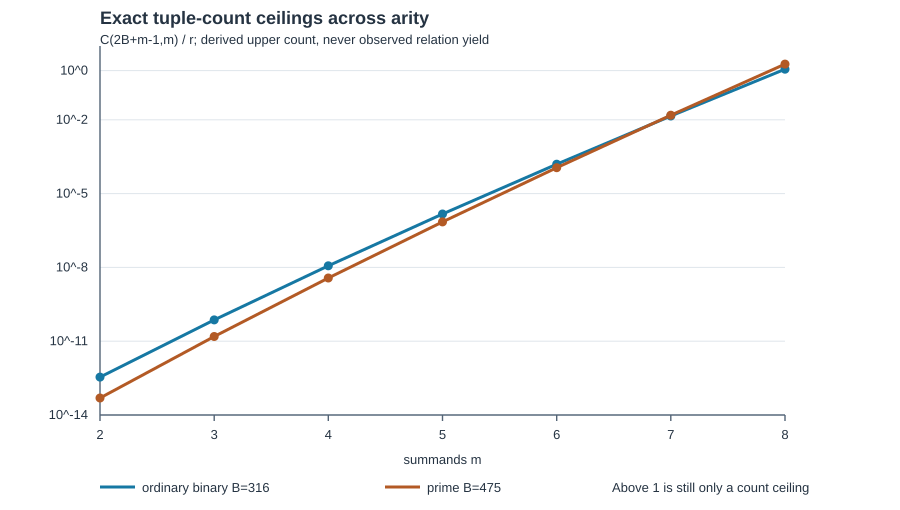

# Next factor-base experiment gates at subgroup order 2^50–2^63

**Search record, 2026-10-17 UTC.** This round ranked prepared factor-base and solver interfaces for ordinary binary, prime, and Koblitz elliptic curves at the requested subgroup sizes and decomposition arities `m=2…8`. It used the current [baseline assessment](2026-10-16-elite-factor-base-baseline.md), the [binary k11 positive-control record](2026-10-17-binary-k11-planted-xcnf.md), the [prime common-target input record](2026-10-17-prime-475-target-systems.md), the [Koblitz size screen](2026-10-17-koblitz-size-screen.md), the [full-width obstruction](../../problems/full-width-ic-arity-grid-unmeasured.md), and the 25-row generated index-calculus known-results map at commit `e226306467fd4684a5bc838c583ff7f5364c9905`. The proposals are adaptations of known mechanisms and instrument designs. This round ran no scientific solver trial and establishes no end-to-end cost improvement.

## Exact scope and ranking

| Rank | Curve and subgroup | Prepared input | Next discriminating gate | Missing before a whole-cost comparison |
| --- | --- | --- | --- | --- |
| 1 | Ordinary binary `y²+xy=x³+31` over `GF(2^61)`, prime `r=576460752557211763` | Two frozen 316-column k11 bases; four matched raw channels; separately planted satisfiable m=8 XCNF formulas and complete Boolean/point witnesses | Bounded solver recovery of both positive controls, followed by a new base-independent common-target feasibility pilot | Observed solver cost and natural certified relation yield, marginal rank, linear algebra, separate held-out target, all setup, matched rho and an algebraic regularity instrument |
| 2 | Prime `p=9223372021248595841`, prime `r=9223372018953067627` | Equal-realized-size 475-point coset, random and small-x bases; 21 common-target direct systems across `m=2…8`, seven coset lifts | Independently validated 63-bit-capable polynomial backend and positive decomposable controls before capped matched calls | A validated wide solver, false-root filtering, natural yield, rank, linear algebra, held-out target and matched rho |
| 3 | Binary Koblitz `a=0` at field degrees 71/73 and `a=1` at 73; certified prime subgroups from `2^52.29` to `2^62.22` | Exact field/point/cofactor fixtures and independent Sage checks | Select an arity-aware, target-blind base and port the full cold-run pipeline to a certified full-width fixture | A full-width relation/solve runner, per-phase costs, target solve and matched rho |

**Independently verified input facts:** The binary positive witnesses satisfy every serialized CNF clause and XOR row; the two fixture targets differ and are only solver/certificate controls. The prime systems share one public known-answer group target per arity across all three bases; these are input checks and do not imply a decomposition. The Koblitz fixtures certify the selected prime subgroups; the reviewed `GF(2^53)` cold-start comparison instead has a 45-bit target subgroup and remains a separate reference. The [baseline report](2026-10-16-elite-factor-base-baseline.md) records the latest reviewed N53 composition at median cold wall 3.080913 s and an IC/strengthened-rho ratio of 3.294582 within its own matched panel. Neither ratio transfers to the full-width fixtures.

## Arity capacity is a gate, not a measured yield

For a fixed base of `B` projected columns and `m` signed terms, the exact count of signed multisets with repetition is `C(2B+m−1,m)`. Dividing by prime subgroup order `r` gives an **upper bound on the fraction of uniformly drawn targets representable** only when the ratio is below one. Above one it is a tuple-count ratio, not a probability or a coverage estimate. Point-sum collisions can only lower distinct target coverage. The [editable source](2026-10-17-icperf-next-experiments-chart.py) generates the [vector chart](2026-10-17-icperf-next-experiments.svg) directly from the two independently checked fixture orders and prepared base sizes.

| `m` | Binary B=316 count/`r` | Prime B=475 count/`r` |
| ---: | ---: | ---: |
| 2 | `3.47×10⁻¹³` | `4.90×10⁻¹⁴` |
| 3 | `7.33×10⁻¹¹` | `1.55×10⁻¹¹` |
| 4 | `1.16×10⁻⁸` | `3.70×10⁻⁹` |
| 5 | `1.48×10⁻⁶` | `7.06×10⁻⁷` |
| 6 | `1.57×10⁻⁴` | `1.12×10⁻⁴` |
| 7 | `0.0143` | `0.0154` |
| 8 | `1.144` | `1.837` |

**Derived consequence:** With these *fixed* bases, short m=2…6 target panels are very unlikely to contain a certifiable natural relation even under a perfect solver. A fair complete-cost arity ladder therefore needs arity-specific base sizes, with each base-construction, relation, rank and linear-algebra cost charged. These counts are necessary ceilings, not evidence that m=8 systems are solvable or that their sums are uniformly distributed.

## Decision boundary and next checks

The immediate binary experiment should be a frozen, capped instrument pilot. Its first outcome is whether the solver returns the already verified positive Boolean/point witnesses in both arms. If that works, a fixed base-independent target panel tests whether natural certified rows can be produced at all, retaining every timeout, memory stop, rejected model and unvalidated solver-reported UNSAT. A small pilot cannot resolve a modest base-speed ratio. A separate powered comparison must freeze its effect size, target count, censoring rule and total compute cap using pilot variance, before seeing confirmatory targets.

The prime gate is backend correctness. The current `msolve` path refuses this 63-bit field by default and documents wider arithmetic problems. Raising a guard does not validate field operations. A replacement must first pass independent finite-field arithmetic, small-cell complete regressions, planted decomposition roots, altered-root rejection and full-point certificates, then attempt all 21 common input systems under matched caps. Input monomial support alone is not observed solving degree, matrix density, peak memory or cost: at m=8 the coset direct input has 118 monomial occurrences versus 3,910 and 3,902 for the controls, while its quadratic lift has 103 variables and 104 equations.

The Koblitz gate must keep field degree and prime subgroup order distinct. The [size screen](2026-10-17-koblitz-size-screen.md) found no standard Koblitz curve of field degree 50–63 whose prime target subgroup reaches `2^50`; it supplies three certified larger-field fixtures whose prime subgroup does. The next base must be selected without the eventual target, and a full runner must price Frobenius/orbit handling, factor-base generation, all relation attempts, marginal rank, linear algebra, target work and the matched rho comparison on the same certified subgroup.

For every future cell, complete cold-start index-calculus work is modeled only after measuring its terms: `C_FB + B C_dec/(q_rel ρ_rank) + C_LA + C_target_attempt/q_target + C_verify`, with `q_rel` the probability of a certified natural relation per charged attempt and `ρ_rank` the mean useful rank increment per accepted row. Zero observed rank cannot be assigned a finite completion cost. Reusable setup is reported separately with the exact number of targets sharing it. This expression is a protocol checklist, not a measured total or an exponent claim.

**Graph custody:** the canonical ECDLP known-results graph was checked. The search added instrument proposals and bounded preparation, with no reviewed full-cost finding, so its source and rendering do not change. The [PDF](2026-10-17-icperf-next-experiments.pdf) contains this search conclusion and the quantitative diagram. Numerical provenance is `internal` for linked immutable input records and `derived` for the binomial count ceiling; no time or solver behavior was inferred from the chart.
