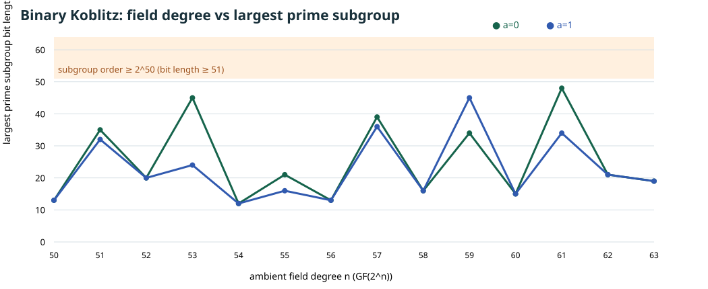

# Binary Koblitz field size and target-subgroup size are different coordinates

**Derived input-selection screen, 2026-10-17 UTC.** The [baseline assessment](2026-10-16-elite-factor-base-baseline.md) called the reviewed Koblitz comparator a 53-bit *field* row and listed subgroup order `21,044,858,204,113`. That prime has bit length 45 (`log₂ r≈44.26`), so the row does **not** measure a subgroup of order `2^50…2^63`. The user's size phrase can mean ambient field size or subgroup order; subsequent experiments must report both. This report checks every standard binary Koblitz curve over `GF(2^n)` for `n=50…63` and does not infer a speed ratio.

## Exact method

For `E_a: y²+xy=x³+a x²+1`, `a∈{0,1}`, direct enumeration over `F₂` gives `#E_0(F₂)=4` and `#E_1(F₂)=2`, hence initial Frobenius traces `t₁=−1,+1`, with `t₀=2`. The characteristic polynomial `T²−t₁T+2` yields the integer recurrence `t_n=t₁ t_(n−1)−2t_(n−2)`, and `#E_a(F_(2^n))=2^n+1−t_n`. The [retrieved elliptic-curve reference, §6.4](https://hyperelliptic.org/tanja/dmbook.pdf), pp. 116–118, states the Frobenius polynomial and extension-field point-count formula; the recurrence and this screen are derived from those identities.

[`tools/icperf_koblitz_size_screen.py`](../../tools/icperf_koblitz_size_screen.py) applies the recurrence, factors each of the 28 resulting orders with SymPy 1.14.0, checks every prime factor using the explicit deterministic Miller–Rabin witness set for integers below `2^64`, and reconstructs each order. The witness set is recorded in the [machine-readable record](../../research/icperf_koblitz_size_screen_20261017/orders.json), alongside each trace, order, factorization, largest prime factor, and cofactor; its use matches the [retrieved SymPy primetest source](https://github.com/sympy/sympy/blob/master/sympy/ntheory/primetest.py). The [editable graph source](2026-10-17-koblitz-size-screen-chart.py), [SVG](2026-10-17-koblitz-size-screen.svg), and [PDF](2026-10-17-koblitz-size-screen.pdf) show the distinction.

| Curve | Field degree | Largest prime subgroup order `r` | `log₂ r` | Cofactor `#E/r` |
| --- | ---: | ---: | ---: | ---: |
| `a=0`, reviewed comparator | 53 | 21,044,858,204,113 | 44.26 | 428 |
| `a=0`, largest `r` in the screened n range | 61 | 162,888,033,982,417 | 47.21 | 14,156 |
| `a=1`, largest `r` in the screened n range | 59 | 25,179,555,920,633 | 44.52 | 22,894 |

**Exact scope:** neither `a=0` nor `a=1` has a prime subgroup with `r≥2^50` at any field degree 50–63. This says nothing about another binary curve, a Koblitz field degree outside the interval, or whether the user intended the interval to label field size. It also does not turn the 53-bit field comparator into a full 50–63-bit *subgroup* baseline. A composite full group can be larger; its ECDLP decomposes across its prime-power factors, so the prime-subgroup identity must remain explicit.

### Certified subgroup-order candidates at larger field degrees

A bounded `factorint(limit=100000)` search at `n=64…80` identified the following prime divisors **inside** the requested subgroup-order interval. The [candidate record](../../research/icperf_koblitz_subgroup_candidates_20261017/candidates.json) retains all 34 attempted cells, including empty rows as *no candidate found by this bounded search*, and verifies each listed `r` independently by deterministic 64-bit primality and exact divisibility of the Frobenius group order. It does not assert complete factorization of every larger group order.

| Curve | Field degree | Certified prime `r` | `log₂ r` | Cofactor `#E/r` |
| --- | ---: | ---: | ---: | ---: |
| `a=0` | 71 | 5,513,228,015,079,457 | 52.29 | 428,276 |
| `a=0` | 73 | 86,020,738,150,056,119 | 56.26 | 109,796 |
| `a=1` | 73 | 5,384,682,420,498,870,703 | 62.22 | 1,754 |

These give concrete **subgroup-order choices** for a Koblitz continuation. The [deterministic fixture record](../../research/icperf_koblitz_subgroup_fixtures_20261017/fixtures.json) now supplies an explicit irreducible trinomial, source point, cofactor projection and prime-order generator for each row. [`tools/icperf_koblitz_subgroup_fixture.py`](../../tools/icperf_koblitz_subgroup_fixture.py) checks the field-polynomial irreducibility criterion, curve equations, `[r]G=O`, and `[#E]P=O`. The [separate Sage replay](../../research/icperf_koblitz_subgroup_fixtures_20261017/sage_replay.json) uses Sage finite-field and elliptic-curve arithmetic, proves each listed `r` prime, rechecks the cofactor projection, and verifies both scalar identities; its [checker source](../../tools/icperf_koblitz_subgroup_fixture_sage_verify.py) and input/source hashes are retained. The replay command was `sage -python tools/icperf_koblitz_subgroup_fixture_sage_verify.py --fixtures research/icperf_koblitz_subgroup_fixtures_20261017/fixtures.json --out research/icperf_koblitz_subgroup_fixtures_20261017/sage_replay.json`.

These are verified **group fixtures**, not IC pipeline measurements. Factor bases, held-out targets, relation systems, full phase costs and matched rho remain to be specified and measured. The higher ambient field degree must be priced honestly.

## Consequence for the elite-base program

Keep the reviewed `GF(2^53)` result as a real, independently checked **45-bit-subgroup comparator** on that exact curve. For an ambient-field 50–63-bit matrix, select and certify each curve and report its actual subgroup order; m=2…8 measurements remain open. For a matrix whose **prime subgroup order** is `2^50…2^63`, the three verified higher-degree Koblitz fixtures are available for a frozen experiment; the 50–63 ambient-field range has no admissible standard Koblitz cell. The [full-width-grid problem](../../problems/full-width-ic-arity-grid-unmeasured.md) now records the remaining runner and measurement obligations. The [direct subfield rank gate](2026-10-17-binary-subfield-base-rank-gate.md) remains conditional on an actual large prime subgroup and its curve; the existing N53 comparator still exceeds its `F₂` ceiling of 5.

This screen selects inputs; it measures no factor-base density, relation yield, solver degree, rank, target work, complete IC cost, or matched rho. No canonical frontier graph changes because no reviewed attack-cost result was added.
