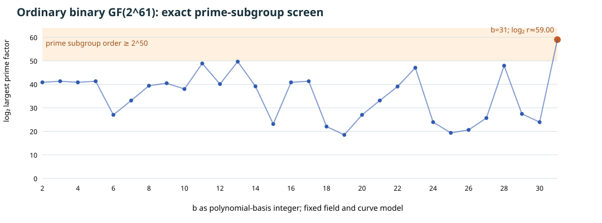

# A verified ordinary-binary subgroup input near 2^59

**Input-selection report, 2026-10-17 UTC.** This record supplies one non-descended ordinary-binary curve and explicit prime-order generator in the user's `2^50…2^63` subgroup-order interval. It does not measure an index-calculus baseline or an elite factor base. The [baseline assessment](2026-10-16-elite-factor-base-baseline.md) and [full-width problem](../../problems/full-width-ic-arity-grid-unmeasured.md) keep those requirements open.

## Bounded curve selection

Fix `F=GF(2^61)=F₂[z]/(z^61+z^5+z²+z+1)` and the model `E_b: y²+xy=x³+b`, with `b` interpreted as a polynomial-basis integer. The [Sage screen source](../../tools/icperf_ordinary_binary_sage_screen.py) checked the field polynomial irreducible, then inspected `b=2,3,…,33` in order, stopping at the first exact group order with a certified prime divisor in `[2^50,2^63]`. It stopped at `b=31` after **30** attempts. Each attempted order was reconstructed from its factorization, and every factor was checked prime with the deterministic 64-bit Miller–Rabin witnesses recorded in the [screen JSON](../../research/icperf_ordinary_binary_fixture_20261017/screen.json). Earlier `b` rows therefore exclude a prime factor in this interval for this exact 30-curve list; they say nothing about other curves or a random-curve success rate. Some rows share an order and are not independent statistical samples.

The [editable graph source](2026-10-17-ordinary-binary-fixture-chart.py), [SVG](2026-10-17-ordinary-binary-fixture.svg), and [PDF](2026-10-17-ordinary-binary-fixture.pdf) show the exact scan boundary. `b=31=z⁴+z³+z²+z+1` has `j(E)=1/b∉F₂`, so this curve is not a Koblitz curve or a curve descended to `F₂` up to algebraic-closure isomorphism.

## Group fixture and independent replay

The selected group order is `#E(F)=2,305,843,010,228,847,052 = 4r`, with prime `r=576,460,752,557,211,763` (`log₂ r≈59.000000001`, bit length 60). The [fixture source](../../tools/icperf_ordinary_binary_fixture.py) uses independent bit-polynomial field and affine curve arithmetic to lift `x=1`, project the source point by cofactor 4, and check the curve equations and `[r]G=O`. The [fixture JSON](../../research/icperf_ordinary_binary_fixture_20261017/fixture.json) records `P=(1,446358225178544464)` and `G=(938161616493806685,1665004790792120888)` in the fixed polynomial basis. Its source, reused arithmetic, and screen digests are bound in the same record.

There is also a group-order proof independent of Sage's point count. The explicit nonidentity `G` has prime order `r`, so `r` divides `#E(F)`. Hasse's interval `2^61+1±⌊2√(2^61)⌋` contains **exactly one** multiple of `r`, namely `4r`; thus the full order follows. The [retrieved elliptic-curve reference](https://hyperelliptic.org/tanja/dmbook.pdf), §6.4, supplies the standard point-count bound. The [separate Sage checker](../../tools/icperf_ordinary_binary_sage_verify.py) independently verified irreducibility, `j∉F₂`, primality with proof, both points, `4P=G`, `[r]G=O`, the unique Hasse multiple, and Sage's own cardinality; its [replay receipt](../../research/icperf_ordinary_binary_fixture_20261017/sage_replay.json) binds the exact fixture and checker bytes. Its command was `sage -python tools/icperf_ordinary_binary_sage_verify.py --fixture research/icperf_ordinary_binary_fixture_20261017/fixture.json --out research/icperf_ordinary_binary_fixture_20261017/sage_replay.json`.

| Stage | Status at this fixture |
| --- | --- |
| Field, curve, prime subgroup and explicit generator | Checked in two arithmetic implementations; full group order fixed by the Hasse interval |
| Target-blind factor-base construction and realized size | Not measured |
| `m=2…8` decomposition, direct `S_8` and chained forms | Not measured |
| Relation yield, useful rank and linear algebra | Not measured |
| Same-point target recovery, complete cost and matched rho | Not measured |

This fixture removes one input-selection dependency for an ordinary-binary baseline. The direct proper-subfield rank obstruction in the [binary subfield report](2026-10-17-binary-subfield-base-rank-gate.md) assumes a curve defined over that subfield and does not apply to this `j∉F₂` curve. A future protocol must freeze a target-blind base, same-size controls, relation and rank checks, memory limits, complete phase costs, and matched rho before trials. No canonical attack-cost graph is changed because this record has no speed comparison.
