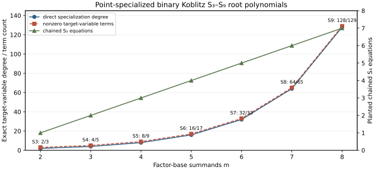

# Koblitz (m=2ldots8) chained inputs and point-specialized direct polynomials

**Date:** 2026-10-18. **Scope:** exact planted correctness inputs on the certified `GF(2^73)` Koblitz curve with a 62.224-bit prime subgroup and the [438-coordinate six-orbit base](2026-10-18-koblitz-six-orbit.md). The [producer (internal)](../../tools/icperf_koblitz_high_arity_inputs.py), [input record (internal)](../../research/icperf_koblitz_high_arity_20261018/inputs.json), [independent Sage source (internal)](../../research/icperf_koblitz_high_arity_20261018/sage_replay.py), [replay result (internal)](../../research/icperf_koblitz_high_arity_20261018/sage_replay.json), [chart source](2026-10-18-koblitz-high-arity-inputs-chart.py), [SVG](2026-10-18-koblitz-high-arity-inputs.svg), and [PDF](2026-10-18-koblitz-high-arity-inputs.pdf) are the record. These inputs do not measure relation yield, solver degree, or ECDLP cost.

## Fixed construction and exact checks

The eight predetermined base-point indices are `0,73,146,219,292,365,1,74`: phase zero from each of six orbits, then phase one from the first two. For each `m=2..8`, the target is the full-point sum of the first `m` points. Every selected point is in the certified prime subgroup and is a root of the archived degree-438 base-membership polynomial. Prefix sums avoid infinity on these fixed inputs.

For `E: y²+xy=x³+x²+1`, the characteristic-two third summation polynomial is `S₃(x,y,z)=(xy+xz+yz)²+xyz+1`. The producer verifies each planted chain equation using full-point prefix sums: `m−1` equations at arity `m`. It also enumerates all `2^m` sign assignments, folds point negation to `2^(m−1)` distinct target `x` roots, and multiplies their linear factors into a monic polynomial in the **target coordinate after every base coordinate is fixed**. The m=2 polynomial is checked against the normalized `S₃` formula. Independent Sage replay reconstructs field and curve arithmetic, all points and chains, all sign roots and coefficients, a nonroot control per arity, and the factorized recursive resultant identity for each point-specialized `S_{m+1}`.

| Summands `m` | Direct point specialization | Target-variable degree | Nonzero terms | Chained `S₃` equations |
| ---: | :--- | ---: | ---: | ---: |
| 2 | `S₃` | 2 | 3 | 1 |
| 3 | `S₄` | 4 | 5 | 2 |
| 4 | `S₅` | 8 | 9 | 3 |
| 5 | `S₆` | 16 | 17 | 4 |
| 6 | `S₇` | 32 | 33 | 5 |
| 7 | `S₈` | 64 | 65 | 6 |
| 8 | `S₉` | 128 | 129 | 7 |

All coefficients of these seven **univariate specializations** are nonzero. The direct `S₈` entry concerns **seven** factor-base summands and one target; the eight-summand direct entry is `S₉`. The complete input construction wall was 0.379315 seconds in one process, after the separately recorded factor-base setup. It is descriptive preparation time; a later complete-cost comparison must charge its own actual setup, attempts, and failures.

## Boundary and next experiment

Fixing all base coordinates makes the direct polynomials small enough to construct by factorized resultants. It does **not** construct the full multivariate `S₈` or `S₉` system whose base coordinates are unknown, prove its sparsity or degree of regularity, or show that a solver can find natural decompositions. The all-nonzero target-variable coefficients are an exact observation on these fixed points, not a claim that every specialization or the multivariate polynomial is dense. The next gate must freeze symbolic direct/chained formulations and equal-size factor-base controls, run planted solver and negative controls, and then measure certified natural relation yield, useful rank, unseen-target reconstruction, whole cold and reusable cost, and matched rho. Every unexecuted or stopped arity remains explicitly unavailable or censored.

The first independent replay attempt completed its algebraic assertions but failed while serializing a Sage `Integer` degree to JSON. Its [partial bytes (internal)](../../research/icperf_koblitz_high_arity_20261018/sage_replay_attempt_01.partial) and [failure record (internal)](../../research/icperf_koblitz_high_arity_20261018/attempt_01_failure.json) are retained; the incomplete bytes use a `.partial` extension so they cannot be mistaken for a valid JSON record. The corrected replay casts that output to a Python integer and reruns every assertion; this serialization failure carries no mathematical implication. The [full-width arity-grid problem (internal)](../../problems/full-width-ic-arity-grid-unmeasured.md) remains open.

**Graph check:** The SVG plots exact finite input degrees, terms and chain lengths. No attack-cost edge is verified, so the canonical ECDLP frontier graph source and rendering are unchanged.
