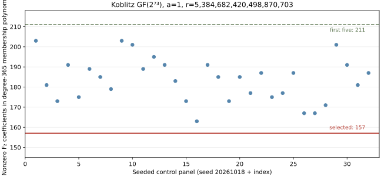

# Target-blind Koblitz Frobenius-orbit factor-base input screen

**Date:** 2026-10-18. **Scope:** exact, finite input construction on one certified Koblitz curve. This is an algebraic candidate screen, not a solver trial, a degree-of-regularity measurement, or a complete ECDLP cost comparison. The [producer (internal)](../../tools/icperf_koblitz_orbit_base.py), [write-once data (internal)](../../research/icperf_koblitz_orbit_base_20261018/base.json), [Sage replay source (internal)](../../research/icperf_koblitz_orbit_base_20261018/sage_replay.py), [Sage replay result (internal)](../../research/icperf_koblitz_orbit_base_20261018/sage_replay.json), [chart source (internal)](2026-10-18-koblitz-orbit-base-chart.py), [SVG](2026-10-18-koblitz-orbit-base.svg), and [PDF](2026-10-18-koblitz-orbit-base.pdf) are the record.

## Question and fixed public input

Can a factor base prepared before targets are known combine Frobenius orbit compression with an exact polynomial over `F₂` whose support is sparser than equal-size orbit controls? The [certified fixture (internal)](../../research/icperf_koblitz_subgroup_fixtures_20261017/fixtures.json) is `E: y²+xy=x³+x²+1` over `GF(2^73)` represented by `z^73+z^25+1`. It has a certified prime subgroup of order `r=5,384,682,420,498,870,703` (`log₂ r≈62.224`) and cofactor `h=1,754`. This lies in the requested prime-subgroup interval, although its ambient field has 73 bits. The earlier complete Koblitz comparison is on a different curve with a 45-bit target subgroup; no timing ratio transfers between them.

The producer scanned the predetermined raw coordinates `x=1..512`. Each liftable raw point `P` was projected to `F=[h]P` in the prime subgroup. It discarded the identity and duplicate Frobenius `x` orbits. For each remaining full 73-element orbit, it constructed the monic minimal polynomial `m_F(X)=∏_(j=0)^72 (X+x(F)^(2^j))` by finite-field multiplication and checked every coefficient lies in `F₂`. The candidate pool has 220 distinct orbits: 278 raw coordinates did not lift, 14 projected to a duplicate orbit, and none projected to the identity.

The target-blind selection starts with `1` and greedily adds one unused orbit whose product gives the fewest nonzero `F₂` coefficients, breaking ties by smaller raw `x`. It selects exactly five orbits: 365 distinct `x` representatives, with point negation implicit. The raw seed coordinates are `498, 442, 41, 299, 25` in selection order. The arity-eight base-size formula used by the [baseline assessment (internal)](2026-10-16-elite-factor-base-baseline.md) gives about 379 representatives at this subgroup order; this finite orbit size is 14 fewer. That count does not establish adequate relation supply.

## Exact algebraic observations

The five-orbit membership equation `M(X)=∏ m_F(X)=0` has degree **365** and **157** nonzero `F₂` coefficients. The largest binary Hamming weight of an exponent in its support is **7**. The first five eligible orbits give 211 terms. Thirty-two predetermined, equal-size random five-orbit panels, drawn from the same 220-orbit pool with seeds `20261018..20261049`, give **163–203** terms and median **185**. These are exact support counts on one finite input pool, not a statistical estimate of solver work. The base record retains every candidate, selected full point, control draw, exact polynomial and construction source hash. Its one-process construction wall was 39.628324 seconds; this is descriptive setup work and must be charged in any later complete-cost comparison.

There is also an exact coverage ceiling. The 365 distinct subgroup `x` coordinates give at most 730 signed points. An unordered eight-term sum with repetition has at most `C(730+8−1,8)=2,078,085,779,887,029,220` distinct multisets, only **0.385925412** times the subgroup order. Counting every arity from one through eight raises this optimistic upper fraction only to **0.390154731**. Thus a single unshifted eight-summand decomposition on this five-orbit base cannot represent every subgroup target, even with a perfect solver. Collisions reduce coverage further. Six full 73-element orbits would give 438 coordinates and make the same count exceed the order, but that necessary count threshold would still prove neither actual coverage nor solver feasibility. Any target shifts, additional bases, or retries must be charged.

The producer resolved the Koblitz Frobenius action on the subgroup as `τ(P)=[λ]P`, `λ=1,069,606,243,985,175,817 mod r`, by checking both roots of `λ²−λ+2=0 mod r` against the certified generator. It checked `λ^73=1 mod r`, all five selected seeds satisfy `[r]F=O`, and each seed satisfies `[λ]F=τ(F)` as a full curve point. The 365 materialized points carry orbit and phase indices. A decomposition relation would therefore have five quotient-log columns with explicitly retained relative phases, subject to independent relation verification; no useful-rank observation was made.

## Limits and next discriminating check

The equation's **term count is an input property**. Degree 365 and exponent binary weight up to 7 may offset the smaller support. The count says nothing about a Gröbner or SAT solver's degree of regularity, linearization size, memory, natural relation yield, independent rank, target descent, or charged end-to-end time. The selected base also has unknown logarithms: raw points were chosen by `x`, then cofactor projected; no scalar construction is used to assign their logs. If a solver instead decomposes the raw points to exploit a raw-coordinate predicate, it must account for the cofactor and all relevant torsion target channels. The present `M(x)=0` applies directly to the projected subgroup coordinates and avoids asserting that the raw predicate survives projection.

The next approved experiment should freeze this exact base as a sparse-input arm with its same-size first/random orbit controls and construct a six-orbit arm before evaluating target coverage. It should compare chained `S₃` and direct `S₈` inputs for seven summands, and a separately labeled eight-summand `S₉` or chain formulation. It must measure actual Boolean/polynomial row counts, observed solving degree, planted correctness, natural relation attempts and distinct rank, linear algebra, unseen target reconstruction, full cold and reused setup costs, and same-point strengthened Frobenius rho. Timeout and memory stops remain censored. No candidate is selected as an end-to-end winner from this input screen; the [full-width measurement obstruction (internal)](../../problems/full-width-ic-arity-grid-unmeasured.md) remains open.

**Graph check:** The canonical ECDLP frontier graph gains no verified attack-cost edge from this study; no canonical graph source changes. This report's SVG plots only the exact finite term-count screen.
