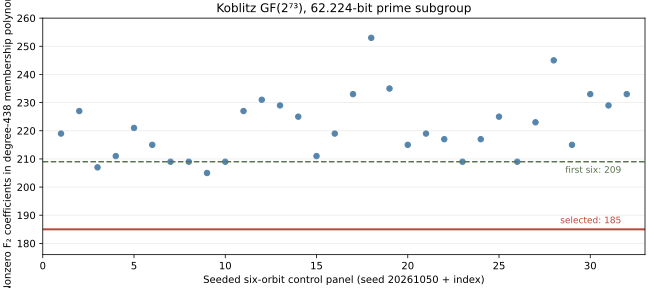

# Six-orbit Koblitz factor-base input screen

**Date:** 2026-10-18. **Scope:** target-blind, finite algebraic input construction on the certified 62.224-bit prime subgroup of `E: y²+xy=x³+x²+1` over `GF(2^73)`. The [producer (internal)](../../tools/icperf_koblitz_orbit_six.py), [record (internal)](../../research/icperf_koblitz_orbit_six_20261018/base.json), [independent Sage source (internal)](../../research/icperf_koblitz_orbit_six_20261018/sage_replay.py), [replay result (internal)](../../research/icperf_koblitz_orbit_six_20261018/sage_replay.json), [editable chart](2026-10-18-koblitz-six-orbit-chart.py), [SVG](2026-10-18-koblitz-six-orbit.svg), and [PDF](2026-10-18-koblitz-six-orbit.pdf) bind this screen. It has no decomposition solver, observed regularity, relation, rank, or ECDLP timing result.

## Selection and exact observations

The preceding [five-orbit screen](2026-10-18-koblitz-orbit-base.md) retained all 220 distinct full Frobenius candidate orbits from a predetermined scan of raw `x=1..512`. This successor fixes those candidate bytes and the first five greedy selections, then adds exactly one unused orbit minimizing the number of nonzero `F₂` coefficients in the product membership polynomial, breaking ties by raw `x`. The added raw seed is **63**, giving the ordered six-seed list `498, 442, 41, 299, 25, 63`. Every raw seed is lifted, cofactor projected, and expanded through all 73 Frobenius phases. The resulting 438 subgroup coordinates are distinct; point negation is implicit, and the six orbit logarithms are unknown.

The selected membership polynomial has degree **438**, **185** nonzero `F₂` coefficients, and supported exponents of maximum binary Hamming weight **8**. The first six eligible orbits give 209 terms. Thirty-two predetermined equal-size six-orbit random controls from the same pool, seeds `20261050..20261081`, give **205–253** terms, median **219**. This compares exact input support on one fixed candidate pool. Neither the smaller support nor the low-dimensional six-log quotient predicts actual solver work.

The earlier candidate scan and five-orbit selection took 39.628324 seconds in its recorded process; this incremental construction took 1.736046 seconds in a separate process. They are descriptive setup observations that must be included, along with input loading and any further preprocessing, in a later cold-start cost ledger. The source, parent record, fixture, and Sage replay are SHA-256 bound in the two JSON records.

## Capacity bound and independent check

With 438 `x` coordinates, there are at most 876 signed subgroup points. Unordered eight-term multisets with repetition number `C(876+8−1,8)=8,878,803,331,971,075,426`, or **1.648900091** times the subgroup order. This exceeds the necessary optimistic count threshold missed by the five-orbit arm. It is not a coverage measurement: different multisets can map to the same sum. At seven summands, the corresponding ceiling is only **0.014939072** of the subgroup order, so a direct `S₈` experiment would cover at most that fraction of uniformly drawn targets with one unshifted base even under perfect solving. Target shifts, additional bases, and retries incur costs.

The independent Sage replay rebuilt the field and curve, proved the subgroup order prime, rescanned all 512 raw coordinates, recomputed 220 minimal polynomials, reselected all six orbits, checked all 438 full points and Frobenius phases, verified polynomial roots, and reproduced all 33 control counts and the multiset bounds. Its first invocation compared Sage's arbitrary `y` lift with the producer's `y` directly and failed on the opposite sign. The replay was corrected to verify the archived raw point's cofactor image and the equality up to sign of the independently lifted point; the final full-point replay passes. This implementation correction gives no scientific evidence for or against the base.

## Next discriminating comparison

Freeze this six-orbit arm and equal-size controls before constructing planted and natural inputs. Compare chained `S₃` against direct `S₈` at seven summands, and separately compare chained eight-summand systems with direct `S₉` only if construction fits the declared resource boundary. Measure input rows, actual solving degree, solver wall and memory, certified natural relation yield, distinct rank, linear algebra, unseen same-point target reconstruction, cold and truly amortized setup, and matched strengthened-Frobenius rho. Preserve every timeout or resource stop as censored. The [full-width arity-grid problem (internal)](../../problems/full-width-ic-arity-grid-unmeasured.md) remains open.

**Graph check:** This chart depicts only finite membership-polynomial term counts. The canonical ECDLP frontier graph has no new verified attack-cost edge, so its source and rendering are unchanged.
