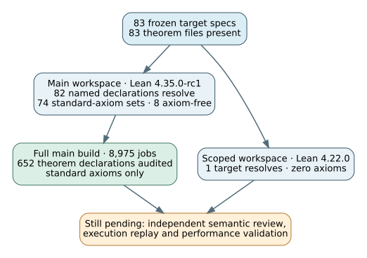

# Formal target declaration audit — 2026-10-23

**Status:** pinned build and declaration audit passed for `crypto-autoresearcher` main `d513b75233e1eb58b24c753ff51675b83b284b44`. This is an operational proof-integration check. It does not independently establish that every Lean statement matches its scientific claim or that every archived experiment is valid.

## Scope and method

The current main tree contains 83 `formal/targets/*.yaml` specs and 83 corresponding theorem files. The [checker](check_target_audit.py) binds all 148 tracked formal files and all target specs to their SHA-256 manifests. It regenerates the exact [Lean batch source](TargetBatchAudit.lean) from the specs, rejects a changed source or a changed theorem name, and verifies the [batch log](evidence/main-target-batch.log) against every target name and Lean's allowed axioms.

The main workspace, pinned to Lean 4.35.0-rc1 and the committed Mathlib manifest, completed [8,975 build jobs](evidence/main-build.log). Its [project audit](evidence/main-axiom.log) examined 652 theorem declarations and found only `propext`, `Classical.choice`, and `Quot.sound`. The batch `#check` and `#print axioms` resolved all 82 main-workspace target names: 74 use only those standard axioms and eight use none. A separate pinned Lean 4.22.0 [scoped build](evidence/scoped-build.log) and [zero-axiom audit](evidence/scoped-axiom.log) checked the remaining target. The [machine-readable receipt](evidence/audit.json) records the exact source and evidence hashes.

The [editable diagram](target-gates.dot) shows the two toolchains and the validation boundary. The checker rejected a changed target audit source, an injected `sorryAx`, and optimized Python that would disable assertions; the [negative-control receipt](evidence/negative-controls.json) records those exits. The same source tree was checked before any new Semaev witness module was added, so these counts describe the named main commit only.

## Additive audit of later main

At main `969e051e204ab8c5668157ebeeb00734a1f074b1`, the formal tree has **84 target specs and 150 tracked files**. The additional target is `DkExactBatch5.exact_discriminants`. A full-history checkout at `abf9e2674e5a1a183c212929fdfd5202e09c08e2` has the *identical formal and batch-five source trees* as this named main commit; [the supplemental checker](check_current_main.py) verifies both tree identities, the source manifests and all evidence hashes. Its [receipt](evidence/current-main-audit.json) records the exact trees and checkout head. The earlier 83-target source, logs, diagram, Typst source and PDF remain pinned to `d513b75233e1eb58b24c753ff51675b83b284b44`.

The current main workspace built **8,976 jobs**, including `DkExactBatch5`. The [project axiom audit](evidence/current-main-axiom.log) checked **656 theorem declarations** and found only `propext`, `Classical.choice` and `Quot.sound`. The generated [83-name batch source](CurrentMainTargetBatchAudit.lean) resolved every main-workspace target: **75 standard-axiom sets and eight axiom-free**. The separate scoped workspace tree is byte-identical to the earlier zero-axiom-audited tree, so its one target retains that pinned result.

For batch five specifically, a [direct Lean audit](Batch5DirectAudit.lean) resolved the target theorem with the three standard axioms and the closed arithmetic lemma with none. The repository's [per-target verifier receipt](evidence/batch5-target-verification.json) also reports `machine_verified`: full build, forbidden-construct scan, project axiom audit, and the exact requested-theorem audit passed against hashed inputs. Its semantic-review status remains **pending**. A [one-digit false discriminant](Batch5OneDigitNegative.lean) was rejected by Lean. All 13 files in the batch-five source manifest matched their hashes; the focused source test suite reported **17 passed, one skipped**. The skipped test requires `cypari2`/PARI to independently prove primality of the three large factors and check the four open cofactors. The source reports a prior PARI proof, but that proof was not replayed on this host. The theorem itself keeps large-factor primality as an explicit premise, and it does not prove primality of the curve field/order or the curve trace and endomorphism-ring bridge.

The batch-five README's result line states `End(E) = O_K` for the named curve; the Lean target certifies integer arithmetic and an abstract-order degree bound, with the curve trace and endomorphism-ring identification explicitly outside its scope. That result line therefore needs a separate source-to-curve model justification before it can be described as Lean-validated. GitHub still reports `lean-verification` as `disabled_manually`, so PR #2492's hosted checks did not build this module; this local audit supplies a named-tree build receipt, not a recurring hosted gate. The [open problem](../../../problems/formal-target-semantic-fidelity-unreviewed.md) tracks the remaining semantic and execution obligations.

## What remains

File presence, kernel acceptance, and allowed axioms are necessary technical checks. They do not prove that the statements faithfully encode all 84 current target claims, independently validate source measurements, or cover the thousands of archived experiment directories. A current-head per-target verifier sweep for the remaining targets and independent semantic review remain claim-level gates; these two declaration audits and the one batch-five per-target receipt do not replace them. The [open semantic-fidelity problem](../../../problems/formal-target-semantic-fidelity-unreviewed.md) names the exact coverage and review obligations. The earlier [2026-10-20 formal validation report](../2026-10-20-formal-validation/report.md) recorded 62 machine-verified targets and four then-undischarged targets at its own source commit. These later audits establish the named declaration inventories and builds without rewriting that dated result.

No benchmark value, canonical scientific graph, performance dashboard, or official hypothesis state changed. The dashboard publication gate and its unresolved ledger integrity warnings are tracked separately in the [Pages preflight report](../2026-10-23-pages-publication-preflight/report.md).
