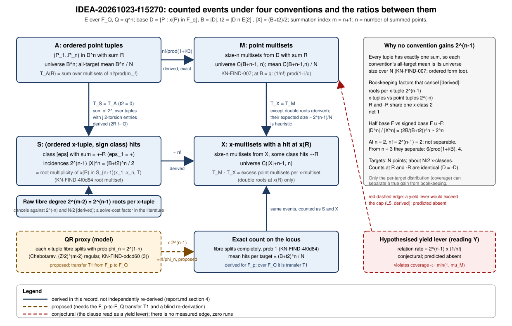

# Search-round report: IDEA-20261023-f15270, re-scope of IDEA-20260803-ff7415

Date 2026-10-23. Task TASK-20261023-4c12dc, batch BATCH-7ca353, goal GOAL-PATH-001, question
RQ-MONO-001. Role: idea-generator, policy research-deep. This is a proposal-stage document.
**Zero runs, no code, no compute: no number below is measured by this session.** Every statement
carries one label.

- **[D]** derived in this report by the idea-generator from cited committed premises. The
  derivation is written out and is *not independently re-derived*. It is a derivation note at
  level 2 of the refutation artifacts in `docs/claims-and-verification.md`, never "proved".
- **[P]** proposed: a conjecture, a design choice, or a transfer assumption.
- **[M]** measured: a number committed in a named record, cited by record and key.
- **[R]** read in this session from a retrieved or frozen source, with its location.

*Figure 1. Counted events under four conventions and the ratios between them. Solid edges are
derived [D]; dashed edges are proposed or conjectural [P]. No edge is measured.*

## 1. The question

`KN-OPEN-62c870` Q3 carries CS-D2 of `DEC-20261017-435b01`: the transfer of the "compounding"
clause from F_p to F_{q^n} is "an untested extrapolation and no exponent statement is made". The
clause comes from the superseded `KN-FIND-c41ea9` and is quoted here only as superseded text, as
`IDEA-20260803-ff7415`, `DEC-20260802-a51c82` and two goal heads carry it: *a per-fibre factor of 2
applied once per summation fibre in a Gaudry/Diem-style decomposition over F_{q^n} with n growing
compounds as 2^{n-1} = q^{Theta(1)} and WOULD move an exponent.*

**Decision question.** Can the clause be specified as a discriminating hypothesis on a current
anchor, which metric carries the discriminating power, and can a derivation alone reach the
disposition? (This unblocks `/design-experiment`: DEC-20261017-12e0f4 S-2 readiness (a) and (b).)

**Answer in one paragraph.** [D] The clause has three readings. Reading Y, a gain in the exact
relation rate, is decided by arithmetic: the rate cannot exceed `C(B+n-1,n)/N`, which at `B = q`,
`N = q^n` is the Gaudry-Diem `1/n!` itself. Reading P, a correction to a quasirandom proxy, is true
and is explained by the regular action of `(Z/2)^{m-2}`: the factor is `1/phi_n = 2^{n-1}`, and it
lifts the proxy exactly to the cap and no further. Reading C, a solve-cost factor, is not decided.
The mean over all targets is an identity under every convention, so ff7415's conservation band and
the all-target trend slope have no power against the clause. The metrics that carry power are the
coverage ratio against a matched random base, the generic complete-split frequency `phi_n` (a
positive control with slope 1), and the exact per-cell convention ratios.

## 2. Corpus screen and sources

Paths searched or read (no shell: no `search_knowledge`, no `tools/*` run).

| Path | How read | Used for |
|---|---|---|
| `ledger/handoffs/TASK-20261023-4c12dc.yaml` | in full | constraints IG-1 to IG-15; sha256 pin **not verified** (no shell) |
| `ledger/proposals/IDEA-20260803-ff7415.yaml` | in full | carry map |
| `knowledge/open-problems/KN-OPEN-62c870.md` | in full | Q3 anchor, PF-1, CS-D2, CS-R7 |
| `knowledge/findings/KN-FIND-007.md`, `KN-FIND-4f0d84.md`, `KN-FIND-bdcd60.md` | in full | conservation, root multiset, monodromy |
| `ledger/decisions/DEC-20261023-19c53b.yaml` | in full | C-Q3 assessment, prior 0.85 |
| `ledger/decisions/DEC-20261017-12e0f4.yaml` | grep, lines 208-297 | S-2 readiness, successor |
| `ledger/decisions/DEC-20260802-a51c82.yaml` | grep, lines 55-94 | relation-rate formula, scope clause |
| `ledger/corrections/CORR-20260802-1d8384.yaml` | in full | the five OI-1 repairs |
| `ledger/hypotheses/H-MONO-663fb4.yaml` | lines 1-66, 515-585, grep | (I1), (I2), HEUR-CHR-3, K8 |
| `ledger/evidence/EV-MONO-04d447.yaml`, `EV-MONO-0e7ace.yaml` | grep by key | no ordered/multiset key found |
| `ledger/evidence/EV-MONO-1ef611.yaml` | grep, lines 335-365 | R2 text |
| `experiments/EXP-MONO-c819ba/execution_report.yaml` | lines 120-140, 268-293 only | F_p both-convention fixture (no run directory opened) |
| `ledger/goals/GOAL-ICEX-001/goal.yaml` 222-250, `GOAL-PATH-001.yaml` 212-236 | read | where the clause is carried |
| `knowledge/frontiers/ecdlp/` README, 8 index-calculus rows in full, all row titles | read | prior_art, dominated_by |
| `knowledge/literature/KN-LIT-673219.md`, `inputs/JOUX-VITSE-2010-157/paper_fulltext.md` | lines 56-66, 236-289, 322-353 | relation form, 1/n! baseline |
| `docs/inventor-protocol.md`, `agents/idea-generator.md`, `templates/research-records.md`, `tools/validate_ledger.py` (prior_art only) | read | schema |
| `src/crypto_autoresearcher/index_calculus/{decompose,tails}.py`, `experiments/EXP-SMON-e5cbe6/code/semaev_cover.py` | headers only | reuse list |

Web (retrieved): two searches; the HAL record `inria-00337631` was refused by an access
interstitial; the later version of Joux-Vitse at
`https://www-fourier.univ-grenoble-alpes.fr/~viva/research/articles/DLFq5.pdf` was read on pages
1-7. [R] Gaudry (2009) and Diem (2011) themselves were **not read**; they are recalled pointers and
nothing here rests on them.

**Finding of the screen [R].** The frozen Joux-Vitse text states the relation form
`R = +-P_1 +- ... +- P_n` with `n` the extension degree (lines 249-256), the equation
`f_{n+1}(x_P1,...,x_Pn, x_R) = 0` (line 274), and "the probability of finding one decomposition of
a point R is approximately #(F u -F)^n/S_n / #E(F_{q^n}) ~ q^n/n! . 1/q^n = 1/n!" (lines 329-349).
The later version (page 5) says "the cost of sign-finding can be reduced by a factor of 2 by fixing
the sign of P_1 to + and considering the 2^{n-1} possible signs": in the literature the 2^{n-1} is
a *cost* remark, not a probability.

**A correction to ff7415 found by the screen [R].** ff7415's mechanism (1) says
`DEC-20260802-a51c82` is "silent on whether the factor compounds". Its text
(`scope_that_must_travel_with_it`, lines 80-84) asserts the opposite: the factor "compounds as
2^{n-1} = q^{Theta(1)} and DOES move an exponent". The goal heads say "would"
(`GOAL-ICEX-001/goal.yaml` lines 229 and 244; `GOAL-PATH-001.yaml` line 223). The carry map records
this as a change with its reason.

## 3. Re-anchoring and the index map

**Index map [D].** A decomposition of `R` into `n` factor-base points, `R = +-P_1 +- ... +- P_n`,
holds iff `S_{n+1}(x_1,...,x_n,x(R)) = 0` (Semaev's defining property, `KR-IC-5a43e5`; Joux-Vitse
Proposition 2 and equation (4) [R]). So `m = n + 1`. `KN-FIND-4f0d84` gives the fibre
`S_m(x_1..x_{m-1},T)` degree `2^{m-2}` over sign classes with `eps_1 = +1`; with `m-1 = n` points
there are `2^n` sign vectors and `2^{n-1}` classes modulo the global sign. The expected `m = n+1` is
confirmed. **Consequence [D]:** `k = m - 1` is the number of summed points in *any* field. A
`k`-point decomposition in F_p uses the same `S_{k+1}` and the same fibre of `2^{k-1}` classes. The
clause's "2^{n-1}" is a function of the point count; the extension degree enters only because
Gaudry-Diem take `k = n`. This also explains why `DEC-20260802-a51c82` can say "constant at fixed
m": `m = 3` there is `k = 2` and the factor is `2^1 = 2`.

**Known-answer control restated on KN-FIND-4f0d84 [P for F_Q].** On the factor-base locus
`S_{n+1}(x_1..x_n,T) = c prod (T - x(sum eps_i P_i))` over sign classes with the sum not `O`,
splitting completely, degree `2^{n-1}` minus the classes summing to `O`. The committed scope is
F_p, toy tier, derivation (corroborated at `m = 3, 4` exhaustively on two curves and `m = 5` at
random with zero exceptions, CS-QB [M]). Over F_Q this is transfer **T1**, not an established
fact. "193/193" is the old figure from the superseded entry and appears here only as history.

## 4. Derivations (all [D] unless stated)

Notation. `Q = q^n`. `E: y^2 = f(x)` nonsingular over `F_Q`, characteristic above 3,
`N = |E(F_Q)|`. `D = {P in E(F_Q) \ {O} : x(P) in F_q}`, so `D = -D`. `B = |D|`.
`t2 = |D n E[2]|` (at most 3). `X = x(D)`, `|X| = (B+t2)/2`. Counts at target `R`:

- `T_A(R)`: ordered tuples `(P_1..P_n)` in `D^n` with sum `R`;
- `T_M(R)`: size-`n` multisets from `D` with sum `R`;
- `T_S(R)`: pairs (ordered x-tuple `xi`, class `[eps]`) with `sum eps_i l_i = +-R`, for fixed lifts
  `l_i` of `x_i`; for `R != O` this is the multiplicity of `x(R)` as a root of `S_{n+1}(xi, T)`;
- `T_X(R)`: size-`n` multisets of `X` having at least one class with sum `+-R`.

### 4.1 Conservation under each convention

**L1 [D].** Every ordered tuple has exactly one sum, so `sum_R T_A(R) = B^n` and the all-target
mean is `B^n/N`. (`H-MONO-663fb4` (I1) states this over F_p; the proof is the same for any finite
abelian group.) `KN-FIND-007` gives `sum_R T_M(R) = C(B+n-1,n)`.

**L2 [D], convention ratio of means.**
`mean T_A / mean T_M = B^n / C(B+n-1,n) = n! / prod_{i=0}^{n-1} (1 + i/B)`,
which lies between `n! exp(-n(n-1)/(2B))` and `n!`. Per target, a multiset with multiplicities
`m_j` has `n!/prod(m_j!)` orderings, so `T_A(R) = sum over multisets mu with sum R of n!/prod(m_j!)`.
The fraction of multisets with a repeated point is `1 - prod_{i<n}(B-i)/(B+i)`. This matches the
F_p observation in `EXP-MONO-c819ba` (lines 125-134 [M]) that `F^m/N` and the multiset mean "agree
only asymptotically", with no single m-independent convention factor.

Nominal values at `B = q` (actual `B` differs from `q` by `O(sqrt q)`):

| n | q | A/M mean ratio `n!/prod(1+i/q)` | compare `n!` | compare `2^{n-1}` |
|---|---|---|---|---|
| 2 | 61 | 1.968 | 2 | 2 |
| 3 | 17 | 5.070 | 6 | 4 |
| 3 | 251 | 5.929 | 6 | 4 |
| 4 | 11 | 14.63 | 24 | 8 |
| 4 | 101 | 22.63 | 24 | 8 |
| 5 | 7 | 36.38 | 120 | 16 |
| 5 | 29 | 86.42 | 120 | 16 |

At `n = 2` the pair `n!` versus `2^{n-1}` is not separable (both 2); from `n = 3` they separate. At
small `q` the ratio sits far below `n!`, so the comparator is always the exact L2 value.

### 4.2 Baseline reproduction (proof_search_map, audit 1)

With `B = q` and `N = q^n`: `C(q+n-1,n)/q^n = (1/n!) prod_{i=0}^{n-1}(1 + i/q) -> 1/n!`, because
`C(q+n-1,n) = q(q+1)...(q+n-1)/n!`. This is the Joux-Vitse `1/n!` [R, lines 329-349] and
`KN-FIND-007`'s remark that the Gaudry-Diem probability *is* the conservation mean. Examples:
`n = 3, q = 17`: `(1/6)(18/17)(19/17) = 0.1972` against `1/6 = 0.1667`; `n = 5, q = 29`:
`0.01157` against `1/120 = 0.00833`. The baseline is a parameter slice of the family
`C(B+n-1,n)/N`, so the proposal is a family extension, not an independent method.

### 4.3 The sign-class convention

**L3 [D].** For `R` with `2R != O`: `T_S(R) = sum over ordered tuples with sum R of 2^{j}`, where `j`
counts entries in `E[2]`. Proof. Fix lifts `l_i`. The map `(xi, eps) -> (eps_i l_i)` from
`X^n x {+-1}^n` to `D^n` is onto and is `2^j`-to-one over a tuple with `j` two-torsion entries
(`l = -l` for those). The sums satisfy `s(-eps) = -s(eps)`. For a class `{eps, -eps}` with
`s = +-R`, exactly one of the two vectors sums to `R`, because `R != -R`. So the number of classes
with `s = +-R` equals the number of vectors `eps` with `s(eps) = R`, which is the sum above. Hence
`T_S = T_A` whenever `t2 = 0`, and `sum_R T_S ~ (B+t2)^n`. The factor `2^{n-1}` therefore does
**not** appear between S and A.

**L4 [D], x-multisets.** `T_M(R) - T_X(R) = sum over x-multisets eta of (number of point multisets
over eta with sum R, minus 1)`, over those `eta` with at least one; two distinct multisets over one
`eta` summing to `R` are two distinct classes with `s = +-R`, i.e. a double root at `x(R)`. Under a
random model the expected relative size is `O(2^{n-1}/N)` [P, heuristic]; each cell reports the
exact count.

**Exact known answers at n = 2 [D].** `T_A(O) = B` (the pairs `(P,-P)`), `T_M(O) = (B+t2)/2` (one
multiset per x-class). These are exact, cheap, and test the counter on a degenerate target.

**Cancellation-free count [D].** A multiset with a pair `{P,-P}` (or `{P,P}` for a 2-torsion `P`)
sums into an `(n-2)`-fold sum. The number of multisets with no such pair is the coefficient of
`z^n` in `((1+z)/(1-z))^{(B-t2)/2} (1+z)^{t2}`. Check at `n = 2`, `t2 = 0`, `b = B/2`: coefficient
`2b^2`, equal to `C(B+1,2) - b = b(2b+1) - b`. Generic targets exclude `E[2]`, `O` and the sums of
`n-2l` base points; their mean is `(N_cf - m_S)/(N - |S|)` with `m_S` of relative size `~ q^-2`.

### 4.4 Where 2^{n-1} is real: the proxy factor

**L6 [D given T1].** By `KN-FIND-bdcd60` (3), for `x_1..x_{m-1}` in the field with every
`f(x_i) != 0` and the fibre squarefree of full degree, Frobenius acts on the `2^{m-2}` roots as
translation by the class of `(chi(f(x_1)),...,chi(f(x_{m-1})))` modulo `+-(1,...,1)`, and the cycle
type is `1^{2^{m-2}}` iff all `chi(f(x_i))` are equal. With `m - 1 = n` independent signs,
`phi_n = P(all equal) = 2 . 2^{-n} = 2^{1-n}` (up to `O(n/sqrt Q)` from Weil). This equals `1/|G|`
for `G = (Z/2)^{m-2}` acting regularly (`KN-FIND-bdcd60` (1)): `|G| = deg = number of sign classes`.
That explains the coincidence ff7415 noticed. On the factor-base locus every `chi = +1`, so the
split probability is exactly 1 (`KN-FIND-4f0d84`).

**Quasirandom proxy QR [P].** Treat each ordered x-tuple's fibre as splitting completely with
probability `phi_n`, and, if it splits, its `2^{n-1}` roots as uniform on the `~N/2` x-classes. Mean
hits per target: `|X|^n phi_n 2^{n-1} (2/N) = 2|X|^n/N`. The exact value is
`2^{n-1}|X|^n (2/N) = (B+t2)^n/N`. **Exact over proxy = `1/phi_n = 2^{n-1}`.** At `n = 2` this is the
committed `1/freq_split ~ 2` of `EV-MONO-a0a89c` OBS-4 (as `EV-MONO-1ef611` R2 records it [M]). The
factor corrects a proxy, as ff7415 conjectured, and lifts the proxy exactly to the conservation
mean, no further.

**L7 [P].** The `DEC-20260802-a51c82` formula `(1-1/W_eff)/freq_split -> 2(1-1/W_eff)` is the
`m = 3` slice. The general-`m` form would be `2^{m-2} prod_{i=1}^{m-2}(1 - i/W_eff)`, reducing to
the committed formula at `m = 3`. Not derived; stated so the design step checks it against the F_p
fixture. If it holds, "2" is not the limit at `m >= 4` in prime fields, independent of extension
fields.

### 4.5 The cap (reading Y)

**L5 [D].** Let `T = T_M(R)` for `R` uniform over the group, `mu = E[T] = C(B+n-1,n)/N`, and
`c = P(T >= 1)` the coverage (relation rate per target). Since `1{T>=1} <= T` and `c <= 1`:
`c <= min(1, mu)`. By Cauchy-Schwarz, `mu = E[T 1{T>=1}] <= sqrt(E[T^2] c)`, so
`c >= mu^2/E[T^2]`. For any base of size `B`, the relation rate is at most `C(B+n-1,n)/N`: at
`B = q` this is `(1/n!) prod(1+i/q)`. **No base, structured or random, and no per-fibre factor can
lift the rate above the Gaudry-Diem `1/n!` (times that product).** A claim of `2^{n-1}/n!` exceeds
the cap whenever `n(n-1)/(2q) < (n-1) ln 2`, i.e. for `n < 1.38 q`. `KN-FIND-007`'s `1.582` is the
matched-random version: gain `<= min(1,mu)/(1 - e^{-mu})`.

Poisson-null ceilings for the coverage ratio against a matched random base (`mu = 1/n!`, [D]
arithmetic):

| n | `mu = 1/n!` | `1 - e^{-mu}` | cap ratio `mu/(1-e^{-mu})` | `log2` ceiling |
|---|---|---|---|---|
| 2 | 0.5 | 0.3935 | 1.2707 | 0.346 |
| 3 | 0.1667 | 0.1535 | 1.0857 | 0.119 |
| 4 | 0.04167 | 0.04081 | 1.0210 | 0.030 |
| 5 | 0.008333 | 0.008299 | 1.0042 | 0.006 |

The ceilings *fall* with `n`. A fitted slope of `log2 kappa_rel` against `n-1` is therefore bounded
above by a negative number under the null, so F1 (slope `>= 0.5`) is unreachable unless a premise
fails. The Poisson null on the coverage-over-cap ratio `(1-e^{-mu})/mu` has `log2` values
`-0.346, -0.119, -0.030, -0.006` at `n = 2..5` and a least-squares slope of `+0.111` against `n-1`:
the null alone uses 74 percent of the band `[-0.15, 0.15]`. That is why the fitted object is the
line-to-matched-random ratio, which cancels this trend.

### 4.6 Quantifier order (proof_search_map, audit 3)

**L8 [D].** `2^{n-1} = q^{Theta(1)}` forces `n = Theta(log q)`: `q` depends on `n`. With
`n = c log2 q`, `n! = q^{(c/ln 2)(ln n - 1)(1+o(1))}`, superpolynomial, while `2^{n-1} = q^c / 2`. A
genuine gain `2^{n-1}` in the rate `1/n!` would change `log_q(1/rate)` by the relative amount
`ln 2/(ln n - 1) -> 0`: not an exponent-class change. Against the published bound, the Gaudry-Diem
hidden constant is `2^{O(n^2)}` (`KN-LIT-673219` lines 63-66 [R]; `n! 2^{n(n-1)}` in
`KR-IC-46d822`), so a `q^c` factor is lower order next to a `q^{Theta(log q)}` upper bound. This
reads relative to an *upper bound* and says nothing about the true cost. A fixed `q` ladder with
`n <= 5` never enters the regime and decides only the premises. The "for all n" content of the
conclusion comes from the closed forms L1-L5, not from the grid.

## 5. What a derivation reaches, and what the measurement adds (IG-9, IG-12)

**The corpus already decides part of it, plainly.** `KN-FIND-007` Consequence 2 states that "any
growth with N clause on mean yield is identically satisfied at slope zero", and its "What this does
not say" bullet states that the Gaudry-Diem `1/n!` *is* the conservation mean. Both are committed
(`confidence: established`, derivation, toy). What the corpus does **not** hold is (i) the origin of
`2^{n-1}` (L6), (ii) the cap written against the clause (L5), (iii) the four-convention map
(L2-L4), and (iv) the transfer T1.

**Derivation alone reaches** [D, pending independent re-derivation]: reading Y and the mean
(L1-L5), the convention table (L2-L4), the origin of `2^{n-1}` given T1 (L6), and the
non-exponent-class statement (L8). The three named dispositions (`CLAUSE_REFUTED_AT_TOY`,
`CONVENTION_ARTIFACT_DIAGNOSED`, `CLAUSE_SUPPORTED`) need the measurement by their names ("at toy")
and are assigned by the Coordinator, not by this record.

**What the measurement adds that the derivation does not:**
1. T1: the F_p derivations (4f0d84, bdcd60) over `F_Q`, at the tested `(q, n)`.
2. Counter correctness, through exact known answers and a failing twin.
3. The Poisson per-target law and coverage against `1 - e^{-lambda}` (HEUR-F-1, F-2).
4. The size of the small-`q` corrections (repeats, 2-torsion, cancelling pairs).
5. A positive control that the toolchain can *see* a `2^{n-1}` trend where one exists (PR-5).

It cannot add anything about `n` beyond the tested ladder, or about reading C.

**Cheapest artifact that would make the derivation official.** A zero-run, blind re-derivation
review of L1-L6 (the pattern used for `KN-FIND-4f0d84` and `KN-FIND-bdcd60`), followed by a
knowledge entry for `KN-OPEN-62c870` Q3 that supersedes the "WOULD move an exponent" reading. The
n = 2 and n = 3 exhaustive cells (enumeration sizes below) corroborate it in a single short run.
Conditional parts (L6 given T1; coverage statements given HEUR-F-1, F-2) are to be recorded under
the two-record rule of `docs/claims-and-verification.md`.

## 6. Design (IG-5, IG-7)

### 6.1 Exhaustive grid, arm A

Group `E(F_Q)`, order `N` found by exhaustive count. Factor base `D = {P : x(P) in F_q}`, `B ~ q`.
Curves per `(n, q)`: 3, coefficients `(a,b)` uniform over `F_Q` from a seeded generator, reject
singular, reject `j(E) in F_q` (this also removes `j = 0, 1728`). Field `F_Q = F_q[t]/(g)`, `g` the
least monic irreducible of degree `n`. Identity fields to freeze: `q, n, g, a, b, N, t2, B, |X|,
seed`. Targets: all `N` points; generic targets exclude `E[2]`, `O` and sums of `n-2l` base points.

| n | q ladder | `Q = q^n` | multisets `C(q+n-1,n)` at `B = q` |
|---|---|---|---|
| 1 (anchor) | 61, 251 | 61, 251 | all ratios must be 1 |
| 2 | 61, 251, 1021, 4093 | 3,721; 63,001; 1,042,441; 16,752,649 | 1,891; 31,626; 521,731; 8,378,371 |
| 3 | 17, 41, 101, 251 | 4,913; 68,921; 1,030,301; 15,813,251 | 969; 12,341; 176,851; 2,667,126 |
| 4 | 11, 23, 53, 101 | 14,641; 279,841; 7,890,481; 104,060,401 | 1,001; 14,950; 367,290; 4,598,126 |
| 5 | 7, 11, 17, 29 | 16,807; 161,051; 1,419,857; 20,511,149 | 462; 3,003; 20,349; 237,336 |

Counts are derived from the parameters, not timings. Ordered x-tuple incidences are `(B+t2)^n/2`,
about `Q/2`. All 48 grid cells (4 `n` x 4 `q` x 3 curves) and the 6 anchors are exhaustive over all
targets; none is sampled. Per curve three bases are run: the line base, a matched random symmetric
base (null), and a half-size random base (failing twin). Cells with `B < n^2` are flagged
repeat-dominated; fits are reported with and without them. The largest `Q` is `104,060,401 < 2^27`,
toy tier by the mechanical rule (field size at most 32 bits).

### 6.2 Arms B and D

**Arm B.** Per curve per `n`, `10^6` uniform ordered x-tuples in `F_Q^n`: complete-split frequency
`phi_hat_n` against `2^{1-n}`. Standard errors: `0.0005` at `n = 2` (`phi = 0.5`), `0.00024` at
`n = 5` (`phi = 0.0625`). `S_{n+1}` is evaluated numerically by the resultant recursion,
cross-checked by the group-law method on a subsample.

**Arm D (optional).** Prime-field window base, `k = 2, 3, 4` points (`m = 3, 4, 5`), same convention
table, to show that the convention ratios and the factor `2^{k-1}` do not depend on the field
degree. Reuses `EXP-MONO-c819ba` outputs as a fixture; not re-measured.

### 6.3 Sampled validation arm C (the heuristic-validation arm)

Required by `DEC-20261017-12e0f4` successor_after_this_lane, `agents/coordinator.md` "Dispatch bias"
and `docs/target-result-profile.md` C12. **Design specification only.**

- **Method: target-sampled, base-exhaustive.** Enumerate all `C(B+n-1,n)` multisets once, sum each,
  and look the sum up in a hash set of `s` sampled target classes (`R` and `-R` share a class; the
  counts agree because `D = -D`). No table of size `N`. Per-target counts are exact; the only
  sampling is the targets. `N` by an SEA/Schoof point counter.
- **Scale.** `Q` between `2^30` and `2^32` (toy by the mechanical rule): `n = 2`, `q` about `2^15`
  to `2^16`; `n = 3`, `q` about `2^10`; `n = 4`, `q` about `2^8`; `n = 5`, `q` about `2^6`;
  `n = 6`, `q = 37`; `n = 7`, `q = 23`. Multisets per cell about `Q/n!` (at `Q = 2^32`: `2.1e9`,
  `7.2e8`, `1.8e8`, `3.6e7` for `n = 2..5`; `C(42,6) = 5,245,786` for `n = 6, q = 37`;
  `C(29,7) = 1,560,780` for `n = 7, q = 23`). An optional extension to `Q` about `2^36`
  (`n = 6, q = 61`; `n = 7, q = 31`) is **medium tier** by the mechanical rule (`32 < bits <= 96`),
  still far from cryptographic scale. `n = 6, 7` sit at `B/n^2` about `1.0` and `0.47`:
  repeat-dominated, handled exactly by L2.
- **Instances and seeds.** Curve seed = SHA-256 of the string `f15270|n|q|index`; the PRNG is named
  by the design step; 3 curves per `(n, q)`; targets by uniform `x in F_Q` with `chi = +1` and a
  uniform sign, one representative per class; a null base and a twin base per curve; every seed in
  the contract.
- **Random model with parameter tied to the conservation mean.** On generic targets
  `T_M(R) ~ Poisson(lambda)`, `lambda = (N_cf - m_S)/(N - |S|)`, with `N_cf` from the generating
  function of section 4.3. `lambda` is the conservation mean of L1-L2 corrected for cancelling pairs;
  there is no free parameter. [P: HEUR-F-1.]
- **Sample sizes and power.** `s >= (1-c)/(c eps^2)`, `c = 1 - e^{-lambda}`, `eps = 0.03` relative
  SE on coverage. At nominal `lambda = 1/n!` (an upper bound on `s`, since the actual `lambda` is
  larger at small `B`): `n = 2`: `1.7e3`; `3`: `6.1e3`; `4`: `2.6e4`; `5`: `1.3e5`; `6`: `8.0e5`;
  `7`: `5.6e6` [D arithmetic]. A coverage ratio of `1.10` against `1` is then `3.3` SE; the clause's
  `2^{n-1}` and the `1.582` cap are many SE away.
- **Machine-readable CDF output.** One JSON file per cell, `results/<cell_id>.cdf.json`: `cell_id,
  n, q, curve_id, seed, B, t2, N, lambda, s, hist, cdf_empirical, cdf_poisson, ks_stat, chi2_stat,
  chi2_df, zero_fraction, coverage, dispersion_index, max_count, p_max_pred, exceptional_targets`.
- **Tail-consistency checks.** (T1) the observed maximum count against the Poisson order statistic,
  `P_pred(max >= observed) >= 0.001`; (T2) the fraction of targets with count `>= 3`; (T3) the zero
  fraction against `e^{-lambda}`; (T4) a structural tail: counts at `R in S` exceed Poisson by
  construction (for `n = 3` and `R in D`, `T_M(R) >= |X|`), reported separately as a
  counter-sensitivity check.
- **Transfer assumption, stated.** Poisson at the tested `(q, n)` is indicative at larger `q` for
  the same `n` (`B/n^2` grows). The derivation L1-L5 needs no such transfer.

## 7. Pre-registration, with each metric's power (IG-3)

Carried from ff7415: the conservation band `[1/1.582, 1.582]`; the trend-slope band `[-0.15, 0.15]`
against a compounding prediction of `1.0`; F1 at slope `>= 0.5`; F2 to F5; the three dispositions.
Nothing is loosened and no data exist to loosen it against.

| Metric | Vacuous by KN-FIND-007? | Power |
|---|---|---|
| PR-1 conservation ratio over all targets | **yes**, an identity (exactly 1 in an exhaustive cell) | counter and convention defects only; the band passes a 40 percent defect |
| PR-2a slope of `log2(PR-1)` against `n-1` | **yes**, identically 0 | none; kept so its inability to fire is on the record |
| PR-2b slope of `log2 kappa_rel` (line coverage over matched-random coverage) | no | fires only through a failed premise; ceilings in 4.5 fall with `n` |
| PR-3 convention ratios (exact, per cell) | partly | detects a counter or encoding error; the n!-versus-2^{n-1} test works from `n = 3` |
| PR-4 split completeness over `F_Q` | not a yield metric | tests transfer T1 |
| PR-5 generic split frequency `phi_n`, slope of `log2(1/phi_n)` | no | the one real `2^{n-1}`; slope 1.0 in `[0.85, 1.15]` |
| PR-6 Poisson law, coverage against `1 - e^{-lambda}` | no | tests HEUR-F-1, F-2 |

**Metrics that carry the discriminating power.** PR-5 (positive, slope 1) against PR-2b (null, slope
0): the two explanations of the clause, a proxy factor versus a yield factor, give predicted slopes
that differ by `1.0`, more than six times the band `0.15`. PR-3 separates a convention artifact
(ratio `2^{n-1}` or `2^n`, separable from `n!`) from the tautology `A/M = n!/prod(1+i/B)`.

**Repair of ff7415's artifact trigger.** ff7415 diagnoses a convention artifact if the ordered count
over the multiset count "tracks `2^{n-1}` OR `n!`". By L2 that ratio tracks `n!` whatever the clause
is, so the trigger fires on a tautology and has no power. The label now requires a ratio that tracks
`2^{n-1}` or `2^n` *and* is separable from `n!` (`n >= 3`).

**What each outcome would mean.**

| Outcome | Reading |
|---|---|
| PR-1, 2b, 3 agree; PR-5 slope 1; controls detect | reading Y refuted at the tested cells, the factor is a proxy factor: `CLAUSE_REFUTED_AT_TOY` with `CONVENTION_ARTIFACT_DIAGNOSED` (compatible, not exclusive) |
| PR-2b slope `>= 0.5` or the cap exceeded at a cell | `CLAUSE_SUPPORTED`: the measured event is not the counted event, or a premise (cap, Poisson null, counter) is false; event identification before any exponent claim |
| PR-5 not near `2^{1-n}` | the proxy reading P or transfer T1 fails: the origin of `2^{n-1}` is unexplained, but Y stays refuted by L5 |
| a positive control not detected (F6) | no null may be claimed; the family is void as a refutation, the derivation is unaffected |
| an exact identity L2-L4 fails (F7) | derivation error; correction record |

## 8. Controls (IG-6, declared before belief)

| Control | Object | Expected | Power |
|---|---|---|---|
| (a) null base | uniformly random symmetric base of size `B` (`t2` matched where possible) | all-target mean ratio exactly 1; 3 SE if sampled | counter defects |
| (a2) failing twin | random symmetric base of size `ceil(B/2)` | ratio `C(B/2+n-1,n)/C(B+n-1,n)`, about `2^{-n}`, exact per cell | proves the counter *can* see a `2^n` effect |
| (b) nearby object | `n = 1` anchor; prime-field window arm D | factor `2^0`, all ratios 1 | confirms no spurious compounding where the clause predicts none |
| (c) positive PC-A | slope of `log2(A/M)` against `n-1`: derived `1.972` at `B -> infinity` (`log2 n! = 1, 2.585, 4.585, 6.907`) | within 0.15 of the L2 value at the actual `B` | the method must detect a slope above 1 built into the convention |
| (c) positive PC-B | slope of `log2(1/phi_n)` | `1.0` | the one real `2^{n-1}` |
| (c) positive PC-C | the failing-twin ratio | about `2^{-n}` | `2^n` bookkeeping visible |
| (d) known answers | `n = 2`: `T_A(O) = B`, `T_M(O) = (B+t2)/2`; split completeness on the locus (F_p scope, CS-QB [M]) | exact | counter and transfer |
| (e) exact denominator | every ratio is against an exact rational | no certifying gate to fail | EV-ECDLP-008 lesson |

Each control has a failing twin or an exact value, so none can pass without power (OI-1 repair 3).

## 9. OI-1 repairs, and overlap (IG-10)

`PF-1` of `KN-OPEN-62c870` applies to any successor census of a relation-search statistic. No waiver
is claimed here; a waiver is for the Coordinator. The five repairs of `CORR-20260802-1d8384` OI-1:

| Repair | Handling in an F_{q^n} decomposition count |
|---|---|
| R1 reverification-disposition rule (defect 3) | **Applied, adapted.** Every cell has an independent recount (S from ordered x-tuples, M from multisets). A cell whose recount ends in `failed_infrastructure` is void and never counted for or against; an outcome depending on it is inconclusive. |
| R2 2-torsion generator guard (defect 7) | **Applied, adapted.** `t2` is reported per curve and carried in L3 and `N_cf`; `E[2]` targets are excluded from the generic set; `j not in F_q` removes the `j = 0, 1728` automorphism curves. |
| R3 relative tolerances on window controls (defect 4) | **Applied.** Tolerances are exact equality or z-scores against the predicted SE, never absolute; each control has a failing twin. |
| R4 `FAMILY_RATE_ALERT` | **Not applicable as defined.** There is no exceptional-locus family in a decomposition count. Its purpose, multiplicity control, is met by Holm correction across cells and a reported flagged-cell fraction. |
| R5 uniform `(A,B)` draw (defect 9) | **Applied.** `(a,b)` uniform over `F_Q`, not a small-height box. |

**Overlap with H-MONO-663fb4.** Its statement carries (I1) the ordered mean and (I2) the exact
variance over F_p; HEUR-CHR-3 and K8 call the ordered/multiset correspondence a declared stage and
cite ff7415. `EV-MONO-04d447` and `EV-MONO-0e7ace` carry no ordered/multiset key (grep by key, no
match); they rest on `EXP-MONO-c819ba`, whose `execution_report.yaml` (lines 122-139, 268-282)
reports both conventions at every F_p cell and that `F^m/N` is not `KN-FIND-007`'s mean. **Reused as
a fixture, not re-measured:** the F_p per-cell `mean_ordered`, `mean_multiset`, `var_ordered`,
`var_multiset` of `EXP-MONO-c819ba` `raw-result.json`, to be read by key by the design step. Raw
numbers live in run directories, which this session did not open. **Not covered there:** F_{q^n},
conventions S and X, coverage and the cap, `phi_n`.

## 10. Carry map summary (33 entries covering every ff7415 field)

**8 kept**, **24 changed**, **1 dropped** (the id). The per-field table with reasons is in the
proposal's `carry_map`. The substantive changes:

- Anchor moved from `KN-FIND-c41ea9` to `KN-OPEN-62c870` Q3 and `KN-FIND-007`; root-set facts from
  `KN-FIND-4f0d84`; "193/193" is history only.
- Mechanism (1) corrected: `DEC-20260802-a51c82` asserts the clause, it is not silent.
- Counting widened from two conventions to four (A, M, S, X) with exact predicted ratios.
- The all-target trend slope is declared vacuous; the same band is applied to the coverage ratio
  against a matched random base.
- The artifact trigger repaired (tautology).
- Added: the sampled validation arm C, positive controls PC-A to PC-C, the failing twin, the
  proof_search_map, the OI-1 handling.
- Kept: the conservation band, the slope band `[-0.15, 0.15]` and compounding value `1.0`, F1 at
  `0.5`, F2 to F5, the three dispositions, toy tier, "moves no exponent in either direction".

## 11. Prior and recommendation

**Prior, recorded before any work.** At least 0.90 that the measurement agrees with the derivation;
disagreement paths are a derivation error, a failed transfer T1, a counter defect, or the clause
meaning reading C. `DEC-20261023-19c53b` recorded 0.85 for artifact or refuted.

**Recommendation to the Coordinator (not an assignment).** Rank the zero-run blind re-derivation of
L1-L6 first, since it decides readings Y and the mean at the lowest cost; then `/design-experiment`
with arms A and B as the primary contract, arm C as the paired heuristic-validation arm, and a
proof-of-concept implementation task in the same batch. **Cheapest valid discriminator to run
first:** the `n = 2` and `n = 3` exhaustive cells with the null base and the failing twin
(enumeration at most `2,667,126` multisets at `B = q`), because they test the exact identities
L2-L4, the known answer `T_M(O) = (B+t2)/2` and the counter's power at once.

**Blockers for `/design-experiment` (S-2 readiness).** (a) re-anchor: cleared by this record.
(b) sampled arm: specified here. (c) implementation: not cleared; it needs `F_{q^n}` arithmetic for
`n` up to 7, point counting, the exhaustive histogrammer and numeric `S_{n+1}`. Reusable by path
(headers read, bodies not): `experiments/EXP-SMON-e5cbe6/code/semaev_cover.py` (F_p and F_{p^2}),
`src/crypto_autoresearcher/index_calculus/decompose.py`, `tails.py`. Also: an independent
re-derivation of L1-L6 is advisable before a contract freezes the predicted values.

## 12. Limitations

- **[D] is not verified.** Nothing here is independently re-derived. A reviewer should treat L1-L8 as
  a derivation note awaiting a blind re-check.
- **Scope.** Toy tier. The grid is at most `Q < 2^27`; arm C at most `2^32` (toy) with an optional
  `2^36` (medium by the mechanical rule). CS-D2 and CS-R7 bind: the transfer from F_p to F_{q^n} is
  an untested extrapolation and no exponent statement is made. **This moves no exponent in either
  direction.**
- **T1 is a transfer.** Both 4f0d84 and bdcd60 are F_p statements. L6 and PR-4, PR-5 are conditional
  on T1. `RQ-MONO-001`'s own scope lists prime fields only; ownership is recorded in
  `DEC-20261023-19c53b`.
- **Reading C is untouched**: fibre degree, Groebner cost, sign-finding cost, and a per-attempt
  success inside one algorithm. The cap bounds relations per target, hence attempts times success,
  not cost. Larger factor bases (`B > q`), target-dependent bases (`KN-OPEN-020`), relation rank and
  independence (`KN-FIND-007` "not captured") are untouched.
- **Literature.** Gaudry and Diem were not read. The `1/n!` baseline rests on the Joux-Vitse
  restatement. Whether L2-L5 are already in the published literature was not checked.
- **Not done (no shell).** The sha256 pin of the card, `tools/allocate_id.py --check`,
  `tools/validate_ledger.py`, `tools/build_frontier_map.py --match` and `search_knowledge` were not
  run; the YAML was checked by eye only. The proposal exceeds the 8 KiB advisory cap (an advisory in
  `validate_ledger.py`, not an error), because the card's required content cannot fit and its write
  scope has no sibling notes file.

## 13. Honest accounting (docs/inventor-protocol.md section 5)

- **Objects considered.** (1) the all-target mean count per convention; (2) the per-target count
  distribution and coverage; (3) the sign-class root multiset of the fibre; (4) the proxy-to-exact
  ratio `1/phi_n`; (5) a per-attempt success inside an exhaustive `S_3` solve tree (named, not
  examined). Established families are off-limits as the lens: summation-polynomial decomposition
  with Groebner solving (`KR-IC-5a43e5`, `46d822`, `081a58`), symmetrised polynomials and torsion
  (`KR-IC-955fd6`). No object enumeration for the ECDLP exists (`KN-OPEN-019`), so the list is a
  sketch.
- **Lossy-projection test.** A, M-with-multiplicities and S are changes of coordinates (L2, L3
  recover one from another), so their ratios carry combinatorial weights and no new information about
  yield. The all-target mean is a lossy projection (it forgets the target) and is exact under every
  convention, hence vacuous for any claim about bases. Only the coverage (per-target indicator) is a
  lossy projection that separates bases.
- **Operation set and class.** Operation: translation by factor-base elements; index calculus is
  Class I, partial-action (`IDEA-20260806-c5d183`). No non-translation operation set is proposed; the
  record is not an attack, so search bias 6 supplies no candidate.
- **Depth of verified structure.** Derivation tier, unreviewed, toy; no measurement.
- **`dominated_by`:** `n/a (no result claimed)`. Frontier rows checked: `KR-IC-46d822`, `64659b`,
  `5a43e5`, `081a58`, `955fd6`, `5931ee`, `73db3f`, `9e610d`.
- **`sota_delta`:** no attack; measurement/correction contribution only. The clause would put the
  rate `2^{n-1}` above the `1/n!` baseline (2, 4, 8, 16 times at `n = 2..5`); L5 caps it at a ratio of
  1 to the baseline.
- **Closures, with mechanism (inventor-protocol section 4).** *Closed:* the clause read as a gain in
  relation rate at fixed factor-base size. Obstruction: exact conservation plus the coverage cap
  (L1, L5). Argument: every tuple has one sum, so only universe-size ratios differ. *Not closed, and
  naming what remains:* reading C (solve cost), larger factor bases, target-dependent bases, relation
  rank and independence, and any `n` beyond the ladder.
- **Open directions.** (1) blind re-derivation of L1-L6; (2) the general-`m` form L7 against the F_p
  fixture, which matters to `GOAL-ICEX-001`'s read of `DEC-20260802-a51c82` independently of extension
  fields; (3) the per-attempt success of `decompose.py`'s exhaustive tree (reading C); (4) a `KN-LIT`
  entry for the later Joux-Vitse version read here.

## 14. Citations with provenance

| Ref | Provenance | Used for |
|---|---|---|
| `KN-LIT-673219` (Joux-Vitse, ePrint 2010/157, frozen) | kb, read by this session at lines 56-66, 236-289, 322-353 | relation form, `f_{n+1}`, `1/n!`, constants |
| `https://www-fourier.univ-grenoble-alpes.fr/~viva/research/articles/DLFq5.pdf` | retrieved, pages 1-7, not frozen | sign-finding as a cost remark (p.5) |
| `KN-FIND-007`, `KN-FIND-4f0d84`, `KN-FIND-bdcd60`, `KN-OPEN-62c870` | internal, read in full | premises |
| `KN-LIT-001`, `KN-LIT-002`, `KN-LIT-003` (Semaev, Gaudry, Diem) | recalled as pointers; abstract_read in frontier rows | not relied on |
| `DEC-20260802-a51c82`, `CORR-20260802-1d8384`, `EXP-MONO-c819ba`, `H-MONO-663fb4` | internal, read at the stated lines | formula, repairs, fixture, overlap |
