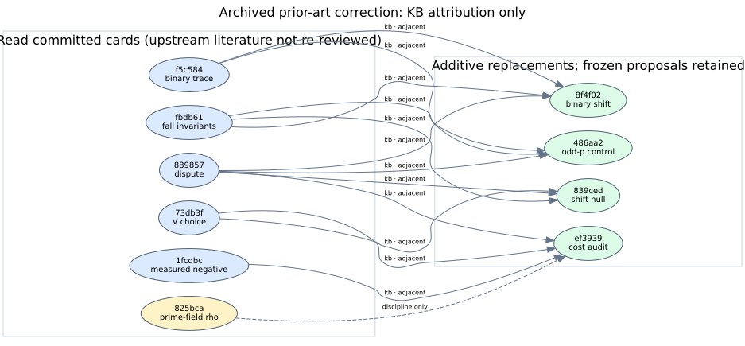

# Four archived prior-art metadata corrections

**Status:** Source-bound metadata correction. The full ledger gate remains red. No experiment, theorem, numerical result, hypothesis status, or performance dashboard value changes.

## Scope and source reading

Four October 6 proposals (`IDEA-20261006-486aa2`, `839ced`, `8f4f02`, and `ef3939`) name a real `knowledge/frontiers/ecdlp/index-calculus` directory, but append a descriptive parenthesis to the path. Their nearest-prior-work entries also place prose in the typed `relation` field and omit `provenance`. The archived records remain byte-for-byte unchanged.

I read the six committed nearest-prior-work cards: `KR-IC-f5c584` (binary trace mechanism), `KR-IC-fbdb61` (distinct fall and solving-degree invariants), `KR-IC-889857` (the disputed first-fall assumption), `KR-IC-73db3f` (factor-base subspace heuristic), `KR-IC-1fcdbc` (measured negative binary summation results), and `KR-RHO-825bca` (reported prime-field rho constants). The cards' upstream literature has mixed `abstract_read`, `secondary_source`, and `full_text_read` states; this correction does **not** independently verify their papers or the archived proposals' pasted 24-row inventory. In particular, `KR-RHO-825bca` concerns prime-field constants; proposal `ef3939` already forbids transferring those numbers to its binary vOW baseline.

Each hash-bound replacement points `frontier_map` at the directory, marks these six card references as `kb`, and classifies their relationship as `adjacent`: each proposal is a prospective control or cost audit around the card, not the same known result. The original prose is retained verbatim in `relation_detail`, and each `delta` is unchanged. The [focused checker](check_sources.py) compares all other parsed proposal fields and registry hashes, confirms every listed KR path exists, and binds the six cards to their exact SHA-256 hashes. It runs under optimized Python without relying on assertions.



The [editable graph](prior-art-graph.dot) shows only these KB attribution links. It does not encode a new mathematical implication. Searches of canonical graph sources in `knowledge/frontiers/ecdlp/` and related report graphics found no existing visual naming these four proposal IDs; no canonical scientific graph or performance value needed revision.

## Full-tree validation

On exact PR parent `9fc0685a5fd51e5fe66a80d42124f1d522f7c8f5`, complete-tree `python3 tools/validate_ledger.py` reported **118** unsuppressed errors. With the four additive replacements, the same command reported **88**. The [machine receipt](validation.json) and [parent](validator-parent.log) and [candidate](validator.log) logs show exactly **30** removed lines: seven for each of the first three proposals and nine for `ef3939`; zero lines were added. Both validator runs exited 1, so this is a scoped correction rather than a clean-ledger claim. The 1,210-entry grandfathered baseline and the frozen proposal bytes are unchanged.

The remaining errors include prior-art, review-plan, execution-record, and reference issues that require their own source-backed corrections. A passing metadata check would still not replay the underlying experiments or establish that every formal target faithfully states its scientific claim. The [open ledger problem](../../../problems/full-ledger-validation-errors.md) retains those obligations.

## Reproduce

From a full checkout of this PR head with PyYAML installed:

```sh
python3 -O docs/reports/2026-10-23-odd-characteristic-prior-art-correction/check_sources.py
python3 tools/validate_ledger.py
cd docs/reports/2026-10-23-odd-characteristic-prior-art-correction
dot -Tsvg prior-art-graph.dot -o prior-art-graph.svg
dot -Tpdf prior-art-graph.dot -o prior-art-graph.pdf
tectonic report.tex
```

The validator is expected to exit 1 with 88 remaining errors. The PDF embeds the graph and reports the same limited scope.
