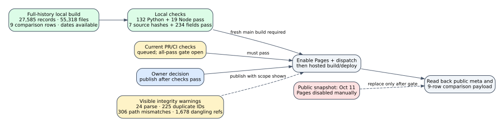

# Pages publication preflight — 2026-10-23



**Status:** Local build and source checks passed for `crypto-autoresearcher`
main `e9b91d62a9b81a3e33a62f9f3e5036e8f7707907`. Publication has not
occurred. The public dashboard is still the October 11 snapshot, and the
Pages workflow is still `disabled_manually` as of 01:48:39 UTC. The user
authorized re-enabling and publishing **after all checks pass**. Current PR
and CI checks were queued at the last check, so the condition has not been
met. The reason for the historical manual disable remains unknown.

## Requirement and evidence

| Requirement | Current evidence | State |
| --- | --- | --- |
| Build from current main with full commit history | [Build receipt](evidence/site-report.json) and [snapshot check](evidence/snapshot-check.json): Git history is complete, 6,590 commits and 88,459 paths indexed; 27,585 records, 55,318 files, 523,416,604 bytes. | Passed locally for named commit |
| Check reader code | [Python test log](evidence/python-tests.log): 132 passed on Python 3.11.17. [Node install log](evidence/node-install.log) and [test log](evidence/node-tests.log): 19 passed on Node 22.23.4. | Passed locally |
| Bind displayed primary benchmark rows to sources | [Snapshot check](evidence/snapshot-check.json): all seven files pinned to cryptanalysis commit `5ab7d5bc5a16ff4d87a5ef8bed45cf9543f47c14` match their SHA-256; nine source rows pass 90 direct field comparisons, and nine displayed receipts pass 144 mapped field/source comparisons. `comparisons.json` SHA-256 `c03a242b79197f0603bbf6657766a90e030f6d419c907c3e5ac68e07021d043b`, byte-identical to the prior checked payload. | Passed for archived nine-row scope |
| Show integrity limitations | The generated payload reports 24 unparseable records, 225 duplicate IDs, 306 ID/path mismatches, and 1,678 dangling references. The full ledger validator is separately red. | Visible, unresolved |
| Publish current main | [Public status readback](evidence/public-status.json): Pages disabled, public meta names `bb9e9f01f3f9fcdf6e456acd7e01cd9af6c05bc3` built October 11. | Pending checks and hosted deploy |

The PR-scoped [merge hygiene log](evidence/merge-hygiene.log) passed on a
full-tree scratch checkout with this exact patch applied: no conflict
markers, newly unparseable records, identifier collisions, or new legacy
goal IDs. The sparse authoring checkout cannot satisfy that check's trusted
goal-directory precondition, so its failure was not treated as a source
verdict.

The previous local snapshot was shallow and correctly withheld record commit
dates. This run fetched complete history with `git fetch --unshallow
--filter=blob:none origin main` before building. `meta.json` now says
`git.available: true`; the output commit equals the checked source commit.
The build size is below the workflow's 900 MB rejection threshold. These
checks validate dashboard generation and the selected archived comparison
mapping. They do not rerun the nine underlying experiments or resolve the
integrity warnings.

## Reproduce

From a complete checkout of the named auto-researcher commit with Python
3.11 and PyYAML, run:

```sh
python -m ui.build --out site-fullhistory --report site-report-fullhistory.json
python -m pytest tests/test_ui_index.py tests/test_ui_ops.py tests/test_ui_benchmarks.py tests/test_curve_identity.py -q
npm ci --prefix ui --ignore-scripts --no-audit --no-fund
node --test tests/test_ui_client.cjs
python docs/reports/2026-10-23-pages-publication-preflight/check_snapshot.py \
  --repo . --site site-fullhistory \
  --source-repo /path/to/cryptanalysis \
  --build-report site-report-fullhistory.json \
  --out snapshot-check.json
```

The [execution manifest](evidence/execution.json) records the exact local
commands and versions, including the explicit Node 22 binary used for `npm ci`
and the test command. The source repository must contain the pinned
cryptanalysis commit above.
The checker verifies the full-history invariant, exact source SHA-256 pins,
source rows, displayed fields, build counts, and integrity warning counts.
It rejected a deliberately changed displayed operation count and an
optimized-Python invocation that would disable its assertions
([negative controls](evidence/negative-controls.json)). It is scoped to the
nine archived primary rows. The [diagram source](publication-gate.dot)
records the deployment gate; [report.pdf](report.pdf) embeds its vector
rendering.

## Publication gate and graph state

Before enabling Pages, recheck the exact current main head and all required
and applicable PR/CI results. If main advances, repeat the full-history build
and snapshot check on that head. Then enable the workflow, dispatch it, require
successful hosted build and deploy, and read back public `data/meta.json` and
`data/comparisons.json`. The live commit must match the published main commit;
the live comparison payload must retain nine pinned primary rows with no
error and display its integrity warnings. The user has already authorized
this action once those conditions pass.

No canonical benchmark graph changes here: the comparison payload is
byte-identical to the earlier checked build, and no benchmark number or
underlying measurement changed. The diagram shows the operational gate and
unresolved warning counts. It is not a scientific performance figure.
