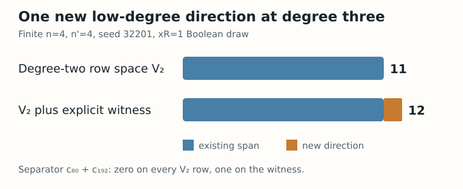

# Concrete finite Semaev first-fall witness — 2026-10-23

**Status:** machine-checked finite proof, pending independent semantic review and hosted current-head CI. This report makes no generic first-fall, solving-degree, ECDLP cost, or official hypothesis-state claim.

## Question and source

Can we exhibit the low-degree class whose existence was proved in the [finite filtration certificate](../../../formal/CryptoResearch/Semaev/BooleanParityFiltrationCertificate.lean)? The frozen sample is `n=4`, `n'=4`, draw index `1`, seed `32201`, `x_R=1`, basis `[9,3,2,12]`, over `F₂[X]/(X⁴+X+1)`. Its four component equations have canonical SHA-256 `89ab8e668c510572bbf9307f105b2eaf46858ad900f0b6b4a2fce8803e0ba6eb` in the [archived replay](../2026-10-22-semaev-first-fall-replay/evidence/draws.json). No new experiment was run; the same archived draw and corrected Boolean multiplication rule were used.

## Constructed certificate

The [Lean module](../../../formal/CryptoResearch/Semaev/ConcreteFirstFallWitness.lean) selects 23 of the 80 compatible degree-three rows with `comboMask = 1321682796735964` and XORs them. Its packed coefficient vector is `6277101735386703064921270320751746415339343215057222047510`; the present monomial masks are `1, 2, 4, 8, 9, 10, 12, 16, 18, 20, 32, 40, 48, 64, 65, 128, 144, 192`. Every present monomial has degree at most two.

The linear functional `c₈₀ + c₁₉₂`, where `cₘ` is the coefficient of monomial mask `m`, is zero on all 28 compatible degree-two rows. It is one on this vector. By linearity, the vector cannot be in their span. Lean proves membership in the degree-three row space by induction over the selected XORs, checks the degree bound, and proves the separator annihilates the degree-two span. Its theorem `concreteNewFall` states exactly that the vector belongs to `V₃ ∩ R≤2` and lies outside `V₂`.

The independent [source-binding checker](check_source_binding.py) compares the archived equations with Lean's literal list, regenerates the Boolean rows in source order, recomputes the XOR and separator, and checks that adding the witness raises the degree-two rank from 11 to 12. Its [machine-readable receipt](evidence/source-binding.json) lists every selected row and source hash. The archived set-product error remains a negative control: multiplication of the first equation by mask `1` retains three masks that cancel under F₂ parity.

The [editable chart source](render.py) reads the binding receipt. These are exact finite dimensions, with no sampling uncertainty. The canonical archived-versus-corrected first-fall [draw chart](../2026-10-22-semaev-first-fall-replay/draws.svg) and performance dashboards need no data change: this certificate adds a witness for one already charted draw and measures no performance. The archived 70/10 and corrected 68/12 counts remain distinct.

## Validation and limits

The [proof receipt](evidence/concrete-proof.json) records the pinned Lean version, full workspace build, project theorem axiom audit, theorem axiom output, target verifier, and source hashes. The [formal target](../../../formal/targets/semaev-s3-concrete-first-fall-20261023.yaml) is additive; the historical target and result remain unchanged. This certificate refines an already proved finite existence theorem. It still needs independent semantic-fidelity review before claim wording changes. Generic `rankOn` correctness, generic symbolic descent, a reviewed additive correction of the historical uniform wording, and cryptanalytic cost inference remain open in the [problem record](../../../problems/semaev-degree-two-fall-nonzero-bridge.md).
