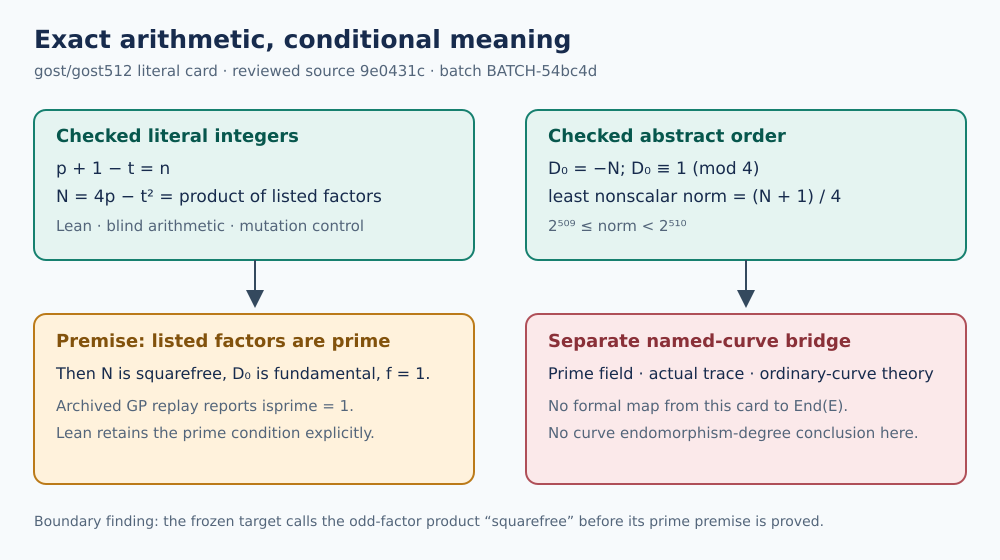

# Batch-five GOST discriminant: independent semantic review

**Reviewed source:** `9e0431cfcea350dac1f50f96419f0ac8d4a189f6`  
**Review batch:** `BATCH-54bc4d` · 25 October 2026  
**Verdict:** The literal integer certificate and abstract-order norm bound hold. The frozen target overstates one unconditional step by calling the listed odd-factor product the *squarefree part* before proving that its factors are prime. The theorem leaves that primality as a premise. No named-curve endomorphism-ring or degree conclusion follows from this numeric theorem alone.

## Question and evidence custody

The [batch-five target](https://github.com/aburan28/crypto-autoresearcher/blob/9e0431cfcea350dac1f50f96419f0ac8d4a189f6/formal/targets/endosweep-dk-exact-batch5-discriminants.yaml) concerns the recorded `gost/gost512` integers in [the producer archive](https://github.com/aburan28/crypto-autoresearcher/tree/9e0431cfcea350dac1f50f96419f0ac8d4a189f6/research/endosweep_dk_exact_batch5_20261023), its factor split, a quadratic discriminant, and the least nonscalar norm of an abstract order. The [review plan](../../../coordination/formal-reviews/BATCH-54bc4d/review-plan.yaml), [blind card](../../../coordination/formal-reviews/BATCH-54bc4d/blind-input.yaml), and [18 source hashes](../../../coordination/formal-reviews/BATCH-54bc4d/input-bindings.json) were committed before the reviewers started. No new experiment, PARI job, Sage run, or EKS job was launched.

Three separately committed and released reviews cover different joints:

| Joint | Frozen evidence | Result |
| --- | --- | --- |
| J1 source custody and wording | [J1 attestation](../../../coordination/formal-reviews/BATCH-54bc4d/reviews/TASK-20261025-5dc462/j1-source-custody.yaml), commit `589f56266179` | Twelve bound source hashes and internal arithmetic/factor records agree; the named-curve statement is conditional. |
| J2 Lean theorem boundary | [J2 attestation](../../../coordination/formal-reviews/BATCH-54bc4d/reviews/TASK-20261025-e19dad/j2-lean-boundary.yaml), commit `f44f0996aa1d` | The pinned target compiles, but unconditional “squarefree part” wording exceeds the proved list product. |
| J3 blind integer rederivation | [J3 attestation](../../../coordination/formal-reviews/BATCH-54bc4d/reviews/TASK-20261025-9add12/j3-blind-arithmetic.yaml), scientific commit `1d9401c1a39a` | Exact identities and bounds pass; factor primality and the curve bridge remain premises. |

The blind result was frozen before the J3 reviewer saw any producer or sibling scientific result. The [archive receipt](../../../coordination/formal-reviews/BATCH-54bc4d/archives/TASK-20261025-da40fd/snapshot-receipt.json) records the exact report hashes and the independence check. J1 disclosed initial workspace filename enumeration and a host AGENTS read before isolation; no sibling scientific content entered its verdict. J2 disclosed a failed probe under the wrong default Lean version, followed by a successful direct compile under the pinned version. J3 made a metadata-only attestation correction after its completed release; the receipt keeps both its original scientific hash and final attestation hash.

## What the integers establish

Let `p`, `n`, and `t` be the three literal integers on the blind card, with `h=1`, and put `N=4p−t²`. J3 independently checked `p+1−t=h·n`, `N>0`, and the exact product of the three listed factors equals `N`. It found `2^511 ≤ N < 2^512`, `N ≡ 3 (mod 4)`, and hence `D₀=t²−4p=−N ≡ 1 (mod 4)`. Changing just the last digit of the second factor makes the product unequal to `N`; the difference is exactly the product of the first and third factors.

For the **abstract order** `Z[(1+√D₀)/2]`, the norm of a nonscalar element can be written `(a²+N·b²)/4`, with `a` and `b` of equal parity and `b≠0`. The odd case attains `(N+1)/4` at `|a|=|b|=1`; the even case has minimum `N`. Therefore the least nonscalar norm is `(N+1)/4`, with `2^509 ≤ (N+1)/4 < 2^510`. This conclusion uses the literal negative order discriminant. It does not identify an endomorphism of the named curve.

The archived factor custody is more limited than the arithmetic equality. The project driver found the 11-digit factor with GMP-ECM. The 71- and 74-digit factors were fetched from FactorDB; their original finder and discovery method are unknown. The repository retains a GP script, output and prior replay receipt reporting PARI/GP 2.19 `isprime=1` on all three factors, but this review did not rerun PARI or obtain separate primality certificate objects. The exact product by itself cannot prove that a listed factor has no repeated prime divisor. Thus `D₀` is an order discriminant unconditionally; calling it the field's fundamental `D_K` with conductor `f=1` requires the three prime premises.

## What Lean checks, and where the wording breaks

J2 directly elaborated the pinned [DkExactBatch5.lean](https://github.com/aburan28/crypto-autoresearcher/blob/9e0431cfcea350dac1f50f96419f0ac8d4a189f6/formal/CryptoResearch/Endosweep/DkExactBatch5.lean) with Lean `v4.35.0-rc1`, using cached imported oleans whose relevant source hashes and manifest matched the pinned tree. `gost_gost512_holds` has no reported axioms. The elaborated `exact_discriminants` type asserts a singleton `dkCerts`, `c.Statement` for its member, and the bounds `2^511 ≤ |c.DK|` and `2^509 ≤ c.deg`; its reported axioms are `propext`, `Classical.choice`, and `Quot.sound`. A one-digit factor mutation led to a kernel-checked product inequality. This is a direct target compile, not a clean dependency rebuild.

The imported `Statement` checks the literal product, odd-exponent list, parity and discriminant construction, and abstract norm value. Its fundamental-discriminant conclusion has the explicit form **all `largePrimes` are prime ⇒ `IsFundamental DK`**. All three listed factors are in `largePrimes`. Neither `gost_gost512_holds` nor `exact_discriminants` proves that premise. Yet target line 27 lists “the squarefree part of `4p−t²`” among unconditional results, and the theorem comments also call the listed bases primes and their product squarefree without carrying that premise. The checked proposition supports **product of the odd-exponent listed factors** unconditionally; “squarefree part” and “fundamental” require the prime premise. This is a semantic boundary error in the prose, not evidence that the factors are composite or that the integer identity is false.

The [producer README](https://github.com/aburan28/crypto-autoresearcher/blob/9e0431cfcea350dac1f50f96419f0ac8d4a189f6/research/endosweep_dk_exact_batch5_20261023/README.md) later qualifies `End(E)=O_K` on a prime field, the actual Frobenius trace, factor primality and ordinary-curve theory, and says the model identification is outside Lean. Its title and opening answer omit those qualifications, so a standalone quotation can overstate the result. The theorem type contains no named curve model, proof that `p` is prime, actual trace, endomorphism-ring map, or degree-as-norm equivalence. The abstract lower norm bound must remain an abstract-order bound.

## Disposition

1. Preserve the frozen target and add a dated correction stating that `s` is the product of the odd-exponent **listed factors** until their primality is supplied. State `D_K` fundamental and `f=1` only under the prime premises, or add Lean-checked primality certificates for an unconditional claim.
2. Carry the field-size, actual-trace, ordinary-curve and order-identification premises beside any named-curve `End(E)` or endomorphism-degree statement. A curve-level Lean claim needs explicit theorems connecting those data to the literal certificate.
3. Keep the factor origin distinct: project ECM for the 11-digit factor; external FactorDB for the other two. Preserve the archived PARI replay as evidence of a reported prior check, without presenting it as a new check in this review.

No measured runtime, success probability, or ECDLP performance value changed. The diagram here shows proof dependencies, not performance. No canonical performance graph or dashboard value was updated from this semantic review, because it supplies no new measured performance observation; the existing corpus-wide semantic-fidelity problem remains open.
