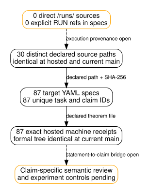

# Formal target provenance inventory at a named main commit

**Scope:** Static repository inventory at main `0b38ac1157f777cb4a77d35e53d7ed583c541eb4` (formal tree `96f334e856c87d397b5db720899d833a75db0352`) and exact archived hosted Lean receipts from main `5998553341fb29d3b9ca1a4c9ac6e58d96ca3ffa`. This is an evidence review, not a research run or a proof of claim fidelity. The machine-readable [target inventory](provenance.json), [experiment pointer map](corpus-pointer-coverage.json), [builder](build.py), [hosted receipt checker](check_hosted.py), [receipt audit](evidence/hosted-87/receipt-audit.json), [diagram source](coverage.dot), [rendered diagram](coverage.svg), and [PDF](report.pdf) are kept together. The inventory records the Git blob ID and SHA-256 of every declared source, target spec, and theorem file.

## Observation

| Static fact at the named commit | Count |
| --- | ---: |
| Target YAML specs | 87 |
| Declared theorem paths that exist as Git blobs | 87 |
| Distinct declared source paths | 30 |
| `EXP-*` directories at the named main commit | 2,781 |
| Experiment directory IDs with an exact target/source token pointer | 5 |
| Formal targets with at least one such pointer | 17 |
| Specs containing a canonical `EXP-*` identifier | 12 |
| Source paths directly under `experiments/` | 6 |
| Declared source paths inside `/runs/` | 0 |
| Specs with an explicit `/runs/` path or `RUN-*` reference | 0 |
| Exact hosted machine-verified receipts | 87 |

The 12 `EXP-*` references name two experiments: `EXP-BINSTD-8bdf86` and `EXP-FROB-91ee9c`. Source status labels in the specs are 54 `COMPUTED`, 23 `PROVED`, eight `STATED`, one `DERIVATION`, and one `MEASURED_WITH_ALGEBRAIC_EXPLANATION`. These are source labels, not independently checked outcome tiers. The builder checks unique task and claim IDs, parses every YAML spec, and reads the source and theorem bytes from the named Git commit. It does not use the working tree as evidence for those source bytes.

The reverse map enumerates every top-level `EXP-*` directory at the named main commit, including legacy numeric IDs. It finds exact ID tokens in target specs or their declared source bytes for `EXP-BINSTD-8bdf86`, `EXP-FROB-91ee9c`, `EXP-FROB-b8cf21`, `EXP-GFPN-05ff43`, and legacy `EXP-NCP-001`. The earlier canonical six-hex-digit scan omitted that legacy pointer. The other 2,776 directory IDs have no **exact token pointer in these 87 target/spec-source pairs**. This is not a claim that those experiments lack an applicable generic theorem, or that the five pointed experiments have been semantically validated.

The [hosted `lean-verification` run](https://github.com/aburan28/crypto-autoresearcher/actions/runs/40168163325) completed successfully at `5998553341fb29d3b9ca1a4c9ac6e58d96ca3ffa`. Its 87 archived per-target receipts report `machine_verified`, successful builds and axiom audits, zero forbidden constructs, and semantic review pending. The portable checker matches every receipt hash and input SHA-256 to the named commit. The entire formal Git tree and all 30 declared source blobs are identical at that hosted commit and the named main snapshot `0b38ac1157f777cb4a77d35e53d7ed583c541eb4`. This supports machine acceptance of the same 87 theorem statements on that snapshot; it does not replace an independent semantic review.

The diagram shows declared links, syntactic corpus pointers, and two missing evidence classes. An absent direct run path in a spec does **not** show that its source document lacks provenance elsewhere. A generic mathematical theorem can be useful without an experiment ID. The matching hosted receipts establish compilation and axiom audit for these exact formal bytes; they do **not** establish that the theorem proves the source claim. No new speed, success, attack-cost, or experiment-validity conclusion follows from these counts.

## Interpretation and limits

The earlier local per-target sweep covered 84 targets. The later hosted 87-target run closes the machine-verification gap for the identical named formal tree. All 87 hosted receipts still mark independent semantic review `pending`. The open [semantic fidelity problem](../../../problems/formal-target-semantic-fidelity-unreviewed.md) remains the controlling limitation.

For each claim that might be promoted to a dashboard or scientific conclusion, the next review must name the source and any frozen run record, exact theorem statement and assumptions, the model bridge, controls, and independent reviewer conclusion. Empirical measurements may have no appropriate Lean theorem; their provenance, controls, units and uncertainty need separate validation. The Semaev first-fall correction is a known reason to check meaning instead of counting compiled declarations.

## Graph and dashboard disposition

This report adds a provenance topology diagram generated from the static inventory counts. It changes no canonical scientific graph because it records no new experiment result or decision. Existing measured dashboard values are unchanged. The public Pages snapshot remains gated on current-head PR checks and a full-history build from merged main; this static inventory does not authorize publication.

## Rebuild and falsification check

From a checkout containing both named Git commits, run `python3 docs/reports/2026-10-25-formal-target-provenance/build.py` and `python3 docs/reports/2026-10-25-formal-target-provenance/check_hosted.py`, then `dot -Tsvg coverage.dot -o coverage.svg` and `dot -Tpdf coverage.dot -o coverage.pdf` in this directory. Render the report with `pdflatex -interaction=nonstopmode -halt-on-error -jobname=report-source report.tex`, then optimize the PDF with `gs -q -sDEVICE=pdfwrite -dCompatibilityLevel=1.6 -dPDFSETTINGS=/screen -dDetectDuplicateImages=true -dCompressFonts=true -dSubsetFonts=true -dNOPAUSE -dBATCH -sOutputFile=report.pdf report-source.pdf`. The checked-in two-page PDF is below the repository's 64 KiB PDF threshold; both pages were visually inspected after optimization. The builder fails if a declared source or theorem path is missing, a YAML schema differs, or task/claim identifiers collide. The hosted checker fails if receipt bytes, input hashes, formal tree, source blobs, corpus directory IDs/pointers, or machine result fields differ. A byte match establishes custody and machine acceptance of a statement, not semantic fidelity.
