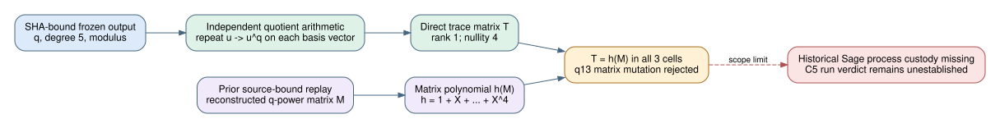

# Frob C5 direct-trace successor replay — 2026-10-25

**Result:** For the three frozen q=11, 13 and 19 degree-five cells, a direct polynomial-quotient computation of `u + u^q + u^(q^2) + u^(q^3) + u^(q^4)` agrees entry by entry with `h(M)`, where `h(X) = 1 + X + X^2 + X^3 + X^4` and `M` is the prior source-bound replay's reconstructed q-power matrix. Each direct trace matrix has rank one and nullity four. The q=13 matrix-entry mutation fails this comparison.

This is a **replacement mathematical replay**, not authentication of the original Sage subprocess. The frozen native outputs record the modulus and C5 flags, but do not serialize `M`; the matrix input comes from the earlier [source-bound replay](../2026-10-22-frob-c5-factor-kernels/c5-matrix-replay.json). The [historical problem](../../../problems/frob-c5-factor-kernel-and-model-bridge.md) remains open.



## Fixed inputs and method

The checker [recheck_direct_trace.py](recheck_direct_trace.py) pins the prior replay SHA-256 `22bcbdbdc6dd8c020456549cb1aa2edf887422cb10912105d9fa0508a6ee1005`, verifies each native output's SHA-256 against that replay, and checks its `q`, `n`, cell ID and modulus against the frozen three-cell card. It parses the exact `RESULT_JSON_BEGIN`/`RESULT_JSON_END` envelope. No Sage invocation or new scientific trial is involved.

For each power-basis vector, the direct path performs polynomial convolution and ordinary monic long division modulo the frozen degree-five polynomial, repeatedly raises the result to the q-th power, and sums the five residues. It does not read or multiply the Frobenius matrix while constructing `T`. Only afterward does a separate matrix path compute `h(M)` from the reconstructed matrix. Equality is checked on all 25 entries per cell, followed by a direct rank computation over the corresponding prime field. This closes the specified **direct-trace calculation** for this replacement replay; both paths share the frozen modulus, and neither observes the original loaded Sage code.

| Frozen cell | q | Direct trace's nonzero row | Rank / nullity | Direct `T = h(M)` |
| --- | ---: | --- | ---: | --- |
| `FROB-SPLIT-q11n5` | 11 | `[5, 9, 4, 3, 5]` | 1 / 4 | yes |
| `FROB-NOLATTICE-q13n5` | 13 | `[5, 5, 12, 8, 1]` | 1 / 4 | yes |
| `FROB-EQDEG-q19n5` | 19 | `[5, 16, 9, 11, 5]` | 1 / 4 | yes |

All other rows are zero, so the direct trace lands in the base-field line in each quotient. The exact per-cell matrices and native hashes are in [replay.json](replay.json). This replay checks the trace comparison and dimension; the factor-kernel direct sums, modulus irreducibility tests, exact q-power matrix entries, and Lean quotient theorems have their separate cited evidence in the [independent semantic review](../2026-10-25-frob-c5-semantic-review/composition.md). No new field isomorphism theorem or C8 result is asserted here.

## Controls and reproducibility

The checker changes the q=13 matrix's zero-based entry `(1,1)` from `2` to `3` and requires the direct trace to differ from `h(M_mutant)`. An explicit injected run of that altered matrix fails with `direct trace differs from h(M)`. A deliberately bad native-output SHA also fails before arithmetic. The unmodified three-cell run passes under both ordinary Python and `python3 -O`; the validation gates use explicit exceptions, not optimization-sensitive `assert` statements.

Run from the repository root:

```bash
python3 docs/reports/2026-10-25-frob-c5-direct-trace/recheck_direct_trace.py \
  --repo-root . \
  --output docs/reports/2026-10-25-frob-c5-direct-trace/replay.json
```

The finalized checker SHA-256 is `9673e46c0abf1548e2d27f5ae5b48f9c0cba445166b23d90ba90d3094e7eb720`; [replay.json](replay.json) is `4188f268e95ae37539153fe59281dd3f4e267d3cf38fd09afec4a3e24aea99cb`. The SVG hash is `d093776a98a37bd94ffddfb4ea7ca1a4b60d5e86d94976c2357f5dbf5d8ee488`. The [two-page PDF](report.pdf), which embeds the boundary diagram, has hash `3c1e9b81b63c841589615a89bb2711af8f4850fbea263e98f9fe6c7412b45d7b`; its embedded portrait graph is [trace-boundary-portrait.pdf](trace-boundary-portrait.pdf) with hash `ada198baa3535606f3b032539a0fb18cc316e4f9e21681e1c1bc8c3fe0de2c1d`. Both PDF pages and the SVG were rendered and visually inspected. The editable diagram source is [trace-boundary.dot](trace-boundary.dot); `dot -Grankdir=TB -Tpdf` produces the portrait PDF used by [report.tex](report.tex).

## Inference boundary

The original command ran a relative `implementation.py` and imported local `work/` modules; its archived final post-bugfix hashes do not identify what the original Sage process loaded. The historical `T_equals_hM` flag computed two equivalent sums from that process's matrix. This successor replay demonstrates the missing independent calculation on pinned archived parameters, but cannot retroactively repair source custody or make the historical C5 verdict established. A future run needs a fail-closed C5 gate and an execution receipt binding the loaded driver, imports and environment. C8, the experiment success gate, ECDLP cost and performance remain outside this replay. No canonical performance graph value or public dashboard number changes; the boundary diagram records the new validation path.
