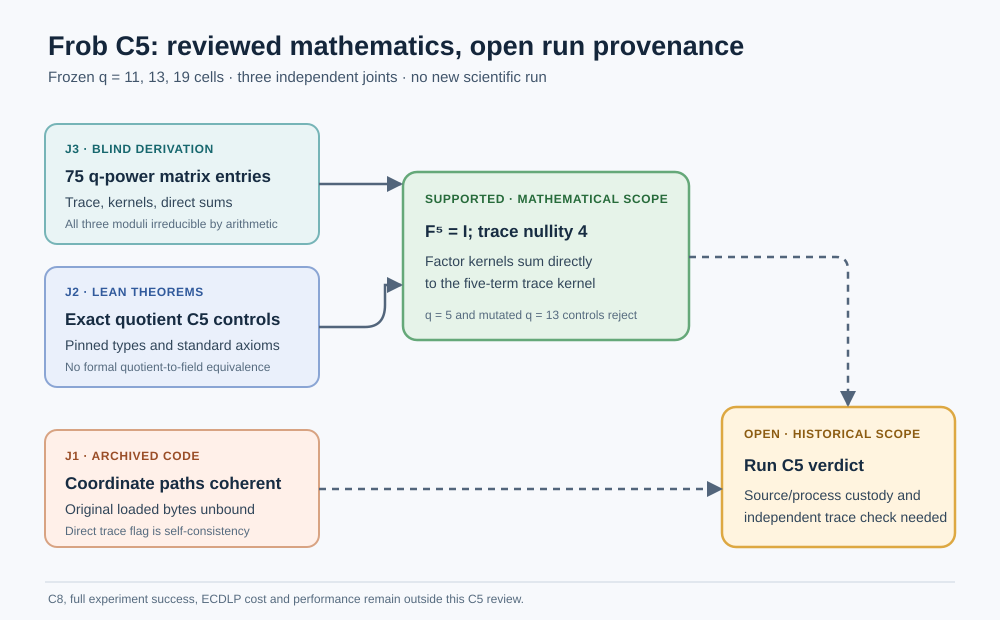

# Frob C5 independent semantic review — 2026-10-25

**Decision:** The q=11, 13 and 19 quotient-algebra C5 controls survive an independent blind derivation and a scoped Lean theorem review. The historical `EXP-FROB-91ee9c` C5 run verdict remains **unestablished**. The frozen archive does not authenticate the exact source bytes loaded by the original Sage process, and its `T_equals_hM` flag is not the specified independent direct-trace check. This review does not decide C8, the full experiment success gate, ECDLP cost or performance.

## Fixed inputs and independent joints

The review plan, blind card, dispatch queue and 45-file SHA-256 manifest were committed and pushed before reviewer dispatch at `47c7897c618bae7b076eb7be3485d4cfa6248637`. Every bound file matches frozen source commit `1c376353b8037072d17e7d98513ce3bbd1d7e993`. Three agents owned disjoint joints; their claims preceded the work, their scientific reports were committed independently, and their release receipts bind the frozen report hashes. The [plan](../../../coordination/formal-reviews/BATCH-6da0fe/review-plan.yaml) records the Coordinator's prior and the controls.

| Joint | Frozen report | Scoped verdict |
| --- | --- | --- |
| J1: historical custody and Sage implementation | [source and code audit](../../../coordination/formal-reviews/BATCH-6da0fe/reviews/TASK-20261025-cc3c17/j1-source-code.yaml) | **Breaks** the historical custody and independent direct-trace links; finds no transpose mismatch in the inspected, conditional source path. |
| J2: exact Lean theorem boundary | [Lean audit](../../../coordination/formal-reviews/BATCH-6da0fe/reviews/TASK-20261025-7c7297/j2-lean-boundary.yaml) | **Holds** for canonical-field and quotient-algebra statements; formal named-quotient field identification and historical executable refinement are absent. |
| J3: blind q-power matrix arithmetic | [blind derivation](../../../coordination/formal-reviews/BATCH-6da0fe/reviews/TASK-20261025-291039/j3-blind-matrices.yaml) | **Holds** for the parameter-card mathematics alone; all 75 entries and controls agree with the archived replay. |

The repository's independence checker returned `PASS: 3 report(s), every joint owned and attested, blindness respected, controls declared` after the J3 reviewer added attestation **metadata only** in a separate commit. The first J3 scientific report at `4a8d18782517f919839a293e05820af7373788a8` remains a verbatim prefix of the final report; its completed release still binds that original SHA-256. The later 37-line metadata addition is commit `627c0a9ed5fb4ae22e11a49dba69a57cf1d933dc`. No reviewer read a sibling report before freezing its own result.

## Exact mathematical comparison

The Coordinator compared J3's independently derived `frobenius_matrix_rows`, trace nullity, fixed dimension, ordered factor-kernel dimensions, directness, trace-kernel equality and modulus irreducibility against all three cells of the pinned [source-bound matrix replay](../2026-10-22-frob-c5-factor-kernels/c5-matrix-replay.json). All **21 field comparisons** and every matrix entry agree. J3 computed the moduli's irreducibility independently by degree-five finite-field polynomial tests; this is executable arithmetic evidence, not a Lean theorem of `Irreducible modulus11/13/19`.

| q | Nontrivial factor-kernel dimensions | Trace rank / nullity | Fixed-space dimension | Combined kernel rank | Blind matrix agrees |
| ---: | --- | ---: | ---: | ---: | --- |
| 11 | 1 + 1 + 1 + 1 | 1 / 4 | 1 | 4 | All 25 entries |
| 13 | 4 | 1 / 4 | 1 | 4 | All 25 entries |
| 19 | 2 + 2 | 1 / 4 | 1 | 4 | All 25 entries |

For each quotient, J3 obtains `F^5 = I` and a direct sum of the nontrivial factor kernels equal to the five-term trace kernel. The q=5 negative control has `X^5 − 1 = (X − 1)^5`; a cyclic-shift example has trace nullity four while the sum over nontrivial **distinct** factor kernels is zero. The q=13 zero-based matrix entry `(1,1)` mutation `2 → 3` fails `F^5 = I` and raises trace rank from one to five. J2's pinned Lean check rejects the same mutated fifth-power identity. These controls rule out promoting the distinct-factor argument in characteristic five or treating the factor identity alone as proof of the intended Frobenius.

J2 freshly elaborated the nine bound FrobTrace source bodies with pinned Lean 4.35.0-rc1 and matching dependency revisions, using one worker and a 6000 MB Lean limit. It printed all ten target declaration types and audited 94 public producer theorems plus its mutation theorem; the only transitive axiom constants were `propext`, `Classical.choice` and `Quot.sound`. This source-body check hoisted external imports and omitted repository-local imports, so it is narrower than a fresh per-module Lake/verifier build. The earlier [exact-source proof receipts](../2026-10-22-frob-c5-quotient-matrices/REPORT.md) and the separate 84-target sweep cover their own named trees; neither authenticates the original Sage process.

## Historical-code boundary

J1 checked all 17 scientific source bindings and found the archived final source hashes, native outputs, metrics and stdout internally consistent. Conditional on those source bytes being the ones executed, the field construction, constant-first power basis, q-power matrix columns, polynomial evaluation and right-kernel conventions are coherent.

The earliest missing link precedes those calculations: the frozen command runs relative `implementation.py` and imports `work/` modules, while the manifest hashes final **post-bugfix** files. No process receipt binds the original invocation to the driver and imported bytes loaded at that moment. The original reported execution commit contains no run-directory entry. This is a provenance gap, not evidence of fabrication or a mathematical counterexample.

The specified independent direct trace matrix was not implemented: both `T` and `h(M)` use the geometric sum of powers of the same matrix, so `T_equals_hM` would be true for an arbitrary same-sized `M`. The archived independent checker separately reconstructs a modulus and verifies trace nullity, but does not independently check factor-kernel decomposition, directness, fixed-space equality or all serialized matrix entries. C5 booleans are reported without a fail-closed worker gate. The saved outputs happen to show true C5 flags; worker completion alone cannot establish the control.

The [open problem](../../../problems/frob-c5-factor-kernel-and-model-bridge.md) therefore retains its historical bridge obligation. A later archive would need original loaded-source/process custody or an independently reproducible replacement with explicitly limited historical inference, an actually independent repeated-q-power trace check, and a formal or independently justified bridge from the three quotient moduli to the intended fields. C8 and experiment success require their own reviews. No new Sage, EKS, scientific trial or performance measurement ran in this review, and no canonical performance graph values changed. This boundary diagram is new because the independent review changes what can responsibly be said about the C5 evidence.

## Procedure and publication limits

The frozen J1/J2 handoff read scopes omitted `AGENTS.md` and its binding governance references although the Coordinator's dispatch message required them. The Coordinator allowed only relevant governance reads and required disclosure; both reviewers listed them. J3 kept the blind-card-only scientific read restriction, omitted linked governance reads before freeze, and embedded a diagram rather than writing an out-of-scope standalone visual. J2 retained two thread-creation infrastructure failures before its successful single-worker elaboration, and its release notes a late main fetch whose uncommitted metadata was discarded. These deviations do not change the frozen inputs or the joint verdicts. They are recorded here rather than rewriting the plan.

The combined report requires an exact archive receipt, current-head CI and PR review before merge. It is not a declaration that the entire historical experiment corpus has been proved or that a public dashboard has been published.
