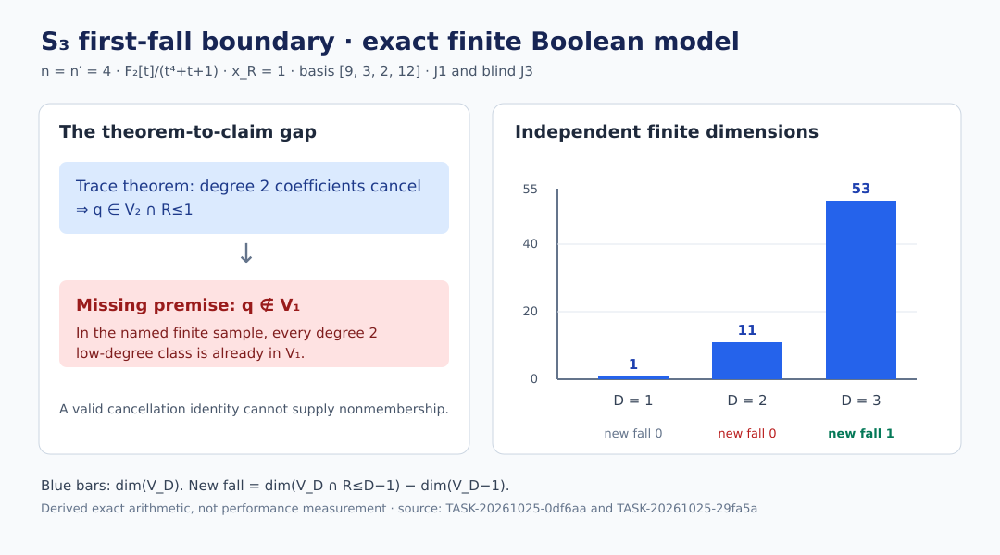

# Semaev S₃ degree two target: independent semantic review

**Reviewed source:** `9e0431cfcea350dac1f50f96419f0ac8d4a189f6`
**Review batch:** `BATCH-1a3355` · 25 October 2026
**Status:** The frozen target's *uniform degree two first-fall* consequence is unsupported and has a finite counterexample. The conditional trace-cancellation theorem remains valid at its stated scope. This report makes no generic ECDLP cost claim.

## Question and custody

The frozen [degree two target](https://github.com/aburan28/crypto-autoresearcher/blob/9e0431cfcea350dac1f50f96419f0ac8d4a189f6/formal/targets/semaev-s3-degree2-fall-witness.yaml) (`TASK-20260916-43505c`, `FFD-SEMAEV-MEASUREMENT1-THM-WITNESS`) says that a trace witness supplies a degree two fall uniformly for every admissible $n,n',V$ when $x_R\ne0$. The [producer note](https://github.com/aburan28/crypto-autoresearcher/blob/9e0431cfcea350dac1f50f96419f0ac8d4a189f6/research/FFD_SEMAEV_MEASUREMENT1.md) made that inference and later withdrew it in its dated 24 October correction. This review tests the original inference against the exact Lean statement and one explicitly defined finite Boolean model. The [review plan](../../../coordination/formal-reviews/BATCH-1a3355/review-plan.yaml) and [source hashes](../../../coordination/formal-reviews/BATCH-1a3355/input-bindings.json) were committed and pushed before any reviewer ran.

Three independent, pinned reviews supplied the result:

| Joint | Frozen artifact | Result |
| --- | --- | --- |
| J1: archived sample and parity product | [J1 attestation](../../../coordination/formal-reviews/BATCH-1a3355/reviews/TASK-20261025-0df6aa/j1-attestation.yaml), commit `2d0e7937c861` | Four component equations match independent field evaluation; historical set union mishandles duplicate monomials. |
| J2: Lean statement boundary | [J2 attestation](../../../coordination/formal-reviews/BATCH-1a3355/reviews/TASK-20261025-ae5519/j2-attestation.yaml), commit `6a311c9a6067` | The checked theorem proves cancellation, with no lower-row-space nonmembership. |
| J3: blind finite calculation | [J3 attestation](../../../coordination/formal-reviews/BATCH-1a3355/reviews/TASK-20261025-29fa5a/j3-blind-rederivation.yaml), scientific commit `6eb4d740ec3b` | First new low-degree class occurs at degree three in the specified finite model. |

The review-independence checker reports **PASS** for all three attestations: each joint is owned, the blind derivation read no protected producer material, and the controls are declared. J1 and J2 disclosed extra reads beyond their dispatch scopes in their attestations; none supplied a sibling result. J1's source-custody statement uses one extra replay receipt, while its equations, mutation control, and ranks do not. J2's extra reads supplied procedure and build context, not the mathematical verdict. The J3 scientific result was frozen before two later metadata-only attestation corrections. Its completed task release binds the earlier scientific version; the [archive receipt](../../../coordination/formal-reviews/BATCH-1a3355/archives/TASK-20261025-849cb6/snapshot-receipt.json) records both that earlier hash and the final report hash rather than treating them as identical.

## Exact finite calculation

For the field $\mathbf F_2[t]/(t^4+t+1)$, $n=n'=4$, target $x_R=1$, $a_6=1$, and encoded basis `[9,3,2,12]`, J1 and the blind J3 independently derived the four coordinate equations of

$$
S_3=(x_1x_2+x_1x_R+x_2x_R)^2+x_1x_2x_R+a_6.
$$

J3 evaluated all 256 Boolean assignments and recovered the same algebraic normal forms by a Boolean Möbius transform. Its independent parity row-space calculation gave:

| Degree $D$ | Nonzero compatible rows | $\dim V_D$ | $\dim(V_D\cap R_{\le D-1})$ | New falls |
| ---: | ---: | ---: | ---: | ---: |
| 1 | 1 | 1 | 0 | 0 |
| 2 | 12 | 11 | 1 | **0** |
| 3 | 64 | 53 | 12 | **1** |

The degree two low-degree intersection is already $V_1$: $1-1=0$ new classes. At degree three, $12-11=1$. J3 gives an explicit degree two vector in $V_3$ outside $V_2$ and a separating coefficient functional; J1 independently obtains the same ranks. This is a counterexample to the universal degree two first-fall consequence within the finite Boolean model, assuming the target intended this standard S₃ descent and row-space definition. It is not a claim about other field sizes or attack cost.

The mutation control identifies the historical bug concretely. In $u_0f_0$, masks 1, 17, and 129 each arise twice. Set union retains them; multiplication over $\mathbf F_2$ cancels them. At Boolean assignment mask 1, the set-union product evaluates to 1 while direct multiplication evaluates to 0. J1's corrected product agrees at all 256 assignments.

The [historical aggregate JSON](https://github.com/aburan28/crypto-autoresearcher/blob/9e0431cfcea350dac1f50f96419f0ac8d4a189f6/research/verification/ffd_semaev_results.json) did not serialize per-draw matrices. The later source-bound [replay](https://github.com/aburan28/crypto-autoresearcher/blob/9e0431cfcea350dac1f50f96419f0ac8d4a189f6/docs/reports/2026-10-22-semaev-first-fall-replay/evidence/draws.json) reconstructed this sample from committed source and seed. It supports reproducibility of the stated finite model, but does not authenticate an earlier per-draw matrix that was never archived.

## What Lean proves

J2 checked the elaborated type of `CryptoResearch.Semaev.trace_witness_annihilates_degree_two_part` at the pinned Lean 4 toolchain. It is conditional on a field $K$, an additive target $L$ with $y+y=0$, an additive map $T:K\to L$ satisfying $T(z^2)=T(z)$, and $x\ne0$. Its conclusion is

$$
T\big((x^{-1})^2(t^2+tx)\big)=0.
$$

The observed axiom set was `[propext, Classical.choice, Quot.sound]`. The theorem says nothing about an S₃ equation family, a Boolean row space, or $q\notin V_1$. Cancellation at most places a constructed row $q$ in $V_2\cap R_{\le1}$; first fall also requires $q\notin V_1$, or another explicit vector outside $V_1$. Even a nonzero $q$ may be a degree one generator already in $V_1$. The zero additive map also satisfies the abstract premises, so nontriviality cannot be inferred from the abstract theorem.

The later [concrete target](https://github.com/aburan28/crypto-autoresearcher/blob/9e0431cfcea350dac1f50f96419f0ac8d4a189f6/formal/targets/semaev-s3-concrete-first-fall-20261023.yaml) names `CryptoResearch.Semaev.ConcreteFirstFallWitness.concreteNewFall`. Its source states a fixed witness in the degree three low-degree row space and outside the degree two row space. Separate Lean source uses the same four literal equations to compare polynomial evaluation against S₃ on all 256 assignments, so the finite theorem is not merely an unrelated numeral. The archive digest and seed are external custody comments, not a proved Lean hash equality. In this review J2 could not obtain a fresh elaborated type or axiom set for the concrete theorem: a bounded `lean --stdin` attempt stalled on filesystem reads. The source-level reading therefore does **not** substitute for a fresh kernel check of that theorem in this round.

## Disposition and next proof obligations

1. Preserve the frozen historical target. Add a dated correction or supersession record that withdraws its final uniform degree two first-fall sentence and `source_status: PROVED` interpretation. Keep the checked conditional trace identity as a valid narrower theorem.
2. State the finite $n=4,n'=4,x_R=1$ degree three witness only at its exact row-space and source-custody scope. The separate no-fall statements at degrees one and two are needed to call degree three the *first* fall.
3. Recheck the concrete theorem and finite-equation theorem with the pinned Lean toolchain on a responsive filesystem, recording exact types and transitive axioms. A generic first-fall theorem would need a proved source-to-row-space map and lower-row-space nonmembership; the named finite control already rules out a universal degree two version.

No experiment or EKS job was launched for this review. No measured runtime, success probability, or performance value changed. The immutable [22 October replay report](https://github.com/aburan28/crypto-autoresearcher/blob/9e0431cfcea350dac1f50f96419f0ac8d4a189f6/docs/reports/2026-10-22-semaev-first-fall-replay/report.md) and [23 October concrete witness report](https://github.com/aburan28/crypto-autoresearcher/blob/9e0431cfcea350dac1f50f96419f0ac8d4a189f6/docs/reports/2026-10-23-semaev-concrete-witness/report.md) remain historical artifacts. This report adds a new derived graph for the independently reviewed finite dimensions; it does not overwrite their figures or a performance dashboard with unmeasured values.
