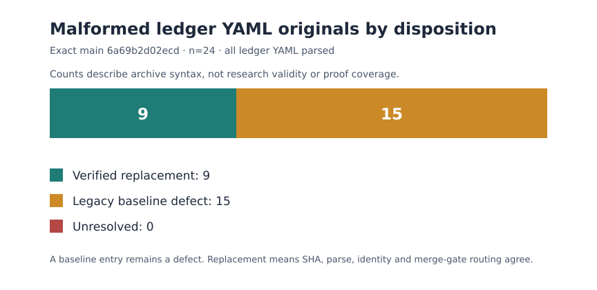

# Ledger YAML parse disposition audit — 2026-10-26

**Scope.** This is a read-only validation of every materialized `ledger/**/*.yaml`
file at crypto-autoresearcher main commit
`6a69b2d02ecd53f1649bcf56e23e4ffe91d953ad`. It classifies syntax
failures against the repository's existing schema supersession registry and
legacy parse baseline. It does not validate the scientific claims inside a
parseable record, change research status, or repair an archived source.

## Question and method

The exact-main dashboard build reports 24 unparseable ledger YAML originals.
Are these untracked current-main failures, verified retired originals, or
disclosed legacy defects?

Run `python3 docs/reports/2026-10-26-ledger-parse-audit/audit.py` from the
repository root with PyYAML installed. Replay JSON goes to stdout. To retain a
new sweep separately, add `--output /path/to/new-replay.json`; that path must
not already exist. The committed `evidence.json` is reserved and never written
by replay. The script exactly parses every ledger
YAML file. For each failure, it reads
`tools/schema_supersession_registry.yaml`, checks that original and replacement
SHA-256 digests match their pins, checks that the replacement parses and names
the same record ID, and cross-checks the accepted route against
`tools/check_merge_hygiene.py`. It then checks
`tools/merge_hygiene_baseline.txt`. The committed [evidence](evidence.json)
lists every malformed original, its hash and disposition; [audit.py](audit.py)
is the replay. [render.py](render.py) renders the [SVG graph](parse-dispositions.svg).

## Observation

| Disposition | Count | Meaning |
| --- | ---: | --- |
| Hash-verified schema replacement | 9 | Immutable original is malformed; a registry-routed copy passes hash, parse, record-ID and merge-gate checks. This is not a semantic review of the copy. |
| Legacy parse baseline | 15 | Malformed original remains a disclosed defect. No replacement was established by this audit. |
| Unresolved by either mechanism | 0 | No additional malformed ledger YAML was found in this exact-main sweep. |

The total is 24. The merge gate's baseline has 30 entries across the repository;
15 are ledger YAML files, so the other 15 are outside this audit's numerator.
The current-main static dashboard build independently reported the same 24
paths, 28,074 indexed records, and 56,299 generated files. Its site content
was 531,908,896 bytes, under the existing 900 MB Pages gate. The dashboard's
`unparseable` field deliberately lists *original* files; it does not separate
retired originals from unrepaired baseline defects. The public older snapshot
also lists 24 originals. These counts are repository metadata, not trial
measurements or a cryptographic performance result.

## Interpretation and limits

The nine registry entries are verifiable syntax routes. An independent
semantic-fidelity review must still establish that each copy preserves the
intended record. The 15 baselined originals cannot be marked repaired merely
because the merge gate allows them; its baseline explicitly calls them
defects. Editing the originals in place would break their archived hashes and
the repository's immutable-record rule. This audit does not infer any
experiment result, claim status, proof completeness, or attack cost from these
parse counts.

## Next check

Start with one of the 15 baselined ledger records. Preserve its original hash,
produce a parseable immutable schema-supersession copy with an independently
reviewed text/meaning comparison, pin both hashes in the registry, then remove
that path from the parse baseline. The follow-up passes only if the absolute
merge-hygiene sweep and ledger validator pass and this audit decreases the
baseline count without raising the unresolved count. Repeat under the same
rules for the other 14. The full historical experiment and Lean proof audit
remains a separate, much larger obligation.

This report is a derived communication artifact. Its `report.pdf` includes the
same graph and was rendered from `report.typ`.

**Replay custody correction (2026-10-30).** The original replay overwrote its
committed evidence with current-HEAD results. The corrected script emits stdout
or exclusively creates a separate output. The committed evidence, SVG, PDF and
Typst source retain their original bytes and exact 2026-10-26 snapshot scope;
new replay results do not revise those historical observations.
