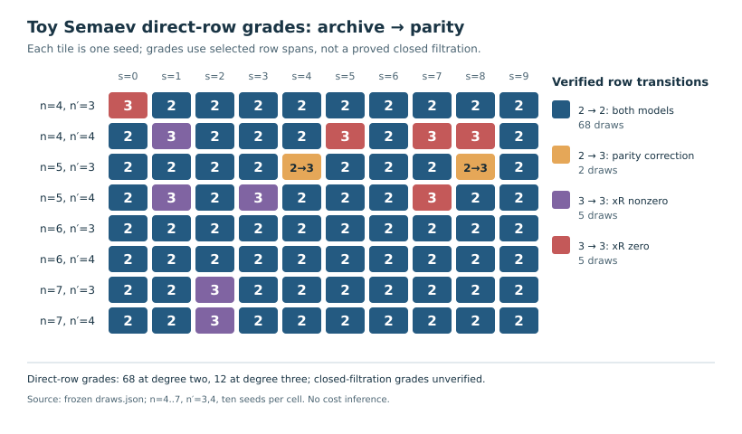
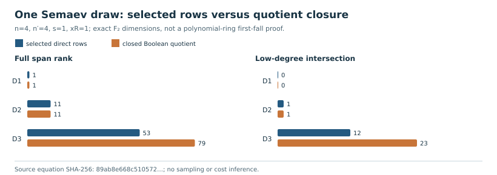
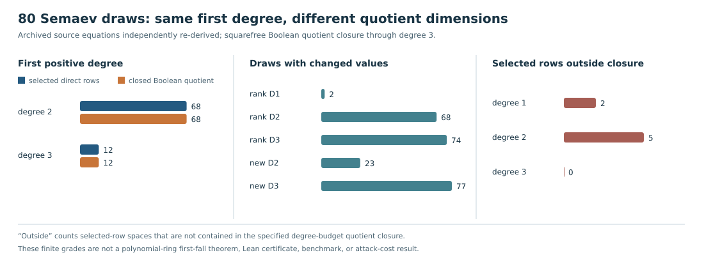
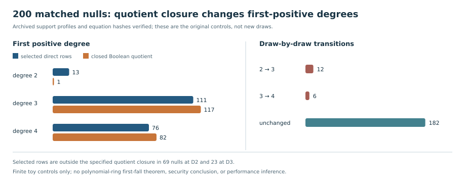

# Finite Semaev row-space closure audit — 2026-10-26

**Status:** independent finite-model code review of the 80 archived Semaev
draws and 200 archived matched-null controls, with one detailed closure
witness; a semantic bridge and a new
Lean theorem remain open. This report does not change the frozen target,
archived outputs, official research status, or any ECDLP cost claim.

The [inspected PDF](report.pdf) embeds all four additive charts; [report.tex](report.tex)
is its editable source. From this directory, rebuild the visuals and PDF with:

```sh
convert -density 192 direct-row-grades.svg -resize 1640x960 direct-row-grades.png
python3 render_closure.py
convert -density 192 closure-ranks.svg -resize 1640x580 closure-ranks.png
python3 distribution.py > distribution-evidence.json
python3 render_distribution.py
convert -density 192 closure-distribution.svg -resize 2200x820 closure-distribution.png
python3 null_distribution.py > null-distribution-evidence.json
python3 render_null_distribution.py
convert -density 192 null-closure-distribution.svg -resize 1840x740 null-closure-distribution.png
pdflatex -interaction=nonstopmode -halt-on-error report.tex
pdflatex -interaction=nonstopmode -halt-on-error report.tex
```

Every PDF page was rendered and visually inspected before publication.

## Question and sources

Does the published rank-53 degree-three span of the fixed Boolean Semaev draw
already have the multiplication closure required by the `V_{F,3}` filtration?
This matters because a verified matrix rank proves the dimension of the
*selected row span*, while the name `V_{F,3}` additionally requires the correct
row-generation and closure semantics.

The repository inputs were the [historical measurement](../../../research/FFD_SEMAEV_MEASUREMENT1.md),
the [corrected replay](../2026-10-22-semaev-first-fall-replay/report.md), the
[finite Lean certificate](../../../formal/CryptoResearch/Semaev/BooleanParityFiniteCertificate.lean),
the [finite filtration proof](../../../formal/CryptoResearch/Semaev/BooleanParityFiltrationCertificate.lean),
the [concrete witness report](../2026-10-23-semaev-concrete-witness/report.md), and
the source-bound draw record in the corrected replay. For the mathematical
boundary, [Caminata–Gorla, Definition 1.5 and equation (1)](https://arxiv.org/pdf/2112.05579)
define `V_{F,D}` by closure under multiplication within the degree budget and
identify it with a degree-compatible Macaulay row space in a polynomial ring.
[Kosters–Yeo, Corollary 4.11 and Remark 4.12](https://arxiv.org/pdf/1503.08001)
give a trace identity for ordinary binary curves and describe degree-two first
falls as *usual*, not universal under every factor-base choice. Their paper
does not identify the particular Boolean quotient row generator audited here.

## Independent calculation

Run `python3 docs/reports/2026-10-26-semaev-closure-review/audit.py` at the
repository root. The script reads the frozen draw from Git, checks its equation
SHA-256 `89ab8e668c510572bbf9307f105b2eaf46858ad900f0b6b4a2fce8803e0ba6eb`,
and independently evaluates `S₃=e₂²+e₃+1` over
`F₂[X]/(X⁴+X+1)` for all 256 Boolean assignments. A Möbius transform recovers
all four archived component equations exactly. It also finds `y=6,7` on
`y²+xy=x³+x²+1` at the fixed target `x_R=1` and uses the archived basis
`[9,3,2,12]`.

Boolean monomial products combine variable masks by OR and **coefficients by
XOR**. The script compares two direct row policies: multipliers with degree at
most `D−deg(f)`, and the repository's policy accepting every multiplier whose
parity-corrected product has degree at most `D`. Their row counts differ, but
the rank and top-degree projection rank agree on this sample:

| Degree | Strict rows | Product-degree rows | Full rank | Top-degree projection rank |
| ---: | ---: | ---: | ---: | ---: |
| 1 | 1 | 17 | 1 | 1 |
| 2 | 12 | 28 | 11 | 10 |
| 3 | 64 | 80 | 53 | 41 |

The resulting *direct-row statistic* has no new degree-two fall
(`11−10−1=0`) and one new degree-three fall (`53−41−11=1`). This reproduces
the published finite computation with a separate field evaluator, Boolean
multiplier, and elimination routine.



The [additive chart](direct-row-grades.svg) preserves every tile, count, and
color of the [archived chart](../2026-10-22-semaev-first-fall-replay/draws.svg)
while labeling the values as **direct-row grades** and the polynomial-ring
interpretation as unverified. Its [renderer](render.py) changes only explanatory
SVG text and checks that all 80 draw tiles remain; the historical chart is
unchanged. The 68/12 counts are therefore presented as exact outputs of the
parity-corrected row procedure, not as newly established standard first-fall
grades.

There is an additional closure witness. Let `W` be the already published
degree-two polynomial with monomial masks
`[1,2,4,8,9,10,12,16,18,20,32,40,48,64,65,128,144,192]`.
The audit confirms `W` belongs to the selected degree-three row span and lies
outside the degree-two row span. Multiplication by `u₀` (mask `1`) gives a
degree-three polynomial with masks
`[1,3,5,11,13,17,19,21,33,41,49,129,145,193]`.
Adjoining that product increases the selected degree-three row rank from
**53 to 54**. The exact inputs and output are in [evidence.json](evidence.json).

## Degree-bounded closure in the fixed Boolean quotient

The separate [closure checker](closure.py) computes the least subspace of
`F₂[u₀,…,u₇]/(uᵢ²−uᵢ)` containing the four source-bound equations and closed
under `f·g` whenever `deg(g) ≤ D−deg(f)`, using squarefree monomial degree.
It forms a finite fixed point in three ways: degree-filtered echelon rows with
one-variable products; degree-filtered rows with every allowed monomial; and
numeric-pivot elimination that obtains low-degree vectors from the kernel of
the top-degree projection. They agree on the *spaces* by joint-rank checks,
as well as on ranks. Repeated one-variable products generate every allowed
monomial product, while high-degree-first elimination isolates the vectors
whose actual degree has fallen and permits their further multiplication.

| D | Direct rank / top projection / low dimension | Closed Boolean rank / top projection / low dimension | New closed low-degree classes |
| ---: | ---: | ---: | ---: |
| 1 | 1 / 1 / 0 | 1 / 1 / 0 | — |
| 2 | 11 / 10 / 1 | 11 / 10 / 1 | 0 |
| 3 | 53 / 41 / 12 | **79 / 56 / 23** | **23−11=12** |

The closed quotient retains the zero degree-two fall on this draw. Its
degree-three count is 12, whereas the selected direct-row statistic gives 1.
The published `W` is outside closed `D=2`, and both `W` and `u₀W` lie in closed
`D=3`. Exact source hashes, all three method profiles, inclusion checks and
counts are in [closure-evidence.json](closure-evidence.json). The independent
[comparison chart](closure-ranks.svg) shows only this **one fixed draw**;
the complete archived-draw calculation is reported separately below.



## All 80 archived Semaev draws

The [distribution checker](distribution.py) independently re-derives every
archived component equation from `S₃` over the recorded binary fields, checks
the four field moduli have no zero divisors, checks each basis is independent
and each target abscissa is on the recorded curve, and verifies all 80
per-draw equation hashes. It reproduces every archived parity-corrected
selected-row rank, low-degree dimension, new-class count and row count at
degrees 1–3. For each draw and degree it then compares three fixed-point
methods for the specified Boolean quotient closure, checks equality of their
*spaces* by joint rank, and verifies that the closed spaces are nested.

| Observable among 80 draws | D=1 | D=2 | D=3 |
| --- | ---: | ---: | ---: |
| Selected rank differs from quotient closure rank | 2 | 68 | 74 |
| Selected new-class count differs from quotient count | 0 | 23 | 77 |
| Selected row space has a vector outside quotient closure | 2 | 5 | 0 |

Despite these differences, the **first degree with a positive new-class count**
agrees draw by draw: 68 draws at degree two and 12 at degree three under both
definitions. This equality of grade labels must not be mistaken for equality
of spaces or multiplicities. At degree three, the selected and quotient
new-class counts differ for 77 draws; the fixed draw above changes from 1 to
12. At degrees one and two, seven selected-row spaces contain rows outside
the specified closure. The selected policy admits a product based on its
*actual* degree after cancellation, even when its multiplier exceeds the
degree budget required by the quotient closure definition.

The exact 80-row comparison, hashes and per-degree profiles are in
[distribution-evidence.json](distribution-evidence.json). The additive
[distribution chart](closure-distribution.svg) compares grade counts and
dimension disagreements without altering the frozen draw chart. The closure
calculation used less than 17 MiB peak RSS under a 1 GiB process limit;
normal and optimized Python runs produced identical JSON. This is finite
computational evidence in a defined quotient, with no Lean closure theorem
or established transfer to the polynomial-ring filtration.



## The 200 archived support-matched null controls

The [null checker](null_distribution.py) reads the same frozen archive and
verifies each null equation hash, variable mask range, and per-equation
multiset of monomial degrees against the source Semaev draw recorded for that
cell. It reproduces every archived parity-corrected selected-row rank,
low-degree dimension, new-class count and row count through degree six. For
each null and degree, the same three quotient fixed-point methods agree on
their full spaces by joint rank, and the degree-bounded spaces are nested.
No null system was generated or resampled for this audit.

| First positive degree | Selected direct rows | Closed Boolean quotient |
| ---: | ---: | ---: |
| 2 | 13 | **1** |
| 3 | 111 | **117** |
| 4 | 76 | **82** |

Exactly 12 nulls move from degree two to three and six move from degree three
to four; 182 retain their label. Selected rows are outside the specified
quotient closure in 69 nulls at degree two and 23 at degree three. The
[machine-readable evidence](null-distribution-evidence.json) identifies
every control, source-draw link, equation hash, selected profile, quotient
profile and transition. Normal and optimized Python runs produced identical
JSON, taking about 82 seconds with less than 20 MiB peak RSS under a 1 GiB
process limit. The [additive chart](null-closure-distribution.svg)
shows the counts. This changes the interpretation of the old null comparison:
the archived selected-row null distribution **13/111/76** is not the
specified quotient-closure distribution **1/117/82**. The 80 Semaev draws
retain 68/12 first-positive labels in this quotient. These two frozen sample
sets have different sizes, and this report makes no significance, general
curve, security or performance inference from their contrast.



## Interpretation and limits

The Lean matrix-rank theorems remain valid for their literal 80 rows. This
counterexample shows that their span is **not closed under multiplication** by
all monomials allowed by a degree-three filtration rule in the Boolean
quotient: `W` has degree two, `u₀` has degree one, and their product is absent
from the span. The separate finite computation gives rank **79** for the
*defined Boolean quotient closure* on this draw. It does not establish the
rank of the polynomial-ring `V_{F,3}` of Caminata–Gorla augmented with Boolean
field equations. That passage needs an explicit theorem and independent
semantic review. The published `newFalls(3)=1` is established for the selected
row statistic, while the fixed quotient closure gives 12; neither number is
yet a proved standard polynomial-ring first-fall multiplicity. The all-draw
Boolean quotient computation agrees on Semaev first-positive degrees but
differs widely in dimensions, while 18 null labels shift. The literal Lean
row theorems are intact, but no Lean
theorem yet certifies this new closure computation.

This also does not refute Kosters–Yeo's trace identity or their qualified
statement that degree-two first falls usually occur. The frozen uniform
assertion had already been withdrawn in the historical note. A reviewer
should decide whether the final claim is about a specified Boolean quotient
filtration or the polynomial-ring filtration with field equations, then
formalize that definition and check its row-span closure before promoting a
first-fall theorem or updating any graph's interpretation. The archive and
corrected 68/12 draw counts are preserved; this audit adds no new draw.

No Lean build was started for this report. GitHub Actions currently refuses
runner assignment with a payment-or-spending-limit annotation, and this Spot
host lacks the required reserve for a memory-heavy proof build. The script's
small finite check is evidence of a model boundary, not a replacement for a
Lean theorem or independent human claim review.
