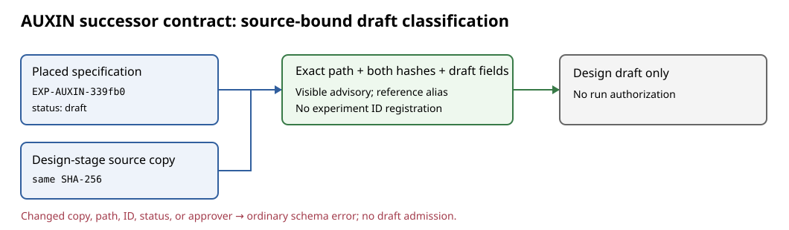

# Hash-bound classification of the AUXIN successor draft

**Mechanical validation, 2026-10-28.** The archived
[`EXP-AUXIN-339fb0` specification](../../../experiments/EXP-AUXIN-339fb0/specification.yaml)
has a top-level `successor_contract` rather than `experiment`. Its source
header says `status draft, approved_by null`. The `fresh` block gives
`id: EXP-AUXIN-339fb0`, `status: draft`, `approved_by: null`, and
`approval_decision: null`; its `F-APPROVAL` block is also draft. It is
byte-identical to the [design-stage copy](../../../coordination/goals/GOAL-AUXIN-a93442/batches/BATCH-ad00c6/design/TASK-20260929-d519f6/draft-contract.yaml):
both SHA-256 hashes are
`6a1dca32c109d5badf4ba143c31f9d4d9a49e18ae287c8bb4fc604526bf02ecc`.
This establishes a placed draft, not an approved executable experiment.

The [hosted ledger job on PR #2655](https://github.com/isogeny-labs/crypto-autoresearcher/actions/runs/40627808095/job/122616982776)
contains one error for this path: `expected top-level key 'experiment'`.
[PR #2656](https://github.com/isogeny-labs/crypto-autoresearcher/pull/2656)
separately archives the complete 65-error inventory; it was open when this
classification report was written.
The validator now classifies **only this exact path and both exact copies**
as a draft. It requires matching experiment, batch, task, and goal IDs;
draft status; null approval fields; and the frozen hash on both files.
It records a visible advisory and keeps the existing legacy alias for
reference resolution, but it does not register an experiment in `ctx.ids`.
No run is authorized by this classification.

## Controls and result

`PYTHONDONTWRITEBYTECODE=1 python3 -m unittest
tools.test_validate_ledger.FrozenSuccessorDraftTests -v` passed 3 tests on
the scoped worktree. The positive test checks the advisory and absence from
the experiment index. Negative controls mutate status, approver and ID;
alter the source copy; and present the same document under another path.
The altered source copy retains the ordinary top-level schema error and no
experiment registration. The underlying archived files, hash registries,
suppression baseline, and numerical results are unchanged.

This targeted check demonstrates one accurately classified draft. It does
**not** establish a clean full-ledger gate. The earlier hosted job had 65
unsuppressed messages; the expected current-head delta is removal of this
one line plus one non-failing advisory. A complete-tree hosted validator run
must confirm the exact delta, including any new cross-reference effect,
before the change can be merged. No canonical performance graph changes:
this is a record-category correction with no measured quantity.
