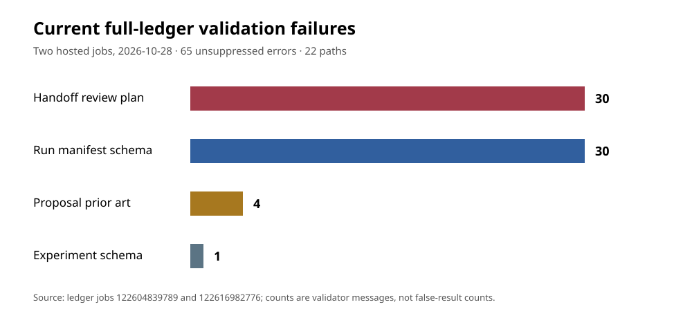

# Full-ledger validator: current hosted error inventory

**Observation, 2026-10-28.** This report records the exact unsuppressed messages
from two hosted `ledger` jobs. It is a mechanical integrity observation, not
an evidence review, scientific verdict, Lean proof, or performance result.
The current full-ledger gate is **failing**. No archived record, validator
rule, suppression baseline, experiment result, or canonical performance graph
was changed for this report.

## Source and method

The [first job](https://github.com/isogeny-labs/crypto-autoresearcher/actions/runs/40624063556/job/122604839789)
ran on head `64da2f50560c3565c36880fc86b0aad8addeb223` (PR #2609) and failed
at 03:01:51 UTC. The [second job](https://github.com/isogeny-labs/crypto-autoresearcher/actions/runs/40627808095/job/122616982776)
ran on head `a94a304f1e76d81e4a9899e8bcb709b8fdb0e21c` (PR #2655) and
failed at 03:40:44 UTC. Both checked out complete trees. We downloaded their
job logs, stripped terminal color, extracted only the `FAIL: 65 new validation
error(s)` lines beginning with `ledger/` or `experiments/`, sorted them, and
compared the lists exactly. The source logs have SHA-256 values
`d5cc3cfc3e2978093ca8899ddaa1e9b77627088c719ffff427816ad8d01d221f`
and `facca0444c59dc386a6662c21e73a552a329cc5008cee2c6c602e662cd7b75af`,
respectively. [generate.py](generate.py) reproduces the extraction from the
downloaded logs; [errors.json](errors.json) contains every path and message.
The normalized sorted message set hashes to
`dd067769a634991c71a34c58f2630dc57ea37f098444d2ae9286d1c6b4f2807d`.

The compared lists are identical: **65 unsuppressed errors in 22 paths; zero
added and zero removed** between the two PR heads. The second log also
reports 1,210 grandfathered errors suppressed by the existing baseline and
578 non-failing advisories. Those are separate from the 65. This report's
repository base is `7b16f392d39c00e558bdaf44a35063303cd550ab`; no
complete-tree validator was rerun on that merge commit. The two observed
heads support the persistence of these exact messages through the dashboard
change, not a claim that the merged `main` tree has been independently checked.

## Where the gate fails

| Record category | Errors | Paths | Specific gap |
| --- | ---: | ---: | --- |
| Handoff review plans | 30 | 12 | Missing named blind reviewer, prior, load-bearing joints, or known-false controls. |
| Run manifests | 30 | 5 | Required execution/source fields missing or invalid, including two ICPERF certificate kinds. |
| Proposal prior art | 4 | 4 | Missing or invalid nearest-work references. |
| Experiment specification | 1 | 1 | AUXIN successor draft has no top-level `experiment` key. Its classification needs adjudication. |

These are validator-message counts, not counts of invalid experiments or false
conclusions. The most concentrated path is
`ledger/handoffs/TASK-20261003-308fcf.yaml` with 14 review-plan errors;
`experiments/EXP-ECDLP-381959/runs/RUN-ECDLP-9f18c9/manifest.yaml` has 10.
The complete path-by-path counts and messages are in `errors.json`. The
chart is derived from those rows; no measured speed or attack-cost value is
plotted or changed.

## Next checks

1. Assign source readers to the four proposal records and review actual prior
   work before writing any replacement metadata.
2. Review each of the 12 handoffs against contemporaneous assignments and
   controls. Leave absent assignments and prior beliefs explicitly open.
3. Triage the five run manifests against original execution receipts and
   source custody; use hash-bound supersession where justified. Do not fill
   missing fields with inferred commands or fabricated environment data.
4. Decide whether `EXP-AUXIN-339fb0/specification.yaml` is a draft successor
   contract or an approved experiment specification; test any schema change
   against negative controls.
5. After each reviewed correction, rerun the full validator on a complete
   current-head checkout and compare exact added/removed messages. Maintain
   the prune-only baseline and sealed run bytes. Recheck static dashboard
   integrity after any changed underlying record, then refresh affected
   derived visuals.

The older [open problem](../../../problems/full-ledger-validation-errors.md)
documents earlier checkpoints and the FROB execution-source custody gap.
That gap remains independent of the 65-message mechanical count. Existing
research decisions and performance charts were checked for **scope**, not
revalidated numerically in this report; no canonical graph is updated here.
