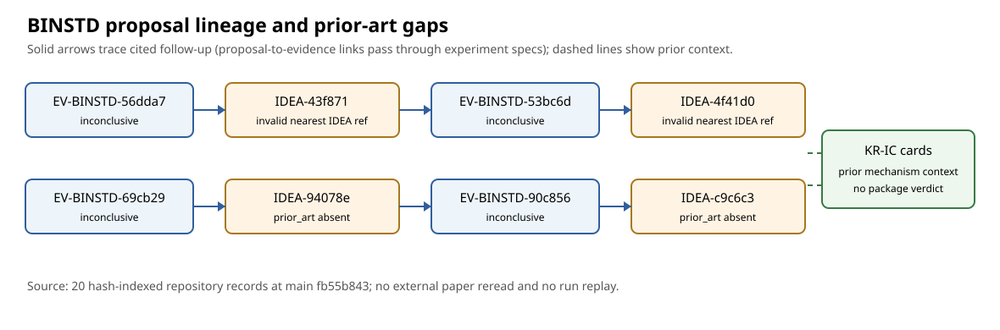

# BINSTD proposal prior-art source review

**Observation, 2026-10-28.** Four October 3 BINSTD proposals account for four
of the 65 unsuppressed ledger errors on the named main commit. The separate
AUXIN draft PR removes one unrelated error on its first hosted head, leaving
these four among 64 there. This report reads committed
proposal, experiment-specification, known-result, evidence, and decision
records at main `fb55b843d5c025d95e80de6185f12a4dd5da2a6f`. The exact 20 paths and
SHA-256 hashes are in [sources.json](sources.json). This is a retrospective
repository-card review. The linked known-result cards themselves label most
literature sources `abstract_read` or `secondary_source`; no paper was
independently reread for this report. It does not approve an experiment,
change a scientific decision, or establish an attack cost.

## Error-by-error findings

| Frozen proposal | Validator finding | What the sources establish | Honest next correction |
| --- | --- | --- | --- |
| [`IDEA-20261003-43f871`](../../../ledger/proposals/IDEA-20261003-43f871.yaml) | `prior_art.nearest[1].ref` names `IDEA-20261003-f20e41`; the schema requires a `KR-*` row or `knowledge/` entry. | The [`f20e41` proposal](../../../ledger/proposals/IDEA-20261003-f20e41.yaml) is an internal analogy about `dim(V·V)` and `N_var`. `43f871` instead targets Trace rank and residual `N_nl`. Its other nearest row, `KR-IC-f5c584`, is a valid adjacent trace card. | Preserve the internal idea as an explicitly labelled pointer or note, and use only an actually compared known-result row in `nearest`. Do not relabel the idea as literature. |
| [`IDEA-20261003-4f41d0`](../../../ledger/proposals/IDEA-20261003-4f41d0.yaml) | `nearest[0].ref` names the internal `43f871` idea. | The same frozen block already has valid `KR-IC-5765d2` and `KR-IC-f5c584` entries; the `KR-IC-5765d2` note explicitly identifies `43f871` as an unpublished idea pointer. | A hash-bound replacement could remove the invalid `nearest[0]` while keeping that note and the valid rows, after a line-by-line replacement review. |
| [`IDEA-20261003-94078e`](../../../ledger/proposals/IDEA-20261003-94078e.yaml) | No `prior_art` block. | Its citations already name `KR-IC-73db3f` for factor-base `V`; its source chain names inconclusive `EV-BINSTD-69cb29` and `DEC-20261003-5e4cb9`. `KR-IC-73db3f` is a heuristic card, not a proof of the proposed diversity fix. | Record a **retrospective** source comparison with the actual reading date and the relevant KR rows; do not imply that a complete prior-art search occurred at proposal time. |
| [`IDEA-20261003-c9c6c3`](../../../ledger/proposals/IDEA-20261003-c9c6c3.yaml) | No `prior_art` block. | Its citations also name `KR-IC-73db3f`; `EV-BINSTD-90c856` and `DEC-20261003-9f58a7` remain inconclusive, although they record a scoped `(17,4)` cell reading. The proposed Stage-2 null and changed package scope are prospective. | Record the current source comparison as retrospective, distinguishing the prior factor-base mechanism from the new cell-scoped decision rule. Do not turn the cell reading into a package result. |

The two proposal-to-evidence arrows pass through the frozen experiment
specifications: `EXP-BINSTD-6fd454` names `IDEA-20261003-43f871` as its
`source_idea`, and `EV-BINSTD-53bc6d` names that experiment; likewise
`EXP-BINSTD-9b18fc` names `IDEA-20261003-94078e`, and
`EV-BINSTD-90c856` names that experiment. The diagram compresses those
two-step links; it does not claim the evidence files directly cite the ideas.

## Scope of the source comparison

The six checked frontier cards were `KR-IC-f5c584` (trace-linear S3
mechanism), `KR-IC-5765d2` (XOR-aware SAT point decomposition),
`KR-IC-73db3f` (factor-base vector-space choice), `KR-IC-5a43e5`
(summation polynomials), `KR-IC-1fcdbc` (binary-field cost gap against rho),
and `KR-IC-9e610d` (survey consensus). These cards constrain novelty and
performance wording, but the present review only confirms what those
committed cards say. In particular, `KR-IC-73db3f` has status `heuristic`;
it does not establish that any new catalog will meet the proposals' floors.

The four cited BINSTD evidence records have `strength: inconclusive`. The
two decisions read here, `DEC-20261003-5e4cb9` and
`DEC-20261003-9f58a7`, also say `decision: inconclusive`. Their source
chains support successor designs and disclose scoped cell observations;
they do not establish a package-wide band result, a cryptanalytic break,
an exponent improvement, or a Lean proof. No run, solver, or benchmark was
replayed in this review.

## Next discriminating checks

1. Check the exact frozen hashes and proposed replacement fields against
   the schema supersession registry contract. For the first two proposals,
   retain the internal lineage without placing `IDEA-*` in `nearest.ref`.
2. For the latter two, have a named reader record an explicitly retrospective
   comparison and the actual source states. Do not fabricate a contemporaneous
   search log or claim full-text verification of the cards' abstract-only
   literature sources.
3. Make any corrections as additive hash-bound supersessions, then run the
   full current-head ledger validator and compare exact added/removed lines.
   The existing [AUXIN draft correction](https://github.com/isogeny-labs/crypto-autoresearcher/pull/2657)
   reduced the hosted count to 64, not zero.

The frozen proposals and every canonical performance graph remain unchanged.
This report has no newly measured quantities to plot, so the visual shows
source and decision lineage rather than a performance curve. The broader
full-ledger problem and Lean fidelity review remain open.
