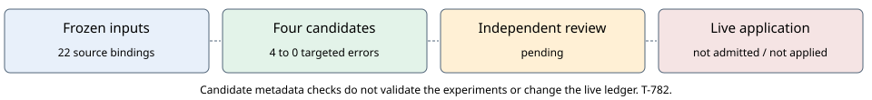

# Four BINSTD attribution corrections: review candidates

**Retrospective metadata review, 2026-10-29. Application pending.**
Conductor T-782; archive TASK-20261029-8b1359; independent review
TASK-20261029-d6606a. The live ledger and routing registry are unchanged.

## Source and scope

The source commit is `7e45528b293fd42049b1486a03135670ab5ac55c`.
[sources.json](sources.json) binds 22 existing documents, including the four
original proposals, their two already-routed replacements and six KR cards.
All 20 inputs in the earlier [source review](https://github.com/isogeny-labs/crypto-autoresearcher/pull/2658)
still match its hashes. The current coordinator read the six KR cards and
the four effective proposal claim, prior-art and citation blocks. Hash-checking
the other contextual documents is not a new independent scientific review.

The six cards are KR-IC-f5c584, KR-IC-5765d2, KR-IC-73db3f,
KR-IC-5a43e5, KR-IC-1fcdbc and KR-IC-9e610d. This is a reading of repository
cards, not new full-text verification of their cited literature. Their own
source-verification labels remain authoritative. In particular, the
factor-base V card KR-IC-73db3f is heuristic and its cited papers are
`abstract_read`; no catalog-diversity theorem follows from that card.

## Proposed changes

| Original proposal | Candidate attribution change |
| --- | --- |
| IDEA-20261003-43f871 | Move its internal IDEA-f20e41 comparison from typed `nearest` into `internal_lineage`, retaining the exact entry. |
| IDEA-20261003-4f41d0 | Retain the displaced internal IDEA-43f871 entry verbatim; correct the KR-IC-5765d2 comparator to describe the actual SAT/XOR card, date that reading retrospectively, and preserve its internal-pointer note. |
| IDEA-20261003-94078e | Add an explicitly retrospective comparison to the heuristic factor-base V card. Preserve the existing scoped replication and package limitations. |
| IDEA-20261003-c9c6c3 | Add the same dated source comparison, distinguishing proposed cell-scoped protocol changes from an established package result. |

Every parsed field outside `prior_art` equals the effective source record.
Original records and the October 23 v2 replacements remain byte-identical.
The proposed routes in [candidates-v2.json](candidates-v2.json) retain both
original and previous replacement hashes. No seed, threshold, approval,
claim, novelty status, result, or experiment contract changes.

## Checks and controls

The unchanged real `tools/validate_ledger.py` at the bound source revision
reports **four prior-art errors before, zero on these four candidates**.
The 12 negative controls cover an unauthorized claim change, an internal
IDEA reference inserted as typed nearest work, and a removed prior-art block,
for each of the four documents. All pass. See
[candidate-checks-v2.json](candidate-checks-v2.json).

This is the targeted prior-art function, not a full-ledger pass or a test of
live registry application. The global error count is unchanged by this packet.
The v1 candidates remain as an intermediate artifact; v2 additionally repairs
the SAT/XOR comparator. The initial checker failed because the sparse checkout
omitted `orchestration.fast_yaml`; the dependency was materialized before the
successful v2 check. No failed check was counted as passing.

## Review and application gates

Independent review is pending under the precommitted [review plan](review-plan.json).
Conductor refused the ledger and registry scope because of T-650/T-673
migration reservations. Its separate report-directory scope was admitted.
This packet prepares reviewable candidate data and does not apply the correction.
A future application must reacquire the actual ledger/registry scope, verify
current original and routed hashes, preserve prior files, validate all four
routes, and compare the complete current-tree error sets. Passing current-head
CI and independent review remain delivery requirements.

No new experiment, benchmark, Lean theorem, security result or attack-cost claim
is asserted. No canonical performance graph changes are justified. The new
diagram records source attribution and the still-unmet application gates.
