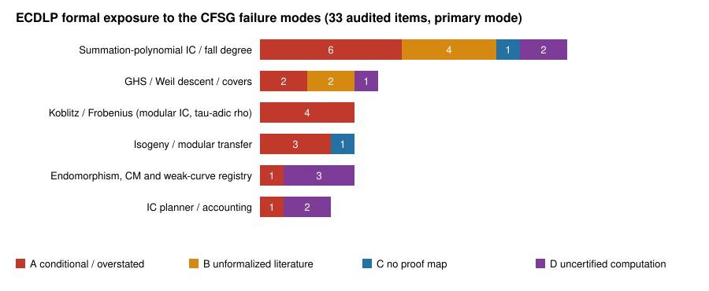

**Date:** 29 October 2026.

**Source:** `KN-LIT-63f33d`, Axiom Math's agent-built Lean proof of the
classification of finite simple groups. It reports four failure modes:

- **A.** A theorem is cited for more than its hypotheses give.
- **B.** A published lemma is taken as given without checking.
- **C.** A multi-lemma effort has no dependency map.
- **D.** A finite computation has no independently checkable certificate.

**Scope.** We ran a read-only audit of ECDLP formal work in three
repositories:

- `crypto-autoresearcher`: `formal/`, frontier rows and leads;
- `crypto`: 34 Lake projects across the `crypto` and `cryptanalysis` research
  trees, counted together;
- `cryptanalysis`.

Two independent audit sessions did the work. The coordinating session
spot-checked five items against the source: frontier rows `KR-IC-f5c584` and `KR-RHO-755e35`, `CubicGluing`,
`S3Roots` and `CyclicWindow`. All five hold.

**What this report is.** An exposure map, not a review decision. It changes
no hypothesis, frontier row or lead. Every proposed fix below needs the
Coordinator, or the owner of the cited record.

## Headline

- **Lean hygiene is clean.** No `sorry`, `admit` or custom `axiom` appears in
  any audited project. The only `native_decide` is
  `crypto/research/ic_tree_split_structured_v_20261011/lean/TreeSplit/Replay.lean:249`,
  and it is disclosed. In nearly every case the Lean file headers state their
  own scope correctly.
- **The exposure sits one layer up**, in frontier rows, leads, README
  headings and "proved" cells. These state results more broadly than the Lean
  or the sources support. This is mode A, the failure an axiom audit cannot
  see.
- **Many literature results are filed as `proven` from an abstract read
  only.** They include Semaev's theorem, Diem's complexity results, the GHS
  and Iijima–Momose–Chao results, and JMV. This is mode B.

## Areas affected, ranked by exposure

1. **Summation-polynomial index calculus and first-fall degree** (13 items).
   - `KR-IC-f5c584` claims first fall degree 2 for S₃, has status `proven`,
     and forecloses "first fall degree 3 on S3 descent". Its sources are
     abstract or secondary reads. The finite control in
     `formal/targets/corrections/2026-10-25-semaev-s3-degree-two.md` finds no
     new class at degree 2 and one at degree 3. The row does not cite that
     correction.
   - `LEAD-ICE-first-fall-degree-assumptions` still asks to discharge the
     bridge that was already refuted.
   - Semaev's correspondence, that S_m vanishes exactly when ±P sum to O, is
     not formalized anywhere. `crypto/papers/rootfinding-decomposition/lean/S3Roots.lean`
     defines its own chord formulas and never proves them equal to Mathlib's
     group law.
   - `KN-FIND-a8990a` claims (Z/2)^{m-2} monodromy in every characteristic.
     Its corroboration appears to cover F_p only.
   - The Nagao Lemma 4 erratum (`KN-FIND-936151`) is a case where this
     program caught a published error. Its counterexample exists only as a
     Python certificate.
   - The 282 `d_F` values in `crypto/.../fall_degree_bounds_20261008` have no
     rank certificates.
   - None of the 89 formal targets uses `proof_map`. The S₃ lane was split
     into seven targets after a hidden prerequisite surfaced, the map from
     equations to row space.
2. **GHS / Weil descent / cover attacks** (5 items).
   - The `proven` foreclosures `KR-IC-64659b`, `KR-IC-5ea2f8` and
     `KR-IC-0d2021` rest on abstract reads only. They bear on
     `LEAD-TRF-ghs-binary-composite` and `LEAD-ICB-composite-degree-c2pnb`.
   - `ghs_cubic_hyperelliptic_genus3` marks "genus 3 by subcover sum" as
     proved. Lean checks only the bitmask arithmetic; Kani–Rosen is assumed.
   - In the weak-curve database, `ghsGenusForType` is a definition, not a
     theorem.
   - `cryptanalysis/experiments/ghs-sweeper/formal/CubicGluing.lean:49`
     proves `3·4 = 3³` in F₅. The comment says this is det M = q³, which is
     false over ℤ.
   - The Enge cover Lean project was never built.
3. **Koblitz / Frobenius** (4 items). These cover modular index calculus and
   τ-adic rho.
   - `koblitz_modular_ic` states "no degree-131 cyclic carrier below genus
     394" unconditionally in its heading. `CyclicWindow.lean` takes the
     spectral bound `hSpectral` as a hypothesis.
   - The Q34 exclusion depends on a descent bridge that is only written out.
   - The √m gain in `KR-RHO-482ed3` assumes that τ(G) = [λ]G.
   - `LEAD-RHO-automorphism-class-walks` says "strong rho correct (Lean)".
     The Lean models the group as Z_r; the curve and arithmetic bridge is
     still open.
4. **Isogeny / modular transfer** (4 items).
   - `KR-RHO-755e35` (JMV) is filed as `proven` without naming GRH.
   - Only 19 of the 84 reviewed declarations received a fidelity review. The
     transport theorems assume reverse composition and coprimality.
   - Hecke-432 bolds "trivial torsion". The fact that torsion injects into a
     good reduction enters only as a hypothesis.
   - About 70 Hecke modules have no proof map across them.
5. **Endomorphism, CM and the weak-curve registry** (4 items).
   - The "fundamental D_K" claims in `DkExact*` rest on PARI `isprime`, with
     no archived primality certificates.
   - The Hasse bound and point orders are premises (13,219 orders, checked in
     Python only).
   - The witness search in `CubicCM53` is bounded.
6. **IC planner and accounting** (3 items).
   - `ic_planner_exhaustive` is titled "proven in Lean", and a leaderboard row
     cites it. Its key premise, that the Rust collector uses only four group
     operations, was checked by reading the code.

## Proposed actions, cheapest first

These are proposals for the Coordinator. None has been applied.

| Action | Closes | Cost |
| --- | --- | --- |
| Downgrade `KR-IC-f5c584` from `proven` and cite the 2026-10-25 correction; update `LEAD-ICE-first-fall-degree-assumptions` | Area 1, row-level A | record edit |
| Name GRH in `KR-RHO-755e35`; mark `KR-IC-5931ee` heuristic; state the conditions in `KR-IC-fbdb61` | Area 4/1, mode A | record edit |
| Requalify README headings: "conditional" (CyclicWindow), "formula arithmetic, Kani–Rosen assumed" (GHS genus 3), "det ≡ q³ mod 5" (CubicGluing), "walk algebra over Z_r" (rho lead), "arithmetic of reported sums" (IC planner title) | Areas 2, 3, 6 | doc edit |
| Add `proof_map` to the `semaev-s3-*`, `lastfall` and first-fall targets, chained through finite-equation semantics | Area 1, mode C | spec edit |
| Retroactive hypothesis-delta pass over targets cited by findings, Semaev and Endosweep first | Areas 1, 5 | review batch |
| Encode the Nagao Lemma 4 witnesses as a Lean `decide` theorem; Lean `decide` or a Sage check that S₃ vanishes on all triples of one small curve over F_p and F_{2^k} | Area 1, modes B/D | small Lean |
| Exhaustive S₃/S₄ monodromy check over F_{2^k} and F_{3^k} | `KN-FIND-a8990a`, mode B | small computation |
| Full-text reads recording the exact hypotheses of Semaev, Diem, GHS/IMC and JMV, with `verification_state` upgraded | Areas 1, 2, 4, mode B | reading |
| Archive ECPP/Pratt primality certificates for `DkExact` and the Oakley primes; give the formal gate a per-declaration `#print axioms` log | Area 5, mode D | tooling |

## Method and limits

- **Who did the work.** Two read-only agent sessions, one for
  crypto-autoresearcher and one for crypto and cryptanalysis. Each was given
  the four failure modes and the project list.
- **How each item is backed.** Every table row in their reports says whether
  the auditor read the Lean statement or inferred the gap from documentation.
  Three items are inferred, not read: the F_p-only scope of `KN-FIND-6edecd`,
  the transport and rho Lean, and the Boolean-parity certificates.
- **What was not read in depth.** `projective_law_followup` (494 theorems).
- **Missing atlas summary.** `tools/lead_atlas.py --brief` timed out, so the
  lead atlas's change summary was not consulted.
- **No experiment, no performance claim.** Nothing was run, and no
  performance number is claimed, so no `benchmarks/` entry applies.
