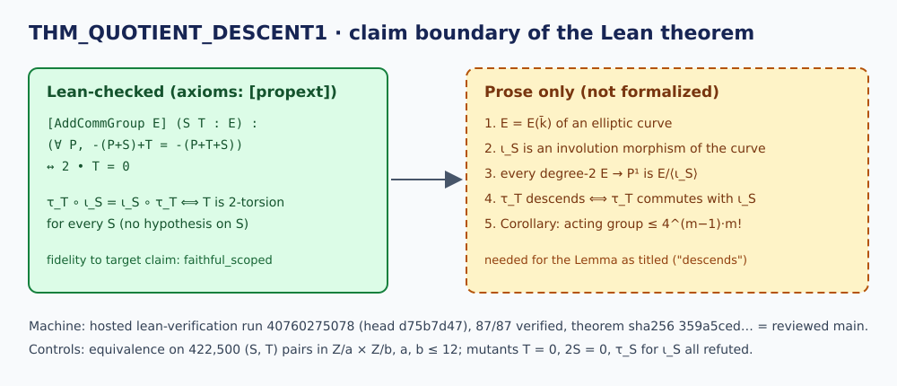

# Quotient translation-descent: independent semantic review — 2026-10-29

**Decision (scoped):** `CryptoResearch.Quotient.translation_commutes_iff_two_torsion`
is a **faithful_scoped** formalization of the claim in
`formal/targets/quotient-translation-descent.yaml`: the group-law identity
"τ_T commutes with ι_S for every S exactly when 2T = 0". It does **not**
formalize the Lemma of `research/THM_QUOTIENT_DESCENT1.md` as stated (descent
through a degree-2 quotient), nor its Corollary. Machine status **passed** on
hosted CI for the exact bytes reviewed. Review outcome for the target's claim:
**validated_scoped**, with the single-reviewer and no-local-rebuild deviations
listed below. No hypothesis, ledger record or sheriff case is changed.



## Bound inputs

| Input | Value |
| --- | --- |
| Reviewed revision | `origin/main` `3fe6e1226d5a40f9f8f1e1d30c513481e34bf3a9` |
| Theorem | `CryptoResearch.Quotient.translation_commutes_iff_two_torsion` |
| Lean file | `formal/CryptoResearch/Quotient/TranslationDescent.lean`, sha256 `359a5ced…6bf401e` |
| Target | `formal/targets/quotient-translation-descent.yaml`, sha256 `12fa5950…bdd24b` |
| Source note | `research/THM_QUOTIENT_DESCENT1.md`, sha256 `ac91debe…99b08e` |
| Toolchain | `leanprover/lean4:v4.35.0-rc1` (`lean-toolchain` sha256 `5699bbbd…dc150`) |
| Mathlib | `7fa22735254ddf7e11f119250a9f2d0352bc7c3a` (`lake-manifest.json` sha256 `3adfcdc0…c3a4dc`) |

The full hashes are in [review.yaml](review.yaml).

## Machine status: passed (hosted), local rebuild not possible

- **Hosted, current bytes.** `lean-verification` run
  [40760275078](https://github.com/isogeny-labs/crypto-autoresearcher/actions/runs/40760275078),
  job `formal workspace (lake build + axiom audit)` (123070123680), head
  `d75b7d47` of #2654, 2026-10-28. Plain `lake build` of the whole workspace
  (8,979 jobs, exit 0), then `tools/verify_formal_targets.py`:
  `87 verified, 0 not verified`. The receipt for this target in artifact
  `formal-verification-receipts` (id 12850205685, zip sha256
  `e2ebfcca…dbead95`, downloaded and read for this review) records
  `status: machine_verified`, `axiom_audit_passed: true`,
  `axiom audit: 700 theorem(s), all standard axioms only`, and the elaborated
  type below. Its `theorem_sha256`, `task_spec_sha256`, `lean_toolchain_sha256`
  and `lake_manifest_sha256` equal the hashes of the files on the reviewed
  `main`, so that run checked exactly the bytes reviewed here.
  Run 40713787875 (head `b0e03a16` of #2496) gives the same result.
- **`#print axioms` = `[propext]`.** The hosted gate checks that the axioms are
  standard ones; it does not print the list. The exact list `[propext]` comes
  from `docs/reports/2026-10-23-translation-commutes-rename/evidence/print-axioms.log`.
  Its receipt binds the same theorem, toolchain and manifest hashes, so the
  file has not changed since. It agrees with the proof: `abel` normalization
  and `rw` with no classical step or quotient. Treat it as replayed evidence,
  not a fresh check from this session.
- **Local rebuild: `infrastructure_error`.** This container has no Lean. Installing
  elan (`curl … | sh`) was refused by the session's permission policy, so no
  `lake build` or `#print axioms` ran here. This is not a fact about the
  theorem.

Elaborated type (from the hosted receipt):

```lean
CryptoResearch.Quotient.translation_commutes_iff_two_torsion.{u}
  {E : Type u} [AddCommGroup E] (S T : E) :
  (∀ (P : E), -(P + S) + T = -(P + T + S)) ↔ 2 • T = 0
```

## Semantic fidelity

**Definitions.** The left-hand side spells out τ_T ∘ ι_S (P) = −(P+S) + T and
ι_S ∘ τ_T (P) = −(P+T+S), with ι_S(P) = −(P+S) and τ_T(P) = P+T. Both match
the note's Proof. `2 • T` is `ℕ`-smul, i.e. T + T, the note's "2T = O".
Neither ι_S nor τ_T is defined as a Lean term. The identity is stated
pointwise, which says the same thing.

**Quantifiers.** S and T are universally quantified outside. P is
universally quantified inside the left side only. That is the right reading:
"commutes" means equal as maps. The placement is not load-bearing here,
because for each single P the two sides differ by exactly 2T. So the identity
at any one P (an ∃P reading, or ∀P moved outside the ↔) is already equivalent
to 2T = 0. `E` is any additive commutative group in any universe.

**Hypotheses.** There are none beyond `AddCommGroup`. The stub's `2 • S = 0`
was dropped. That is correct: the note's 2026-10-16 correction (sheriff L2)
says S may be any point, and controls M2 below show that `2S = 0` is not the
condition. The note's `char k ≠ 2` assumption plays no part in the group
identity and is not needed. Commutativity is used: `abel` closes the goal.

**Both directions.** (→) instantiates P = 0, and the difference of the two
sides is 2T. (←) rewrites the left side to the right side plus 2T. Both are
real directions, and neither is assumed.

**Degenerate and vacuous cases.** The trivial group, and any group of
exponent 2, make both sides true for every S and T. That is correct and not
vacuous: the controls show both sides take both truth values on 144 finite
groups, false for 408,100 (S, T) pairs and true for 14,400. The condition does
not depend on S at all. This is the content: no choice of involution centre
admits a translation that is not 2-torsion.

**Bridges not formalized (each one is prose only):**

1. That E(k̄) of an elliptic curve is the `AddCommGroup` the theorem is
   applied to. No elliptic curve, field, Weierstrass model or Mathlib
   `WeierstrassCurve.Affine.Point` appears.
2. That ι_S is an involution of the curve, i.e. a morphism with ι_S ∘ ι_S = id.
   This is trivial, but not stated in Lean.
3. That every degree-2 map φ: E → P¹ over k is, up to an automorphism of P¹,
   the quotient by some ι_S.
4. That "τ_T descends through E/⟨ι_S⟩" (there is ψ: P¹ → P¹ with
   φ ∘ τ_T = ψ ∘ φ) is equivalent to "τ_T commutes with ι_S". This is the
   fibre argument. It also needs ψ to be a morphism, not only a map of sets,
   which the note does not argue.
5. The Corollary's acting-group statement for summation polynomials, the
   bound 4^{m−1}·m!, and the three curve-class cases.

## Claims supported and not supported

| Claim | Where | Supported by the Lean theorem? |
| --- | --- | --- |
| In any additive commutative group, for all S and T, τ_T commutes with ι_S iff 2T = 0 | target `claim`; note Proof, last line | **Yes**, exactly |
| The identity holds for every S; `2S = 0` is unnecessary | target `notes`; note correction 2026-10-16 | **Yes** (no hypothesis on S) |
| The same identity for the group E(k̄) of an elliptic curve | note Setting | Only by instantiation, which is not done in Lean (bridge 1) |
| τ_T **descends** through φ = E/⟨ι_S⟩ iff 2T = O (the Lemma as stated) | note Lemma; title | **No**: bridges 3 and 4 |
| Every degree-2 map E → P¹ is a quotient by some ι_S; x(P+R) is the quotient by ι_{2R} | note Setting | **No** |
| ι_S is an involution of the curve | note Setting | **No** (bridge 2) |
| The acting group on summation-polynomial solutions is E[2](k)^m ∩ {ΣT_i = O}, order ≤ 4^{m−1}·m!; (Z/4)^{m−1} needs degree > 2 or an automorphism | note Corollary | **No** |
| Closes the "Larger group actions?" question for every x-type coordinate | note header | **No**. This needs bridges 3–5 |
| Novelty | note header | Not a formal question. The note itself claims only "formalized here" |

The rename in #2496 (`translation_descends…` → `translation_commutes…`)
removed the one mismatch between the name and the statement. The docstring,
the file header ("WHAT IS NOT PROVED") and the target `notes` now describe
the boundary above correctly. I found no wording on the target or in the Lean
file that claims more than the theorem proves. The note's **title** and
**Lemma** still state descent. The Status line and the 2026-10-17 and
2026-10-23 corrections say that only the identity is formal. Anyone citing
this theorem for descent or for the Corollary would be overclaiming.

## Controls

[controls.py](controls.py) (standard library only, sha256 `7642609e…ef27b`)
re-derives the statement independently of the Lean proof. It enumerates every
Z/a × Z/b with a, b ≤ 12 and every S, T in each. Output: [controls.out](controls.out).

| Control | Result |
| --- | --- |
| Positive: the equivalence on all 422,500 (S, T) pairs | holds everywhere |
| Nonvacuity: the left side takes both values | false 408,100, true 14,400 |
| M1: conclusion `T = 0` | refuted on 8,316 pairs (non-zero 2-torsion T commutes) |
| M2: conclusion `2S = 0` (the stub's hypothesis) | refuted on 27,000 pairs |
| M3: τ_S in place of ι_S | commutes on all 408,100 pairs where 2T ≠ 0, so the [−1] carries the content |

The sheriff outputs cited in the note's 2026-10-17 correction already cover
curve-level checks: every T on two curves over F_1009 and F_211, with S = 2R
not 2-torsion. They check the identity on curve points. They do not check
bridges 3 and 4.

## Deviations

- **One reviewer.** The lean-review route asks for a precommitted
  `review_plan`, separate reviewer sessions, one owner per joint, and a blind
  re-derivation by someone who has not read the producer's files. This is one
  reviewer, who read the Lean file and the note before writing the controls. The
  controls are an independent re-derivation, not a blind one, and
  `tools/check_review_independence.py` was not run. Because of this, the
  `validated_scoped` outcome covers only the target's group-law claim, where
  the proof is two `abel` steps. It is not a claim-changing validation of the
  research note.
- **No local Lean check.** See the machine-status section above. The fresh
  machine evidence is the hosted gate, and the exact axiom list is replayed.
- **Plain PDF.** [report.pdf](report.pdf) puts the diagram and this text into
  a PDF without typesetting. There is no performance chart, because this
  review has no performance or experiment content.

## Next actions

None needed for the target. Anyone who wants the note's Lemma or Corollary
formal must first state bridges 3 and 4 (degree-2 maps E → P¹ ≅ quotients by
ι_S, and descent ⟺ commutation). Mathlib currently has no theory of quotient
curves for elliptic curves that would support this.
