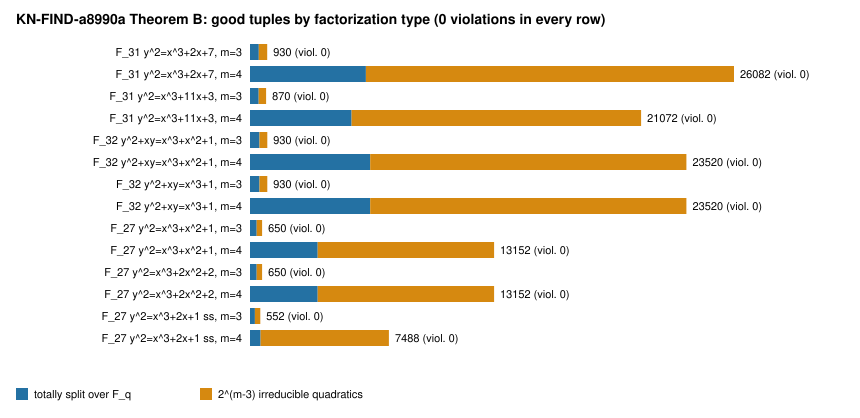

**Why.** The 2026-10-29 exposure audit
(`docs/reports/2026-10-29-cfsg-lessons-ecdlp-exposure/`) found two
summation-polynomial claims that rest on unchecked premises:

- Semaev's correspondence (`KR-IC-5a43e5`) is filed `proven` from abstract
  reads only. No Lean target or computation in this repository checks it
  against the group law.
- `KN-FIND-a8990a` states its monodromy and factorization theorems "in every
  characteristic incl. 2, 3". Its 241,643 verified specializations are all
  over prime fields.

**What was run.**
`python3 research/verification/semaev_char23_checks_20261029.py result.json`
([script](../../../research/verification/semaev_char23_checks_20261029.py),
[result.json](result.json)), in under a minute on one CPU. It is an exact,
exhaustive computation over small fields: no sampling, no statistics.

1. **Semaev S₃ against the group law.** The script takes every ordered pair of
   distinct abscissae x₁, x₂ in F_q. It lifts them to points P₁, P₂ over
   F_{q²}, and checks that the published S₃(x₁, x₂, X) equals
   lc · (X − x(P₁+P₂)) · (X − x(P₁−P₂)) coefficient by coefficient. Two
   formulas are checked:
   - short Weierstrass in odd characteristic p > 3;
   - y² + xy = x³ + a₂x² + a₆ in characteristic 2.
2. **Theorems B and C of `KN-FIND-a8990a` at m = 3 and m = 4.** The script
   uses generic long-Weierstrass arithmetic, so no S_m formula enters. For
   every good tuple a ∈ F_q^{m−1}, it builds the polynomial whose roots are the
   signed-sum abscissae. It checks three things:
   - the coefficients lie in F_q and the roots are distinct;
   - either every root is in F_q (exactly when the fibre classes c(aᵢ) agree)
     or none is;
   - the exact class count S^k N^{n−k} + N^k S^{n−k}.
3. **Known-false controls on the same instrument.** Two deliberately wrong
   inputs:
   - S₃ with its constant term shifted by one;
   - the fibre class of one rational abscissa flipped.

## Result

| curve | q | S₃ pairs, mismatches | m = 3 good, violations | m = 4 good, violations | controls rejected |
| --- | --- | --- | --- | --- | --- |
| y² = x³+2x+7 | 31 | 930, 0 | 930, 0 | 26,082, 0 | S₃ 930/930; class 60 |
| y² = x³+11x+3 | 31 | 930, 0 | 870, 0 | 21,072, 0 | S₃ 930/930; class 58 |
| y²+xy = x³+x²+1 | 32 | 992, 0 | 930, 0 | 23,520, 0 | S₃ 992/992; class 60 |
| y²+xy = x³+1 | 32 | 992, 0 | 930, 0 | 23,520, 0 | S₃ 992/992; class 60 |
| y² = x³+x²+1 (ordinary) | 27 | not checked | 650, 0 | 13,152, 0 | class 50 |
| y² = x³+2x²+2 (ordinary) | 27 | not checked | 650, 0 | 13,152, 0 | class 50 |
| y² = x³+2x+1 (supersingular) | 27 | not checked | 552, 0 | 7,488, 0 | class 46 |

**The claims hold, and the checker can tell when they don't.**

- Every pair satisfies Semaev's S₃ correspondence in characteristic 31 and
  characteristic 2.
- Every good tuple obeys the totally-split-or-all-quadratics dichotomy at
  m = 3 and m = 4 in characteristics 31, 2 and 3. This includes a
  supersingular curve in characteristic 3, which `KN-FIND-a8990a`'s
  "every curve" wording covers.
- The class-count law holds exactly in every case.
- Both known-false controls fail on every curve. The perturbed S₃ mismatches
  on every pair, and the flipped class map produces 46–60 violations.

## Limits

- **Small fields only.** These are exact checks at q ≤ 32 and m ≤ 4. They
  corroborate:
  - Semaev's correspondence at m = 3;
  - `KN-FIND-a8990a` Theorems B and C at m ≤ 4 in characteristics 2 and 3.

  They do not prove either claim in general, and they say nothing about ECDLP
  cost.
- **No closed S₃ in characteristic 3.** This repository has no published
  closed-form S₃ for characteristic 3. There, only the point-defined
  polynomial is checked, which is what Theorems B and C are about.
- **No review yet.** `KN-FIND-a8990a`'s own review gap (AGENTS.md rule 12)
  is unchanged. A validator still has to read its derivation.
- **Graphs checked.** Only `factorization.svg` is new. No existing dashboard
  graph plots these quantities, so none needed updating.
